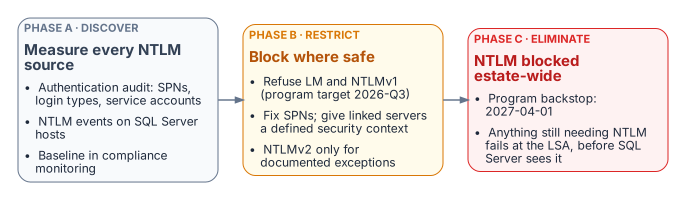

::: {.content-visible when-format="docx"}
# Book_06 — Eliminating NTLM at the SQL Layer
:::

::: {.callout-note}
SQL Server is one of the most common sources of NTLM traffic in a federal environment, and the reasons are more varied than most DBA teams expect. This book traces the Kerberos/NTLM-elimination program's three phases — assess, block-where-safe, eliminate — as they apply to the SQL Server workload, against the program's hard 2027-04-01 network-level block.
:::

{fig-alt="Phase A discovers and measures every NTLM source, phase B blocks LM and NTLMv1 where safe and fixes SPNs and linked servers, and phase C blocks NTLM estate-wide by the program backstop of 2027-04-01."}

::: {.callout-tip}
## Download this book
**[Book_06-bundle.docx](../../../downloads/Book_06-bundle.docx)** — every chapter of this book concatenated into one Word document. Regenerated on every site deploy.
:::

## Chapters

::: {#book-chapters}
:::

## Authoritative references

Checked 19 October 2026.

- [Retiring NTLM: frequently asked questions (Microsoft Tech Community)](https://techcommunity.microsoft.com/blog/windows-itpro-blog/retiring-ntlm-frequently-asked-questions/4550522)
- [Features removed or no longer developed in Windows Server](https://learn.microsoft.com/en-us/windows-server/get-started/removed-deprecated-features-windows-server)
- [Overview of NTLM auditing enhancements in Windows 11, version 24H2, Windows Server 2019, and later versions (Microsoft Support)](https://support.microsoft.com/en-us/servicing/os/windows/2025/07/overview-of-ntlm-auditing-enhancements-in-windows-11-version-24h2-and-windows-server-2025)
- [Register a Service Principal Name for Kerberos connections](https://learn.microsoft.com/en-us/sql/database-engine/configure-windows/register-a-service-principal-name-for-kerberos-connections?view=sql-server-ver17)
- [sys.dm_exec_connections (Transact-SQL)](https://learn.microsoft.com/en-us/sql/relational-databases/system-dynamic-management-views/sys-dm-exec-connections-transact-sql?view=sql-server-ver17)
- [Linked server for SQL Server with Microsoft Entra authentication](https://learn.microsoft.com/en-us/sql/relational-databases/security/authentication-access/azure-ad-authentication-sql-server-linked-server?view=sql-server-ver17)
- [Kerberos constrained delegation overview](https://learn.microsoft.com/en-us/windows-server/security/kerberos/kerberos-constrained-delegation-overview)

::: {.callout-tip}
## Continue the series
[← Previous: Book 05 — The Login Migration](Book_05.md) · [Index](index.md) · [Next: Book 07 — Access Control →](Book_07.md)
:::
