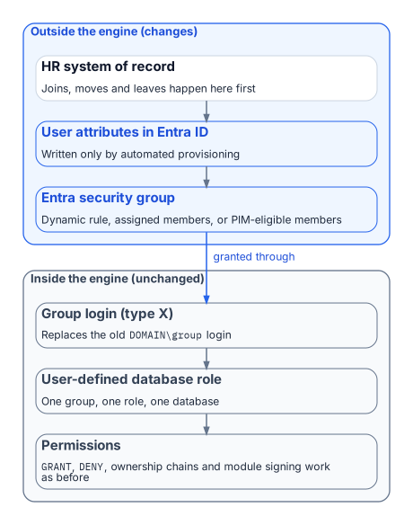

::: {.content-visible when-format="docx"}
# Book_07 — Access Control: Groups, Roles, and Dynamic Membership
:::

::: {.callout-note}
The migration moves SQL Server's groups from Active Directory to Microsoft Entra ID, but it keeps group-based authorization. What changes is who maintains the groups and how. A group that maps to a single database role can keep itself current from HR-sourced attributes, which removes the helpdesk ticket. That only works if the attributes are trustworthy, the rules are tested, delegation is scoped, and privileged access is just-in-time. This book covers that design and the governance it needs.
:::

{fig-alt="Outside the engine, the HR system of record feeds user attributes in Entra ID and Entra security groups; inside the engine, a type X group login maps to a user-defined database role and its permissions, unchanged from before."}

::: {.callout-tip}
## Download this book
**[Book_07-bundle.docx](../../../downloads/Book_07-bundle.docx)** — every chapter of this book concatenated into one Word document. Regenerated on every site deploy.
:::

## Chapters

::: {#book-chapters}
:::

## Authoritative references

Checked 19 October 2026.

- [Manage rules for dynamic membership groups in Microsoft Entra ID](https://learn.microsoft.com/en-us/entra/identity/users/groups-dynamic-membership)
- [Privileged Identity Management (PIM) for Groups](https://learn.microsoft.com/en-us/entra/id-governance/privileged-identity-management/concept-pim-for-groups)
- [What are access reviews?](https://learn.microsoft.com/en-us/entra/id-governance/access-reviews-overview)
- [Administrative units in Microsoft Entra ID](https://learn.microsoft.com/en-us/entra/identity/role-based-access-control/administrative-units)
- [CREATE LOGIN (Transact-SQL)](https://learn.microsoft.com/en-us/sql/t-sql/statements/create-login-transact-sql?view=sql-server-ver17)

::: {.callout-tip}
## Continue the series
[← Previous: Book 06 — Eliminating NTLM at the SQL Layer](Book_06.md) · [Index](index.md) · [Next: Book 08 — The Application Chain →](Book_08.md)
:::
