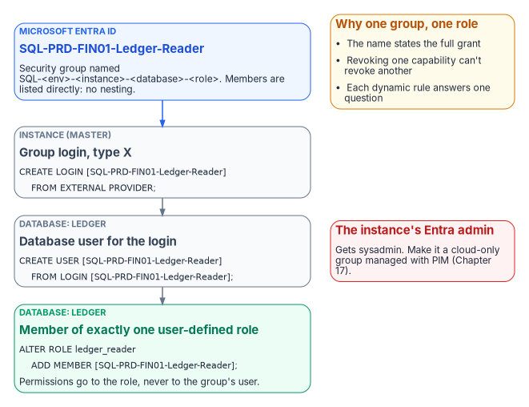
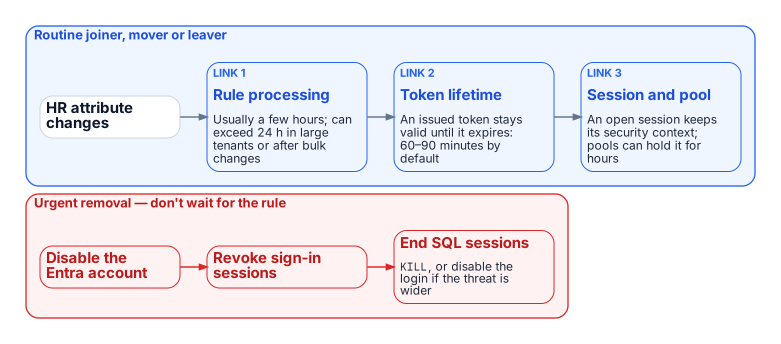

# Chapter 1 — Groups, Roles, and How Membership Reaches the Engine

*Group-based authorization survives the migration. Its plumbing, its timing, and its outer boundary do not.*

::: {.callout-note}
## In this chapter
How an Entra security group becomes a SQL Server login and a database role member. Why each group should grant exactly one role. Why the group model should stay flat. When a membership change actually takes effect at the engine. How the four kinds of AD group found in a SQL Server estate migrate. Why Conditional Access becomes the outer perimeter once every login is Entra-backed.[^b07c01-ca]
:::

SQL Server's access model has always had two halves. Inside the engine are server roles, database roles, and the permissions granted to them. Outside it is the directory, which decides who belongs to the groups those roles are granted to. For twenty years the outside half was Active Directory. A DBA mapped `DOMAIN\SQL-Reporting-Readers` to a login, added the login to a database role, and from then on access was managed by whoever could change that AD group's membership.

The transformation replaces the outside half and leaves the inside half nearly untouched. Server and database roles, `GRANT` and `DENY`, ownership chains, and module signing all work as before. What changes is the principal those roles are granted to (an Entra group instead of an AD group), the mechanism that proves membership (an Entra token instead of a Kerberos ticket), and the moment a membership change takes effect. Most of this book is about the outside half: how the groups are designed, populated, delegated, and governed. This chapter starts at the seam between the two halves.

## How an Entra Group Becomes SQL Server Access

{fig-alt="An Entra security group named by environment, instance, database and role becomes a type X group login in master, a database user, and a member of exactly one user-defined database role."}

An Entra security group enters SQL Server the same way an AD group did: as a server-level login. `CREATE LOGIN [SQL-PRD-FIN01-Ledger-Reader] FROM EXTERNAL PROVIDER` creates a login for the group by display name. SQL Server records it in `sys.server_principals` with type `X`, `EXTERNAL_GROUP`. That differs from type `E`, `EXTERNAL_LOGIN`, which SQL Server uses for individual Entra users and applications. The distinction matters for the continuous audit in Book 09. A posture query that counts only type-E principals will miss every group login, and group logins are where most access should live. Inside each database the group gets a user (`CREATE USER … FROM LOGIN`), and the user is added to a database role with `ALTER ROLE … ADD MEMBER`, exactly as before.

The instance's Microsoft Entra administrator works the same way. It's configured when Entra authentication is enabled, it receives `sysadmin`, and it can be an individual or a group. In an estate of any size it should be a group, and that group is the subject of the privileged-access design in Chapter 2. To resolve users, groups, and applications, the instance's Entra identity is granted read permissions on Microsoft Graph: `User.Read.All`, `GroupMember.Read.All`, and `Application.Read.All`.[^b07c01-graph-perms] Granting them takes a Privileged Role Administrator, so it is a step for the identity team, not the DBA team.

```sql
-- Instance level: one login per Entra group
CREATE LOGIN [SQL-PRD-FIN01-Ledger-Reader] FROM EXTERNAL PROVIDER;

-- Database level: the group becomes a member of exactly one role
USE Ledger;
CREATE USER [SQL-PRD-FIN01-Ledger-Reader] FROM LOGIN [SQL-PRD-FIN01-Ledger-Reader];
ALTER ROLE ledger_reader ADD MEMBER [SQL-PRD-FIN01-Ledger-Reader];
```

The Implementation Companion carries the full runbook. The narrative point is that nothing about authorization inside the engine has to be redesigned. Only the principal changes.

## One Group, One Role

The most consequential design decision in this book is also the simplest: **each Entra group grants exactly one role, on one database, in one environment.** In practice, a user-defined database role holds a coherent permission set, and the group that maps to it is named for that role, that database, and that environment. A user who needs to read the ledger and also run the month-end job belongs to two groups, not one group built to cover both.

Three things follow from the rule, and each is a reason to keep it. First, the group's name is a complete statement of what it grants, so an access review (Chapter 2) can be answered by someone who has never opened SQL Server Management Studio.[^b07c01-ar] Second, revoking one capability never revokes another by accident. Third, the rule makes dynamic membership tractable. A rule that answers "who should read the ledger?" can be written and tested. A rule that answers "who should have whatever this legacy group happened to grant?" cannot.

Least privilege then becomes a property of the role catalog, not of individual grants. Permissions go to user-defined database roles, never directly to group users, and fixed roles such as `db_owner` and `sysadmin` are kept for the handful of principals whose job requires them. A migration is the right time to do this. Every legacy AD group mapped to `db_owner` "because the application needed it" is a finding to resolve before its replacement is created, not after.

## Flat by Design

Active Directory estates are full of nested groups: a departmental group inside an application group inside a server-access group. It's tempting to rebuild that tree in Entra ID. Don't. The new platform's constraints point toward a flat model.

- **Dynamic groups can't contain groups.** A dynamic rule selects users (or devices) by attribute, never other groups.
- **The `memberOf` operator is ending.** It was the preview workaround for building a dynamic group from other groups. Microsoft has announced that its public preview ends on 3 November 2026. After that date, groups that use it stop updating and stay in their last-known state.
- **Role-assignable groups can't nest.** These are the groups with the strongest protection against privilege escalation, and they accept no group members at all.
- **Group claims are capped.** Applications that read group membership straight from the token get at most 200 groups in a JWT, and above that receive an overage indicator instead of the list.
- **Nested-group evaluation is undocumented for SQL Server.** Microsoft's SQL Server documentation doesn't describe how nested Entra group membership is evaluated for an on-premises instance's group logins.

A design that depends on nesting is therefore building on behavior that is either unsupported, ending, or undocumented. The flat alternative costs a few more groups and gives up nothing. Each role-mapped group lists its members directly, either by rule or by assignment. If several populations need the same role, use one group whose rule covers all of them. Where a login *must* be reached through a nested chain, test that path explicitly on the target instance version before relying on it.

## When a Change Takes Effect

{fig-alt="Routine changes pass through rule processing, token lifetime and open sessions, so they can take hours; urgent removal disables the Entra account, revokes sign-in sessions and ends SQL sessions directly."}

Under Windows Authentication, a membership change reached SQL Server when the user next obtained a Kerberos ticket, which usually meant the next logon. The Entra model has a longer and more varied chain, and the DBA team should be able to explain each link in it:

1. **Rule processing.** A dynamic group is recalculated when a relevant attribute changes. Microsoft documents that this usually completes within a few hours, but that it can take more than 24 hours in large tenants, after bulk changes, or with complex rules.
2. **Token lifetime.** An access token already issued to the user stays valid until it expires. By default that's a randomized 60 to 90 minutes.
3. **Session and pool lifetime.** An open SQL Server session keeps the security context it was established with. A connection pool can keep that session open for hours.

For routine joiners, movers, and leavers this latency is acceptable. It is often faster than the ticket queue it replaces. For urgent removal it is not. The urgent path doesn't wait for a rule: disable the Entra account, revoke the user's sign-in sessions, and end the user's SQL Server sessions (`KILL`, or disabling the individual or group login if the threat is broader). Write this path into the operations runbook before the first dynamic group grants production access.

## Migrating the Four AD Group Patterns

The groups found in a twenty-year SQL Server estate fall into four recognizable patterns, and each one migrates differently.

**Organization-derived access groups** exist because everyone in a given part of the organization needs a given access, and an administrator kept membership in step with the org chart by hand. These are the natural candidates for **dynamic membership**. The rule restates the organizational intent in terms of directory attributes that HR data keeps current, such as `department`, `companyName`, `jobTitle`, an `extensionAttribute`, or a directory extension property. Chapter 2 covers which attributes are safe to use and how to test the rule before it grants anything.

**Explicit role-assignment groups**, such as `PROD-SQL-SYSADMIN` or `DB-REPORTING-READONLY`, exist because specific people were given a specific permission. Organizational position doesn't define them, so a rule shouldn't either. They become **assigned** Entra security groups, flattened, with membership changed by a delegated administrator or, for privileged roles, granted just-in-time through PIM (Chapter 2).

**Distribution lists** used for SQL Server Agent notifications are not access control at all. They become mail-only groups. The Agent operator's address is updated, and no login is created.

**Mail-enabled security groups** that do both jobs are split in two: a mail-only group for notifications and an assigned security group for access. Record the pairing in each group's description and in the migration record, so the two lifecycles can diverge without losing their history.

## Conditional Access as the Outer Perimeter

Completing the access-control migration delivers the architectural dividend. Once every login is an Entra user, group, or application, every connection needs an Entra token, and every token request passes Conditional Access before it is issued. A DBA on an unmanaged or non-compliant device is refused a token, so the connection never opens. So is a sign-in from outside the program's named locations, and so is a sign-in that Entra ID Protection rates as high risk.[^b07c01-idp]

None of these controls reach a Windows-backed or SQL-authenticated login, which is why the perimeter is binary. A single surviving Windows login is a path around every policy. Compensating controls such as privileged-access workstations, bastion hosts, segmentation, and credential vaulting are legitimate while the migration is in progress, but none of them evaluate identity, device, and risk on every connection. Book 05 and the SQL Server engine-authentication decision therefore treat each surviving legacy login as a documented, sunset-dated exception rather than a co-equal end state.

::: {.callout-note title="What Book 07 establishes — Chapter 1"}
1. An Entra group reaches SQL Server as a type-X login and grants exactly one role, on one database, in one environment.
2. The group model stays flat, and membership changes reach the engine only after rule processing, token expiry and session turnover, so urgent removal needs its own runbook.
3. Each kind of AD group maps to a specific Entra replacement, and Conditional Access then sits in front of every login.
:::

## Authoritative references

- [CREATE LOGIN — Microsoft Entra group logins](https://learn.microsoft.com/en-us/sql/t-sql/statements/create-login-transact-sql?view=sql-server-ver17) and [sys.server_principals principal types](https://learn.microsoft.com/en-us/sql/relational-databases/system-catalog-views/sys-server-principals-transact-sql?view=sql-server-ver17)
- [Set up Microsoft Entra authentication for SQL Server enabled by Azure Arc](https://learn.microsoft.com/en-us/sql/sql-server/azure-arc/entra-authentication-setup-tutorial?view=sql-server-ver17) and [Managed identity for SQL Server enabled by Azure Arc](https://learn.microsoft.com/en-us/sql/sql-server/azure-arc/managed-identity?view=sql-server-ver17) (Graph permissions)
- [Rules for dynamic membership groups](https://learn.microsoft.com/en-us/entra/identity/users/groups-dynamic-membership) and [the memberOf preview and its end date](https://learn.microsoft.com/en-us/entra/identity/users/groups-dynamic-rule-member-of)
- [Role-assignable groups](https://learn.microsoft.com/en-us/entra/identity/role-based-access-control/groups-concept) and [group claims limits](https://learn.microsoft.com/en-us/entra/identity/hybrid/connect/how-to-connect-fed-group-claims)
- [Dynamic group processing times](https://learn.microsoft.com/en-us/entra/identity/users/manage-dynamic-group) and [access token lifetimes](https://learn.microsoft.com/en-us/entra/identity-platform/configurable-token-lifetimes)

[^b07c01-ca]: Microsoft Learn, [What is Conditional Access?](https://learn.microsoft.com/en-us/entra/identity/conditional-access/overview).
[^b07c01-graph-perms]: Microsoft Learn, [Set up managed identity and Microsoft Entra authentication for SQL Server enabled by Azure Arc](https://learn.microsoft.com/en-us/sql/sql-server/azure-arc/microsoft-entra-authentication-with-managed-identity?view=sql-server-ver17).
[^b07c01-ar]: Microsoft Learn, [What are access reviews?](https://learn.microsoft.com/en-us/entra/id-governance/access-reviews-overview).
[^b07c01-idp]: Microsoft Learn, [What is Microsoft Entra ID Protection?](https://learn.microsoft.com/en-us/entra/id-protection/overview-identity-protection).
