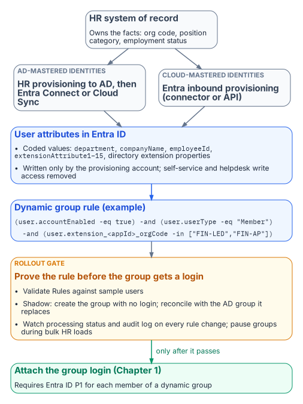
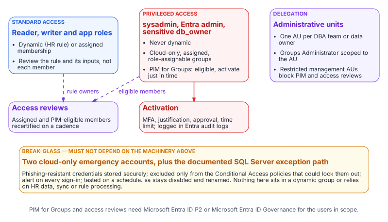

# Chapter 2 — Dynamic Membership, Delegation, and Privileged Access

*A dynamic group is a policy that executes itself. It is only as trustworthy as the data it reads and the people who can change it.*

::: {.callout-note}
## In this chapter
Why the attribute a rule reads is itself an access control. Which user attributes Entra dynamic rules can use, and where those values should come from. How to write, name, test, and change rules safely within Microsoft's processing limits. How administrative units scope DBA delegation, and where restricted management collides with governance tooling. Why privileged SQL Server access belongs in PIM for Groups rather than in a dynamic rule. How access reviews, break-glass, and monitoring close the loop. What a FedRAMP Moderate system in the commercial cloud can adopt as written, and why preview features stay out of production.
:::

Chapter 1 established that the organization-derived groups of the old estate become dynamic groups: Entra security groups whose membership is computed from a rule such as `user.department -eq "Finance"` instead of maintained by hand. When a user's attributes change, Entra ID re-evaluates the rules and adds or removes them. No ticket is raised and no DBA acts. That is the dividend. The rest of this chapter is about what has to be true for the dividend to be safe.

## The Attribute Is the Access Control

::: {.callout-important title="Principle: the attribute writer controls access"}
The person or process that can write the attribute a dynamic rule reads controls access to everything that rule grants. Write access to an access-driving attribute is therefore a privileged permission, governed and reviewed like any other.
:::

{fig-alt="The HR system of record writes coded user attributes into Entra ID through provisioning; a dynamic group rule uses them, and the group gets a SQL Server login only after the rule passes a rollout gate."}

Moving to dynamic membership relocates the access decision. Under assigned membership, the person who can add a member to the group controls access. Under dynamic membership, **the person or process that can write the attribute the rule reads controls access.** Microsoft makes the point explicitly in its dynamic-group guidance. Before using an attribute in a rule that governs access, review who can write it in Entra ID *and* in any source directory that syncs it. Watch especially for on-premises attributes that users are allowed to modify on their own objects.

This is why the series insists on a single, authoritative **source of truth** for the attributes that drive SQL Server access, and in a federal agency that source is the HR system of record. HR knows when someone joins, moves, or leaves, and HR has the governance (personnel actions, approvals, records retention) to make those changes defensible. The path from HR to the directory should be automated and one-way:

- **For identities still mastered in Active Directory**, HR-driven provisioning populates AD, and Microsoft Entra Connect or Cloud Sync carries the values into Entra ID.[^b07c02-connect]
- **For cloud-mastered identities**, Entra ID's inbound provisioning writes them directly. There are built-in connectors for the major cloud HR suites, and an API-driven inbound provisioning endpoint covers any other HR system that can produce a feed.

Either way, the attribute is written by a provisioning service account, not by a person, and self-service and helpdesk write access to those attributes is removed. A rule is only as good as the weakest writer of the data it reads.

## Choosing the Attributes

Entra dynamic rules can read a fixed set of user properties. Microsoft's current list includes `department`, `companyName`, `jobTitle`, `employeeId`, `employeeHireDate` (preview), `userType`, `accountEnabled`, and location fields. It also includes the fifteen `extensionAttribute1`–`extensionAttribute15` values, which are commonly synced from on-premises AD, and **directory extension properties** (`user.extension_<appId>_<name>`), which can be synced from AD or created through Microsoft Graph. Two cautions apply. First, not every attribute on the user object is usable. For example, `employeeType` doesn't appear in the supported-properties list at the time of writing, so check that list before designing around any attribute. Second, multi-value extension properties aren't supported in rules.

Good rule inputs share three properties: HR owns the value, the value is a **code** rather than free text, and the value changes only when the business fact changes. A cost-center or organization code in a directory extension property is a far better input than a display string like "Office of the CFO — Ledger Operations", which someone will eventually retype. A useful pattern is to publish a small, documented set of HR-sourced attributes for access purposes (organization code, position category, employment status) and to write rules only against those:

```text
(user.accountEnabled -eq true) -and (user.userType -eq "Member")
  -and (user.extension_<appId>_orgCode -in ["FIN-LED","FIN-AP"])
  -and (user.extension_<appId>_positionCategory -eq "Analyst")
```

Rules have limits worth designing around. A rule body can't exceed 3,072 characters, and a tenant can have at most 15,000 dynamic groups. Microsoft's efficiency guidance is to prefer `-eq`, `-startsWith`, and `-in` over `-match` and `-contains`, and to use `-in` instead of chains of `-or`. Rules built that way process faster and are easier to read in a review. Every rule that grants SQL Server access should also exclude disabled accounts and guests explicitly, as above.

Dynamic membership is a **Microsoft Entra ID P1** feature. The tenant needs a P1 license for each unique user who is a member of one or more dynamic groups, which most federal tenants already have through their Microsoft 365 or EMS agreements. Confirm the count before the rollout, not after.

## Writing, Naming, and Testing Rules

Two practices keep a dynamic group from becoming an untested access grant.

The first is **naming and ownership.** Entra's group naming policy applies only to Microsoft 365 groups, not to security groups, so the convention for SQL Server access groups has to be enforced by process. That process is either the provisioning automation that creates the groups or a review gate on group creation. A pattern such as `SQL-<env>-<instance or app>-<database>-<role>` gives the name the one-group-one-role meaning of Chapter 1. Each group's description should record the business intent of its rule, the owning team, and the change record that last altered it. Each group should have at least two named owners in the DBA or data-owner organization.

The second is **testing before granting.** A rule should be proven before its group is attached to a SQL Server login:

1. **Validate.** The *Validate Rules* feature in the Entra admin center evaluates a draft rule against up to 20 chosen users and shows which expression each one passes or fails.
2. **Shadow.** Create the group first with no login attached. Once processing reports complete, compare its membership with the legacy AD group it replaces, and explain every difference before the login is created.
3. **Watch processing.** For a rule change on a group that's already live, check the group's processing status and its audit-log entries for the additions and removals the change caused.
4. **Pause bulk changes.** For HR reorganizations or bulk attribute loads that will touch thousands of users, Microsoft recommends pausing non-essential dynamic groups, letting processing catch up, and resuming in phases.

The **rollout gate** for the whole pattern follows from this. No dynamic group grants production access until the access attributes are populated and verified for a pilot cohort, and its rule has been validated, shadowed, and reconciled against the group it replaces.

## Scoped Delegation with Administrative Units

Someone still has to manage the assigned groups of Chapter 1 and the owners and descriptions of the dynamic ones. Granting a DBA lead tenant-wide Groups Administrator to do that would swap one concentration of privilege for another. **Administrative units** are the answer. An AU holds a set of groups, and a role such as Groups Administrator assigned *at AU scope* lets its holder manage those groups' membership and properties, and nothing else. An administrator scoped this way needs an Entra ID P1 license. The AU's members need no additional license.

Draw AU boundaries to match ownership: one AU per DBA team, application portfolio, or data owner, containing exactly the SQL Server access groups that team answers for. Then the authority a team holds and the systems it is accountable for are the same set.

**Restricted management** administrative units go further. Only administrators scoped to the AU can modify its objects, even Global Administrators can't, and that is attractive for protecting access groups. But it has costs that matter here:

- Groups in a restricted management AU **can't be managed by PIM, access reviews, entitlement management, or lifecycle workflows.**
- Restricted management AUs accept only plain security groups.
- The setting can't be changed after the AU is created.

Use regular AUs for SQL Server access groups that need governance tooling, and reserve restricted management for cases where tamper-resistance outweighs reviewability. Dynamic membership *of the AU itself* is generally available in the commercial (global) cloud this series assumes, with a P1 license for each member. Its rules can select users or devices, but not groups, so SQL Server access groups are added to an AU explicitly or by automation. Dynamic AU membership is not available in Azure Government.

## Privileged Access Belongs in PIM, Not in a Rule

{fig-alt="Standard reader, writer and app roles may use dynamic or assigned groups with access reviews; privileged roles use cloud-only, role-assignable groups activated just in time through PIM for Groups; administrative units scope delegation; two cloud-only break-glass accounts stand outside all of it."}

The groups mapped to `sysadmin`, to the instance's Entra administrator, and to `db_owner` on sensitive databases should never be dynamic. Microsoft makes the same judgment for directory roles: role-assignable groups must have assigned membership, because an automated rule could add an unintended account to a privileged role. The SQL Server equivalent of that protection is **PIM for Groups**. DBAs are made *eligible* members of the privileged group rather than standing members. Each activation is time-bound, requires MFA and, where policy demands it, approval and a justification. Every activation is logged.

PIM for Groups can't manage dynamic groups or groups synchronized from on-premises, so the privileged groups are cloud-only, assigned groups by construction. Creating them as role-assignable adds protection against credential changes by lower-tier administrators even though they hold no directory role. PIM for Groups and access reviews require **Microsoft Entra ID P2** or **Microsoft Entra ID Governance** licensing for the users who are eligible, who approve, and who review.

## Access Reviews

Dynamic groups and access reviews answer different questions. A dynamic group's membership can't be edited by hand, so reviewing it member by member has no remediation path. **Review the rule and its inputs instead.** On a fixed cadence, the data owner confirms that the rule still expresses the intended population, and the identity team confirms that the attributes it reads are still HR-sourced and write-protected. For **assigned** groups, and for eligible assignments in PIM, Entra access reviews are the right instrument. A recurring review by the data owner or the group owners can automatically remove access when the reviewer doesn't respond, and its results are the evidence an assessor will ask for under AC-2.

## Break-Glass

Two kinds of break-glass access are needed, and they must not depend on the machinery they exist to bypass. At the **tenant** level, Microsoft's guidance for emergency-access accounts applies:

- at least two cloud-only accounts, with phishing-resistant credentials stored securely
- excluded only from the Conditional Access policies that could lock them out[^b07c02-ca]
- alerting on every sign-in
- tested on a regular schedule

At the **SQL Server** level, Book 05's position stands. The built-in `sa` is disabled and renamed, and any retained emergency path is a documented exception with its own monitoring. Neither emergency path may sit in a dynamic group or rely on HR data, Entra Connect, or rule processing being healthy.

## Monitoring

The access model is now spread across HR, the provisioning service, Entra ID, and the engine, so monitoring has to cover each hand-off:

- **Entra audit logs** record rule edits, membership additions and removals, PIM activations, and AU and role-assignment changes. A change to the rule of any SQL Server access group should raise an alert.
- **Entra sign-in logs** show every token issued for SQL Server and the Conditional Access result.[^b07c02-signins]
- **SQL Server Audit** records successful and failed logins, and changes to server and database role membership.[^b07c02-sqlaudit]

The continuous audit described in Book 09 should reconcile all three. Every type-E and type-X principal on an instance must map to a known user, application, or group. Every group must follow the naming convention and have an owner. No privileged role may have a standing member that PIM doesn't account for.

## FedRAMP Moderate in the Commercial Cloud

This series assumes the agency tenant is in Microsoft's commercial cloud: Entra ID at `login.microsoftonline.com` and Azure public US regions, not Azure Government. It also assumes the system is operated under an agency authorization at FedRAMP Moderate. That combination is common, and it shapes which of this book's recommendations can go into production as written.

**What the cloud authorization covers.** Azure's public cloud holds a FedRAMP High provisional authorization (P-ATO) for its US regions. The Moderate baseline (325 controls) is a subset of the High baseline (421 controls), so a Moderate system can draw on services authorized at High. Whether it actually inherits them is the agency's call in its own authorization. Microsoft's current audit-scope list for the public cloud includes these services this book relies on:

- Entra ID (Free, P1 and P2), Entra ID Governance, the Entra provisioning service, and Entra multifactor authentication
- Microsoft Graph
- Azure Arc-enabled servers and Azure Arc-enabled SQL Server
- Azure Monitor (Log Analytics), Microsoft Sentinel, and Key Vault

The list names services, not individual features. Dynamic groups, administrative units, PIM for Groups, and access reviews are features of those authorized Entra services, but no Microsoft page lists them feature by feature. Confirm them against the agency's authorization boundary and Microsoft's FedRAMP package, which agencies can request through the FedRAMP Marketplace. Two other things sit outside Microsoft's authorization. The SQL Server instances and the Arc agent run on agency hosts and are part of the agency's own system. A third-party HR system that feeds attributes into Entra has its own authorization, which the agency must check separately. Microsoft's FedRAMP configuration guidance for Entra says the same: the authorization makes compliant configuration possible, and the agency is responsible for configuring it.

**Keep previews out of the production access path.** Microsoft's Data Protection Addendum says previews "may employ lesser or different privacy and security measures". Unless Microsoft notes otherwise, it says not to use them for data that is subject to legal or regulatory compliance requirements. Its Data Security terms do not apply to most previews. Entra's preview terms add that normal service-level agreements don't apply. For a Moderate system, that rules out:

- the `memberOf` dynamic-rule operator (a preview that ends on 3 November 2026; see Chapter 1)
- preview user properties in membership rules, such as `employeeHireDate`
- any PIM, access-review, or provisioning capability that the Entra admin center or Microsoft Learn still marks as preview

Check for the preview label before each new capability is adopted, and again when the rollout gate described earlier is applied.

**What is in scope as recommended.** The generally available pieces of this book's design are delivered by services on the High list:

- Entra group logins and Entra authentication for SQL Server through Azure Arc. Microsoft notes that the SQL Server instance needs access to the Azure public cloud for this.
- Dynamic security groups built on supported properties and directory extension attributes
- Regular and restricted-management administrative units, including dynamic AU membership for users
- PIM for Groups and access reviews, licensed through P2 or Entra ID Governance
- Emergency access accounts and Log Analytics monitoring

Where this book cannot verify a feature's status at the feature level, treat it as unconfirmed until the agency's ATO documentation says otherwise.

::: {.callout-note title="What Book 07 establishes — Chapter 2"}
1. Whoever can write the attribute a rule reads controls access, so only HR-driven provisioning writes access attributes.
2. Rules are validated, shadowed against the groups they replace and piloted; privileged groups are assigned, cloud-only and governed by PIM for Groups and access reviews.
3. Only generally available features sit in the production access path, and break-glass paths depend on none of this machinery.
:::

## Authoritative references

- [Rules for dynamic membership groups](https://learn.microsoft.com/en-us/entra/identity/users/groups-dynamic-membership): supported properties, extension attributes, attribute write-permission guidance, 3,072-character limit, 15,000-group limit, P1 licensing
- [Create simpler, more efficient rules](https://learn.microsoft.com/en-us/entra/identity/users/groups-dynamic-rule-more-efficient), [validate rules](https://learn.microsoft.com/en-us/entra/identity/users/groups-dynamic-rule-validation), and [dynamic group processing and pausing](https://learn.microsoft.com/en-us/entra/identity/users/manage-dynamic-group)
- [Plan cloud HR provisioning](https://learn.microsoft.com/en-us/entra/identity/app-provisioning/plan-cloud-hr-provision) and [API-driven inbound provisioning](https://learn.microsoft.com/en-us/entra/identity/app-provisioning/inbound-provisioning-api-concepts)
- [Group naming policy (Microsoft 365 groups)](https://learn.microsoft.com/en-us/entra/identity/users/groups-naming-policy)
- [Administrative units](https://learn.microsoft.com/en-us/entra/identity/role-based-access-control/administrative-units), [restricted management administrative units](https://learn.microsoft.com/en-us/entra/identity/role-based-access-control/admin-units-restricted-management), and [dynamic membership for administrative units](https://learn.microsoft.com/en-us/entra/identity/role-based-access-control/admin-units-members-dynamic)
- [PIM for Groups](https://learn.microsoft.com/en-us/entra/id-governance/privileged-identity-management/concept-pim-for-groups), [role-assignable groups](https://learn.microsoft.com/en-us/entra/identity/role-based-access-control/groups-concept), and [ID Governance licensing](https://learn.microsoft.com/en-us/entra/id-governance/licensing-fundamentals)
- [Access reviews](https://learn.microsoft.com/en-us/entra/id-governance/access-reviews-overview) and [emergency access accounts](https://learn.microsoft.com/en-us/entra/identity/role-based-access-control/security-emergency-access)
- [Azure services in FedRAMP audit scope](https://learn.microsoft.com/en-us/azure/azure-government/compliance/azure-services-in-fedramp-auditscope) (Azure public cloud: FedRAMP High P-ATO; Entra ID, Entra ID Governance, provisioning, Graph, Arc-enabled SQL Server) and [Azure FedRAMP offering](https://learn.microsoft.com/en-us/azure/compliance/offerings/offering-fedramp) (Moderate and High baselines; requesting the package)
- [Configure Microsoft Entra ID to meet FedRAMP High](https://learn.microsoft.com/en-us/entra/standards/configure-for-fedramp-high-impact) (customer configuration responsibility)
- [Microsoft Entra preview program terms](https://learn.microsoft.com/en-us/entra/fundamentals/licensing-preview-terms) and the [Microsoft Products and Services Data Protection Addendum](https://www.microsoft.com/licensing/docs/view/Microsoft-Products-and-Services-Data-Protection-Addendum-DPA) (May 2026 edition, "Previews" section)
- [Microsoft Entra authentication for SQL Server](https://learn.microsoft.com/en-us/sql/relational-databases/security/authentication-access/azure-ad-authentication-sql-server-overview?view=sql-server-ver17) and [managed identity for Arc-enabled SQL Server](https://learn.microsoft.com/en-us/sql/sql-server/azure-arc/managed-identity?view=sql-server-ver17) (requires Azure public cloud access)

[^b07c02-connect]: Microsoft Learn, [What is Microsoft Entra Connect?](https://learn.microsoft.com/en-us/entra/identity/hybrid/connect/whatis-azure-ad-connect).
[^b07c02-ca]: Microsoft Learn, [What is Conditional Access?](https://learn.microsoft.com/en-us/entra/identity/conditional-access/overview).
[^b07c02-signins]: Microsoft Learn, [Sign-in logs in Microsoft Entra ID](https://learn.microsoft.com/en-us/entra/identity/monitoring-health/concept-sign-ins).
[^b07c02-sqlaudit]: Microsoft Learn, [SQL Server Audit (Database Engine)](https://learn.microsoft.com/en-us/sql/relational-databases/security/auditing/sql-server-audit-database-engine?view=sql-server-ver17).
