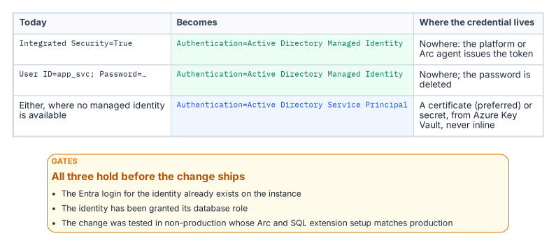
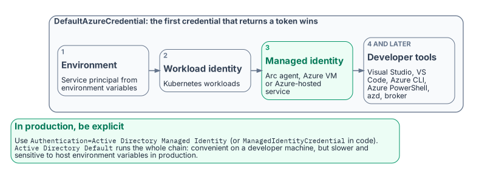

# Chapter 2 — Connection String Migration: The Last Mile

*The simplest change in the entire program, and the most gate-controlled.*

::: {.callout-note}
## In this chapter
The connection-string change that ends the application-chain migration — from Integrated Security or SQL Authentication to Entra ID authentication keywords — the gate conditions that must hold before it can be executed, and how the `Azure.Identity` SDK's `DefaultAzureCredential` chain lets a .NET application use one credential code path across production and development without modification.
:::

The final step in the application-chain migration is the SQL Server connection-string change. It is the moment the engine sees the Entra ID identity plane in the application connection rather than a SQL Authentication credential or a Windows Integrated Security token. Technically it is the simplest step in the entire migration. Operationally it is the most gate-controlled, and the two facts together are why it is treated as a distinct step rather than folded into the work that precedes it.

## The Connection String Change

{fig-alt="Integrated Security and SQL-login connection strings become Authentication=Active Directory Managed Identity, or Active Directory Service Principal where no managed identity is available; the login, the role grant and a production-like test must all be in place first."}

For an application using Windows Integrated Security — `Data Source=sqlserver;Initial Catalog=database;Integrated Security=True` — the connection string changes to use Entra ID authentication. For an application running on an Arc-enabled server with a system-assigned Managed Identity, it becomes `Data Source=sqlserver;Initial Catalog=database;Authentication=Active Directory Managed Identity`. The keyword tells the driver to acquire a token from the local Managed Identity rather than negotiate a Windows credential. On an Arc-enabled server the driver reaches that identity through the Arc agent's local endpoint (`localhost:40342`), the application authenticates as the server's own identity, and its process account must be a member of the local Hybrid Agent Extension Applications group (or Administrators) to obtain the token.[^b08c02-arc-mi-endpoint]

For an application using a service principal with a client credential, the string uses `Authentication=Active Directory Service Principal`, with the client ID and credential supplied through an Azure Key Vault reference rather than inline. For SQL Authentication connections — `User ID=serviceaccount;Password=storedpassword` — migrating to Managed Identity or service principal eliminates the credential from the connection string entirely. In every case the stored secret is removed, which is the point: the connection no longer carries a credential the identity plane cannot see.

## The Gate Conditions

The change is the simplest step technically, but it cannot be executed on demand. Three conditions must hold first. The Entra ID login must already exist on the target SQL Server instance — the `FROM EXTERNAL PROVIDER` login created in the work Book 05 covers — because a connection string that names an Entra identity with no corresponding login on the instance fails at connection time.[^b08c02-create-login]

The application's service principal or Managed Identity must have been granted the appropriate SQL Server database role, so that authentication succeeds and authorization follows. And the change must have been tested in a non-production environment whose Arc and SQL Server extension configuration matches production, because token acquisition and validation depend on that infrastructure being present and correctly configured. A connection-string change that works against a developer's laptop but has never been exercised against a production-equivalent Arc and extension stack is not a tested change. Only when all three gates are satisfied is the production cutover safe to perform.

## The Azure.Identity SDK and DefaultAzureCredential

{fig-alt="DefaultAzureCredential tries environment variables, workload identity, managed identity, then developer tools such as Visual Studio and the Azure CLI; production code should name the managed identity explicitly."}

For .NET applications — a large fraction of the federal application estate — the `Azure.Identity` SDK provides the `DefaultAzureCredential` class, which implements an ordered credential chain. It tries environment-variable service-principal credentials first, then workload identity, then managed identity — reached through the Arc agent's local endpoint (`localhost:40342`) on an Arc-enabled server and through the Azure Instance Metadata Service on an Azure VM — and then developer-tool credentials: Visual Studio, Visual Studio Code, Azure CLI, Azure PowerShell, Azure Developer CLI and, where installed, the broker.

The value of the chain is that a single credential code path works unchanged across environments. In production the application resolves its Managed Identity; in a developer's local environment it resolves the developer's Visual Studio or Azure CLI sign-in; no code differs between them. The SQL connection uses a `SqlConnection` with the `Authentication=Active Directory Default` keyword — available in `Microsoft.Data.SqlClient` 3.0 and later — or sets the `AccessToken` property from the `DefaultAzureCredential` token directly.

The `Authentication=Active Directory Default` keyword is convenient in development, because it delegates credential resolution to the `DefaultAzureCredential` chain automatically. In production, Microsoft recommends naming the credential explicitly — `Authentication=Active Directory Managed Identity`, or `ManagedIdentityCredential` in code — because walking the whole chain is slower and its result can change if someone sets environment variables on the host. The result is that the connection-string change is a net reduction in complexity for .NET applications: one keyword replaces an entire credential-management system. This is the workload-identity model the Managed Identity credential model establishes — the application authenticates as itself through a Managed Identity, with no human credential and no stored secret anywhere in the path.

::: {.callout-note title="What Book 08 establishes — Chapter 2"}
The connection-string change is the last mile of the application-chain migration: Integrated Security or SQL Authentication becomes `Authentication=Active Directory Managed Identity`, `Service Principal`, or `Default`, and the stored credential disappears. It is the simplest step technically but the most gate-controlled — it requires the Entra ID login to exist on the instance, the identity to hold the right database role, and a tested change in a production-equivalent non-production environment. For .NET, the `Azure.Identity` SDK's `DefaultAzureCredential` chain and the `Authentication=Active Directory Default` keyword collapse credential management to a single keyword, realizing the workload-identity model of the Managed Identity credential model.
:::

[^b08c02-arc-mi-endpoint]: Microsoft Learn, [Access Azure resources with managed identity on Azure Arc-enabled servers](https://learn.microsoft.com/en-us/azure/azure-arc/servers/managed-identity-authentication).
[^b08c02-create-login]: Microsoft Learn, [CREATE LOGIN (Transact-SQL)](https://learn.microsoft.com/en-us/sql/t-sql/statements/create-login-transact-sql?view=sql-server-ver17).
