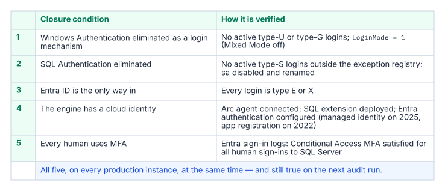
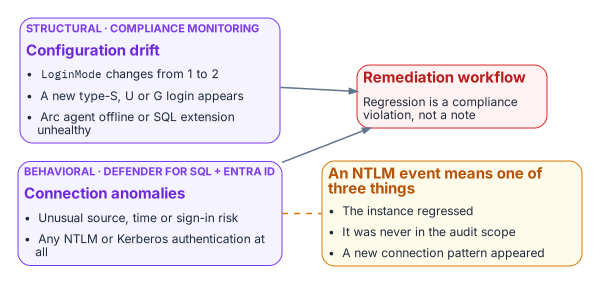

# Chapter 1 — The Closure Condition for the SQL Server Authentication Transformation

*Transformations do not complete — they achieve a posture, and a posture is something you keep proving.*

::: {.callout-note}
## In this chapter
The five conditions that must be simultaneously satisfied for the SQL Server authentication transformation to be closed across the estate, why the continuous audit rather than a one-time scan is the verification instrument, how the per-instance compliance record captures the satisfying state, what drift detection looks for, and how behavioral telemetry — Defender for SQL threat alerts, Entra ID sign-in logs, and host authentication logs — adds a layer on top of the structural monitoring.[^b09c01-defender][^b09c01-signins]
:::

A transformation that achieves a completed state and then stops monitoring is a transformation that will regress. A SQL Server instance brought to the Entra-exclusive operational posture can be reconfigured to Mixed Mode by any administrator with sufficient permission.[^b09c01-auth-mode] New SQL Authentication logins can be created. New Windows logins can be created if the instance remains domain-joined. The transformed posture is not a permanent state achieved through a one-time action — it is an ongoing condition maintained by continuous monitoring, automated drift detection, and a governance process that treats regression as a compliance violation rather than an operational preference.

## The Five Closure Conditions

{fig-alt="Table of five conditions: no usable Windows logins, SQL authentication blocked and no usable SQL logins, Entra authentication observed working, a cloud identity for the engine, and MFA for every human, each with the evidence that shows it."}

The transformation inventory defines the SQL Server authentication transformation as complete when five conditions are simultaneously satisfied across all production SQL Server instances in the estate. None of the five is a single engine setting, and the series calls the combined state the *Entra-exclusive operational posture*: an evidenced condition, not a mode. SQL Server has no setting that turns Windows authentication off. Entra authentication works alongside whichever authentication mode the instance uses, and even SQL Server 2025's Disable SQL Authentication setting leaves the instance accepting "Microsoft Entra authentication and Windows authentication."[^b09c01-disable-sql-auth] `LoginMode = 1` (Windows Authentication mode) therefore proves only that SQL logins are refused, not that Windows logins are gone.

[^b09c01-disable-sql-auth]: Microsoft Learn, [Disable SQL Authentication — SQL Server enabled by Azure Arc](https://learn.microsoft.com/en-us/sql/sql-server/azure-arc/disable-sql-authentication?view=sql-server-ver17) (SQL Server 2025 on Windows).

The first condition is that no usable Windows-backed principal remains. A query of `sys.server_principals` shows zero type-U and type-G logins that are enabled and hold `CONNECT SQL`, other than a documented break-glass group recorded in the exception registry.[^b09c01-principals]

The second condition is that SQL Authentication is eliminated. No SQL Authentication logins — type-S logins — exist on any production instance other than those carrying documented exception status, and the `sa` account is disabled on every instance. SQL logins are refused: `SERVERPROPERTY('IsIntegratedSecurityOnly') = 1` (Windows Authentication mode, `LoginMode = 1`), and on SQL Server 2025 also `SERVERPROPERTY('IsExternalAuthenticationOnly') = 1` once Disable SQL Authentication is on. The operational verification is that evidence plus a `sys.server_principals` query for type-S logins, cross-referenced against the exception registry the program maintains. The third condition is that Entra authentication is observed working and nothing else is: every usable login is type E or X, Entra sign-in logs show connections to the instance, and `sys.dm_exec_connections.auth_scheme` shows no `NTLM` or `KERBEROS` connections over the validation period.[^b09c01-auth-scheme]

The fourth condition is that the engine has a cloud identity. The Arc Connected Machine agent is connected, the Azure extension for SQL Server is deployed, and Microsoft Entra authentication is configured on every production instance — with the managed identity on SQL Server 2025, or an app registration on SQL Server 2022.[^b09c01-arc-servers][^b09c01-arc-sql][^b09c01-mi-2025] The fifth condition is that every human principal authenticates with MFA enforced by Conditional Access.[^b09c01-ca] This is verified through Entra ID sign-in logs and Conditional Access policy reports — every sign-in event for a SQL Server resource should show MFA satisfied and Conditional Access grant controls met.

## The Continuous Audit as the Verification Instrument

The authentication-audit script (`the authentication audit script`) in continuous monitoring mode — running on a recurring schedule against the full estate rather than as a point-in-time scan — is the primary instrument for verifying that all five closure conditions remain satisfied over time. The per-instance compliance record, updated on each audit run, is the structured evidence artifact that captures the current state of each condition for each instance. The SQL Server engine-authentication decision defines the field set that record carries.

A per-instance compliance record that shows SQL authentication refused, zero usable type-S logins, zero usable type-U and type-G logins outside the break-glass exception, zero Windows-authenticated connections over the validation period, the `sa` account disabled and renamed, the Arc agent enrolled, the SQL extension deployed, and Entra authentication configured is a record that satisfies all five closure conditions for that instance. When all production instances carry satisfying compliance records, the SQL Server authentication transformation is verifiably closed for the estate. The continuous audit ensures closure is not a point-in-time claim — it is an ongoing verification.

## Drift Detection

{fig-alt="Configuration drift from compliance monitoring and connection anomalies from Defender for SQL, Entra ID and host authentication logs both open the remediation workflow; an NTLM event means a regression, a scope gap or a new connection pattern."}

Drift detection in the compliance-monitoring pipeline identifies conditions that would constitute regression before they become compliance violations. A drift event for SQL Server authentication takes one of several forms. An instance whose `LoginMode` value changes from 1 to 2 — Windows Authentication Only to Mixed Mode — indicates that someone has enabled Mixed Mode without authorization. A new type-S login appearing in `sys.server_principals` that was not present on the previous audit run indicates that a SQL Authentication login has been created.

A new type-U or type-G login appearing on an instance that was previously in the Entra-exclusive posture is the same class of regression for Windows-backed identity. And an Arc agent going offline, or the SQL extension becoming unavailable, would leave the instance's Entra identity unmanaged: certificate renewal on SQL Server 2022 and managed-identity tokens on SQL Server 2025 both depend on the agent. Each drift event triggers the program's remediation workflow. The SQL Server engine-authentication decision records these same events — `LoginMode` reverting to Mixed Mode, a new type-S/U/G login appearing, the Arc agent going offline — as compliance violations, not advisory signals.

The 2027-04-01 NTLM elimination backstop is not a migration completion date in the continuous-compliance monitoring context — it is the date by which the records for all production instances must have been in the satisfied state continuously for a sufficient validation period. Migration activity should conclude well before the 2027-04-01 block date set by the elimination program's enforcement phase; the final months before it are the continuous-audit validation period, not the migration period.

## Behavioral Telemetry: Defender for SQL, Entra ID, and Host Logs

Behavioral telemetry complements the continuous-compliance monitoring. The compliance monitoring tracks the configuration state of each instance — is the `LoginMode` correct, are the login types correct. The behavioral layer watches the connections themselves, and it draws on three sources with distinct jobs. Microsoft Defender for SQL servers on machines, enabled through Defender for Cloud on the Arc-enabled host, raises threat alerts — sign-ins from an unusual location or an unfamiliar principal, brute-force attempts, potential SQL injection — and runs vulnerability assessment; it is an alerting service, not an audit log of every authentication. Entra ID sign-in logs record every token issued for SQL Server, with its risk and Conditional Access result. The authentication protocol itself is recorded on the host: Windows Security log logon events (4624 and 4625) name the authentication package, the NTLM operational log records NTLM use, `sys.dm_exec_connections.auth_scheme` shows `NTLM` or `KERBEROS` for each live Windows connection, and SQL Server Audit records successful and failed logins.[^b09c01-sqlaudit] The Azure Monitor agent forwards those Windows logs, including SQL Server Audit written to the Security log, to a Log Analytics workspace, where the alert queries run.

In the transformed posture, the baseline is Entra-authenticated connections only. Every Entra-authenticated connection rests on a token that Entra ID issued, and each token issuance is recorded in the sign-in logs (a client can reuse a cached token across connections); an anomalous connection — from an unusual source IP, at an unusual time, with an elevated sign-in risk signal — is surfaced by Defender for SQL and by Entra ID Protection.[^b09c01-idp] Any NTLM- or Kerberos-authenticated connection to an instance, visible in `auth_scheme`, SQL Server Audit and the host's logon events, should be zero in the transformed posture and raises an immediate alert from Log Analytics.

An NTLM event means one of three things: an instance has regressed to Mixed Mode, which the compliance monitoring should already have detected; an instance was not included in the original audit scope, a discovery gap; or a novel connection pattern has appeared that the migration plan did not anticipate. All three require investigation. The combination of continuous-compliance structural monitoring and behavioral monitoring from these sources is the two-layer governance instrument that maintains the transformed posture continuously after the migration is complete.

::: {.callout-note title="What Book 09 establishes — Chapter 1"}
The SQL Server authentication transformation is closed when five conditions hold simultaneously across every production instance: no usable type-U/G logins, SQL authentication refused (`LoginMode = 1`, plus Disable SQL Authentication on SQL Server 2025) with `sa` disabled and no usable type-S outside the exception registry, Entra authentication observed working with no Windows-authenticated connections, Entra authentication configured on the instance (managed identity on SQL Server 2025, app registration on SQL Server 2022), and every human principal MFA-enforced via Conditional Access. The continuous audit (the authentication-audit script on a schedule) is the verification instrument, the satisfying per-instance compliance record as defined by the SQL Server engine-authentication decision is the evidence, drift detection catches regression before it becomes a violation, and behavioral telemetry — Defender for SQL alerts, Entra sign-in logs, and host authentication logs in Log Analytics — adds a layer over the structural monitoring.
:::

[^b09c01-signins]: Microsoft Learn, [Sign-in logs in Microsoft Entra ID](https://learn.microsoft.com/en-us/entra/identity/monitoring-health/concept-sign-ins).
[^b09c01-defender]: Microsoft Learn, [Microsoft Defender for SQL servers on machines overview](https://learn.microsoft.com/en-us/azure/defender-for-cloud/defender-for-sql-on-machines-overview).
[^b09c01-auth-mode]: Microsoft Learn, [Change server authentication mode](https://learn.microsoft.com/en-us/sql/database-engine/configure-windows/change-server-authentication-mode?view=sql-server-ver17).
[^b09c01-principals]: Microsoft Learn, [sys.server_principals (Transact-SQL)](https://learn.microsoft.com/en-us/sql/relational-databases/system-catalog-views/sys-server-principals-transact-sql?view=sql-server-ver17).
: Microsoft Learn, [Manage emergency access admin accounts](https://learn.microsoft.com/en-us/entra/identity/role-based-access-control/security-emergency-access).
[^b09c01-auth-scheme]: Microsoft Learn, [sys.dm_exec_connections (Transact-SQL)](https://learn.microsoft.com/en-us/sql/relational-databases/system-dynamic-management-views/sys-dm-exec-connections-transact-sql?view=sql-server-ver17).
[^b09c01-mi-2025]: Microsoft Learn, [Managed identity overview — SQL Server enabled by Azure Arc](https://learn.microsoft.com/en-us/sql/sql-server/azure-arc/managed-identity?view=sql-server-ver17).
[^b09c01-arc-sql]: Microsoft Learn, [Overview — SQL Server enabled by Azure Arc](https://learn.microsoft.com/en-us/sql/sql-server/azure-arc/overview?view=sql-server-ver17).
[^b09c01-arc-servers]: Microsoft Learn, [Azure Arc-enabled servers overview](https://learn.microsoft.com/en-us/azure/azure-arc/servers/overview).
[^b09c01-ca]: Microsoft Learn, [What is Conditional Access?](https://learn.microsoft.com/en-us/entra/identity/conditional-access/overview).
[^b09c01-sqlaudit]: Microsoft Learn, [SQL Server Audit (Database Engine)](https://learn.microsoft.com/en-us/sql/relational-databases/security/auditing/sql-server-audit-database-engine?view=sql-server-ver17).
[^b09c01-idp]: Microsoft Learn, [What is Microsoft Entra ID Protection?](https://learn.microsoft.com/en-us/entra/id-protection/overview-identity-protection).
