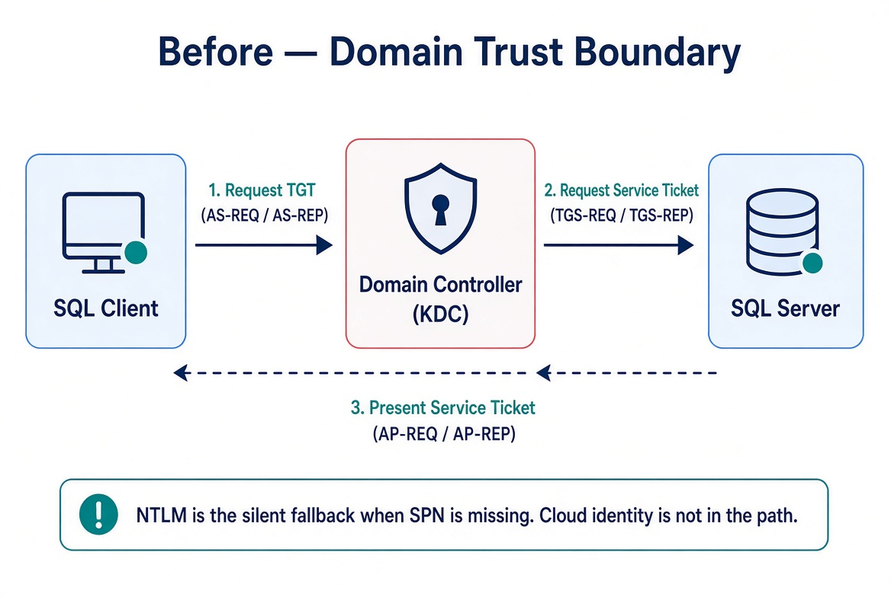
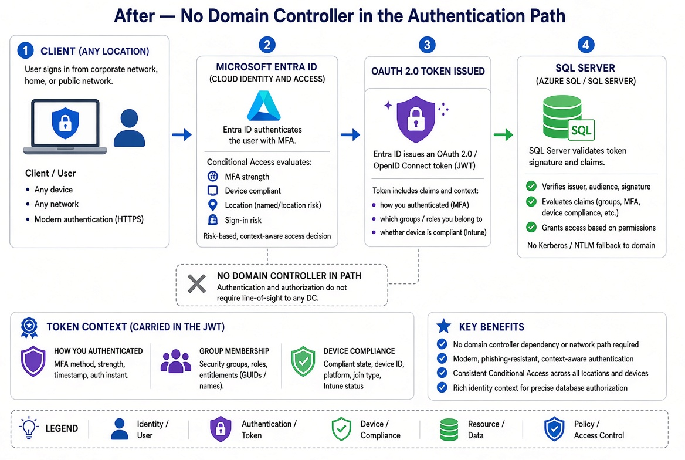

# SQL Server Identity Transformation — Narrative Series

**From Windows Authentication to cloud identity — a reading sequence on transforming the SQL Server estate**

## Status

This is a cleaned multi-chapter narrative. It is written as an engineering argument, not a runbook. Treat the patterns as guidance that must be validated against the specific estate.

## The destination

Windows Authentication and SQL Authentication are eliminated and replaced with cloud identity authentication for SQL Server 2022 and later. Authentication is enforced through OAuth 2.0 tokens, a managed identity for the engine process, and multi-factor authentication for every human principal.

## The journey in three states

### Before — the domain is the trust boundary

Every party is domain-joined. The domain controller is the authentication authority. Kerberos is the protocol. NTLM is the silent fallback when the service principal name is missing. The cloud identity plane is not in the path.

### During — both paths live simultaneously

Legacy clients still use Kerberos or fall back to NTLM. Migrated clients authenticate to the cloud identity platform and present a token. The SQL Server accepts both Windows logins and cloud-identity logins during the parallel-run window.

### After — no domain controller in the authentication path

The client authenticates to the cloud identity platform with multi-factor authentication. Conditional Access evaluates identity and device. An OAuth 2.0 token is issued. The SQL Server validates the token. The token carries context — how you authenticated, which groups you belong to, whether your device is compliant.

## Reading sequence

| Book | Title | Focus |
|------|-------|-------|
| [01](book-01-the-inheritance.md) | The Authentication Inheritance Problem | What Windows Authentication actually is, and why it must end |
| [02](book-02-the-estate.md) | The Estate Itself | Assess and consolidate before you touch authentication |
| [03](book-03-authentication-audit.md) | The Authentication Audit | What is actually using Windows Authentication, SQL Authentication, and NTLM |
| [04](book-04-identity-bridge.md) | The Identity Bridge | Hybrid-management attachment and managed identity for the engine |
| [05](book-05-login-migration.md) | Login Migration | Parallel-run of Windows and cloud-identity logins |
| [06](book-06-ntlm-elimination.md) | NTLM Elimination | Silent fallback, service principal name repair, and protocol restriction |
| [07](book-07-access-control.md) | Access Control | Dynamic groups and administrative-unit delegation |
| [08](book-08-upstream-chain.md) | The Upstream Application Chain | Applications that depend on Windows Authentication or LDAP |
| [09](book-09-steady-state.md) | Transformed Steady State | The destination and the milestone |
| [10](book-10-certificate-authority.md) | Certificate-Authority Dependency | The layer the other steps depend on but rarely name |

## Relationship to attribute-driven structure

This transformation consumes the organizational-attribute model. Dynamic security groups whose membership rules reference organizational attributes drive SQL Server access without manual database-administrator provisioning. The attribute infrastructure must precede the dynamic-group access work.

---

*Cleaned extraction for project use. No internal branding or document identifiers.*
