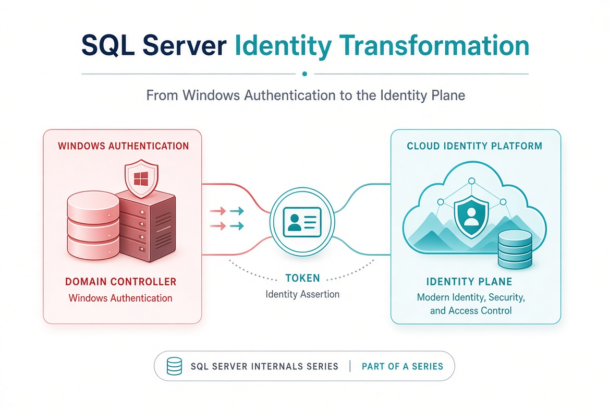
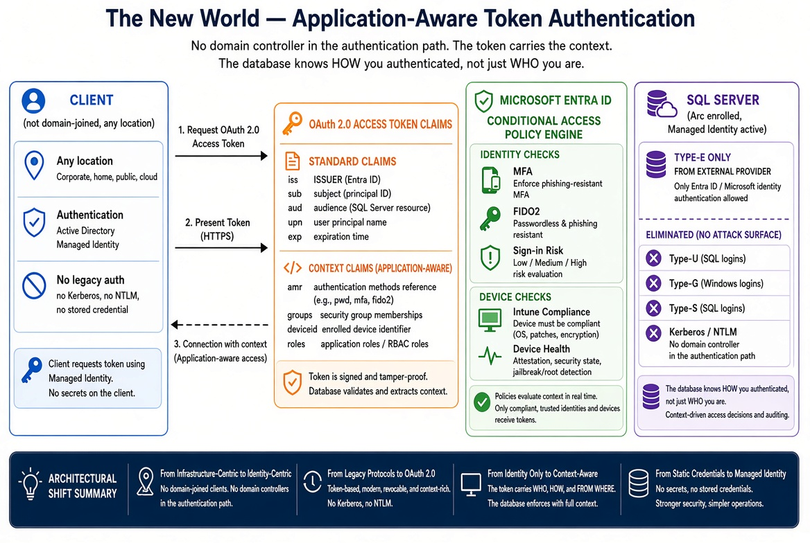

# SQL Server Identity Transformation — Narrative Series

**From Windows Authentication to cloud identity — a reading sequence on transforming the SQL Server estate**



**Full narrative bundle:** [sql-server-narrative-bundle.docx](../../../downloads/sql-server-narrative-bundle.docx) — all books combined into one Word document, regenerated on every site deploy.

**Neutralized Markdown:** [sql-server-narrative-neutralized.md](sql-server-narrative-neutralized.md) — source identifiers replaced with plain language.

**Series overview:** [Series Overview](series-overview.md) — cleaned summary with original diagrams.

## Status

The full original narrative is available as a single DOCX bundle. Individual cleaned Markdown chapters are also present. Original diagrams from the source bundle are referenced in the overview and index.

## The destination

Windows Authentication and SQL Authentication are eliminated and replaced with cloud identity authentication for SQL Server 2022 and later. Authentication is enforced through OAuth 2.0 tokens, a managed identity for the engine process, and multi-factor authentication for every human principal.

## The journey in diagrams

### Before — Kerberos overview


Every party is domain-joined. The domain controller is the authentication authority. Kerberos is the protocol. NTLM is the silent fallback when the service principal name is missing.

### During — two paths


Legacy clients still use Kerberos or fall back to NTLM. Migrated clients authenticate to the cloud identity platform and present a token.

### After — token authentication



No domain controller in the authentication path. Conditional Access evaluates identity and device. The SQL Server validates the OAuth token.

## Reading sequence

| Book | Title | Focus |
|------|-------|-------|
| [01](book-01-the-inheritance.md) | The Authentication Inheritance Problem | What Windows Authentication actually is, and why it must end |
| [02](book-02-the-estate.md) | The Estate Itself | Assess and consolidate before you touch authentication |
| [03](book-03-authentication-audit.md) | The Authentication Audit | What is actually using Windows Authentication, SQL Authentication, and NTLM |
| [04](book-04-identity-bridge.md) | The Identity Bridge | Hybrid-management attachment and managed identity for the engine |
| [05](book-05-login-migration.md) | Login Migration | Parallel-run of Windows and cloud-identity logins |
| [06](book-06-ntlm-elimination.md) | NTLM Elimination | Silent fallback, service principal name repair, and protocol restriction |
| [07](book-07-access-control.md) | Access Control | Dynamic groups and administrative-unit delegation |
| [08](book-08-upstream-chain.md) | The Upstream Application Chain | Applications that depend on Windows Authentication or LDAP |
| [09](book-09-steady-state.md) | Transformed Steady State | The destination and the milestone |
| [10](book-10-certificate-authority.md) | Certificate-Authority Dependency | The layer the other steps depend on but rarely name |
| [11](book-11-platform-question.md) | The Platform Question | Database consolidation toward SSOT |

## Relationship to attribute-driven structure

This transformation consumes the organizational-attribute model. Dynamic security groups whose membership rules reference organizational attributes drive SQL Server access without manual database-administrator provisioning. The attribute infrastructure must precede the dynamic-group access work.

---

*Original diagrams from the source bundle. Paths are relative and resolve for both HTML and DOCX.*

## Building the Word bundle

The combined Word document (`downloads/sql-server-narrative-bundle.docx`) is built directly from the Markdown pages in this folder by `scripts/build_sql_bundle.py`. The site deploy workflow runs it on every push to `main`. To build it locally, run this from the repository root (you need [Quarto](https://quarto.org/), plus `rsvg-convert` if any page uses an SVG):

```bash
python3 scripts/build_sql_bundle.py                 # writes _site/downloads/sql-server-narrative-bundle.docx
python3 scripts/build_sql_bundle.py /tmp/test.docx  # or choose your own output path
```

- **Reading order** comes from the explicit `MANIFEST` list at the top of the script: `index.md`, then each `Book_NN.md` followed by its `Book_NN_CPT_*.md` chapters, then Book 11. **When you add, remove, or rename a page, update `MANIFEST`.** The build fails if a listed file is missing, and it warns about any `Book_*` page that isn't listed.
- **Images** are found in every listed page and resolved relative to that page (normally `../../images/sql-server/`). Each one is embedded where it appears, with its alt text as the caption, scaled to the page width. SVGs are converted to PNG, and files whose extension doesn't match their content are fixed for Word. **The build fails if a referenced image is missing**, and it prints a report of references, embedded images, and any images in `docs/images/sql-server/` that no page uses.
- **Web-only pieces** are dropped by `scripts/bundle-strip-nav.lua`: chapter listings, the "Continue the series" and "Download" callouts, and links between pages, which become plain text. The bundle gets a title page and a Word table of contents. If Word asks to update fields when you open it, choose **Yes** so it fills in the page numbers.
