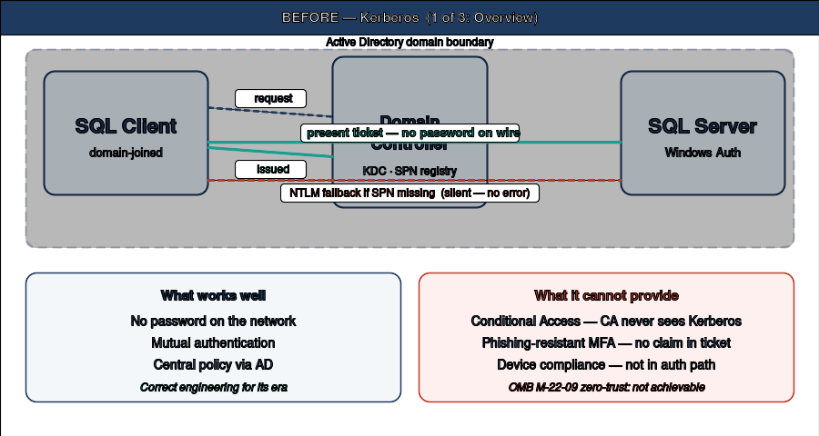
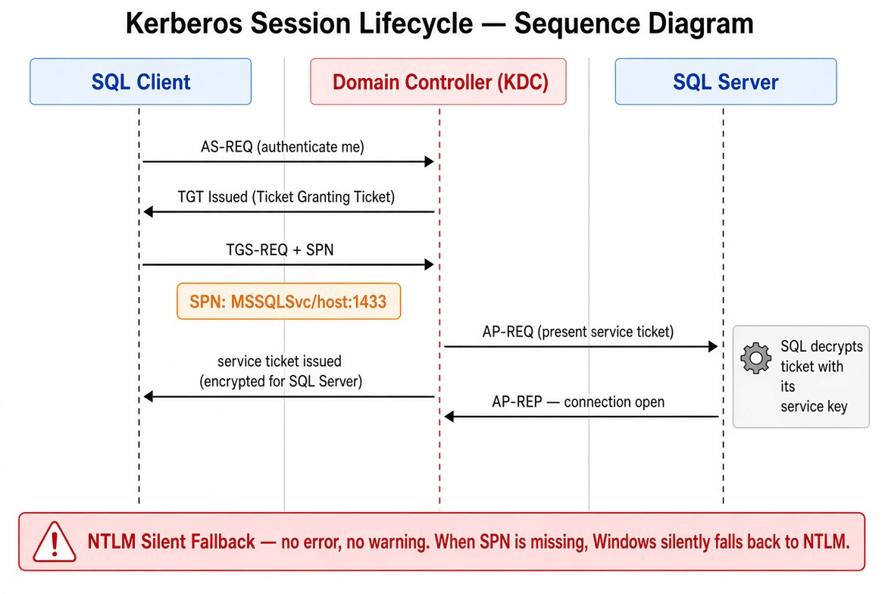
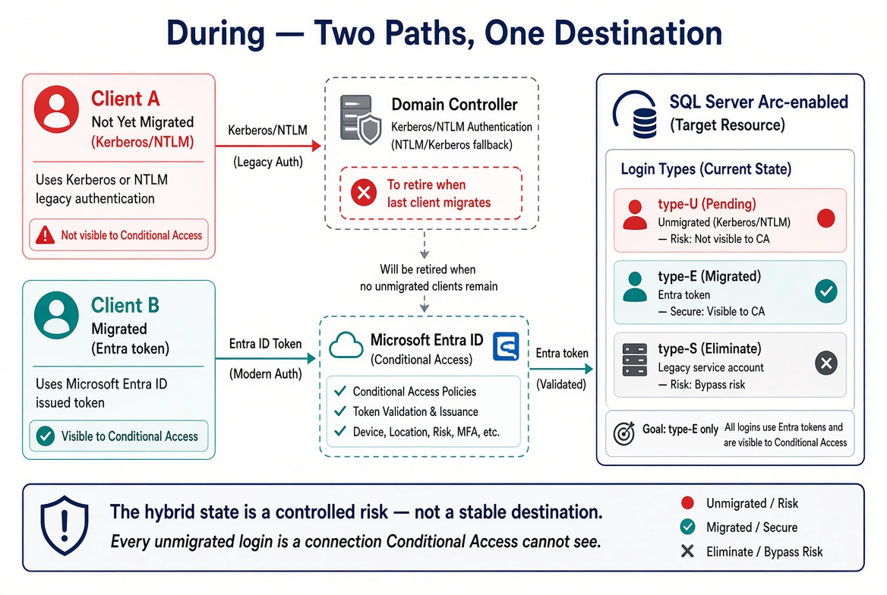

# Book 01 — The Authentication Inheritance Problem

**Why SQL Server’s Windows Authentication was good engineering, and why it must now end**

## What Windows Authentication actually is

SQL Server in Windows Authentication mode delegates authentication entirely to the Windows security subsystem. It does not implement its own password verification or its own session token model. When a client opens a connection with integrated security, the driver passes control to the Security Support Provider Interface (SSPI).

SSPI examines the available authentication protocols and determines whether Kerberos is negotiable for the target server. If it is, SSPI requests a Kerberos service ticket from the domain controller’s Key Distribution Center, scoped to the SQL Server’s Service Principal Name. That ticket is presented to the SQL Server engine.

The engine validates the ticket’s cryptographic signature using the session key derived from the service account’s credentials, extracts the principal, and maps it to a SQL Server login. No password has traversed the network. No credential has been stored in any application configuration file. The authentication is mutual. This is genuinely good security architecture.

The Service Principal Name must be registered against the service account running the SQL Server engine process. Without a correctly registered Service Principal Name, the Key Distribution Center cannot issue a service ticket. SSPI silently falls back to NTLM.

This silent fallback is the first and most consequential fault in the inheritance. It is invisible at the application layer, produces no error in the SQL Server error log under default configuration, and means that environments which believe they are running Kerberos are, in a significant fraction of connections, running NTLM. The fraction can be measured, but it cannot be known without measurement.

## The NTLM fallback

NTLM is a challenge-response protocol that embeds the entire authentication exchange within the connection negotiation. There is no token issued at the conclusion of this exchange, and no session assertion that can be presented to a third party for validation.

There is, therefore, no mechanism by which a Conditional Access policy engine — which lives in the cloud identity plane, outside the SQL Server connection path — can observe the NTLM exchange, evaluate it against policy conditions such as device compliance or sign-in risk, and either permit or deny it. NTLM authentication succeeds or fails at the protocol layer, between client and server, and produces no artifact the cloud identity plane can observe, record, or control.

## The service account

The SQL Server engine process runs under a service account. That account is the identity the engine presents when it makes network connections. Historically that account has taken one of three forms: a named domain service account with a non-expiring password, a group managed service account whose password is managed by the directory, or a virtual account that uses the computer’s domain account for network authentication.

In every one of these patterns, the directory is the identity authority for the engine process. When the directory is removed as the authoritative identity source, the service account pattern loses its foundation, and the engine must acquire a new identity — the system-assigned managed identity that hybrid management provides for the host.

## The sa account

Alongside Windows Authentication, SQL Server has always supported SQL Authentication, which uses credentials stored in SQL Server’s own master database. The sa account is the built-in SQL Authentication login present on every instance at installation.

In a well-governed environment, sa is disabled, renamed, or both. In practice, many environments carry active sa accounts as emergency-access mechanisms, often with passwords set at installation and never rotated. SQL Authentication produces no cloud identity sign-in events. A connection using SQL Authentication is invisible to the cloud identity plane: there is no Conditional Access policy that can intercept it.

## Why this was correct

In a fully domain-joined world with a working Key Distribution Center, correctly registered Service Principal Names, and a client population consisting entirely of domain members, Windows Authentication was centrally managed, non-repudiable at the Kerberos ticket level, and resistant to credential theft in the network path. It required no infrastructure beyond the domain controller that already existed.

It was not a security compromise. It was the application of the existing Windows security model to the SQL Server authentication problem, and for the world that model was designed for, it was the right answer. The problem is not the design. The problem is that the world it was designed for — every client domain-joined, every server domain-joined, the perimeter as the security boundary, no cloud identity plane — no longer exists.

## Why the inheritance must end

Three drivers require replacing Windows Authentication for SQL Server:

1. **NTLM elimination.** Microsoft has deprecated NTLM and is disabling it by default across successive Windows releases. Any SQL Server connection that relies on NTLM — because a Service Principal Name is missing, because the client cannot negotiate Kerberos, or because the host has been migrated to a non-domain-joined state — will fail when NTLM is blocked at the Local Security Authority layer.
2. **Zero Trust requirement.** Conditional Access policies enforce device compliance, network-location restrictions, multi-factor authentication, and sign-in risk by intercepting the token issuance request. If the authentication protocol is Kerberos or NTLM, there is no token issuance request. The cloud identity plane is not in the path.
3. **Service-account credential problem.** When the directory is removed as the authoritative identity source, the domain service accounts and group managed service accounts that currently authorize the engine process lose their governance foundation. The only credential-free, cloud-native identity available for an on-premises server is the system-assigned managed identity that hybrid management provides.

Their dependency structure dictates the order of the series: assess and consolidate the estate first, then hybrid-management enablement, then login migration, then NTLM elimination.

---

*Cleaned extraction for project use. No internal branding or document identifiers.*
