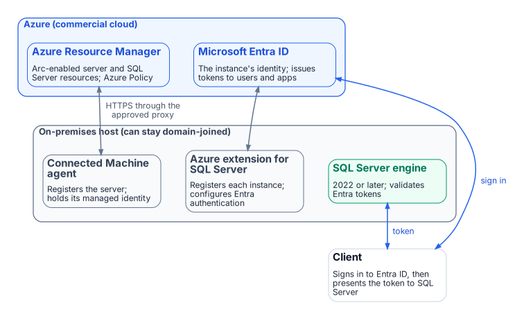

# Book 04 — The Identity Bridge

**Hybrid-management attachment and an Entra identity for the engine**

## What hybrid management provides

The Azure Arc Connected Machine agent registers the host with Azure, gives it a system-assigned managed identity, and serves that identity's tokens from a local endpoint — the agent's Hybrid Instance Metadata Service at `http://localhost:40342`, not the Azure VM address `169.254.169.254`. The Azure extension for SQL Server then configures Microsoft Entra authentication on each instance: SQL Server 2025 uses the managed identity directly; SQL Server 2022 uses an app registration whose certificate is kept in Azure Key Vault. Either replaces the AD-anchored service account as the instance's identity in Entra ID.

Clients sign in to Entra ID, Conditional Access evaluates the request, and the issued token is presented to SQL Server, which validates it. No password traverses the network. No credential is stored in a configuration file.

{fig-alt="The Connected Machine agent on the on-premises host projects it into Azure Resource Manager; the Azure extension for SQL Server and the instance's Entra identity let the engine validate Entra tokens."}

## Layer 1 and Layer 2

SQL-engine Entra authentication (Layer 1) does not depend on OS-level domain unjoin (Layer 2). Layer 1 can proceed while the host remains domain-joined. Layer 2 — domain unjoin — is a separate decision that follows the authentication migration, not a prerequisite for it.

This distinction must be communicated to every stakeholder. SQL-engine Entra authentication must never be blocked waiting for OS-level domain unjoin.

## Deployment sequencing

Arc deployment respects linked-server dependency order. The host that is the target of a linked server must be enrolled before the host that originates the linked-server connection. Outbound HTTPS connectivity through the GCC-Moderate egress proxy must be verified before enrollment. Verification is the gate that authorizes login migration: the agent returns a token from its local endpoint, and a test Entra login connects.

## What Book 04 establishes

Arc and the Azure extension for SQL Server give each instance an Entra identity that replaces the AD-anchored service account — the managed identity on SQL Server 2025, an app registration with a Key Vault certificate on SQL Server 2022. Layer 1 (SQL-engine Entra auth) does not depend on Layer 2 (OS-level domain unjoin). Deployment sequencing respects linked-server dependency order. The local-endpoint token test and a test Entra login are the gate that authorizes login migration.

---

*Cleaned extraction for project use. No internal branding or document identifiers.*
