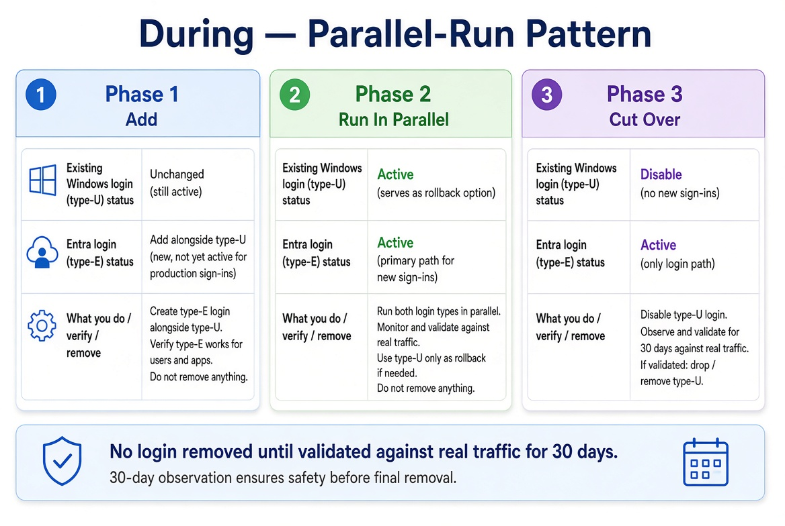
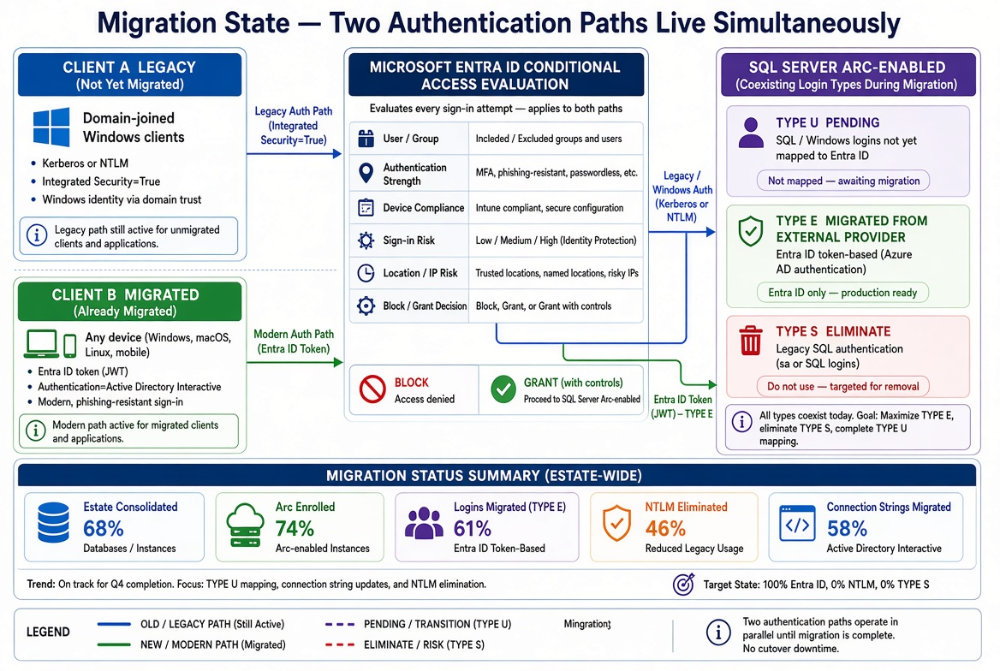

# Book 05 — Login Migration

**Parallel-run of Windows and cloud-identity logins**

## Why this book exists

Login migration is the period during which both authentication paths live simultaneously. Windows logins (type-U) and cloud-identity logins (type-E) coexist until every connection string has been migrated and every application has been verified.

## Parallel-run

The SQL Server accepts both login types during the parallel-run window. Legacy clients continue to use Kerberos or fall back to NTLM. Migrated clients authenticate to the cloud identity platform and present a token.

This hybrid state is a controlled risk. Progress is measured across:

- Estate consolidation (Book 02)
- Hybrid-management enrollment (Book 04)
- Login migration (this book)
- NTLM elimination (Book 06)
- Connection-string migration (Book 08)

## Login types

- **Type-U (Windows).** Logins that map to directory principals. These are the inheritance.
- **Type-E (cloud identity).** Logins that map to cloud identity principals. These are the destination.
- **Type-S (SQL Authentication).** Logins that use credentials stored in the master database. These are eliminated for human principals and retained only for break-glass where required.

## Migration order

Human principals are migrated first. Service accounts are migrated after the engine process has a managed identity. Break-glass accounts are reviewed last and retained only if they are still required.

## The gate

No NTLM restriction begins until the login migration for the pilot cohort is complete and the connection-string inventory shows that no remaining connection requires NTLM.

---

*Cleaned extraction for project use. No internal branding or document identifiers.*
