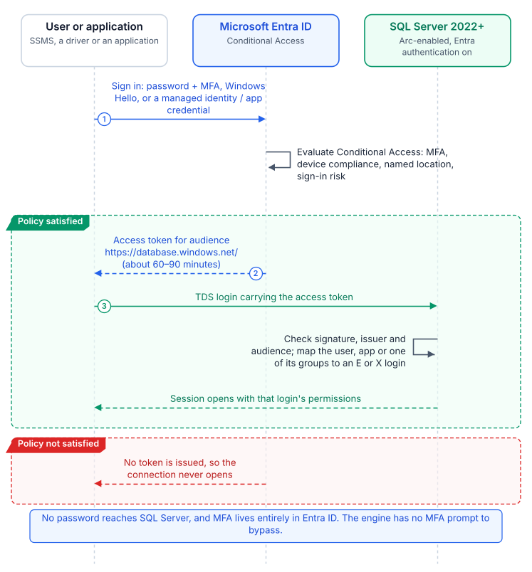

# Book 09 — Transformed Steady State

**The destination and the milestone**

## No domain controller in the authentication path

In the transformed state, no domain controller participates in SQL Server authentication. The client authenticates to the cloud identity platform with multi-factor authentication. Conditional Access evaluates identity and device. An OAuth 2.0 token is issued. The SQL Server validates the token. The token carries context — how you authenticated, which groups you belong to, whether your device is compliant.

{fig-alt="Before: a domain-joined client gets a Kerberos ticket or falls back to NTLM, invisible to Entra ID. During: legacy and migrated clients coexist, with two authorities and old logins disabled after validation. After: users, apps and managed identities get an Entra token under Conditional Access, SQL Server accepts only Entra logins, and every sign-in is logged."}

{fig-alt="Sequence diagram between client, Microsoft Entra ID and SQL Server: the client signs in, Conditional Access is evaluated, a token for https://database.windows.net/ is issued, and SQL Server validates it and maps it to a type E or X login."}

## Closure conditions

The transformation is complete when five conditions are simultaneously true across every production instance:

1. Every human principal authenticates via Entra ID. No Windows logins remain for human access.
2. Each instance has its Microsoft Entra identity configured through Arc — the managed identity on SQL Server 2025, an app registration with a Key Vault certificate on SQL Server 2022. No domain service account or gMSA remains.
3. NTLM is blocked at the Local Security Authority layer. No silent fallback remains.
4. Conditional Access policies enforce device compliance and MFA for every SQL Server connection.
5. Continuous monitoring instruments are in production. Drift is detected and treated as a compliance violation.

The posture is not declared. It is measured. Continuous monitoring instruments must be in production before the migration is declared done.

## What Book 09 establishes

The destination is a state in which no domain controller participates in SQL Server authentication. The client authenticates to the cloud identity platform. Conditional Access evaluates the request. An OAuth 2.0 token is issued and validated by the engine. Five closure conditions must be simultaneously true. The posture is measured, not declared.

---

*Cleaned extraction for project use. No internal branding or document identifiers.*
