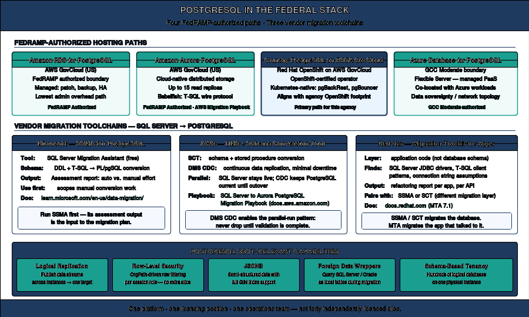

# Book 11 — The Platform Question

**Database consolidation toward a single source of truth**

## The fragmentation cost

The authentication transformation produces a rationalized estate. The platform question asks what to do with that estate. Twenty years of accretion have produced overlapping instances, duplicated data domains, and no single authoritative source for any given subject. The SSOT goal is to dissolve the silos toward one authoritative database per data domain.

*PostgreSQL as a consolidation target: logical replication, row-level security, JSONB, and foreign data wrappers toward one authoritative database.*

## Three destinations

Every retained instance ends at one of three destinations. All three satisfy the forced requirement — authentication that is observable and conditionable in the identity plane. They differ in effort, licensing, and how far they advance the SSOT goal.

| Dimension | A · Stay on SQL Server | B · Consolidate to PostgreSQL | C · Consolidate to Oracle |
| --- | --- | --- | --- |
| What it is | SQL Server 2022, Arc-enabled, Entra token auth | Re-platform onto PostgreSQL (Crunchy on ROSA, RDS/Aurora, or Azure DB for PostgreSQL) | Re-platform onto Oracle (19c on OpenShift Virtualization, or Autonomous DB in OCI US Gov Cloud) |
| Auth model | Entra OAuth 2.0 token | Entra-native on Azure DB for PostgreSQL; attribute-driven roles + RLS elsewhere | Oracle auth integrated to the chosen identity plane |
| Engine effort | Low — upgrade, Arc-enable, migrate logins | High — schema + T-SQL→PL/pgSQL conversion | High — T-SQL→PL/SQL conversion |
| Licensing | Continues SQL Server per-core | Eliminates SQL Server licensing | Oracle licensing — low incremental cost only if a site license already exists |
| SSOT advance | None — re-authenticates the silos | High — logical replication, RLS, JSONB, FDW | High — consolidation onto an existing Oracle authority |

## Decision sequence

1. Audit and rationalize first. Inventory every instance, surface silent NTLM fallback, and classify each instance retire / consolidate / retain.
2. Do the forced authentication move on the retain set: Arc-enable, stand up Entra logins alongside Windows logins, cut over, retire the old logins.
3. Then make the platform choice per data domain. Re-platform follows the same parallel-run discipline — establish the target, validate in parallel, cut over only after the validation window. Never drop before you observe.

## What Book 11 establishes

The authentication transformation produces the inventory that scopes the platform decision. Three destinations satisfy the forced authentication requirement. They differ in effort, licensing, and SSOT advance. The decision is per data domain, not per agency. Two estates, two answers is normal. The goal is fewer authoritative platforms — not a single vendor.

---

*Cleaned extraction for project use. No internal branding or document identifiers.*
