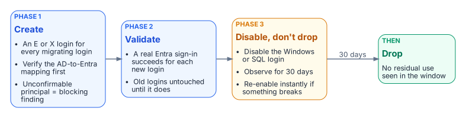

# SQL Server Identity Transformation

**From Windows Authentication to cloud identity — a ten-book reading sequence, with an epilogue, on transforming the SQL Server estate from twenty years of forest sprawl to cloud-only authentication**

{fig-alt="The ten books and the epilogue in stages: why and what survives (Books 01 to 03), migrating the engine (Books 04 to 06), and extending outward then sustaining (Books 07 to 09), with Book 10, the certificate authority dependency, alongside the whole series, and Book 11, the platform question, as the epilogue."}

## Status

This is a cleaned multi-chapter narrative. It is written as an engineering argument, not a runbook. Treat the patterns as guidance that must be validated against the specific estate.

## The destination

Windows Authentication and SQL Authentication are eliminated and replaced with cloud identity authentication for SQL Server 2022 and later. Authentication is enforced through OAuth 2.0 tokens, a Microsoft Entra identity for each instance (the Arc managed identity on SQL Server 2025, an app registration on SQL Server 2022), and multi-factor authentication for every human principal. This series documents the path to that destination and provides the analytical foundation for the engine-layer decision.

The series is written in continuous narrative voice. It avoids the bullet-point shorthand of a runbook, because the transformation it describes is not a checklist — it is an engineering argument, and engineering arguments require sentences.

## The dependency chain

Every book serves one chain. Each step depends on the ones before it:

**Inventory → Rationalize → Audit survivors → Enable identity substrate → Introduce Entra principals → Move applications → Remove legacy principals → Enforce protocol retirement → Demonstrate sustained posture**

| Step | Stage | Where |
|---|---|---|
| 1 | Inventory | Book 02, Chapters 1–2 |
| 2 | Rationalize | Book 02, Chapters 3–4 |
| 3 | Audit survivors | Book 03 |
| 4 | Enable identity substrate | Book 04 |
| 5 | Introduce Entra principals | Books 05 and 07 |
| 6 | Move applications | Book 08 |
| 7 | Remove legacy principals | Book 05 |
| 8 | Enforce protocol retirement | Book 06 |
| 9 | Demonstrate sustained posture | Book 09 |

Book 01 makes the case for the chain. Book 10 is the certificate dependency that steps 4 and 8 rely on. Book 11, the epilogue, comes after step 9.

## Reading sequence shape

Book 01 names the inheritance: SQL Server’s Windows Authentication was good engineering for its world, not negligence. Book 02 confronts the precondition that most authentication narratives skip: you cannot migrate the authentication of an estate you have not first assessed and consolidated, and after twenty years across an Active Directory forest, the estate is larger and more tangled than any team’s mental model of it. Books 03 through 06 trace the migration itself — the authentication audit, the identity bridge, the login migration, and NTLM elimination at the SQL layer. Books 07 and 08 follow the transformation outward, into access control and the upstream application chain. Book 09 describes the transformed steady-state and the milestone, and Book 10 addresses the certificate-authority dependency that the other nine books depend on but rarely name.

## The transformation in diagrams

### Before, during and after

{fig-alt="Before: a domain-joined client gets a Kerberos ticket or falls back to NTLM, invisible to Entra ID. During: legacy and migrated clients coexist, with two authorities and old logins disabled after validation. After: users, apps and managed identities get an Entra token under Conditional Access, only Entra logins remain in use on SQL Server, and every sign-in is logged."}

Before, every party is domain-joined, the domain controller is the authentication authority, and NTLM is the silent fallback when the service principal name is missing; the cloud identity plane never sees the sign-in. During the parallel run, legacy and migrated clients coexist and the SQL Server accepts both kinds of login. After, the client authenticates to Microsoft Entra ID, Conditional Access evaluates the request, and the SQL Server validates the token.

### Kerberos and the NTLM fallback

{fig-alt="Sequence diagram between client, domain controller and SQL Server: the client requests a service ticket for the SQL Server SPN and presents it to the engine; if the SPN is missing, Negotiate falls back to an NTLM challenge-response."}

The client asks the domain controller for a service ticket for the SQL Server SPN and presents it in the TDS login. When the SPN is missing, Negotiate drops to NTLM challenge-response without logging an error by default.

### The parallel-run pattern

{fig-alt="Phase 1 creates an E or X login for every migrating login, phase 2 validates a real Entra sign-in for each, phase 3 disables but doesn't drop the old login, and after 30 days with no residual use the old login is dropped."}

Create the Entra login alongside the Windows login, validate a real Entra sign-in, disable the old login and observe for 30 days, and only then drop it.

### Token authentication

{fig-alt="Sequence diagram between client, Microsoft Entra ID and SQL Server: the client signs in, Conditional Access is evaluated, a token for https://database.windows.net/ is issued, and SQL Server validates it and maps it to a type E or X login."}

The client signs in to Microsoft Entra ID, Conditional Access evaluates MFA, device, location and risk, and a token for the SQL Server audience is issued. The SQL Server checks the token and maps it to an Entra login.

## The decision, in one page

The platform vendor is moving the SQL Server identity floor — version end-of-support, Extended Security Updates gated behind hybrid management, and NTLM deprecation — on a timeline the agency does not set. The choices that remain (stay on SQL Server, or consolidate onto another engine) and a profile-driven recommendation matrix should be summarized for leadership in a single reference page.

## Division of labor

The organizing principle of the series — what the platform vendor provides versus what only the program can solve — should be captured for every topic in a single reference page.

## Reading sequence

| Book | Title | Focus |
|------|-------|-------|
| [—](Applicability.md) | Applicability | Read first: where the series applies as written, alternatives, and fallback protections |
| [01](book-01-the-inheritance.md) | The Authentication Inheritance Problem | What Windows Authentication actually is, and why it must end |
| [02](book-02-the-estate.md) | The Estate Itself | Assess and consolidate before you touch authentication |
| [03](book-03-authentication-audit.md) | The Authentication Audit | What is actually using Windows Authentication, SQL Authentication, and NTLM |
| [04](book-04-identity-bridge.md) | The Identity Bridge | Hybrid-management attachment and an Entra identity for the engine |
| [05](book-05-login-migration.md) | Login Migration | Parallel-run of Windows and cloud-identity logins |
| [06](book-06-ntlm-elimination.md) | NTLM Elimination | Silent fallback, service principal name repair, and protocol restriction |
| [07](book-07-access-control.md) | Access Control | Dynamic groups and administrative-unit delegation |
| [08](book-08-upstream-chain.md) | The Upstream Application Chain | Applications that depend on Windows Authentication or LDAP |
| [09](book-09-steady-state.md) | Transformed Steady State | The destination and the milestone |
| [10](book-10-certificate-authority.md) | Certificate-Authority Dependency | The layer the other steps depend on but rarely name |
| [11](book-11-platform-question.md) | Epilogue — The Platform Question | Database consolidation toward SSOT, after the transformation |
| [A](Appendix_A_Requirements_Mapping.md) | Appendix A — Requirements Mapping | Each book's controls and evidence mapped to M-22-09, CISA ZTMM v2, SP 800-207 and SP 800-53 Rev. 5 (compliance-enabling, not a compliance claim) |
| [B](Appendix_B_ATO_Kit.md) | Appendix B — Security-Approval (ATO) Kit | Boundary diagram, outbound endpoints, FedRAMP audit scope, Graph permission justification, token-folder mitigation, break-glass and licensing |

## Relationship to identity governance

Dynamic Entra security groups grant SQL Server access based on HR-sourced user attributes, so no database administrator has to provision access by hand. The HR-to-directory attribute feed, its write protection, and the rule testing described in Book 07 must be in place before the dynamic-group access work starts.

## Audience

Database engineers who execute the login migrations, infrastructure architects responsible for estate consolidation and hybrid-management sequencing, security engineers who own the Conditional Access design and continuous monitoring, and program leadership who must understand the scope of the engine-layer decision and the consolidation program that precedes it. The series assumes familiarity with SQL Server administration and Active Directory security concepts; familiarity with cloud identity is built progressively across the ten books.

---

*Cleaned extraction for project use. Original diagrams from the source bundle.*
