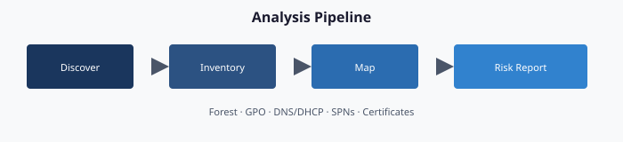

# Chapter 02 — Analyzing the Client/Server Estate

**Forest discovery, GPO inventory, DNS/DHCP scraping, Kerberos SPN audit, certificate-services analysis — read-only, least-privilege, provenance-bound**

## The assessment discipline




You cannot modernize what you have not enumerated. Every modernization begins with a **read-only, least-privilege, provenance-bound analysis** of the existing Client/Server estate. The output of this phase is a structured, versioned artifact set — one per dependency category — committed to the authoritative repository and consumed by every downstream chapter.

No writes. No guesses. No “we will handle that later.”

## The assessment problem

When an organization asks “what is in our Active Directory forest?” the honest answer is usually “more than anyone currently on the team knows.” Twenty-five years of organic growth have produced:

- Forests with trust relationships no one can fully map.
- Organizational-unit trees with orphan branches created for long-dismissed projects.
- Group Policy Objects whose authors left a decade ago and whose effects are unknown.
- Service accounts with service principal names pointed at applications no one operates.
- Certificate templates with permissions that silently enable privilege-escalation paths.[^cs02-entca]
- DNS zones with stale records that still resolve and still route.
- DHCP scopes whose reservations reference MAC addresses of machines that have been retired for years.

A successful modernization starts by producing the complete, structured, current-state picture. Not a best-effort inventory. Not a sample. The full, structured, attestation-grade record.

## Three design principles

The assessment layer enforces three principles that distinguish it from a general-purpose Active Directory scan.

### 1. Read-only by policy

Every assessment operation is constrained to read-only Active Directory rights. The service account has exactly the permissions it needs to read — and zero beyond that. No group memberships are changed, no Group Policy Objects are edited, and no password resets are issued. This is enforced at the account level (least-privilege delegation), at the code level (no write cmdlets imported), and at the audit level (every call logged with operation class).

The practical benefit: because the assessment makes no changes, it usually qualifies for a lighter, standard change process than a write operation would. Whether it needs a change record is the agency's configuration-management decision. Read-only is not an honor system; it is enforced at the account, code, and audit levels.

### 2. Least-privilege delegation

The assessment account needs forest-wide read rights to discover the full surface, but it does not need Domain Admin or Enterprise Admin. A properly delegated account achieves substantial coverage with a basic read-only profile and complete coverage with an expanded profile that adds Group Policy read, configuration-container read, DNS/DHCP read, and service-principal-name enumeration.

Two practical tiers:

- **Tier A (read-only)** — default. Limited Group Policy, certificate-template, and DNS/DHCP visibility without explicit added rights.
- **Tier B (read + enumerate)** — adds Group Policy read, certificate-template read, DNS/DHCP read, and Kerberos service-principal-name enumeration.[^cs02-gmsaad]

The tier is a governance decision. A common pattern is Tier B for the initial full assessment and Tier A for the continuous re-assessment cadence.

### 3. Provenance-bound output

Every assessment run produces a structured artifact set with required metadata:

- Who ran it (service principal or account)
- When (UTC timestamp)
- Against what (forest DNS name, domain FQDNs, domain controller that served the read)
- With what profile (Tier A / Tier B / custom)
- Producing what (hash of each output file)
- Committed where (repository branch, commit SHA)

A run without provenance is rejected by the engine.

## The eleven ingestion streams

The assessment layer produces one artifact stream per dependency category, mirroring the eleven types from Chapter 00. Each stream has its own normalized schema and its own committed location.

### Stream 1 — Forest + Domain topology
Captures forest functional level, domain trust relationships, site topology, domain-controller role assignments, replication intervals, FSMO holders, DNS integration mode, and related schema levels. Feeds identity strategy and migration-roadmap cutover gates.

### Stream 2 — Organizational-unit hierarchy
Captures every organizational unit, full distinguished name, parent-child relationships, linked Group Policy Objects, delegation access-control lists (if Tier B), and user + computer counts. Feeds attribute mapping and policy-linkage mapping.

### Stream 3 — Users
Captures every user object — UPN, samAccountName, distinguished name, enabled state, password last-set, last-logon, manager, group memberships, extension attributes, mail, employee identifier, department, office location, and (if populated) HR-system-sourced attributes. Feeds user migration and attribute-mapping plans. Production exports may redact identifiers according to data-handling rules.

### Stream 4 — Computers
Captures every computer object — distinguished name, DNS hostname, operating system, version, last password-set, service principal names, last-logon timestamp, trusted-for-delegation state, and supported encryption types. Feeds compute migration and risk scoring for stale or unconstrained-delegation hosts.

### Stream 5 — Service accounts + service principal names
Captures all accounts with populated servicePrincipalName values, grouped by likely application boundary; delegation targets; group managed service account status; and password-last-set gaps that indicate stale credentials. Feeds compute and application migration (Kerberos-bound applications need modern application-registration equivalents or a documented Kerberos island).

### Stream 6 — Security and distribution groups
Captures every group — distinguished name, samAccountName, group scope, type, members, member-of, and whether membership is static or rule-based. Feeds dynamic-group authoring from attribute rules.

### Stream 7 — Group Policy Objects (Tier B)
Captures every Group Policy Object — display name, GUID, link targets, security filtering, WMI filters, enabled state, Computer and User configuration settings (full export), and date of last modification per section. Feeds Group Policy to device-management mapping. This is typically the highest-complexity stream.

### Stream 8 — DNS zones + records (Tier B)
Captures all Active Directory-integrated DNS zones, non-integrated zones hosted on domain controllers, conditional forwarders, recursion settings, per-record TTL and last-update, and stale records whose owning computer object has aged out. Feeds services transformation.

### Stream 9 — DHCP scopes + reservations (Tier B)
Captures all DHCP servers, scopes, reservations, option sets, and failover relationships. Feeds services transformation.

### Stream 10 — Certificate services / PKI (Tier B; highest sensitivity)
Captures all certificate authorities in the forest (root and issuing), published certificate templates, template permissions (including privilege-escalation patterns), issued certificates matching high-value enhanced key usages, and CRL distribution health. Feeds certificate-based authentication migration and compliance findings.

### Stream 11 — LDAP bindings + Kerberos service-principal-name map
Captures every application that binds via LDAP/LDAPS or uses Kerberos service-principal-name-based authentication. Discovered via analysis of computer accounts, servicePrincipalName patterns, and (where available) application-server configuration. In practice, often a major source of modernization blockers.

## Python augmentation

PowerShell is excellent at Active Directory reads; it is less excellent at graph analysis. Every stream that produces relational data (organizational-unit hierarchy, Group Policy link graph, service-principal-name-to-application map, trust-relationship graph) is post-processed by a Python analyzer that produces:

- **Dependency graphs** — which organizational units inherit which Group Policy Objects; which applications depend on which service principal names.
- **Risk scores** — stale accounts, over-privileged delegation, privilege-escalation exposures.
- **Gap analysis reports** — organizational units with no linked Group Policy Objects, Group Policy Objects with no enabled settings, groups with zero members, computers that have not logged on within a stale threshold (for example, 90 days).

Python output lands in an analysis subfolder as JSON and Markdown reports consumable by both the engine and a human reviewer.

## Output format: one artifact set per run

Every assessment run produces the same folder layout, committed under `assessments/<run-id>/`. The run identifier is `YYYY-MM-DD-HHmm-<host>-<tier>` (UTC).

```
assessments/
└── 2026-04-24-1030-host-tierB/
    ├── provenance.yaml              ← who/what/when/hash
    ├── forest-topology.json
    ├── ou-hierarchy.json
    ├── users.jsonl
    ├── computers.jsonl
    ├── spn-inventory.json
    ├── groups.jsonl
    ├── gpos/
    │   ├── gpo-index.json
    │   └── {guid}.xml
    ├── dns-zones.json
    ├── dns-records.jsonl
    ├── dhcp-scopes.json
    ├── adcs/
    ├── ldap-bindings.jsonl
    ├── kerberos-spn-map.json
    └── analysis/
        ├── attribute-mapping.md
        ├── risk-scorecard.md
        ├── dependency-graph.json
        └── gap-findings.md
```

Every commit of this folder is signed and attributable. No assessment artifact lives outside the repository; no assessment run executes twice with the same run identifier.

## What happens next

The output of this chapter is the input to the next. The transformation engine takes the assessment folder, runs it through the plan generator, and produces a matched plan folder of deterministic transformation actions. The plan is reviewed, authorized, and then dispatched for delivery.

Assessment and planning are deliberately separate steps. An assessment without a plan is a report; a plan without an assessment is a guess. Only together do they produce governed modernization.


## Authoritative references

- Microsoft Learn, [What is the Certification Authority Role Service in Windows Server?](https://learn.microsoft.com/en-us/windows-server/identity/ad-cs/certification-authority-role)
- Microsoft Learn, [Introduction to Active Directory service accounts - Microsoft Entra](https://learn.microsoft.com/en-us/entra/architecture/service-accounts-on-premises)

---

**Previous:** [Chapter 01 — Platform Foundation](01-platform-foundation.md)  
**Next:** [Chapter 03 — Analysis → Plan → Delivery](03-analysis-plan-delivery.md)

[^cs02-entca]: Microsoft Learn, *What is the Certification Authority Role Service in Windows Server?*. Enterprise CAs use AD DS data and certificate templates to decide whether to issue; template permissions therefore determine who can obtain which certificates. <https://learn.microsoft.com/en-us/windows-server/identity/ad-cs/certification-authority-role>
[^cs02-gmsaad]: Microsoft Learn, *Introduction to Active Directory service accounts - Microsoft Entra*. <https://learn.microsoft.com/en-us/entra/architecture/service-accounts-on-premises>
