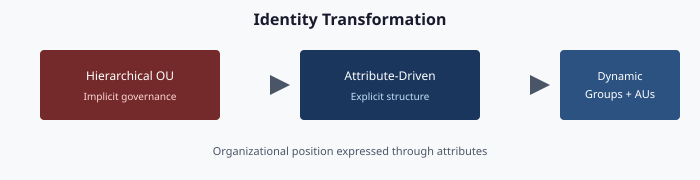

# Chapter 04 — Identity: Hierarchical Directory → Flat Cloud Identity + Attribute-Driven Structure

**How the organizational-unit tree becomes organizational attributes, dynamic groups, administrative units, and Conditional Access**

## The identity claim




The Active Directory organizational-unit tree was never just a folder structure. It encoded delegation, policy inheritance, operational accountability, and security scope in a single hierarchical graph. A flat cloud directory has none of that by default.

The attribute-driven structure reconstructs those governance properties inside a flat directory using four governed mechanisms — **organizational attributes**, **dynamic groups**, **administrative units**, and **Conditional Access targeting** — stitched together into one deterministic model.

This chapter describes how it works.

## The four mechanisms

Cloud identity platforms provide individually powerful tools. The framework uses them together to replace what the organizational-unit tree was doing.

| Mechanism | What it replaces |
|-----------|------------------|
| **Organizational attributes** | Organizational-unit placement |
| **Dynamic groups** | Organizational-unit-derived security groups |
| **Administrative units** | Organizational-unit-level delegation |
| **Conditional Access targeting** | Group Policy-based policy inheritance |

Each mechanism is individually documented by the platform vendor; the innovation is **the contract that binds them together** so that a single act (setting a user’s organizational attributes) produces consistent downstream effects (group membership, administrative-unit scope, policy targeting, license assignment, drift-detector visibility).

## Organizational attributes

Organizational position is carried in attributes on every governed user (and, where applicable, device and group) object.

### What the attributes drive

One stamped set of attributes drives five downstream outcomes:

1. **Dynamic group membership** — every user with a matching department attribute is in the corresponding dynamic group.
2. **Administrative unit scoping** — the administrative unit scopes on the same attributes; delegated administrators of that unit manage only those users.
3. **Conditional Access targeting** — policies include or exclude groups keyed to attribute values.
4. **License assignment** — group-based licensing flows from attribute-scoped dynamic groups.
5. **Drift detection** — every user’s attributes are validated against the HR-system source of truth.

One stamp. Five governance outcomes. Zero administrative-portal clicks to assign any of them.

## Dynamic groups — materializing every subtree

Active Directory computed “who is in the Finance branch?” by walking the organizational-unit tree. Cloud identity computes it by evaluating a dynamic-group rule against user attributes.

### The two query patterns

Every attribute-governed dynamic group uses one of two patterns.

**Pattern 1 — Node Query (exact).** Captures users at one specific place in the hierarchy and nowhere else. This is boolean attribute composition.

```
(user.extensionAttribute2 -eq "Finance") and (user.extensionAttribute3 -eq "GRC")
```

Produces: users in Finance/GRC exactly.

**Pattern 2 — Functional Query (cross-cutting).** Combines an organizational attribute with another attribute for a question that is not about hierarchy position at all.

```
(user.extensionAttribute2 -eq "IT") and (user.jobTitle -contains "Security")
```

Produces: every IT user whose title includes “Security,” in every region.

### Naming convention

Every governed dynamic group follows a consistent pattern, for example `Structure-[SCOPE]-[PURPOSE]`:

- `Structure-FIN-Users` — Finance users
- `Structure-IT-SEC-SOC-Users` — SOC analysts
- `Structure-HR-Licensed` — HR users targeted for specific licenses
- `Structure-EXEC-CA` — Executive users targeted by specific Conditional Access policies

Groups that do not match the pattern are orphan drift. The drift engine finds them; cleanup is escalated.

## Administrative units — the delegation replacement

Active Directory delegated organizational-unit-level administrative rights via access-control lists on the organizational-unit object. Cloud identity delegates via administrative units — named scopes that contain users, and against which roles can be assigned.

### The three-tier model

Administrative units are enumerated in a three-tier structure mirroring the organizational hierarchy:

| Tier | Scope | Pattern | Typical Roles |
|------|-------|---------|---------------|
| **Tier 1 — Enterprise** | All governed users | `AU-ORG-Enterprise` | Global Reader, Security Reader |
| **Tier 2 — Department** | All users in one department, in one region | `AU-[REGION]-[DEPT]` | User Administrator, Groups Administrator |
| **Tier 3 — Division** | Users in one division beneath that department | `AU-[REGION]-[DEPT]-[DIV]` | Helpdesk Administrator, Password Administrator |

The membership rule of each administrative unit is an exact mirror of the corresponding dynamic-group rule. An administrative unit contains exactly the same users as its matching dynamic group.

### Restricted management

Every governed administrative unit is created with member management restricted. That means the only way to manage members is via the governed workflow — by changing a user’s organizational attributes. A global administrator cannot hand-add a user to an administrative unit to bypass delegation. This preserves the property that organizational-unit access-control lists provided.

### Role assignments

Roles are scoped to administrative units, never granted tenant-wide except for break-glass accounts. The assignment pattern:

```
role:        User Administrator
principal:   Structure-NCR-Finance-Admins    ← a dynamic group
scope:       /administrativeUnits/AU-NCR-Finance
```

A member of the administrators group can reset passwords, create groups, and manage users — but only for users in that administrative unit. Outside that scope, the role has no effect.

The full role matrix is stored in the authoritative repository. Changes require review; validation ensures new assignments respect least-privilege and tier-boundary rules.

## Conditional Access — policy inheritance replacement

Group Policy Objects inherited down the organizational-unit tree. Conditional Access policies target groups. The bridge: attribute-scoped dynamic groups that match the inheritance pattern.

Example: a Group Policy Object that applied at a regional organizational unit configured lockout policies for all users in that region. The Conditional Access equivalent is a policy targeting a region-scoped dynamic group whose rule is the region attribute alone. Users in that region get the policy; everyone else does not.

Inheritance is simulated by group targeting at the branch level. Conditional Access does not inherit through administrative units the way Group Policy inherited through organizational units; the governance model makes up the difference by having the branch group include everyone the ancestor policy would have targeted.

## HR-driven lifecycle (joiner / mover / leaver)

Organizational attributes are not a thing administrators maintain. They are driven by the HR system. The lifecycle is:

### Joiner

1. The HR system creates the employee record with organizational unit, department, location, and manager.
2. HR-to-cloud provisioning populates the standard attributes.
3. A governed workflow computes the organizational attributes from HR attributes according to the mapping rules and writes them.
4. Dynamic groups recompute membership within the platform cadence.
5. The user is now an administrative-unit member, Conditional-Access-scoped, group-licensed, and visible to the drift engine — all automatically.

### Mover

The employee’s HR record moves them from one division to another. The same workflow runs; the relevant attribute updates; every downstream group, administrative unit, Conditional Access scope, and license assignment follows automatically. No hand edits; no ticket; no drift window.

### Leaver

Termination writes a leaver attribute that the workflow catches; the organizational attributes are cleared; dynamic groups evict; administrative-unit membership drops; Conditional Access scope drops; license drops. Provenance points to the HR event that triggered it.

Every lifecycle workflow (joiner, mover, leaver, re-hire, contractor onboard, executive provision, emergency deprovision, name change, reorganization) is enumerated with its triggers, inputs, outputs, and exception paths. There are no undocumented identity workflows.

## Drift categories

The drift detection engine classifies identity findings into categories such as:

| Category | Example |
|----------|---------|
| **Value Drift** | HR says Division GRC; the user’s attribute says Data |
| **Orphan Drift** | A security group exists that is not in the governed library |

Every drift finding opens a tracked item with defined response expectations.

## Migration phases

Moving an existing forest into the attribute-driven model is a phased runbook, not a flag-day cutover.

### Phase 0 — Assessment
Chapter 02’s assessment run.

### Phase 1 — Authoring
Dynamic-group rules and administrative units are authored, reviewed, and committed.

### Phase 2 — Pilot division
Pick one division, compute its attribute mappings, stage the transformation plan, authorize, deliver. Validate. Any drift is fixed before moving on.

### Phase 3 — Division-by-division rollout
Each division gets its own plan, its own review, its own delivery. No division is rolled out until the previous one’s drift findings are zero.

### Phase 4 — Legacy retirement
Once every user has organizational attributes and every organizational unit has a dynamic-group equivalent, the organizational-unit-based security groups and legacy Group Policy Objects are retired in a governed deprecation pass. This is the only destructive phase; it requires explicit approval per item.

### Phase 5 — Steady state
The daily assessment produces zero-action plans. The drift engine reports green. The forest itself may remain (for DNS, DHCP, Kerberos-bound legacy applications) but is no longer the governance model.

## Verification

Migration passes when:

- Every HR-listed employee has valid organizational attributes.
- Every dynamic group matches one of the two patterns.
- Every administrative unit’s membership rule mirrors its dynamic group’s rule.
- Every Conditional Access policy targets only governed groups.
- Drift detection reports zero findings.
- The nightly assessment-to-plan run produces a zero-action plan.

Only when every box is ticked is the tenant in steady state.

## What this buys

The tangible outcomes, once the attribute-driven structure is in place:

- **Delegation is provable.** Audit questions such as “who can manage Finance users?” have a literal answer in the role matrix.
- **Reorganizations are cheap.** A division name change propagates through dynamic groups and administrative units in one reviewed change.
- **Access reviews have structure.** Reviewers see governed groups with clear scope semantics.
- **Compliance queries are cacheable.** “Who has access to sensitive resources?” is a dynamic-group query, not a spreadsheet reconciliation.
- **Drift is visible before audit.** Findings are tracked long before they reach an external assessor.

---

**Previous:** [Chapter 03 — Analysis → Plan → Delivery](03-analysis-plan-delivery.md)  
**Next:** Chapter 05 — Policy Transformation
