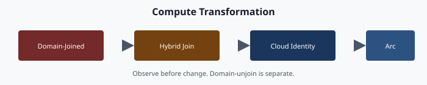

# Chapter 07 — Compute: Domain-Joined → Cloud Identity + Device Management + Hybrid Management

**Device object transformation · PCs to cloud identity + device management · servers to hybrid management · service principal and Kerberos retirement**

## The compute claim

Compute objects — domain-joined PCs and servers — are the single largest remaining Active Directory dependency once identity (Chapter 04), policy (Chapter 05), and services (Chapter 06) have moved. PCs retire into cloud-joined + device management. Servers retire into hybrid management + guest configuration. Kerberos-bound applications lose their domain-join anchor and migrate to modern authentication or are retired.

This chapter ends at “no device authenticates to Active Directory.” That is the final precondition for Active Directory Domain Services retirement.

## The device states

The device-join model has several states. Understanding them is the precondition for planning any compute migration.

| State | Primary auth | Managed by | When to use |
|-------|--------------|------------|-------------|
| **Domain-Joined** (legacy) | Active Directory Kerberos | Group Policy | Legacy — migration origin |
| **Entra registered** | Personal device with a work account added | Device management (optional) | Bring-your-own-device; rarely used in regulated environments |
| **Hybrid-joined** | Both Active Directory + cloud identity (simultaneous) | Group Policy + device management | Transition state — not a target |
| **Entra joined** (cloud-joined) | Cloud identity only | Device management | Target for user PCs |
| **Arc-connected server** | Local or domain logon unchanged; system-assigned managed identity for Azure-plane operations | Azure Arc + Azure Policy machine configuration | Target for servers |

Two architectural rules apply:

1. **Hybrid-joined is a transition, not a destination.** Every hybrid-joined device is a device whose modernization has begun but not finished. A modernization that leaves devices hybrid-joined permanently has not completed.
2. **The target depends on the device class.** User PCs go to cloud-joined + device management. Servers (Windows and Linux) go to hybrid management + guest configuration. These are distinct target states; they share compliance telemetry but not the management model.

## The device migration problem

Every domain-joined device has three Active Directory dependencies that must be resolved before domain-unjoin:

- **Identity.** The device object authenticates to Active Directory via Kerberos. Its computer account is in an organizational unit; Group Policy applies through that unit.
- **Policy.** Device configuration — local administrators, registry settings, software deployment, startup scripts — arrives via Group Policy.
- **Trust.** The device’s certificate store trusts Active Directory-issued certificate authorities; its smart-card logon chain relies on Active Directory Certificate Services; its network access control may use Active Directory credentials.

For each of those dependencies, a modernization must land a replacement before the domain-unjoin. Otherwise the device ships with a policy gap, a trust gap, or both.

## Three migration patterns for user PCs

### Pattern 1 — Greenfield (enrollment from the start)

The lowest-risk pattern. New hardware is shipped directly from the OEM with pre-registration. The first boot is a cloud-joined enrollment; no domain-join happens. No Active Directory dependency is created.

This is the pattern to push toward for any hardware refresh: new PCs are greenfield regardless of whether the fleet modernization is in progress.

### Pattern 2 — Reset-and-re-enroll

For existing domain-joined devices, the cleanest path is to back up user state, reset the device, and re-enroll. Post-reset the device is cloud-joined from the start.

This is operationally heavy for the user (loss of local customization unless synchronization is working), but technically clean. Many organizations run this pattern for high-privilege user devices where leaving any legacy Active Directory trust is unacceptable.

### Pattern 3 — Hybrid-then-cloud

For fleets where an immediate reset is not operationally feasible, devices are first hybrid-joined (both Active Directory and cloud identity). Over a planned period, workloads move from Group Policy to device management. There is no supported in-place conversion from hybrid join to Entra join, so the final step is still a reset and Autopilot re-provisioning (or a third-party migration tool), timed to the device's refresh or a scheduled window.

This is the common transition. It is the slowest of the three and defers, rather than avoids, the reset. Drift detection monitors every step so a device does not get stuck hybrid-joined forever.

## Servers — the hybrid management path

Windows and Linux servers do not go through the same device-management path as user PCs. They go through hybrid management.

### What hybrid management does

Hybrid management projects an on-premises (or other-cloud) server into the cloud as a resource. The server appears in a cloud subscription; it gets a system-assigned managed identity for Azure-plane operations (its operating-system logon is unchanged); it can receive policy and guest-configuration assignments; it appears in security and monitoring services; it is governed the same way a native cloud virtual machine is governed.

Critically, hybrid management does not require the server to be in the cloud. The server stays where it lives physically. Hybrid management is the governance projection; the physical host is unchanged.

### Attribute-scoped hybrid governance

Every hybrid-projected server is tagged with its organizational attributes. Cloud policy and guest configuration assignments target those tags. This is the same pattern as device management for user devices — policy follows attributes.

### Server migration sequence

For each domain-joined server:

1. **Arc-connect.** Install the Connected Machine agent; register; apply organizational tags.
2. **Onboard security and compliance reporting.** Defender for Servers and Azure Policy machine configuration report the server's posture. (Conditional Access governs user and workload sign-ins to Entra-protected resources; it does not evaluate server compliance for server-to-server traffic.)
3. **Assign policy / guest configuration.** Settings that previously came from Group Policy now come from hybrid management.
4. **Validate.** Guest configuration reports compliant; expected settings present; drift engine reports zero.
5. **Domain-unjoin.** Only once all legacy Active Directory dependencies are resolved (all Kerberos-bound clients migrated, no Active Directory-anchored local administrators).
6. **Post-unjoin validation.** Server reboots clean; hybrid heartbeat continues; guest configuration re-applies without Active Directory.

Duration depends mainly on the Kerberos-application inventory; budget it per application, not per server.

## Kerberos and service principal name retirement

Every Active Directory-joined server has an entry in the Kerberos service principal name map (Chapter 02). Each service principal name represents an application or service that expects to be reached via Kerberos authentication. For each one, the modernization needs a decision:

- **Migrate the application to modern authentication.** OAuth2 / OpenID Connect via cloud application registration. This is the preferred path.
- **Retire the application.** If the application is legacy and due for end-of-life, this may be the cheapest option.
- **Keep the application on a Kerberos island.** Last resort — retain a minimal Active Directory island hosting only the Kerberos-bound application, with a documented end-of-life date.

The service-principal-name-to-application mapping determines the sequence: no server can domain-unjoin until every service principal name on that server has been resolved (migrated, retired, or islanded).

## Organizational attributes on devices

User devices carry organizational attributes just like users (for devices, typically through device extension attributes set via Microsoft Graph, or through rules on properties such as the enrollment profile). This drives:

- **Device dynamic groups.** Attribute queries capture devices in a given organizational segment.
- **Device-management compliance scoping.** Attribute-scoped groups are the target for segment-specific compliance policies.
- **Conditional Access device-state targeting.** Policies that require a compliant device can be scoped per attribute value.

Drift detection monitors device attributes the same way it monitors user attributes — if the device’s attributes disagree with its owning user’s attributes, that is value drift.

## Certificate-based authentication

When domain-joined PCs go away, smart-card logon anchored in Active Directory Certificate Services goes with them. The replacement is cloud certificate-based authentication.

Microsoft Entra certificate-based authentication accepts certificates issued by a certificate authority in the tenant's trust store and authenticates the user to Entra ID. Windows smart-card sign-in to Entra-joined devices keeps working; the chain just ends in Entra ID instead of Active Directory. The prerequisites are a smart-card reader and a valid user certificate whose binding to the user is configured (Chapter 08). Access from Entra-joined devices to remaining on-premises Kerberos resources continues to depend on AD until those resources are retired.

## Lifecycle — enrollment and the device-reset pattern

Once the compute fleet is cloud-joined, device lifecycle becomes simpler:

- **Joiner.** Enrollment deploys directly from OEM shipping; the user signs in with their cloud identity; the device is compliance-enrolled; Conditional Access policies apply; applications install from device management; encryption keys are escrowed.
- **Mover.** The user’s organizational attributes change; device dynamic groups recompute; device-management policy re-applies.
- **Leaver.** The device is retired or repurposed via device management. If retired, the cloud object is deleted; if repurposed, the device is reset and picks up a new user’s policies on next sign-in.

No organizational-unit move, no domain-unjoin, no manual Group Policy re-link, no Active Directory cleanup. Device lifecycle is policy, not infrastructure.

## Validation

Compute migration passes when:

- Every user PC is cloud-joined (not hybrid-joined, not domain-joined).
- Every server is hybrid-connected (or documented as exempt with a retirement schedule).
- Every device has valid organizational attributes.
- Every device-management compliance policy targets attribute-scoped groups.
- Every cloud policy / guest configuration targets attribute tags.
- Every service principal name in the legacy map has been resolved (migrated, retired, or islanded with a documented end-of-life).
- Drift detection reports zero device drift for a defined period.
- The nightly assessment-to-plan run produces a zero-action plan for the compute tree.

The last box is the precondition for Active Directory Domain Services retirement. Until every compute object passes, Active Directory cannot go away.

## The last thing Active Directory did

When every device has moved, every application has migrated, every DNS zone is out, every DHCP scope is re-homed, every Kerberos service principal name is resolved, and every Group Policy Object is retired — Active Directory Domain Services has no active consumers.

This is the moment to shut it down.

The actual retirement is mechanical: demote every domain controller, decommission the supporting virtual machines, delete the forest objects. The hard part is the governance transformation that precedes it — every chapter from 04 through 07 of this series.

Chapter 08 wraps the remaining access-plane details. Chapter 09 presents the phased program plan that sequences everything. Chapter 10 frames the executive takeaway.

---

**Previous:** [Chapter 06 — Network Services](06-network-services.md)  
**Next:** [Chapter 08 — Access Plane](08-access-plane.md)
