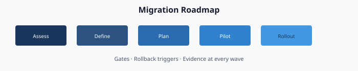

# Chapter 09 — Migration Roadmap: Phased Plan, Gates, Rollback

**Seven phases, five parallel workstreams, named gates, deterministic rollback**

## The program claim

Every modernization this series describes is achievable in a **fifty-two-week program** with five parallel workstreams (identity, policy, services, compute, access) and seven named gates. The roadmap is a reviewable document in the authoritative repository, updated on a regular cadence, with gate criteria that are mechanical to evaluate.

This chapter is how you sequence the work of Chapters 01–08 into a governed program that actually ships.

## The program shape

A full Client-Server-to-Hybrid-Cloud modernization has two defining properties:

1. **Parallel, not sequential.** Identity, policy, services, compute, and access work in parallel streams. Waiting for one to finish before starting the next doubles the program duration and produces worse outcomes.
2. **Gated, not open-ended.** Each phase has explicit entry and exit criteria. A phase cannot start until the prior phase’s exit gate clears. A phase cannot exit until its own criteria are green.

Total realistic duration for a mid-size organization (five thousand to fifty thousand users, five hundred to five thousand servers): approximately fifty-two weeks. Larger organizations extend; smaller organizations compress. The phase structure does not change with scale — only the per-phase duration does.

## The seven phases

### Phase 0 — Pre-flight (weeks 1–4)

**Goal.** Produce the planning artifacts and stand up the platform host.

Entry criteria:
- Executive sponsor named.
- Steward appointed.
- Platform-host hardware or virtual machine provisioned.
- Active Directory read-only service account delegated.

Work in Phase 0:
- Build the platform host (Chapter 01).
- Run the assessment (Chapter 02).
- Stand up the authoritative repository with baseline files.
- Confirm cloud identity, device management, and hybrid management access with least-privilege service principals.

Exit gate (Gate G0 — Ready to Plan):
- Platform host operational.
- Assessment run committed to the repository.
- No open priority-one findings from the assessment.

### Phase 1 — Foundation (weeks 5–8)

**Goal.** Put identity-substrate primitives in place before anything else moves.

Workstream outputs:
- **Identity.** Dynamic groups for enterprise-level branches. Administrative units for Tier-1 and selected Tier-2 scopes.
- **Policy.** Enterprise Conditional Access baseline: multi-factor authentication required for all users, legacy authentication blocked, break-glass carve-outs.
- **Services.** IP address management stood up with partial coverage — enough to tag the platform host and Tier-0 infrastructure.
- **Compute.** Platform host cloud-registered; select server pilots hybrid-connected.
- **Access.** Platform single sign-on configured; FIDO2 registration available for Tier-0 administrators.

Exit gate (Gate G1 — Foundation Complete):
- Enterprise dynamic groups and administrative units created and drift-clean.
- Enterprise baseline Conditional Access enforced; no multi-factor-authentication-exempt users.
- IP address management covers at least Tier-0 infrastructure.
- Drift detection reports zero findings across the foundation scope.
- Break-glass accounts vaulted.

### Phase 2 — Pilot Division (weeks 9–16)

**Goal.** Run one division through the full transformation as a learning exercise, proving the pattern before general rollout.

Typical pilot division: IT (highest tolerance for disruption, most engaged with modernization).

Workstream outputs for the pilot:
- **Identity.** Pilot division organizational attributes fully populated; dynamic groups live; administrative units scoped; role assignments delegated.
- **Policy.** Division-scoped Conditional Access and device-management policies applied. Several Group Policy Objects retired.
- **Services.** Pilot division DNS zones migrated. DHCP scopes re-homed. IP address management populated for the division address space.
- **Compute.** Pilot PCs transition (greenfield for new hardware; reset-and-re-enroll for refreshable legacy; hybrid for the rest). Pilot servers hybrid-connected.
- **Access.** Division users configured for certificate-based authentication where smart-card holders exist; SASE zero-trust network access in place for division applications.

Exit gate (Gate G2 — Pilot Clean):
- Pilot division drift zero for fourteen consecutive days.
- Pilot division has zero Active Directory-only users and zero hybrid-joined PCs that are not scheduled for full cut.
- Retrospective complete; lessons-learned document committed.
- Per-phase runbook updates committed based on pilot experience.

### Phase 3 — General Rollout (weeks 17–36)

**Goal.** Scale the pattern to every remaining division.

This is the longest phase. Duration scales with division count: budget approximately two to three weeks per division, running two to three divisions in parallel. Large organizations may overlap divisions heavily; small organizations may run strictly sequentially.

Workstream cadence:
- Weekly steering-committee review of active divisions. Each division reports green/yellow/red against its rollout plan.
- Per division — four-phase sub-pattern: plan, pilot within division, general availability to the full division, drift-clean hold.
- Parallel — Chapters 04–08 content flows for each division concurrently; the authoritative source is shared.

Exit gate (Gate G3 — Rollout Complete):
- Every in-scope division has passed its division-level exit gate.
- Every HR-listed employee has valid organizational attributes.
- Every user PC is cloud-joined or in a documented exception.
- Every server is hybrid-connected or in a documented exception.
- Drift detection reports zero cross-division drift.

### Phase 4 — Legacy Retirement (weeks 37–44)

**Goal.** Systematically retire legacy infrastructure: Group Policy Objects, organizational-unit security groups, Active Directory-integrated DNS, Active Directory-joined DHCP, Active Directory Certificate Services smart-card logon configuration, service-principal-name-bound legacy applications.

Retirement is governed: each artifact has a retirement plan with its own entry and exit criteria, and the retirement action is a plan-stage action with explicit steward approval.

Retirement sequence (typical):
1. Retire redundant Group Policy Objects (migrated to device management).
2. Retire organizational-unit-based security groups (membership superseded by dynamic groups).
3. Retire Active Directory-integrated DNS zones one at a time.
4. Retire Active Directory-joined DHCP authority.
5. Retire Active Directory Certificate Services smart-card logon Group Policy configuration.
6. Retire remaining Active Directory-bound service principal names (application by application).

Exit gate (Gate G4 — Legacy Quiet):
- No active Group Policy Objects other than the minimum Kerberos-island set.
- No Active Directory-based dynamic or static-membership security groups in active use.
- Zero Active Directory-integrated DNS zones.
- Certificate services retained only for issuance, not for smart-card logon.
- Service principal name map shows all migrated, retired, or islanded — no unresolved names.
- Active Directory authentication rate less than five percent of the peak-migration rate.

### Phase 5 — Active Directory Domain Services Retirement (weeks 45–48)

**Goal.** Shut down Active Directory Domain Services.

This is the shortest phase of the program because the work was done in Phases 0–4. Phase 5 is the mechanical teardown.

Sequence:
1. Freeze Active Directory changes.
2. Final forest assessment and evidence packet.
3. Demote non-FSMO domain controllers.
4. Transfer FSMO roles to the designated survivor (if any — some organizations retain a Kerberos island).
5. Demote remaining domain controllers (or isolate if a Kerberos island is retained).
6. Decommission virtual machines and retire forest objects in backup.
7. Final provenance commit: forest retired on a given date per evidence packet.

Exit gate (Gate G5 — Active Directory Retired):
- Domain controllers decommissioned or explicitly retained as a documented Kerberos island.
- Evidence packet committed to the repository and security information and event management.
- No live production dependency on Active Directory authentication.

### Phase 6 — Steady State (week 49+)

> **Calibration:** The week-49 retirement is illustrative. Real programs with large estates run multi-year. Treat the timeline as a sequencing model, not a schedule.

**Goal.** Operate the modernized environment under governed control.

Steady state is the permanent post-modernization state. It has properties:

- Assessments run on a regular cadence (Chapter 02).
- Plans generated and authorized on change-driven and scheduled cadences (Chapter 03).
- Drift detected and resolved within defined response expectations.
- Evidence packets emitted per delivery.
- Continuous monitoring feeds compliance reporting.
- Changes flow via reviewed pull request.

Exit criteria: none. Phase 6 continues indefinitely. Periodic retrospectives confirm the authoritative source matches organizational intent.

## The five parallel workstreams

During Phases 2–4, five workstreams run in parallel with explicit coordination points:

| Workstream | Lead | Chapter | Key artifacts |
|------------|------|---------|---------------|
| **Identity** | Identity Architect | 04 | Dynamic groups, administrative units |
| **Policy** | Security Engineer | 05 | Device-management configs, Conditional Access policies, hybrid guest configuration |
| **Services** | Network Engineer | 06 | DNS, DHCP, IP address management adapters |
| **Compute** | Endpoint Admin + Server Engineer | 07 | Device enrollments, hybrid projections |
| **Access** | Identity + Security jointly | 08 | SASE, certificate-based authentication, privileged access management, multi-factor authentication |

Workstreams are not independent. Every week, a cross-workstream sync identifies the per-division blockers and resequences work where dependencies exist (for example, compute migration cannot proceed in a division until its Conditional Access policies are in place).

## Gate criteria — mechanical, not subjective

Every gate criterion in this chapter is mechanically evaluable from the authoritative repository and drift-detection reports. Examples:

- “Zero drift for fourteen consecutive days” → drift report filtered by scope and date range.
- “Every HR-listed employee has valid organizational attributes” → query against the canonical user table.
- “Every user PC is cloud-joined” → device inventory query.

Gates are never passed on executive signature alone. The engine reports green; the steward concurs; the pull request merges. A gate that the engine cannot evaluate is a gate that needs a better criterion.

## Rollback triggers

Every phase has defined rollback triggers — conditions that halt progress and revert to the prior phase’s state. Triggers are not subjective; they are thresholded.

| Trigger | Scope | Action |
|---------|-------|--------|
| Drift above threshold for more than twenty-four hours | Phase-wide | Halt phase; investigate; no new deliveries until clean |
| Conditional Access policy blocks more than a defined percentage of legitimate sign-ins | Enterprise | Revert policy; investigate; authorize replacement |
| Drift detection itself fails to report | Platform | Escalate; halt all phase work |
| Evidence packet fails signature validation | Any delivery | Halt; forensic investigation; restore from last known-good |
| Service-level-agreement breach on priority-one finding | Any scope | Escalate; steward and sponsor notified |

Rollback is operationally expensive, so the gate design is meant to prevent the need for it. Pilot phases catch what would otherwise become rollback events later.

## Decision authority at each gate

Not every gate is a steward decision. The program defines decision authority per gate:

| Gate | Authority | Backup |
|------|-----------|--------|
| G0 — Ready to Plan | Steward | Executive Sponsor |
| G1 — Foundation Complete | Steward | — |
| G2 — Pilot Clean | Steward + Executive Sponsor | — |
| G3 — Rollout Complete | Executive Sponsor + Steering Committee | — |
| G4 — Legacy Quiet | Steward | Executive Sponsor |
| G5 — Active Directory Retired | Executive Sponsor + CIO | — |
| Division-level exit | Division Lead + Steward | — |

Gate authority is recorded in the pull request that merges the gate decision.

## Common failure modes

Five failure modes recur. The structure is designed to pre-empt each:

1. **Half-finished identity.** Pattern: rollout begins, a portion of users have organizational attributes, the HR connector breaks, the project stalls. Mitigation: Gate G1 requires the HR connector operational before rollout.
2. **Unscoped Conditional Access policy.** Pattern: broad “require multi-factor authentication” policy deployed; edge cases block operationally critical sign-ins. Mitigation: attribute-scoped and pilot-group-first pattern.
3. **DNS left for “phase 2.”** Pattern: identity moves, DNS stays Active Directory-integrated, Active Directory cannot actually retire. Mitigation: DNS, DHCP, and IP address management migrate together.
4. **Hybrid-joined permanence.** Pattern: devices become hybrid-joined and stay that way indefinitely. Mitigation: hybrid join is a transition state, with drift detection monitoring of time-in-state.
5. **Evidence-less migration.** Pattern: changes happen via ad-hoc administrative actions; an assessment cannot produce provenance. Mitigation: plan-based delivery — every change has provenance by construction.

## The week-by-week cadence

For the steering committee, the cadence is:

- **Monday** — workstream leads update status (green/yellow/red).
- **Tuesday** — cross-workstream dependency sync.
- **Wednesday** — changes and plan reviews merge to the repository.
- **Thursday** — plan deliveries scheduled (typically off-peak).
- **Friday** — evidence packet and drift-detection review; retrospective on the week.

Monthly: gate-criterion reviews against the phase schedule. Red status across two consecutive weeks escalates to the executive sponsor.

## What finishing looks like

In week forty-nine (Phase 6 steady state), the program meeting looks like this:

- Drift-detection report: zero findings.
- Nightly plan run: zero actions.
- Evidence packets: fully signed, shipped to security information and event management and continuous monitoring.
- Tickets: routine operational only; no priority-one findings.
- Audit posture: authorization package refreshed; continuous-monitoring feed live.
- Authoritative source: stable, with changes flowing through reviewed pull requests.

The program is not “done” — steady state is the operational mode — but the modernization is complete. The organization runs governed; Active Directory is gone; the authoritative source is the operational truth.

---

**Previous:** [Chapter 08 — Access Plane](08-access-plane.md)  
**Next:** [Chapter 10 — Leadership Takeaway](10-leadership-takeaway.md)
