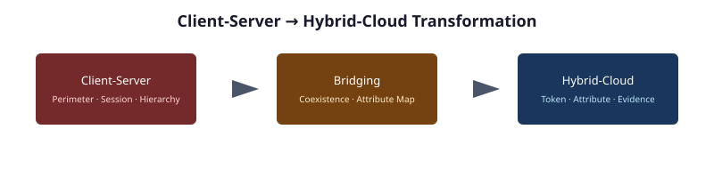

# Microsoft Client-Server to Hybrid-Cloud Transformation

**AD, GPO, DNS, DHCP, Kerberos, and PKI → Entra ID, Intune, Azure Arc, IPAM, SASE, and Zero Trust**

An eleven-chapter narrative covering the end-to-end transformation from a Client/Server-era Active Directory forest through analysis, planning, and delivery to a governed Hybrid-Cloud estate.

## Why this series exists

Most modernization guides answer narrow questions. This series answers the large one: *We have an AD forest. Where are we going, how do we get there, and what does the finished state look like?*

## The arc

The series follows a five-part, eleven-chapter path:

### Part I · Platform
- **[00 — The Problem: AD’s Hidden Governance Surface](00-the-problem.md)** — Why AD modernization fails when the focus is only users and groups.
- **01 — Platform Foundation** — A single Windows Server 2025 host that can read the legacy estate and write to cloud targets (IIS, version control, Kerberos bridge, enterprise PKI, automation).

### Part II · Transformation Engine
- **02 — Analyzing the Client/Server Estate** — Forest discovery, GPO inventory, DNS/DHCP scraping, Kerberos SPN audit, certificate services analysis.
- **03 — Analysis → Plan → Delivery** — Turning assessment output into a deterministic transformation plan, validating it, and delivering it under controlled change.

### Part III · Target Delivery
- **04 — Identity: Hierarchical Directory → Flat Cloud Identity + Attribute-Driven Structure** — Reconstructing organizational hierarchy, dynamic groups, administrative units, and HR-driven lifecycle.
- **05 — Policy: GPO → Intune + Conditional Access** — Device policy, compliance, configuration profiles, MFA, and policy targeting.
- **06 — Services: DNS, DHCP, IPAM in Hybrid Cloud** — AD-integrated DNS → private resolution; AD DHCP → governed IP address management.
- **07 — Compute: Domain-Joined → Cloud Identity + Device Management + Arc** — Device object transformation, hybrid join, Arc-projected servers.

### Part IV · Hybrid Access Plane
- **08 — SASE, Zero Trust, MFA, Certificate-Based Auth** — The identity-bound access plane that replaces the AD perimeter.

### Part V · Program
- **09 — Migration Roadmap** — Phased plan, gates, rollback triggers, cutover.
- **10 — Leadership Takeaway** — Instruments versus orchestra: what the framework is and how to evaluate it.

## How to read this series

| Audience | Recommended path |
|----------|------------------|
| CIO / CISO / program sponsor | 00 → 10 → 09 |
| Identity architect | 00 → 04 → 05 → 08 |
| Infrastructure architect | 00 → 01 → 06 → 07 |
| Modernization program manager | 00 → 03 → 09 |
| Platform engineer | 01 → 02 → 03 |

## Source note

This series is a cleaned extraction of the original Client-Server to Hybrid-Cloud narrative. Branding, internal architectural decision records, document identifiers, and substrate-specific references have been removed so the material can be used directly as modernization project guidance.
