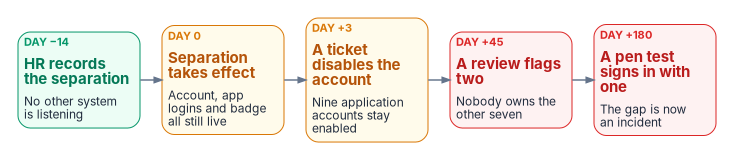

# Chapter 01 — Why HR Is the Source of Authority

*A token proves that an assertion was signed. It can't prove the assertion describes a real, current employee with a real, current role.*

::: {.callout-note}
## In this chapter
Where identity truth lives today and why it contradicts itself. Why accurate employee data matters more under Zero Trust and SASE than it ever did. Why orphaned accounts are the guaranteed output of that design rather than an operational lapse. The federal policy and guidance that support authoritative sources and governed lineage. Why cleanup, directory mastery, and reviews can't substitute for one. What HR provides and what identity architecture has to add.
:::

## What the claims in a token assert

An access token carries claims: an identifier, group memberships, role assignments. Those claims are projections of upstream facts. This person is employed; this person holds this position; this person reports to this supervisor; this person's affiliation ended on this date. If the upstream facts are stale, scattered, or unrecorded, the whole cryptographic apparatus notarizes fiction.

## The fragmented truth problem

### Where identity truth lives today

Ask a federal estate three questions — *who works here, what do they do, and who do they report to* — and no single system answers. The answers are distributed across:

- **Regional Active Directory OU trees**, each built when compute was regional, each drifted through decades of reorganizations, ad-hoc container moves, and administrator judgment calls. The OU estate was originally a downstream projection of organizational truth; nobody maintained the projection, and the source it projected was never machine-readable to begin with.
- **Per-system account stores.** Every application old enough to predate federation keeps its own user table: database logins, mainframe RACF profiles, contact-center agent rosters, badge systems. Each is a private, unsynchronized opinion about who exists.
- **Spreadsheets and email.** The onboarding tracker, the contractor roster, the separation checklist — operational documents that carry authoritative-grade decisions (who gets an account, when access ends) with none of the properties of an authoritative source: no schema, no lineage, no events, no audit.
- **Drawings.** The organizational chart itself lives in Visio and briefing slides. It is read by humans, cited in memos, and queryable by absolutely no policy engine anywhere in the enterprise.

Each fragment is *locally* maintained and *globally* wrong. The regional OU tree knows an account exists but not whether its owner is still employed. The application user table knows a login works but not what position justified it. The spreadsheet knows a contractor started but is a copy the moment it is saved. Fragmented truth is not partial truth — it is contradiction with no arbiter, because no fragment is designated to win.

### The visible symptom: orphaned accounts

The measurable consequence is the orphaned account: an enabled credential whose human justification has ended. Every audit finds them; every remediation sweep removes a batch; every year they return — because sweeps treat the symptom. An orphaned account is not an administrator's mistake. It is the *structurally guaranteed output* of an architecture in which the system that knows a person left (HR) and the systems that must act on it (directory, applications, badge, VPN, database) share no event channel. The information exists on day zero; it arrives — by ticket, by email, by quarterly review, or by audit finding — days to months later, or never. No amount of process discipline closes a gap whose cause is the absence of a wire.

The anatomy is worth one concrete timeline, because it shows *where the information is* at every point during the gap:

{fig-alt="Five boxes left to right. Day minus 14, green: HR records the separation; no other system is listening. Day 0, amber: separation takes effect; account, app logins and badge all still live. Day plus 3, amber: a ticket disables the account; nine application accounts stay enabled. Day plus 45, red: a review flags two; nobody owns the other seven. Day plus 180, red: a pen test signs in with one; the gap is now an incident."}

| Day | What the HR System Knows | What the Fragments Know | Exposure |
|---|---|---|---|
| −14 | Separation recorded, effective day 0 | Nothing — no fragment subscribes to HR events | None yet; the fact exists and is actionable |
| 0 | Separation effective | Directory: account enabled. Applications: logins valid. Badge: active | Credentials of a former worker are fully live |
| +3 | Unchanged | Supervisor emails a ticket; the directory account is disabled; nine application accounts are not | Partial: the fragments deprovision independently, in whatever order tickets are worked |
| +45 | Unchanged | A quarterly review flags two of the nine; nobody is sure who owns the rest | The finding is now aging toward an audit |
| +180 | Unchanged | A penetration test authenticates to a case system with an orphaned service-desk account | The gap is now an incident narrative |

: The orphan timeline — the fact exists on day −14; the fragments learn it by accident {.striped .hover}

Nothing in that timeline is a failure of diligence. It is the *wiring diagram working as built*: a system that records the truth, five systems that need it, and no channel between them. The same anatomy produces the quieter failures: the transferred employee who keeps the old division's access for years (the access-accretion problem PS-5 exists to stop), the contractor converted to staff who now has two identities, the rehired annuitant with three.

## Why the agency needs HR-driven ICAM now

For most of the directory era, the network decided access: a user inside the perimeter reached what the perimeter allowed, and a wrong department or a stale manager produced a wrong phone-book entry. Federal direction has moved the decision off the network and onto identity, in three layers:

- **Zero Trust is the strategy.** OMB M-22-09 sets the federal Zero Trust strategy: centralized identity management for agency staff, phishing-resistant multifactor authentication, and authorization that evaluates each request rather than trusting the network it came from.[^c01-m2209] NIST SP 800-207 describes the architecture — access granted per session by a policy engine, using dynamic policy that includes the client's identity and the attributes the enterprise assigns to it[^c01-sp800207] — and CISA's Zero Trust Maturity Model makes identity its first pillar, defining an identity as an attribute or set of attributes that uniquely describes a user.[^c01-ztmm]
- **SASE delivers it.** Secure Access Service Edge (SASE) is the delivery model that implements Zero Trust at the network edge: security services, including Zero Trust network access, delivered from a cloud edge close to the user instead of the agency perimeter. TIC 3.0, under OMB M-19-26, is what opens that path for agencies, with remote-user, branch and cloud use cases that include cloud-delivered security services.[^c01-tic]
- **ICAM drives SASE.** Every SASE and Zero Trust access decision consumes the identity, the token and the attributes that ICAM supplies. Neither can be more accurate than the identity data behind it.

{fig-alt="Left to right: a grey box, the strategy, Zero Trust: OMB M-22-09, NIST SP 800-207, CISA ZTMM v2.0. An arrow labelled delivered by goes to a blue box, the delivery, SASE: each request enforced at the cloud edge under TIC 3.0. An arrow labelled driven by goes to a violet box, the decision, ICAM in Entra ID: a token from a PIV or phishing-resistant credential, with Conditional Access and dynamic groups reading attributes. An amber box, employee data (organization, position, status, supervisor), tagged accuracy decides access, feeds the ICAM box."}

In Entra ID that direction has a concrete shape. The user signs in with a PIV card or another phishing-resistant method and receives a token. Conditional Access and application roles decide what the token can reach, and the groups they read are dynamic groups computed from attributes (Chapter 08).[^c01-dynamic] The attributes are employee data: organization, position, status and supervisor.

| | Perimeter era | Zero Trust, delivered through SASE |
|---|---|---|
| What decides access | Network location, then static groups | A token evaluated at the cloud edge against attributes and dynamic groups, per session |
| Where the user's facts live | Typed into the directory by IT | Projected from the HR record |
| Cost of a wrong department | A wrong phone-book entry | The wrong dynamic groups, and therefore the wrong access |
| Cost of a stale status | An account someone may find later | A valid token for a separated person |

: Why employee data accuracy matters more now than before {.striped .hover}

That is the case for HR-driven identity in one line: when access is decided by attributes, the accuracy of employee data *is* the accuracy of access — and only the HR system of record originates those facts.

## The federal policy frame

Federal policy and guidance point the same way, though none of it names a product or mandates this architecture. OMB M-19-17 sets the enterprise ICAM policy framework. The FICAM Identity Lifecycle Management Playbook — best practice, not policy — recommends that workforce identities be created and terminated from authoritative sources such as HR systems, and the FICAM Architecture describes identity attributes drawn from authoritative sources. The Evidence Act (2018) and the Federal Data Strategy push agencies toward reliable, governed data with known provenance; they don't require one system of record for every data type, and this series doesn't cite them that way. None of this is achieved by cleaning the fragments. It takes designating the source — and for facts about people and organizational placement, the only candidate system that records hire, position, reporting line, and separation *as a matter of business authority* is the human capital system.

## Why this can't be patched

Three remediation strategies are regularly proposed to fix fragmented identity truth without designating a source. Each fails for a structural reason:

- **"Clean up the directory."** A directory-hygiene project produces a correct *snapshot* with no event source behind it. Drift resumes the day the project ends, because hires, transfers, and separations keep happening in a system the directory still cannot hear. Cleanup is a measurement, not a source.
- **"Make the directory the master."** Elevating the directory to authority inverts causation. Employment facts would then have to be *entered into* the directory by administrators — that is, by tickets — which re-creates the ticket queue as the source of truth, now with a grander title and still with no effective dating, no positions, no supervisory hierarchy, and no business authority behind any entry. Nothing that happens inside a directory *is* a hire or a separation. The directory can hold truth; it cannot originate it.
- **"Review our way to correctness."** Quarterly access reviews sample state; they cannot observe transitions. A review that runs ninety days after a separation certifies an orphan for a quarter, and a reviewer confronted with four hundred entitlements approves them in bulk — the rubber-stamp failure mode every assessor recognizes. Reviews are AC-2(j)'s verification layer and this architecture keeps them, sharper (Chapter 08); but a detective control needs a truth to detect drift *from*, and reviews cannot manufacture the truth they check against.

Every patch preserves the premise — that identity truth can be maintained where it is consumed rather than where it originates — and the premise is the defect. The remediation is not a cleaner copy; it is a designated origin with an event feed.

## What HR-driven provisioning means

Microsoft's name for the fix is **HR-driven provisioning**: "the process of creating digital identities based on a human resources system", in which the HR systems "become the source of authority" and are the starting point for the provisioning processes that follow.[^c01-hrdriven] A hire in HR creates the account; a change in HR updates it; a termination in HR disables it; a rehire reactivates it. In an agency where none of that happens today — where every one of those steps is a ticket — starting HR-driven provisioning is the single largest change to identity risk available, and the two migrations of Chapter 00 are when it costs least.

## What HR provides, and what identity architecture must add

The HR system of record supplies the authoritative origin:

- Authoritative employment status (joiner, mover, leaver)
- Organizational attributes (department, division, location, employee type)
- For federal employees, a consistent feed shape across agencies once Federal HR 2.0 consolidation completes, expressed in OPM's standard data elements and personnel actions (Chapter 05). Contractors and vendors are outside HRIT and need a designated source of their own.

Identity architecture supplies everything that turns that origin into access:

- A governed workforce identity model that normalizes authoritative facts for downstream lifecycle and policy use (Chapter 05)
- Joiner/mover/leaver workflows that act only on HR events (Chapter 06)
- Credential and certificate lifecycle tied to the same events (Chapter 07)
- Population of the attributes policy reads, so that targeting stays deterministic (Chapter 08)
- Drift detection between HR state and directory state, and evidence that account-management controls can be continuously verified (Chapter 09)

The identity architecture doesn't depend on the platform being Oracle Fusion Cloud HCM. It depends on the HR system remaining the authoritative source and on the records being normalizable to the governed workforce identity model. Neither half is sufficient alone.

::: {.callout-tip}
## Continue the series
[← Previous: Chapter 00 — Overview and Applicability](00-overview-and-applicability.md) · [Index](index.md) · [Next: Chapter 02 — Federal HR 2.0 →](02-federal-hr-2-0.md)
:::

[^c01-m2209]: Office of Management and Budget, M-22-09, *Moving the U.S. Government Toward Zero Trust Cybersecurity Principles*, January 26, 2022, <https://www.whitehouse.gov/wp-content/uploads/2022/01/M-22-09.pdf> (accessed Oct 19, 2026).
[^c01-ztmm]: Cybersecurity and Infrastructure Security Agency, *Zero Trust Maturity Model*, Version 2.0, April 2023 (Identity pillar), <https://www.cisa.gov/sites/default/files/2023-04/CISA_Zero_Trust_Maturity_Model_Version_2_508c.pdf> (accessed Oct 19, 2026).
[^c01-sp800207]: NIST, SP 800-207, *Zero Trust Architecture*, August 2020, <https://csrc.nist.gov/pubs/sp/800/207/final> (accessed Oct 19, 2026).
[^c01-tic]: Cybersecurity and Infrastructure Security Agency, "Trusted Internet Connections (TIC)" (TIC 3.0 core guidance and use cases), <https://www.cisa.gov/resources-tools/programs/trusted-internet-connections-tic> (accessed Oct 19, 2026).
[^c01-dynamic]: Microsoft Learn, "Manage rules for dynamic membership groups in Microsoft Entra ID," <https://learn.microsoft.com/en-us/entra/identity/users/groups-dynamic-membership> (accessed Oct 19, 2026).
[^c01-hrdriven]: Microsoft Learn, "What is HR-driven provisioning?," <https://learn.microsoft.com/en-us/entra/identity/app-provisioning/what-is-hr-driven-provisioning> (accessed Oct 19, 2026).
