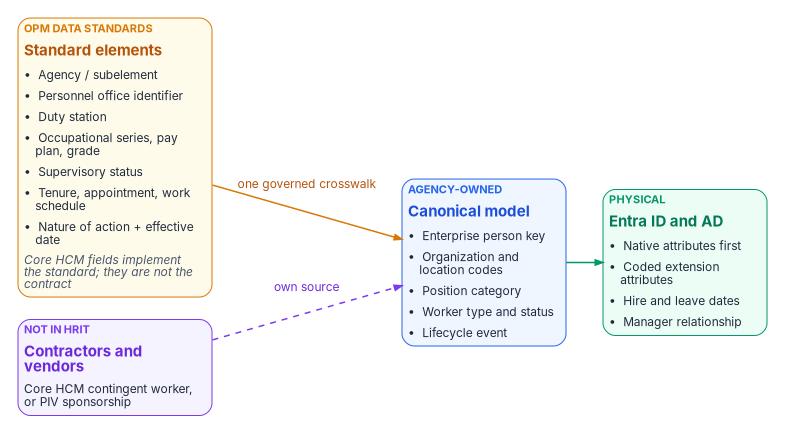

# Chapter 05 — The Canonical Workforce Identity Model

*OPM's standard attributes are the contract. Native attributes first. A small, coded set of extension attributes for access. Nothing hand-edited.*

::: {.callout-note}
## In this chapter
The standard-attribute layer: why OPM's data standards, not vendor fields, are the contract for federal employees. Contractors and vendors, whom HRIT doesn't cover, and where to source them. The design rules behind the schema. The implementation crosswalk, which every other page on this site links to instead of repeating. Why three extension attributes, and why they hold codes. How the hire and leave dates reach Entra ID from each landing zone. Who is allowed to write any of it.
:::

## The standard-attribute layer

The schema below names Oracle fields because Oracle Fusion Cloud HCM is the Core HCM platform. But the durable contract is one level up: **OPM's standard personnel data.** Every agency on the platform records the same data elements with the same codes and meanings, defined by OPM's data standards (formerly published as the *Guide to Data Standards*, now maintained in OPM's online metadata repository),[^c05-opm-gds] and every personnel action carries a nature-of-action code from the same standards (Chapter 06).[^c05-gppa] For federal employees, mapping identity to the standard rather than to vendor fields means one crosswalk serves every employee population, survives the next vendor change, and can be reused by any agency on the platform. The standard stops at federal employees, though; contractors and vendors are covered in the next section.

{fig-alt="Three boxes left to right. Amber, OPM data standards, standard elements: agency or subelement; personnel office identifier; duty station; occupational series, pay plan, grade; supervisory status; tenure, appointment, work schedule; nature of action plus effective date; a footnote says Core HCM fields implement the standard and are not the contract. Arrow labelled one governed crosswalk to a blue canonical model box: enterprise person key; organization and location codes; position category; worker type and status; lifecycle event. Arrow to a green Entra ID and AD box: native attributes first; coded extension attributes; hire and leave dates; manager relationship. Below the standard elements, a violet box, not in HRIT: contractors and vendors, from the Core HCM contingent worker or PIV sponsorship, joins the canonical model by a dashed arrow labelled own source."}

| OPM standard data element | Identity use | Lands as (Chapter 05 crosswalk) |
|---|---|---|
| Agency / subelement | Legal employer and component scope | `companyName`; organization code |
| Personnel office identifier | Servicing HR office; delegated administration scope | Administrative-unit rule input |
| Duty station | Location of record; location-based scoping; physical-access integration | Location code; `usageLocation` source |
| Occupational series, pay plan, grade | Position category for role-eligible access packages | Position category code |
| Supervisory status | Approver and reviewer eligibility; manager-chain integrity | Supervisor group; `manager` checks |
| Tenure, type of appointment, work schedule | Worker type and its lifecycle profile (pre-hire window, license, retention) | `employeeType`; worker-type code |
| Nature of action + effective date | Lifecycle trigger: joiner, mover, conversion, leave, return, leaver, correction | Hire and leave dates; account state |

: OPM standard data elements and what identity does with them {.striped .hover}

Confirm each element's current name, values and how Core HCM exposes it against OPM's current standards at engagement time (Chapter 10, verification register). Where an access decision needs a code that a standard element supplies, the code is the standard's — not a locally invented list.

## Contractors and vendors: the population HRIT doesn't cover

OPM's data standards and nature-of-action codes describe **federal employees**. Federal HR 2.0 moves federal employees. Contractors and vendors — often a large share of an agency's accounts, and the share most likely to be orphaned — are in neither. In most agencies they are tracked today in contracting officer's representative (COR) spreadsheets: a sponsor, a contract or task order, a start date and an end date that nobody is obliged to keep current. A spreadsheet can't be a source of authority, so these workers need one, mapped into the same canonical model as employees.

| Option | What it gives | What it lacks |
|---|---|---|
| **Core HCM Contingent Worker** (best fit) | Oracle Fusion Cloud HCM treats contractors as a full worker type, the contingent worker: a person record, an assignment, a place in the organization and a lifecycle much like an employee's, with add, renew and convert actions and the same interfaces[^c05-cwk][^c05-cwk-renew] | No vendor-management system and no non-employee governance layer: sponsorship, contract linkage and end-date attestation still need an owner and a process. Confirm that the agency's Core HCM configuration will record contingent workers |
| **PIV credential and sponsorship system** | Sponsorship, adjudication, the sponsoring office and an expiry already exist for every badged contractor | Covers only people who get a PIV credential; vendors and short-term workers without one need another path |
| **A non-employee lifecycle service** (complement) | Sponsor workflows, contract and vendor records, periodic attestation | A third source to integrate and govern; usually layered on one of the two options above rather than replacing them |

: Where contractors and vendors can be sourced from {.striped .hover}

Whichever source the agency chooses, the rules are the same:

- **One model.** Contractors map into the same canonical model, with worker type set to contractor and their own enterprise person key (Chapter 03). Conversion between contractor and employee joins the two sources on that key, so a converting person never gets a second identity.
- **Different triggers.** Contractors have no SF-50. Their joiner and leaver events are the contract or sponsorship start and end dates, and a sponsor's withdrawal is a leaver event (Chapter 06).
- **Map what applies.** Organization code, duty station and sponsor (as `manager`) carry over; employee-only elements such as pay plan and grade don't. Add a contract or task-order reference so access can be scoped to the contract and reviewed with it.
- **Expiry is enforced, not trusted.** An end date that passes without renewal ends access on that date, whatever the spreadsheet says.

## Design rules

1. **Use a native Entra attribute wherever one exists.** `employeeId`, `department`, `jobTitle`, `companyName`, `manager`, `employeeType`, `employeeHireDate`, `employeeLeaveDateTime` and `employeeOrgData` already mean what the HR record means. Other Microsoft features (the org chart, Lifecycle Workflows, access-package approvals) read them directly.
2. **Add an extension attribute only where access needs a value a rule can't read natively.** Rules for dynamic membership support a fixed list of user properties. That list includes `department`, `companyName`, `jobTitle`, `employeeId`, `employeeHireDate` (preview), `userType` and `accountEnabled`, plus `extensionAttribute1`–`15` and directory extension properties. It doesn't include `employeeType`, `employeeOrgData` or `manager` (direct-reports groups use a separate rule form).[^c05-dyn-rules] Three attributes cover the gap.
3. **Put codes in access attributes, never display strings.** An organization code changes only when the business fact changes; a display name changes whenever someone retypes it.
4. **Use the same carrier in both landing zones.** `extensionAttribute1`–`15` exist in on-premises AD and in Entra ID. For synced users, AD is the source and the Entra values are read-only; for cloud-only users they can be set when the user is created or updated.[^c05-onprem-ext] A rule written against `user.extensionAttribute10` works the same for a hybrid user and a cloud-mastered one, which matters during the years of coexistence.
5. **Don't build an organizational hierarchy into attributes.** The reporting line is the `manager` relationship; organizational placement is `department`, `employeeOrgData` and one organization code. There's no encoded path, tree or composite key to maintain.

## The schema

| Canonical field | Oracle HCM source | SCIM attribute | On-premises AD | Entra ID | Rule can read it | Used for |
|---|---|---|---|---|---|---|
| Person number | `workers.PersonNumber` | `externalId` | `employeeID` | `employeeId` | Yes | **Source correlation key**, subject to the enterprise identifier decision in Chapter 03 (where the agency already has an enterprise ID, such as a Mainframe PIN, `employeeId` carries that instead and `PersonNumber` maps to it) |
| Employment active | Assignment status | `active` | `accountDisabled` | `accountEnabled` | Yes | Joiner and leaver state |
| Given name / surname | `workers.names` | `name.givenName` / `name.familyName` | `givenName` / `sn` | `givenName` / `surname` | Yes | Display, UPN rules |
| Display name | `workers.DisplayName` | `displayName` | `cn` | `displayName` | Yes | Display only, never access |
| Department | Department name | enterprise `department` | `department` | `department` | Yes | Display, address book, coarse scoping |
| Division | Business unit | enterprise `division` | `division` | `employeeOrgData.division` | No | Reporting, profile card |
| Cost center | Cost center | enterprise `costCenter` | — | `employeeOrgData.costCenter` | No | Chargeback, reporting |
| Legal employer | Legal employer | enterprise `organization` | `company` | `companyName` | Yes | Agency or component |
| Manager | Manager's person number | enterprise `manager` | `manager` (DN) | `manager` | Direct-reports rule only | Supervisory chain, approvals, reviewers |
| Job title | `JobName` | `title` | `title` | `jobTitle` | Yes | Display; not an access input |
| Worker type | Worker type / person type | custom extension `workerType` | `employeeType` | `employeeType` | No | Employee, contractor, intern, volunteer |
| Hire date | Effective start date | custom extension `HireDate` | `extensionAttribute2` | `employeeHireDate` | Yes (preview) | Joiner workflow trigger |
| Leave date | Termination effective date | custom extension `TermDate` | `extensionAttribute3` | `employeeLeaveDateTime` | No | Leaver workflow trigger |
| Work country | Work address country | `addresses[type eq "work"].country` | `co` | `country` | Yes | Address; source for the `usageLocation` expression that licensing needs |
| **Organization code** | Department ID (code) | custom extension `orgCode` | `extensionAttribute10` | `extensionAttribute10` | Yes | **Access targeting** |
| **Worker type code** | Worker type (code) | custom extension `workerTypeCode` | `extensionAttribute11` | `extensionAttribute11` | Yes | **Access targeting**; mirrors `employeeType` |
| **Position category** | Job family or position category (code) | custom extension `positionCategory` | `extensionAttribute12` | `extensionAttribute12` | Yes | **Access targeting** |

: The target crosswalk for the governed workforce identity model {.striped .hover}

Notes on the table:

- The SCIM mappings for both landing zones follow the example worksheets in Microsoft's Oracle HCM integration guide, which also maps a custom `JobCode` to `extensionAttribute1` in both AD and Entra ID. Custom attributes are added to the provisioning app's schema as SCIM schema extensions and then mapped.[^c05-oracle-tutorial][^c05-custom-attrs] For attributes with no AD equivalent, the same guide says to use `extensionAttribute1`–`15` or extend the AD schema.[^c05-oracle-tutorial]
- **Neither date has a native AD attribute.** For AD-landed users, Microsoft's Oracle HCM worksheet writes `HireDate` and `TermDate` to `extensionAttribute2` and `extensionAttribute3`;[^c05-oracle-tutorial] a sync rule then maps each one to `employeeHireDate` or `employeeLeaveDateTime` in Entra ID. The AD attribute must be a string, and the value must be converted to the format Entra expects, usually with a date-format expression. Inbound provisioning, Entra Connect cloud sync and Entra Connect Sync all support both target attributes.[^c05-lcw-sync]
- **The choice of `extensionAttribute10`–`12` for access codes is this workbook's proposed implementation choice**, not a Microsoft default. Before Phase 1 closes, confirm that each one is in the provisioning app's target attribute list and isn't already used. Exchange calls `extensionAttribute1`–`15` custom attributes 1–15.[^c05-onprem-ext]
- Rules can't use multi-value extension properties.[^c05-dyn-rules] All three access attributes hold one code.

## Writers

A dynamic membership rule moves the access decision to whoever can write the attribute it reads. Microsoft's guidance is to check write permissions for every attribute a rule uses, in Entra ID and in any source directory, and to restrict self-service write access to attributes used in security-sensitive groups.[^c05-dyn-rules] For this schema that means:

- The **only writer** of every field above is the provisioning service: the API-driven inbound app for cloud-mastered users, the provisioning agent plus Entra Connect for AD-mastered ones.
- Remove help-desk, self-service and Exchange-admin write paths to `extensionAttribute10`–`12` and to the two date carriers. In AD, review the ACLs on the target OUs; in Exchange, the custom-attribute cmdlets are a write path.
- Any write by another principal is a drift event (Chapter 09).

## How other pages use this schema

The [SQL Server Identity Transformation series, Book 07](../case-studies/sql-server-narrative/Book_07_CPT_02.md) applies the same attribute-to-access discipline to SQL Server logins and database roles. The [AD → Entra ID Identity Modernization Guide](../books/b02-identity/09-building-the-entra-target.md) and the Conditional Access library link here rather than carrying their own attribute map.

::: {.callout-tip}
## Continue the series
[← Previous: Chapter 04 — Provisioning Services](04-the-provisioning-pipeline.md) · [Index](index.md) · [Next: Chapter 06 — Joiner, Mover, Leaver →](06-joiner-mover-leaver.md)
:::

[^c05-opm-gds]: U.S. Office of Personnel Management, "Data Policy & Guidance" (data standards and the metadata repository that replaced the PDF *Guide to Data Standards*), <https://www.opm.gov/policy-data-oversight/data-analysis-documentation/data-policy-guidance/> (accessed Oct 19, 2026).
[^c05-gppa]: U.S. Office of Personnel Management, *Guide to Processing Personnel Actions*, October 2026 edition, <https://www.opm.gov/policy-data-oversight/data-analysis-documentation/personnel-documentation/processing-personnel-actions/guide_to_processing_personnel_actions.pdf> (accessed Oct 19, 2026).
[^c05-cwk]: Oracle, *REST API for Oracle Fusion Cloud HCM*, "Create a Contingent Worker," <https://docs.oracle.com/en/cloud/saas/human-resources/24d/farws/Create_a_Contingent_Worker.html> (accessed Oct 19, 2026).
[^c05-cwk-renew]: Oracle, *Oracle Fusion Cloud HCM*, "How You Convert Pending Workers" (Add Contingent Worker, Add Contingent Work Relationship and Renew Contingent Worker actions), <https://docs.oracle.com/en/cloud/saas/human-resources/fawhr/how-you-convert-pending-workers.html> (accessed Oct 19, 2026).
[^c05-dyn-rules]: Microsoft Learn, "Manage rules for dynamic membership groups in Microsoft Entra ID" (supported properties; extension attributes and custom extension properties; security consideration on attribute write permissions), <https://learn.microsoft.com/en-us/entra/identity/users/groups-dynamic-membership> (accessed Oct 19, 2026).
[^c05-onprem-ext]: Microsoft Graph, "onPremisesExtensionAttributes resource type," <https://learn.microsoft.com/en-us/graph/api/resources/onpremisesextensionattributes> (accessed Oct 19, 2026).
[^c05-oracle-tutorial]: Microsoft Learn, "Configure Oracle Human Capital Management (HCM) for automatic user provisioning," <https://learn.microsoft.com/en-us/entra/identity/saas-apps/oracle-hcm-provisioning-tutorial> (accessed Oct 19, 2026).
[^c05-custom-attrs]: Microsoft Learn, "Extend API-driven provisioning to sync custom attributes," <https://learn.microsoft.com/en-us/entra/identity/app-provisioning/inbound-provisioning-api-custom-attributes> (accessed Oct 19, 2026).
[^c05-lcw-sync]: Microsoft Learn, "How to synchronize attributes for Lifecycle Workflows," <https://learn.microsoft.com/en-us/entra/id-governance/how-to-lifecycle-workflow-sync-attributes> (accessed Oct 19, 2026).
