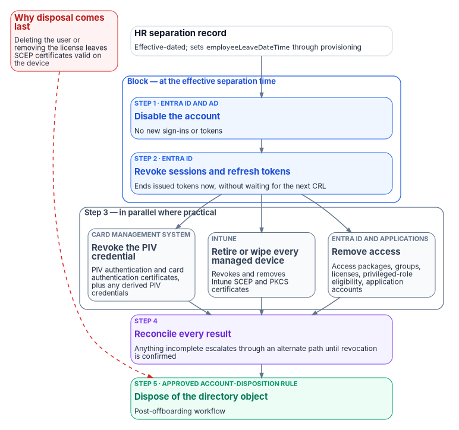

# Chapter 07 — Credentials and Certificates Across Joiner, Mover, Leaver

*Disabling an account doesn't revoke a certificate. Deleting a user doesn't either.*

::: {.callout-note}
## In this chapter
Where certificates sit in an HR-driven identity lifecycle. How a PIV credential comes into being and how Entra ID binds it to a user. What revocation checking does and doesn't do. Derived PIV credentials. Device certificates from Intune and Microsoft Cloud PKI, and the actions that do and don't revoke them. The canonical leaver sequence, and how to run it from Lifecycle Workflows.
:::

## Why certificates need their own chapter

Chapters 04–06 make the account a consequence of the HR record. Certificates don't automatically follow. A PIV authentication certificate is issued by the agency's card management system (CMS) under the Federal PKI and stays valid until it expires or is revoked; an Intune-delivered device certificate stays on the device until Intune revokes or removes it. Neither is touched by disabling or deleting an Entra user. An HR-driven lifecycle that stops at the account leaves the credentials of a former worker live in every relying party that trusts them: Entra ID, physical access control, on-premises smart card logon, signing and encryption, and other agencies.

Federal guidance treats the person, not the authenticator, as the thing being managed. The GSA/FICAM Identity Lifecycle Management Playbook tells agencies to designate HR systems as the authoritative source for identity creation and termination, and to build a **Master User Record** that links each user's attributes, entitlements and authenticators, both PIV cards and alternative FIDO2 credentials, into one view.[^c07-ilm] The playbook is best practice, not policy.[^c07-ilm] In this series the HR record and Entra ID together play the Master User Record's role for the Microsoft estate, and the CMS remains the system of record for the PIV card.

## Joiner: proofing, issuance, binding

### Proofing and issuance

The ILM Playbook's creation stage starts with identity proofing at IAL3 as described in NIST SP 800-63A-4, which meets the requirements for PIV eligibility. After proofing, the user's information is added to the Master User Record, the identity is bound to one or more phishing-resistant authenticators such as a PIV card or a FIDO2 token, and accounts are created for the systems the user's roles require.[^c07-ilm] The PIV card itself is governed by FIPS 201-3, which establishes the PIV system for federal employees and contractors under HSPD-12.[^c07-fips201] NIST SP 800-63-4 (July 2025, superseding SP 800-63-3) is the current revision of the Digital Identity Guidelines covering proofing, authentication and federation.[^c07-sp80063]

The playbook's point about binding is the one that matters here: without the binding between the card's certificate and the digital identity, a PIV card is just a physical badge. The same binding process applies to PKI and non-PKI derived PIV authenticators.[^c07-ilm]

The gap between account creation and card issuance is normal: provisioning creates the account ahead of day one (Chapter 06), and the card follows proofing and adjudication. Bridge it with a Temporary Access Pass sent through the joiner workflow (Chapter 06), not with a password.

### Binding the PIV certificate to the Entra user

Entra certificate-based authentication (CBA) validates the certificate the user presents against the trusted CAs configured in the tenant, checks the CRL, and then maps a field of the certificate to a user attribute through the tenant's **username bindings**.[^c07-cba-deep] By default the SAN Principal Name maps to `userPrincipalName`.[^c07-cba-deep] The stronger option is the `certificateUserIds` attribute, which holds explicit certificate identifiers:

| Binding (certificate field) | Example value in `certificateUserIds` | Affinity |
|---|---|---|
| PrincipalName | `X509:<PN>bob@woodgrove.com` | Low |
| RFC822Name | `X509:<RFC822>user@woodgrove.com` | Low |
| Subject | `X509:<S>DC=com,DC=contoso,OU=UserAccounts,CN=mfatest` | Low |
| IssuerAndSubject | `X509:<I>…<S>…` | Low |
| SKI (Subject Key Identifier) | `X509:<SKI>…` | High |
| SHA1PublicKey | `X509:<SHA1-PUKEY>…` | High |
| IssuerAndSerialNumber | `X509:<I>…<SR>…` | High |

: CBA username bindings and their affinity[^c07-cba-deep] {.striped .hover}

High-affinity bindings use identifiers that can't be reused, which gives higher assurance that only one certificate can authenticate the user; bindings based on usernames and email addresses are low-affinity.[^c07-cba-deep] If the tenant requires high-affinity binding, Entra drops the low-affinity bindings from evaluation.[^c07-cba-deep] For PIV in a federal tenant, prefer a high-affinity binding.

The consequence for lifecycle is direct: **a high-affinity value identifies one certificate.** Every card reissue or certificate renewal produces a new SKI, key hash or serial number, so the binding must be rewritten as part of the CMS's issuance event, and the old value removed. The binding is lifecycle data, and it needs a writer.

How the value gets written depends on where the user is mastered:

- **Cloud-only users:** the Entra admin center or Microsoft Graph, by at least a Privileged Authentication Administrator.[^c07-cuid][^c07-cba-how] An admin center user can hold up to four values of up to 120 characters each.[^c07-cuid] Microsoft's CertificateBasedAuthentication PowerShell module computes the correct `certificateUserIds` value from a certificate.[^c07-cba-deep]
- **Synced users:** only Microsoft Entra Connect can update `certificateUserIds`. Populate `altSecurityIdentities` in on-premises AD and sync it to `certificateUserIds`, either with Connect rules or by syncing the AltSecId value; updating it requires at least the Hybrid Identity Administrator role.[^c07-cuid][^c07-cba-how][^c07-cba-deep]

Microsoft's warning about synced users belongs in the security plan: **Active Directory administrators can change the `certificateUserIds` value in Entra ID for any synchronized account**, and that includes anyone with delegated administrative rights over synchronized users or administrative rights over the Entra Connect servers.[^c07-cuid] Whoever can write `altSecurityIdentities` can decide which certificate signs in as which user. Treat that write path as you treat the access attributes of Chapter 05: one automated writer (the CMS integration), no help-desk or self-service path, and any other write is drift (Chapter 09).

### Revocation checking

Entra ID checks the CRL of the issuing CA during CBA sign-in.[^c07-cba-deep] Three properties shape how fast a PIV revocation takes effect in Entra:

- **No CRL, no revocation.** If a trusted CA has no CRL configured, Entra doesn't check revocation and revoked certificates still authenticate.[^c07-cba-how] Turn on **Require CRL validation**, which makes CBA fail for certificates from a CA without a CRL; exempt a CA only while its CRL is being fixed.[^c07-crl]
- **Caching.** Entra caches the CRL. A newly revoked certificate isn't detected until the cache refreshes with a newer CRL; delta CRLs carry those updates, and without them revocation waits on the base CRL's validity period. Entra doesn't support OCSP.[^c07-crl] Microsoft advises revoking tokens manually when immediate revocation is critical.[^c07-crl]
- **Size limits.** In Azure Global, which includes GCC, the CRL download limits are 20 MB for interactive sign-in and 65 MB for the service.[^c07-crl] Check the issuing CAs' CRL sizes against those limits during Phase 1. If Entra can't reach a configured CRL endpoint, CBA fails.[^c07-crl]

So the PIV revocation in the leaver sequence closes CBA *eventually*, on the CA's CRL schedule. The account disable and token revocation steps close Entra *now*. Both are needed: the first protects every other relying party, the second protects the tenant.

### Derived PIV credentials

Derived PIV credentials let a person who holds a valid PIV card carry an equivalent credential on a device that can't use the card. FIPS 201-3 requires PIV card termination procedures to invalidate every derived PIV credential bound to the PIV identity account.[^c07-fips201] NIST SP 800-157 (December 2014) is the current final guideline; SP 800-157 Revision 1 is a final public draft (November 2024) that widens derived PIV credentials to include non-PKI authenticators verified by the home agency.[^c07-sp800157][^c07-sp800157r1] Plan for both forms in the Master User Record: a derived credential is an authenticator to revoke, and the leaver sequence has to find it.

## Mover: usually nothing, sometimes a reissue

Most moves don't touch credentials: the person, the identifier and the PIV identity account stay the same (Chapter 03). Two exceptions:

- **A change that reissues the card** (a legal name change, a contractor whose engagement changes) produces new certificates, and the high-affinity binding must be rewritten.
- **A change that ends eligibility.** FIPS 201-3 requires termination of the card when, for example, a contractor changes positions and no longer needs access to federal buildings or systems.[^c07-fips201] That is a mover in HR and a leaver for the credential.

## Device certificates: Intune and Microsoft Cloud PKI

Devices get their own certificates, for Wi-Fi, VPN and other authentication, through Intune SCEP or PKCS certificate profiles; Microsoft Cloud PKI can be the issuing CA for SCEP. The [SQL Server series, Book 10](../case-studies/sql-server-narrative/Book_10.md) covers the move from AD CS to Cloud PKI; this section covers only what the leaver sequence needs.

For Windows devices, Intune documents when a SCEP certificate is revoked and removed:[^c07-intune-remove]

| Action | SCEP certificate |
|---|---|
| User unenrolls the device | Revoked and removed |
| Administrator runs **wipe** | Revoked and removed |
| Administrator runs **retire** | Revoked and removed |
| Device removed from an Entra group | Revoked and removed |
| Certificate profile removed from the group assignment | Revoked and removed |
| User loses, or administrator withdraws, the Intune license | **Stays on the device; not revoked** |
| Administrator **removes the user or group from Entra ID** | **Stays on the device; not revoked** |

: When Intune revokes a SCEP certificate on a Windows device[^c07-intune-remove] {.striped .hover}

The same article lists the behavior for the other platforms; check the platforms the agency manages. Two more caveats from the same source: SCEP certificates from a third-party CA are removed but not revoked, and PKCS certificates are revoked and removed on unenroll, wipe or retire.[^c07-intune-remove]

**The rule that follows: retire or wipe the leaver's devices before deleting the user.** Deleting the user first leaves valid device certificates on hardware the agency may not get back.

Manual revocation has a trap of its own. If you revoke a Cloud PKI certificate by hand for a user or device that still has an active SCEP profile assignment, the device requests a new certificate at the next check-in and gets one. To stop reissue, remove all SCEP policy assignments first.[^c07-cpki-monitor]

## The canonical leaver sequence

{fig-alt="A vertical flow. The HR separation record, which sets employeeLeaveDateTime through provisioning, starts five steps. Step 1, Intune: retire or wipe every managed device, which revokes and removes SCEP and PKCS certificates. Step 2, card management system: revoke the PIV authentication and card authentication certificates and any derived PIV credentials. Step 3, Entra ID and AD: disable the account. Step 4, Entra ID: revoke sessions and refresh tokens, which ends issued tokens without waiting for the next CRL. Step 5, after the retention period: delete the user. A red note pointing at step 1 says that deleting the user or removing the license leaves SCEP certificates valid on the device."}

1. **Retire or wipe every managed device** assigned to the leaver. This revokes and removes Intune SCEP and PKCS certificates.[^c07-intune-remove] Wipe needs the device online.[^c07-revoke-access]
2. **Revoke the PIV credential through the CMS.** Collect and destroy the card where possible; otherwise revoke the PIV authentication and card authentication certificates, and the signature and key management certificates if present. Update the CMS, and invalidate all derived PIV credentials. For a card that can't be collected, FIPS 201-3 requires the normal termination procedures to be completed within 18 hours of notification.[^c07-fips201]
3. **Disable the account** in Entra ID, and in AD for synced users.[^c07-revoke-access]
4. **Revoke sessions and refresh tokens.** Microsoft's emergency-revocation procedure disables the user and then revokes refresh tokens, so no new token can be issued after the revocation.[^c07-revoke-access] This is also the step that closes CBA immediately rather than at the next CRL refresh.[^c07-crl]
5. **Delete the user after the retention period** (Chapter 06).

Steps 3 and 4 run back to back. Disabling first, then revoking, follows Microsoft's documented order;[^c07-revoke-access] revoking first would leave a window in which a still-enabled account could get a new token.

### Running it from Lifecycle Workflows

The built-in leaver tasks cover groups, Teams, access packages, licenses, disabling the account, revoking refresh tokens and deleting the user, but none of them revokes a PIV credential or retires a device.[^c07-lcw-tasks] Microsoft's real-time termination tutorial, for example, removes the user from all groups and Teams and deletes the account.[^c07-lcw-offboard-portal] The missing steps go through a **custom task extension**, which calls an Azure Logic App (consumption plan).[^c07-lcw-ext]

- Use **Launch and wait**: the next task waits for the Logic App's response, and if no response arrives within the configured duration the task is considered failed.[^c07-lcw-ext] A third-party system such as the CMS integration can send the response if the Logic App only acts as an intermediary.[^c07-lcw-ext]
- Authorize the response with the Logic App's system-assigned managed identity, the default.[^c07-lcw-ext]
- Order the workflow as the sequence above: custom task (retire or wipe devices through Intune), custom task (CMS revocation), *Disable user account*, *Revoke all refresh tokens for user*, then the group, Teams, access package and license removals. Put *Delete user* in a separate post-offboarding workflow keyed to the retention period.

A failed custom task is a finding, not a retry loop: route it to the service desk and the ISSO, and carry it in the separation-to-revocation metric (Chapter 09).

## What the evidence must show

For each leaver: the HR effective date; the device actions and their completion; the CMS revocation record and the CRL that published it; the disable and token-revocation timestamps; and the deletion date. The interval from the HR effective date to the last of those steps is the number an assessor asks for under PS-4 (Chapter 09).

::: {.callout-tip}
## Continue the series
[← Previous: Chapter 06 — Joiner, Mover, Leaver](06-joiner-mover-leaver.md) · [Index](index.md) · [Next: Chapter 08 — From Attributes to Access →](08-from-attributes-to-access.md)
:::

[^c07-ilm]: GSA / Federal CISO Council ICAM Subcommittee, *Identity Lifecycle Management Playbook* (Executive Summary; Stage 1, Creation; Stage 3, Deletion; Disclaimer), <https://www.idmanagement.gov/playbooks/ilm/> (accessed Oct 19, 2026).
[^c07-fips201]: NIST, FIPS 201-3, *Personal Identity Verification (PIV) of Federal Employees and Contractors*, January 2022, §2.9.4 "PIV Card Termination Requirements," <https://csrc.nist.gov/pubs/fips/201-3/final> (accessed Oct 19, 2026).
[^c07-sp80063]: NIST, SP 800-63-4, *Digital Identity Guidelines*, July 2025, <https://csrc.nist.gov/pubs/sp/800/63/4/final> (accessed Oct 19, 2026).
[^c07-sp800157]: NIST, SP 800-157, *Guidelines for Derived Personal Identity Verification (PIV) Credentials*, December 2014, <https://csrc.nist.gov/pubs/sp/800/157/final> (accessed Oct 19, 2026).
[^c07-sp800157r1]: NIST, SP 800-157 Rev. 1 (Final Public Draft), *Guidelines for Derived Personal Identity Verification (PIV) Credentials*, November 14, 2024, <https://csrc.nist.gov/pubs/sp/800/157/r1/fpd> (accessed Oct 19, 2026).
[^c07-cba-deep]: Microsoft Learn, "Microsoft Entra CBA technical concepts," <https://learn.microsoft.com/en-us/entra/identity/authentication/concept-certificate-based-authentication-technical-deep-dive> (accessed Oct 19, 2026).
[^c07-cba-how]: Microsoft Learn, "Set up Microsoft Entra CBA," <https://learn.microsoft.com/en-us/entra/identity/authentication/how-to-certificate-based-authentication> (accessed Oct 19, 2026).
[^c07-cuid]: Microsoft Learn, "Mapping to the certificateUserIds attribute in Microsoft Entra ID," <https://learn.microsoft.com/en-us/entra/identity/authentication/concept-certificate-based-authentication-certificateuserids> (accessed Oct 19, 2026).
[^c07-crl]: Microsoft Learn, "Understand Microsoft Entra certificate-based authentication certificate revocation list," <https://learn.microsoft.com/en-us/entra/identity/authentication/concept-certificate-based-authentication-certificate-revocation-list> (accessed Oct 19, 2026).
[^c07-intune-remove]: Microsoft Learn, "Remove SCEP or PKCS certificates in Microsoft Intune," <https://learn.microsoft.com/en-us/intune/device-configuration/certificates/remove-profiles> (accessed Oct 19, 2026).
[^c07-cpki-monitor]: Microsoft Learn, "Monitor issued PKI certificates with Microsoft Intune," <https://learn.microsoft.com/en-us/intune/cloud-pki/monitor-certificates> (accessed Oct 19, 2026).
[^c07-revoke-access]: Microsoft Learn, "Revoke user access in an emergency in Microsoft Entra ID," <https://learn.microsoft.com/en-us/entra/identity/users/users-revoke-access> (accessed Oct 19, 2026).
[^c07-lcw-tasks]: Microsoft Learn, "Lifecycle Workflows tasks and definitions," <https://learn.microsoft.com/en-us/entra/id-governance/lifecycle-workflow-tasks> (accessed Oct 19, 2026).
[^c07-lcw-offboard-portal]: Microsoft Learn, "Execute employee termination tasks by using lifecycle workflows," <https://learn.microsoft.com/en-us/entra/id-governance/tutorial-offboard-custom-workflow-portal> (accessed Oct 19, 2026).
[^c07-lcw-ext]: Microsoft Learn, "Workflow extensibility" (Lifecycle Workflows custom task extensions), <https://learn.microsoft.com/en-us/entra/id-governance/lifecycle-workflow-extensibility> (accessed Oct 19, 2026).
