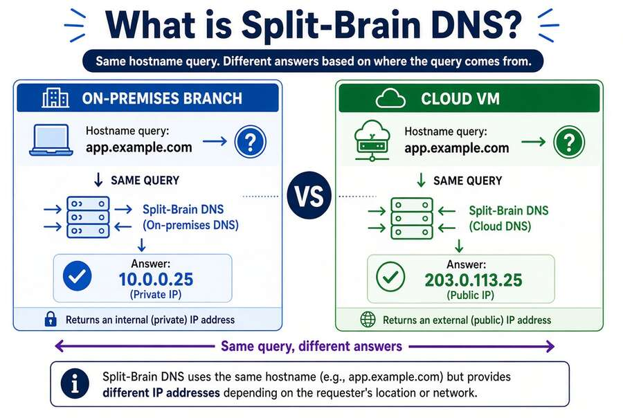
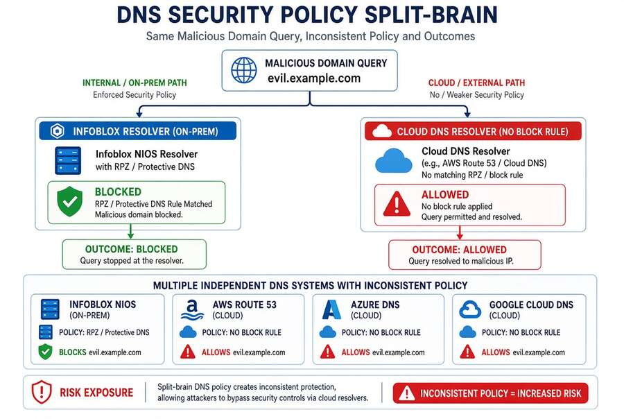
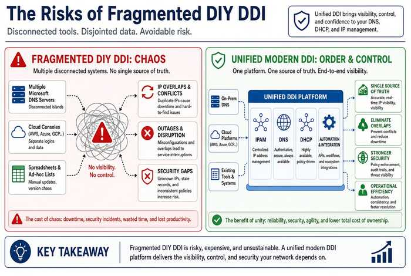

# Chapter 02 — Split-Brain DNS: The Structural Problem

*Same name, different answers — and why process discipline cannot fix it.*

::: {.callout-tip}
## Download this chapter
**[next-generation-ddi-ch02-bundle.docx](../../downloads/next-generation-ddi-ch02-bundle.docx)**: this chapter as a Word document, with its figures. The [whole book](../../downloads/next-generation-ddi-bundle.docx) is also available.
:::

{fig-alt="Same query, different answers by origin."}

Split-brain DNS is the condition in which a query for the same name
returns different answers depending on where the query originates.
Intentional split-brain (internal private address vs. external public
address) is common and legitimate. Unintentional split-brain is
structurally guaranteed when five independent DNS systems have no shared
state.

### Private IP Split-Brain: The Cross-Cloud Case

{fig-alt="Azure private endpoint vs AWS public resolution."}

When an Azure Storage account uses a private endpoint, Azure publishes a
record in the privatelink zone that resolves the FQDN to a VNet-scoped
RFC 1918 address (e.g., 10.1.0.4). Inside the linked VNet the query
returns the private address and traffic stays private. An EC2 instance
in AWS requires a Route 53 outbound resolver rule that forwards the
private zone to the Azure DNS Private Resolver inbound endpoint. If that
rule is missing or stale, the name still resolves — but to a public IP.
Traffic either leaves the private path (bypassing controls) or is
blocked. The failure is invisible without query logging and flow
analysis because the name resolves successfully.

### Security Policy Split-Brain

{fig-alt="Inconsistent RPZ/Protective DNS across resolvers."}

DNS security policy (RPZ, DNS Firewall, Protective DNS block lists) is
enforced at the resolver that answers the query. A domain blocked in the
agency-controlled resolver may be allowed by Route 53 DNS Firewall,
Azure DNS, or GCP Cloud DNS Response Policy Zones if the rule is not
synchronized. The effective posture is the intersection of all
independent policies — only as strong as the weakest system. The same
gap appears with encrypted DNS and upstream CISA Protective DNS
requirements under OMB M-22-09: branches or cloud workloads that bypass
the authorized resolver path silently evade the mandated controls.[^c02-2]

Public SaaS / sovereign endpoint split-brain follows the same pattern.
For GCC High and DoD, .us namespaces must be pinned correctly across
every resolver. For GCC Moderate (which uses the Worldwide endpoint
list), the primary risk is resolution-path consistency and front-door
selection rather than “wrong endpoint.” Encrypted DNS bypass (DoH to a
public resolver) can change the answer again.

## Problems of Not Using Modern Enterprise-Grade DDI

{fig-alt="DIY chaos versus unified modern DDI."}

Organizations that rely on fragmented or DIY DDI face measurable
disadvantages. An ESG study commissioned by Infoblox (February 2025)
reported higher outage frequency for cloud-hosted critical applications
(44% of respondents), slower outage response (38%), lower confidence in
meeting cloud adoption requirements (27–34%), reduced hybrid visibility,
and lower rates of leveraging DNS for protection compared with
organizations using enterprise-grade DDI. Configuration drift,
stale/dangling records, IP overlaps, and siloed management create
compliance gaps and audit difficulties.[^c02-6]

Without unified DDI, agencies struggle to demonstrate consistent policy,
audit trails, and asset inventory required for FedRAMP, NIST SP
800-81r3, CISA Protective DNS, and Zero Trust reporting. For SASE and
Zero Trust, ungoverned DNS is the first trust decision: it determines
the destination before TLS, SSO, or application policies can act.
Fragmented DNS undermines consistent filtering, encrypted DNS
inspection, and threat blocking.

---

**Previous:** [Chapter 01 — DNS Is Now the Control Plane](01-dns-is-the-control-plane.md)  
**Next:** [Chapter 03 — Federal Requirements: NIST SP 800-81 Rev. 3, FedRAMP and Zero Trust](03-federal-requirements.md)

[^c02-2]: OMB Memorandum M-22-09 and CISA Encrypted DNS Implementation Guidance, May 2024.
[^c02-6]: Enterprise Strategy Group (commissioned by Infoblox). 9 Pitfalls of Not Using Enterprise-Grade DDI. February 2025.
