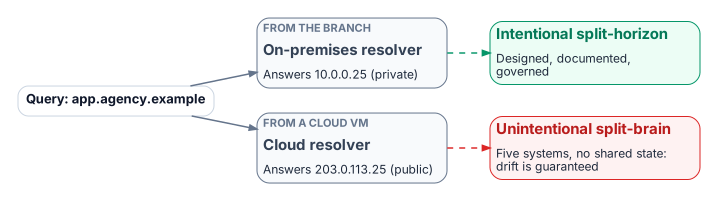
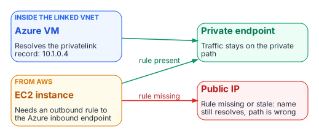
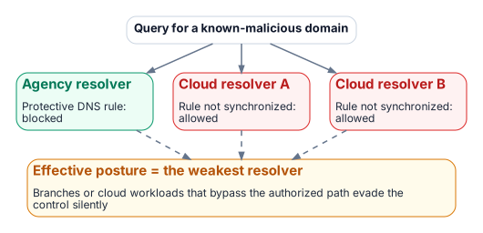

# Chapter 02 — Split-Brain DNS: The Structural Problem

*Same name, different answers — and why process discipline cannot fix it.*

::: {.callout-tip}
## Download this chapter
**[next-generation-ddi-ch02-bundle.docx](../../downloads/next-generation-ddi-ch02-bundle.docx)**: this chapter as a Word document, with its figures. The [whole book](../../downloads/next-generation-ddi-bundle.docx) is also available.
:::

{fig-alt="A query for app.agency.example answers a private address from the on-premises resolver and a public address from a cloud resolver. Intentional split-horizon is designed and governed; unintentional split-brain is drift between systems with no shared state."}

Split-brain DNS is the condition in which a query for the same name returns different answers depending on where the query originates. Intentional split-horizon DNS (an internal private address and an external public address for the same name) is common and legitimate when it is designed, documented and governed. Unintentional split-brain is close to guaranteed when several independent DNS systems hold copies of the same names with no shared state: each copy drifts on its own schedule, and no single team can see the whole.

### Private IP Split-Brain: The Cross-Cloud Case

{fig-alt="An Azure VM inside the linked VNet resolves the privatelink record to 10.1.0.4. An EC2 instance in AWS reaches the private endpoint only if an outbound rule forwards to the Azure inbound endpoint; if the rule is missing or stale the name still resolves, to the public IP."}

When an Azure Storage account uses a private endpoint, Azure publishes a record in the matching privatelink zone that resolves the service FQDN to an address in the virtual network (for example 10.1.0.4).[^c02-azpe] Inside a VNet linked to that Private DNS zone, the query returns the private address and traffic stays private. An EC2 instance in AWS sees that answer only if a Route 53 Resolver outbound rule forwards the zone to an Azure DNS Private Resolver inbound endpoint, or to an agency resolver that does. If that rule is missing or stale, the name still resolves, but to the public address. Traffic then either leaves the private path, around the controls on it, or is refused by the service's network rules. Because the name resolves successfully, the failure is invisible without query logging and flow analysis.

### Security Policy Split-Brain

{fig-alt="A query for a known-malicious domain is blocked by the agency resolver but allowed by two cloud resolvers whose rules were not synchronized. The effective posture is the weakest resolver."}

DNS security policy (response policy zones, DNS firewall rules, Protective DNS block lists) is enforced only at the resolver that answers the query. A domain blocked at the agency resolver may still be answered by Route 53 Resolver, Azure DNS or Google Cloud DNS if the equivalent rule there (Route 53 Resolver DNS Firewall, Azure DNS security policy, Cloud DNS response policies) was never created or has drifted.[^c02-r53fw][^c02-azsecpol][^c02-gcprp] The effective posture is that of the weakest resolver a client can reach. The same gap appears in the federal requirements: OMB M-22-09 expects agency DNS traffic to use encrypted DNS and to pass through CISA-operated Protective DNS infrastructure, so branches or cloud workloads that bypass the authorized resolver path also bypass those controls without anyone noticing.[^c02-m2209][^c02-cisaedns]

Public SaaS endpoint split-brain follows the same pattern. Microsoft 365 GCC High and DoD use their own endpoint lists and namespaces, which must resolve correctly from every resolver.[^c02-m365gcch] GCC-Moderate uses the Worldwide endpoint list,[^c02-m365ww] so the risk there is not a "wrong cloud" answer but resolution-path consistency and front-door selection. A client using DNS over HTTPS to a public resolver can change the answer again.

## Problems of Not Using Modern Enterprise-Grade DDI

Organizations that rely on fragmented or do-it-yourself DDI accumulate configuration drift, stale and dangling records, overlapping address space and siloed administration. Each is an operational risk and an audit finding waiting to happen. A vendor-commissioned survey reports that respondents without enterprise-grade DDI saw more frequent outages of cloud-hosted applications and slower outage response; treat such figures as directional rather than as a benchmark.[^c02-esg]

Without a unified DDI plane, agencies struggle to show the consistent policy, audit trail and asset inventory that FedRAMP continuous monitoring, NIST SP 800-81r3, CISA Protective DNS and Zero Trust reporting all ask for. For SASE and Zero Trust, DNS is the first trust decision: it chooses the destination before TLS, single sign-on or any application policy can act. Fragmented DNS undermines consistent filtering, encrypted DNS policy and threat blocking.

---

**Previous:** [Chapter 01 — DNS Is Now the Control Plane](01-dns-is-the-control-plane.md)  
**Next:** [Chapter 03 — Federal Requirements: NIST SP 800-81 Rev. 3, FedRAMP and Zero Trust](03-federal-requirements.md)

[^c02-azpe]: Microsoft Learn, "Azure Private Endpoint DNS Integration Scenarios" and "Azure Private Endpoint private DNS zone values." <https://learn.microsoft.com/en-us/azure/private-link/private-endpoint-dns-integration>; <https://learn.microsoft.com/en-us/azure/private-link/private-endpoint-dns>
[^c02-r53fw]: AWS, *Amazon Route 53 Developer Guide*, "Using DNS Firewall to filter outbound DNS traffic." <https://docs.aws.amazon.com/Route53/latest/DeveloperGuide/resolver-dns-firewall.html>
[^c02-azsecpol]: Microsoft Learn, "Overview of DNS resolver policy" (Azure DNS security policy). <https://learn.microsoft.com/en-us/azure/dns/dns-security-policy>
[^c02-gcprp]: Google Cloud, "Manage response policies and rules" (Cloud DNS). <https://cloud.google.com/dns/docs/zones/manage-response-policies>
[^c02-m2209]: OMB M-22-09, *Moving the U.S. Government Toward Zero Trust Cybersecurity Principles*, January 26, 2022, section on encrypted DNS. <https://www.whitehouse.gov/wp-content/uploads/2022/01/M-22-09.pdf>
[^c02-cisaedns]: CISA, *Encrypted DNS Implementation Guidance*, May 2024. <https://www.cisa.gov/resources-tools/resources/encrypted-dns-implementation-guidance>
[^c02-m365gcch]: Microsoft Learn, "Microsoft 365 U.S. Government GCC High endpoints." <https://learn.microsoft.com/en-us/microsoft-365/enterprise/microsoft-365-u-s-government-gcc-high-endpoints?view=o365-worldwide>
[^c02-m365ww]: Microsoft Learn, "Microsoft 365 URLs and IP address ranges" (the Worldwide list, which includes GCC). <https://learn.microsoft.com/en-us/microsoft-365/enterprise/urls-and-ip-address-ranges?view=o365-worldwide>
[^c02-esg]: **Third-party source (vendor-commissioned survey).** Enterprise Strategy Group, commissioned by Infoblox, *9 Pitfalls of Not Using Enterprise-Grade DDI*, February 2025. No public URL was verified for this book; figures are reported by the sponsor and were not independently verified.
