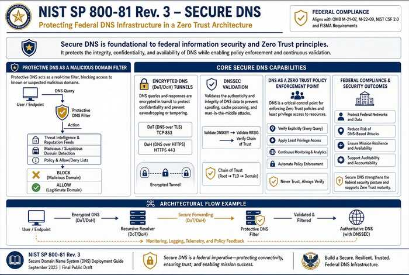

# Chapter 03 — Federal Requirements: NIST SP 800-81 Rev. 3, FedRAMP and Zero Trust

*What the federal mandates actually require of the name layer.*

::: {.callout-tip}
## Download this chapter
**[next-generation-ddi-ch03-bundle.docx](../../downloads/next-generation-ddi-ch03-bundle.docx)**: this chapter as a Word document, with its figures. The [whole book](../../downloads/next-generation-ddi-bundle.docx) is also available.
:::

## FedRAMP Moderate

Infoblox Government Cloud (AWS GovCloud) received a FedRAMP Moderate
authorization in July 2026 for Universal DDI Management, NIOS-X Servers,
and Universal Asset Insights. This is an authorization of the cloud
service; each agency must still issue its own ATO. The on-premises
resolvers and appliances remain inside the agency’s authorization
boundary. The FedRAMP Moderate authorization does not cover GCC High or
DoD environments; agencies operating at those impact levels must confirm
whether a separate authorization or agency-specific ATO is required.[^c03-3]

### NIST SP 800-81 Rev. 3: Secure DNS Deployment Guide

{fig-alt="Protective DNS, encrypted DNS, DNSSEC, Zero Trust PEP."}

Published March 19, 2026 and co-authored with Infoblox, SP 800-81r3
supersedes the 2013 edition. It treats DNS as critical infrastructure
and an active security control. Core recommendations include employing
Protective DNS, encrypting DNS traffic (DoT/DoH/DoQ) wherever feasible,
deploying DNSSEC, maintaining hygiene (eliminating lame delegations,
dangling CNAMEs, stale records), comprehensive logging, and positioning
DNS as a Policy Enforcement Point in Zero Trust architectures (aligned
with SP 800-207).[^c03-4]

SP 800-81r3 directly supports OMB M-22-09 (Zero Trust), OMB M-21-31
(event logging requirements that include DNS logs), OMB M-08-23 (DNSSEC
for federal .gov zones), CISA Encrypted DNS Implementation Guidance, 6
U.S.C. § 663 Protective DNS authorities, EO 14028, NIST SP 800-207, and
the DNS-related controls in FISMA/SP 800-53 (including SC-22 for the
name/address resolution architecture) and FedRAMP baselines. For FCEB
agencies, Protective DNS and encrypted DNS are effectively mandatory
under the M-22-09 language. At large scale this requires centralized
policy and logging combined with local or edge delivery so that roaming
and branch traffic cannot bypass the controls.

## Control Mapping for NIST SP 800-53, FedRAMP, and CISA Zero Trust

The following table maps core Infoblox Universal DDI capabilities to
representative controls. This is illustrative, not exhaustive; agencies
should validate against their specific authorization boundary and
continuous monitoring strategy.

| **Capability** | **Primary Controls Supported** | **Evidence / Notes** |
|----|----|----|
| Protective DNS / RPZ | SC-7, SI-3, SI-4, AC-4 | Query logs, policy hit rates, block events; alignment with CISA Protective DNS |
| Encrypted DNS (DoT/DoH) | SC-8, SC-13, IA-5 | Certificate management, protocol configuration evidence; supports M-22-09 |
| IPAM inventory & discovery | CM-8, CM-6, SI-4 | Asset inventory reports, discovery logs, address space consistency |
| Audit trails & RBAC | AU-2, AU-6, AC-2, AC-3, AC-6 | Change logs, role assignments, policy modification history |
| DNSSEC & zone integrity | SC-20, SC-21, SI-7 | Key management, validation status, zone signing evidence |

---

**Previous:** [Chapter 02 — Split-Brain DNS: The Structural Problem](02-split-brain-dns.md)  
**Next:** [Chapter 04 — The Active Directory DNS Departure](04-active-directory-dns-departure.md)

[^c03-3]: Infoblox Press Release. Infoblox Government Cloud Achieves FedRAMP Moderate Authorization. July 22, 2026. https://www.globenewswire.com/news-release/2026/07/22/3331403/0/en/Infoblox-Government-Cloud-Achieves-FedRAMP-Moderate-Certification-Bringing-Modern-DDI-and-Asset-Visibility-to-Federal-Agencies.html
[^c03-4]: NIST SP 800-81 Rev. 3, Secure Domain Name System (DNS) Deployment Guide, March 19, 2026. https://csrc.nist.gov/pubs/sp/800/81/r3/final
