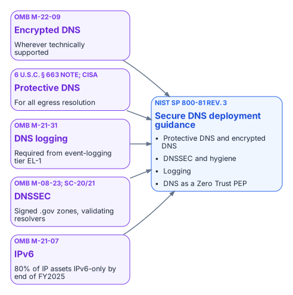

# Chapter 03 — Federal Requirements: NIST SP 800-81 Rev. 3, FedRAMP and Zero Trust

*What the federal mandates actually require of the name layer.*

::: {.callout-tip}
## Download this chapter
**[next-generation-ddi-ch03-bundle.docx](../../downloads/next-generation-ddi-ch03-bundle.docx)**: this chapter as a Word document, with its figures. The [whole book](../../downloads/next-generation-ddi-bundle.docx) is also available.
:::

{fig-alt="Five requirement cards: OMB M-22-09 encrypted DNS wherever technically supported; Protective DNS for egress resolution under 6 U.S.C. 663 note and CISA; DNS logging under OMB M-21-31 from tier EL-1; DNSSEC under OMB M-08-23 and SP 800-53 SC-20 and SC-21; and OMB M-21-07 IPv6 targets."}

## What the Mandates Say

The federal requirements on DNS are specific, and it is worth quoting them rather than paraphrasing them into something stronger.

- **OMB M-22-09 (Zero Trust strategy).** "Agencies must resolve DNS queries using encrypted DNS wherever it is technically supported."[^c03-m2209] The memorandum also notes that agencies "are already required to have DNS requests routed through CISA-operated infrastructure."
- **CISA Encrypted DNS Implementation Guidance (May 2024).** Explains how Federal Civilian Executive Branch agencies meet the M-22-09 requirement while keeping Protective DNS for egress resolution, sets out phased implementation, and names the protocols in scope: DNS over HTTPS (DoH), DNS over TLS (DoT) and DNS over QUIC (DoQ).[^c03-cisaedns]
- **OMB M-21-31 (event logging).** DNS request logs are among the logs required from the first event-logging maturity tier, EL-1.[^c03-m2131]
- **OMB M-08-23 (August 2008).** Required agencies to deploy DNSSEC on federal information systems by December 2009;[^c03-m0823] SP 800-53 controls SC-20 and SC-21 carry the signing and validating-resolver requirements into every system baseline.[^c03-nist53]
- **OMB M-21-07 (IPv6).** Sets targets for IP-enabled assets on federal networks to be IPv6-only: at least 20% by the end of FY2023, 50% by the end of FY2024 and 80% by the end of FY2025.[^c03-m2107] DDI is where dual-stack and IPv6-only address and name management actually happens (Chapter 07).

None of these mandates names a product. Read together, they require resolvers the agency controls that log every query, encrypt client-to-resolver traffic wherever the client supports it, forward egress resolution through Protective DNS, and validate DNSSEC.[^c03-cisapdns] At enterprise scale that means centralized policy and logging combined with local or edge delivery, so that roaming and branch traffic cannot slip past the controls.

### NIST SP 800-81 Rev. 3: Secure DNS Deployment Guide

NIST published SP 800-81r3, *Secure Domain Name System (DNS) Deployment Guide*, on March 19, 2026. It supersedes SP 800-81-2 (2013), and its authors include engineers from Infoblox as well as NIST. It treats DNS as critical infrastructure and as an active security control. Its core recommendations are to use Protective DNS, encrypt DNS traffic (DoT, DoH or DoQ) wherever feasible, deploy DNSSEC, maintain DNS hygiene (no lame delegations, dangling CNAMEs or stale records), log comprehensively, and position DNS as a policy enforcement point within a Zero Trust architecture aligned with SP 800-207.[^c03-nist81][^c03-nist207]

SP 800-81r3 is guidance, not a mandate in its own right. It is the practical companion to the requirements above, and to the DNS-related controls in SP 800-53 (notably SC-20, SC-21 and SC-22 for the name and address resolution architecture) that FedRAMP baselines inherit.

## FedRAMP Moderate and Agency Authorization

FedRAMP authorizes cloud services, not architectures. If the policy plane is delivered as a cloud service, that service needs an authorization at the impact level of the systems it supports, and the agency still issues its own ATO for its use of it. The resolvers, appliances and agents running in agency data centers, branches and cloud tenants remain inside the agency's own authorization boundary.

As one example, Infoblox Government Cloud, which runs in AWS GovCloud (US), has been FedRAMP Moderate authorized since December 2022 (package FR2017257053).[^c03-fedramp] In July 2026 the company announced that Universal DDI management, NIOS-X servers and Universal Asset Insights had been added to that authorized offering.[^c03-ibxpr] A Moderate authorization does not cover High or DoD impact levels; agencies operating there must confirm whether a separate authorization or an agency-specific ATO is required. The [Applicability](00-applicability.md) page sets out these boundaries for each Microsoft and federal cloud environment.

## Control Mapping for NIST SP 800-53, FedRAMP and CISA Zero Trust

The following table maps the core capabilities of a unified DDI plane to representative SP 800-53 controls. It is illustrative, not exhaustive; agencies should validate it against their own authorization boundary and continuous monitoring strategy.

| **Capability** | **Primary controls supported** | **Evidence / notes** |
|----|----|----|
| Protective DNS / response policy zones | SC-7, SI-3, SI-4, AC-4 | Query logs, policy hit rates, block events; alignment with CISA Protective DNS |
| Encrypted DNS (DoT, DoH, DoQ) | SC-8, SC-13, SC-17 | Resolver certificate management and protocol configuration; supports M-22-09 |
| Name and address resolution architecture | SC-22 | Redundant, role-separated internal and external resolvers |
| IPAM inventory and discovery | CM-8, CM-6, SI-4 | Asset inventory reports, discovery logs, address space consistency |
| Audit trails and role-based administration | AU-2, AU-6, AC-2, AC-3, AC-6 | Change logs, role assignments, policy modification history |
| DNSSEC and zone integrity | SC-20, SC-21, SI-7 | Key management, validation status, zone signing evidence |

---

**Previous:** [Chapter 02 — Split-Brain DNS: The Structural Problem](02-split-brain-dns.md)  
**Next:** [Chapter 04 — The Active Directory DNS Departure](04-active-directory-dns-departure.md)

[^c03-m2209]: OMB M-22-09, *Moving the U.S. Government Toward Zero Trust Cybersecurity Principles*, January 26, 2022, section on encrypted DNS. <https://www.whitehouse.gov/wp-content/uploads/2022/01/M-22-09.pdf>
[^c03-cisaedns]: CISA, *Encrypted DNS Implementation Guidance*, May 2024. <https://www.cisa.gov/resources-tools/resources/encrypted-dns-implementation-guidance>
[^c03-m2131]: OMB M-21-31, *Improving the Federal Government's Investigative and Remediation Capabilities Related to Cybersecurity Incidents*, August 27, 2021 (DNS logs at event-logging tier EL-1). <https://www.whitehouse.gov/wp-content/uploads/2021/08/M-21-31-Improving-the-Federal-Governments-Investigative-and-Remediation-Capabilities-Related-to-Cybersecurity-Incidents.pdf>
[^c03-m0823]: OMB M-08-23, *Securing the Federal Government's Domain Name System Infrastructure*, August 22, 2008. <https://georgewbush-whitehouse.archives.gov/omb/memoranda/fy2008/m08-23.pdf>
[^c03-nist53]: NIST SP 800-53 Rev. 5 (update 1), *Security and Privacy Controls for Information Systems and Organizations*: SC-20, SC-21, SC-22 and the other controls cited. <https://csrc.nist.gov/pubs/sp/800/53/r5/upd1/final>
[^c03-m2107]: OMB M-21-07, *Completing the Transition to Internet Protocol Version 6 (IPv6)*, November 19, 2020. <https://www.whitehouse.gov/wp-content/uploads/2020/11/M-21-07.pdf>
[^c03-cisapdns]: CISA, Protective Domain Name System (DNS) Resolver service. <https://www.cisa.gov/resources-tools/services/protective-domain-name-system-dns-resolver>
[^c03-nist81]: NIST SP 800-81 Rev. 3, *Secure Domain Name System (DNS) Deployment Guide*, March 19, 2026. <https://csrc.nist.gov/pubs/sp/800/81/r3/final>
[^c03-nist207]: NIST SP 800-207, *Zero Trust Architecture*, August 2020. <https://csrc.nist.gov/pubs/sp/800/207/final>
[^c03-fedramp]: FedRAMP Marketplace, Infoblox Government Cloud (package FR2017257053), authorized at Moderate since December 15, 2022. <https://www.fedramp.gov/marketplace/products/FR2017257053/>
[^c03-ibxpr]: **Third-party source (vendor).** Infoblox, "Infoblox Government Cloud Achieves FedRAMP Moderate Certification, Bringing Modern DDI and Asset Visibility to Federal Agencies," press release, July 22, 2026. <https://www.infoblox.com/news/news-events/press-releases/infoblox-government-cloud-achieves-fedramp-moderate-certification-bringing-modern-ddi-and-asset-visibility-to-federal-agencies/>
