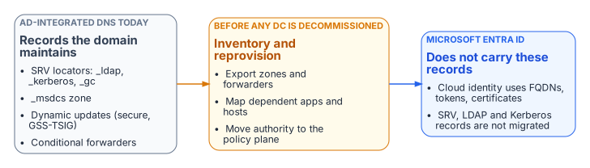

# Chapter 04 — The Active Directory DNS Departure

*What AD-integrated DNS does today, and what must be reprovisioned before it leaves.*

::: {.callout-tip}
## Download this chapter
**[next-generation-ddi-ch04-bundle.docx](../../downloads/next-generation-ddi-ch04-bundle.docx)**: this chapter as a Word document, with its figures. The [whole book](../../downloads/next-generation-ddi-bundle.docx) is also available.
:::

{fig-alt="Left, AD-integrated DNS today: SRV locator records, the _msdcs zone, secure dynamic updates and conditional forwarders. Middle, inventory and reprovision before any domain controller is decommissioned. Right, Microsoft Entra ID does not carry these records."}

Active Directory has been the hidden DNS substrate of on-premises federal networks for twenty years. Domain controllers register SRV locator records (for LDAP, Kerberos and the global catalog) and the `_msdcs` zone; domain-joined hosts register their own records through secure dynamic updates; and AD-integrated zones quietly carry conditional forwarders that other systems depend on. None of this migrates when workloads move to Microsoft Entra ID. Entra ID is a cloud identity service: it consumes FQDNs, but it does not host the agency's zones, and it does not publish the SRV records that remaining domain-joined systems need to find a domain controller.

Departing AD DNS is therefore an inventory problem before it is a migration problem. Every zone, forwarder, SRV record and dynamic-update client must be found, mapped to the systems that depend on it, and reprovisioned under the policy plane before the first domain controller is retired (Chapter 09). DDI platforms commonly provide a coexistence mode for this: they synchronize with Microsoft DNS and DHCP in both directions, preserve domain controller SRV resolution and GSS-TSIG secure updates, and let authority move zone by zone. Decoupling DNS from the identity platform also removes a dependency: an identity outage no longer takes name resolution with it, and the reverse.

## Implications for Modern Microsoft SQL Server

SQL Server deployments continue to shift from Kerberos and SPN-based authentication toward Entra ID authentication, token-based access, managed identities and certificate-based patterns. The [SQL Server modernization narrative](../case-studies/sql-server-narrative/README.md) covers that shift; its DNS consequences are these:

- Kerberos SPNs and the SRV records behind them remain necessary for remaining domain-joined and hybrid instances, and must be inventoried before any AD DNS decommissioning.
- Token audiences, certificate SANs and connection strings all use FQDNs. Split-brain that sends a client to the wrong endpoint produces TLS or authentication failures that look like identity or certificate problems.
- Private connectivity to Azure SQL Database, Azure SQL Managed Instance or equivalent services depends on the private DNS records being visible from every client location (Chapter 07).
- OCSP and CRL endpoints used by the authentication stack must resolve reliably from every origin (Chapter 08, Decision 5).

The net effect is that the name layer must be at least as reliable and consistent as the identity layer it now supports.

---

**Previous:** [Chapter 03 — Federal Requirements: NIST SP 800-81 Rev. 3, FedRAMP and Zero Trust](03-federal-requirements.md)  
**Next:** [Chapter 05 — Edge Interception, Encrypted DNS and Rogue DHCP](05-edge-interception-and-bypass.md)
