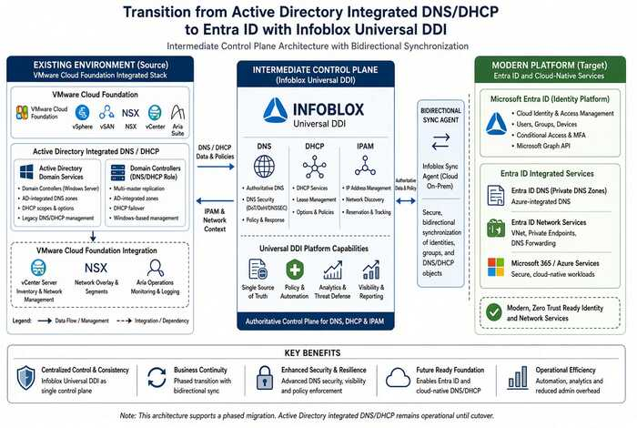

# Chapter 04 — The Active Directory DNS Departure

*What AD-integrated DNS does today, and what must be reprovisioned before it leaves.*

::: {.callout-tip}
## Download this chapter
**[next-generation-ddi-ch04-bundle.docx](../../downloads/next-generation-ddi-ch04-bundle.docx)**: this chapter as a Word document, with its figures. The [whole book](../../downloads/next-generation-ddi-bundle.docx) is also available.
:::

{fig-alt="Phased migration via Infoblox Universal DDI."}

Active Directory has been the hidden DNS substrate for on-premises
federal networks for twenty years. SRV, LDAP, Kerberos, and other
records do not migrate automatically when workloads move to Entra ID.
Universal DDI for Microsoft Management provides a lightweight agent with
bidirectional sync for coexistence and phased modernization while
preserving Domain Controller SRV resolution and GSS-TSIG updates. This
decouples DDI from the identity platform (AD or Entra ID) for resiliency
and reduced attack surface.

## Implications for Modern Microsoft SQL Server

Current and emerging SQL Server deployments continue to shift from
classic Kerberos/SPN session authentication toward Entra ID
authentication, token-based access, managed identities, and
certificate-based patterns.

- Kerberos SPNs and related SRV records remain necessary only for
  remaining legacy or hybrid instances; they must still be inventoried
  before any AD DNS decommissioning.

- Token audience claims, certificate SANs, and connection strings use
  FQDNs. Split-brain that directs a client to the wrong endpoint
  produces TLS or authentication failures that appear to be identity or
  certificate problems.

- Private connectivity to Azure SQL, SQL Managed Instance, or equivalent
  services depends on correct private DNS records being visible from
  every client location. Unified DDI keeps those records consistent.

- OCSP/CRL and other revocation endpoints used by the modern auth stack
  must resolve reliably from all origins.

The net effect is that the name layer must be at least as reliable and
consistent as the identity layer it now supports.

---

**Previous:** [Chapter 03 — Federal Requirements: NIST SP 800-81 Rev. 3, FedRAMP and Zero Trust](03-federal-requirements.md)  
**Next:** [Chapter 05 — Edge Interception, Encrypted DNS and Rogue DHCP](05-edge-interception-and-bypass.md)
