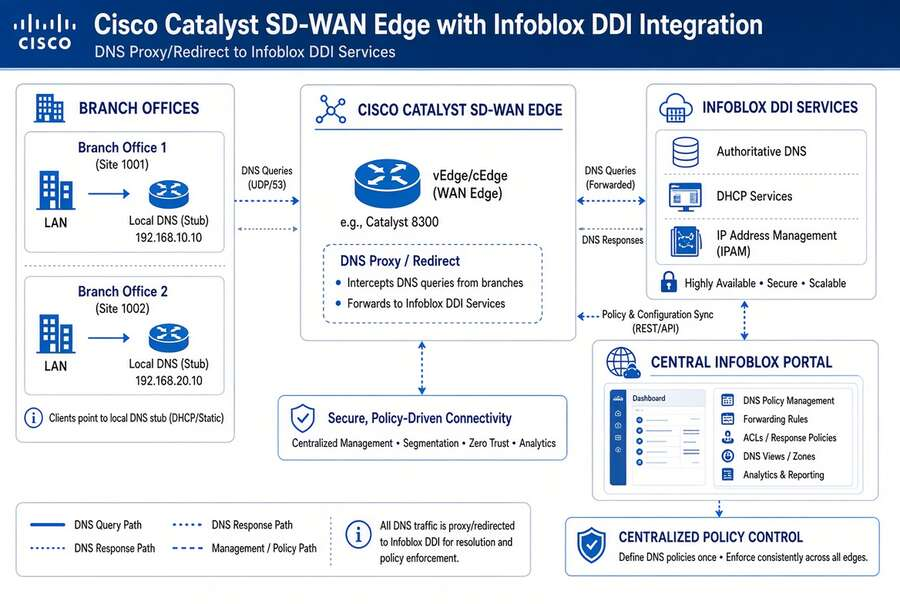
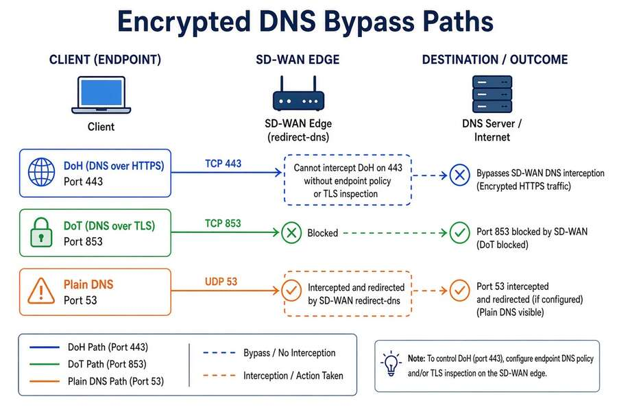

# Chapter 05 — Edge Interception, Encrypted DNS and Rogue DHCP

*Where queries escape the governed resolver path.*

::: {.callout-tip}
## Download this chapter
**[next-generation-ddi-ch05-bundle.docx](../../downloads/next-generation-ddi-ch05-bundle.docx)**: this chapter as a Word document, with its figures. The [whole book](../../downloads/next-generation-ddi-bundle.docx) is also available.
:::

## SD-WAN DNS Interception

{fig-alt="DNS proxy/redirect to Infoblox DDI."}

Cisco Catalyst SD-WAN (IOS XE SD-WAN ≥ 20.4/17.4) intercepts DNS via its
redirect-dns data policy. The edge router redirects the query to a
policy-designated server regardless of the client’s configured resolver.
The destination determines whether agency policy is applied:

Correct path: Branch User → SD-WAN edge → network-addressable
agency-controlled resolver → DDI policy plane (RPZ, DNSSEC, IPAM) →
per-CSP private resolvers.

Bypassed path: Branch User → SD-WAN edge → external resolver (for
example Cisco Umbrella or any non-governed target) → public recursion.
The agency policy plane is invisible to those queries.

DNSSEC validation must occur on a resolver the agency controls. A
forwarding resolver can validate if it requests and checks DNSSEC
records, but if redirect-dns or conditional forwarding sends queries to
an upstream resolver outside agency control, the agency loses the
ability to enforce its own validation policy and trust anchors.
Microsoft INR is available only for WW Commercial tenants and is
explicitly excluded for GCC Moderate, GCC High, and DoD. Direct internet
breakout with DSCP marking and application-aware routing remain the
primary M365 optimization mechanisms in sovereign cloud.[^c05-5]

## Encrypted DNS and Bypass Controls

{fig-alt="DoH DoT and plain DNS paths."}

Client-side DoH or DoT to public resolvers is a common bypass vector.
Under OMB M-22-09 and CISA guidance, FCEB agencies must prevent
unauthorized DNS paths. Practical controls include:

- Network-level blocking or redirection of known public DoH/DoT
  endpoints (with exceptions only for approved resolvers).

- Endpoint controls (MDM, GPO, or SASE agents) that force DNS through
  the governed resolver or Infoblox Endpoint.

- SD-WAN redirect-dns operates on plain DNS (port 53). It cannot
  redirect DNS over TLS (DoT) without breaking the TLS session, because
  the client validates the resolver’s certificate. DoT can be blocked at
  port 853. DNS over HTTPS (DoH) runs over port 443 and cannot be
  intercepted by redirect-dns; DoH bypass requires endpoint policy or
  TLS inspection.

- Logging and alerting on resolution-path anomalies (queries that never
  appear in the governed resolver logs).

The goal is not to prohibit encrypted DNS, but to ensure encryption
terminates at an agency-controlled or CISA Protective DNS resolver
rather than an ungoverned public service.

## DHCP Option-6 and Rogue DHCP

A rogue DHCP server that distributes a malicious DNS resolver via
Option-6 can redirect an entire subnet through an attacker-controlled
resolver in one step, bypassing all RPZ and Protective DNS controls. In
IPv6 networks, rogue Router Advertisements (RFC 8106) can also
distribute DNS server addresses and are often the larger attack surface.
Unified DHCP and IPv6 governance addresses this by:

- Centralized scope and option management with change control and audit
  trails.

- Rogue DHCP detection (via DHCP snooping integration, lease analysis,
  or Network Insight).

- Consistent Option-6 values enforced across all authorized DHCP
  servers.

- Integration with IPAM so unauthorized leases are immediately visible.

---

**Previous:** [Chapter 04 — The Active Directory DNS Departure](04-active-directory-dns-departure.md)  
**Next:** [Chapter 06 — DNS Identity, Certificates and DNSSEC](06-dns-identity-and-dnssec.md)

[^c05-5]: Microsoft Learn. Office 365 Network Connectivity Principles and INR documentation (updated 2026-03-10).
