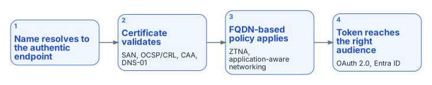
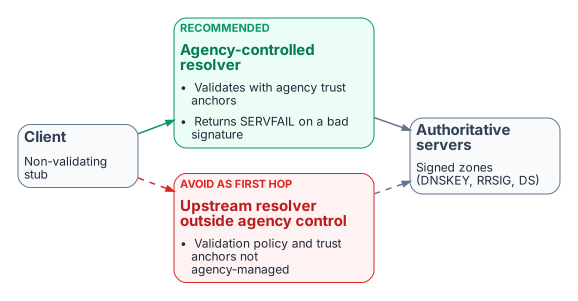

# Chapter 06 — DNS Identity, Certificates and DNSSEC

*The name layer as the first link in the trust chain.*

::: {.callout-tip}
## Download this chapter
**[next-generation-ddi-ch06-bundle.docx](../../downloads/next-generation-ddi-ch06-bundle.docx)**: this chapter as a Word document, with its figures. The [whole book](../../downloads/next-generation-ddi-bundle.docx) is also available.
:::

## DNS Identity as the Foundation for Certificates, Application-Aware Networking and Tokens

{fig-alt="Four steps in sequence: the name resolves to the authentic endpoint; the certificate validates (SAN, OCSP and CRL, CAA, DNS-01); FQDN-based policy applies (ZTNA, application-aware networking); and the token reaches the right audience (OAuth 2.0, Entra ID)."}

DNS identity, meaning the authoritative mapping of names to addresses, owners and lifecycle, is a prerequisite for certificate-based security, application-aware networking and token-based controls.

- **Certificate issuance.** ACME DNS-01 challenges, used by public and private certificate authorities, require the ability to create and remove TXT records under controlled, auditable authority.[^c06-rfc8555] An enterprise DDI API makes automated issuance and renewal possible without exposing web servers. CAA records limit which authorities may issue for a name.[^c06-rfc8659]
- **Certificate pinning.** DNSSEC provides integrity and authenticity for DNS data, which is what makes DANE and TLSA records usable for binding certificates to names independently of the public PKI.[^c06-rfc6698]
- **Encrypted DNS.** DoT, DoH and DoQ resolvers present certificates of their own, which must be issued, rotated and monitored like any other server certificate.
- **Application-aware networking and ZTNA.** These depend on reliable FQDN-based policy ("allow this group to this application FQDN") rather than brittle IP rules. Wildcard namespaces (`*.api.agency.gov`) define the application surface.
- **Tokens.** OAuth 2.0, JWTs and Microsoft Entra ID operate after the connection is made. DNS decides whether the client reaches the authentic endpoint that issues or validates the token, and Protective DNS helps keep tokens from being sent to malicious destinations.

DNS identity is the first link in the chain that makes certificate, application and token controls meaningful. Under split-brain, certificate validation failures, access denials and policy gaps become symptoms that are harder to diagnose than classic Kerberos failures.

## DNSSEC

DNSSEC (DNS Security Extensions) adds data-origin authentication and integrity protection to DNS. It does not encrypt queries; it lets a resolver verify that the answer it received is authentic and was not modified in transit. It provides:

- **Data-origin authentication:** the answer came from the legitimate authoritative servers for the zone.
- **Integrity protection:** the data has not been altered.
- **Authenticated denial of existence:** proof that a name or record type does not exist.[^c06-rfc4033]

DNSSEC uses a chain of trust from the DNS root through the top-level domains to individual zones. Zones are signed with private keys; resolvers validate the signatures with the matching public keys (DNSKEY records) and the Delegation Signer (DS) records published in the parent zone.

### Why It Matters in Hybrid Multi-Cloud and Federal Environments

{fig-alt="A non-validating client stub sends queries either to an agency-controlled resolver that validates with agency trust anchors and returns SERVFAIL on a bad signature, or to an upstream resolver outside agency control whose validation policy and trust anchors the agency does not manage. Both query signed authoritative zones."}

- DNSSEC mitigates cache poisoning and on-path tampering with DNS answers.
- It is the foundation for DANE and TLSA records.
- OMB M-08-23 required DNSSEC for federal systems, SP 800-53 controls SC-20 and SC-21 require signing and validation, and NIST SP 800-81r3 recommends deploying it.[^c06-m0823][^c06-nist81]
- Validation must occur on a resolver the agency controls (Chapter 05). If redirect-dns or forwarding sends queries to an upstream resolver that validates outside agency control, the agency cannot enforce its own validation policy.

### Operational Considerations

- Key management (KSK and ZSK rollover) must be automated and audited.
- Signing increases response sizes, so EDNS(0) and correct MTU and fragmentation handling are required.[^c06-rfc6891]
- DNSSEC support differs across cloud DNS services (see below); a unified DDI plane makes consistent signing and validation policy achievable.
- DNSSEC protects integrity, not confidentiality. Encrypted DNS and Protective DNS remain complementary controls.

Inconsistent DNSSEC deployment across views (signed in one, unsigned or differently signed in another) produces validation failures that surface as application or certificate errors rather than clear DNSSEC errors. A single control plane removes most of that class of inconsistency.

## DNSSEC Across Azure, AWS and Other Cloud Providers

Signing and validation policy should be orchestrated from the central DDI plane, so that key rollover, DS publication and validation behavior do not diverge between environments. The cloud services do not offer equal support, and the gaps matter:

- **Azure.** Azure DNS supports DNSSEC signing for public zones only, with zone-signing key rollover handled automatically. Azure Private DNS zones cannot be signed, and the Azure-provided recursive resolver does not perform DNSSEC validation. Workloads that need validation must use a validating resolver the agency controls.[^c06-azdnssec] Entra ID consumes FQDNs but does nothing for DNSSEC or private endpoint DNS.
- **AWS.** Route 53 supports DNSSEC signing for public hosted zones, not private hosted zones. Route 53 Resolver can validate DNSSEC responses when validation is enabled for a VPC.[^c06-r53dnssec]
- **Everywhere.** Zones that must be signed are signed by the DDI platform, or by the cloud DNS service under DDI control, with rollover automated in one place. Validation happens on resolvers the agency controls, and redirect-dns and cloud forwarding point at those resolvers.

---

**Previous:** [Chapter 05 — Edge Interception, Encrypted DNS and Rogue DHCP](05-edge-interception-and-bypass.md)  
**Next:** [Chapter 07 — Cloud Private Endpoints, SDN and IPAM Consistency](07-cloud-private-endpoints-and-ipam.md)

[^c06-rfc8555]: IETF RFC 8555, *Automatic Certificate Management Environment (ACME)*, March 2019 (DNS-01 challenge). <https://www.rfc-editor.org/rfc/rfc8555>
[^c06-rfc8659]: IETF RFC 8659, *DNS Certification Authority Authorization (CAA) Resource Record*, November 2019. <https://www.rfc-editor.org/rfc/rfc8659>
[^c06-rfc6698]: IETF RFC 6698, *The DNS-Based Authentication of Named Entities (DANE) Transport Layer Security (TLS) Protocol: TLSA*, August 2012. <https://www.rfc-editor.org/rfc/rfc6698>
[^c06-rfc4033]: IETF RFC 4033, *DNS Security Introduction and Requirements*, March 2005, and RFC 9364, *DNS Security Extensions (DNSSEC)*, BCP 237, February 2023. <https://www.rfc-editor.org/rfc/rfc4033>; <https://www.rfc-editor.org/rfc/rfc9364>
[^c06-m0823]: OMB M-08-23, *Securing the Federal Government's Domain Name System Infrastructure*, August 22, 2008. <https://georgewbush-whitehouse.archives.gov/omb/memoranda/fy2008/m08-23.pdf>
[^c06-nist81]: NIST SP 800-81 Rev. 3, *Secure Domain Name System (DNS) Deployment Guide*, March 19, 2026. <https://csrc.nist.gov/pubs/sp/800/81/r3/final>
[^c06-rfc6891]: IETF RFC 6891, *Extension Mechanisms for DNS (EDNS(0))*, April 2013. <https://www.rfc-editor.org/rfc/rfc6891>
[^c06-azdnssec]: Microsoft Learn, "Overview of DNSSEC - Azure Public DNS" (Azure DNS: public zones only; Private DNS not supported; automatic ZSK rollover). <https://learn.microsoft.com/en-us/azure/dns/dnssec>
[^c06-r53dnssec]: AWS, *Amazon Route 53 Developer Guide*: "Configuring DNSSEC signing in Amazon Route 53" and "Enabling DNSSEC validation in Amazon Route 53." <https://docs.aws.amazon.com/Route53/latest/DeveloperGuide/dns-configuring-dnssec.html>; <https://docs.aws.amazon.com/Route53/latest/DeveloperGuide/resolver-dnssec-validation.html>
