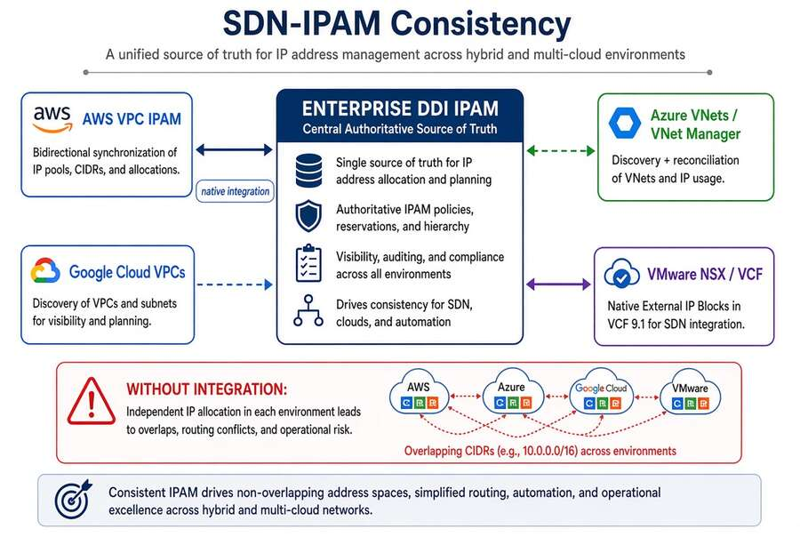

# Chapter 07 — Cloud Private Endpoints, SDN and IPAM Consistency

*Keeping names and addresses consistent across Azure, AWS, Google Cloud and VMware.*

::: {.callout-tip}
## Download this chapter
**[next-generation-ddi-ch07-bundle.docx](../../downloads/next-generation-ddi-ch07-bundle.docx)**: this chapter as a Word document, with its figures. The [whole book](../../downloads/next-generation-ddi-bundle.docx) is also available.
:::

## How to Handle Azure DNS and Private Endpoints

{fig-alt="Private endpoint resolution consistency."}

Azure Private Endpoints and Private Link create the most common source
of private-IP split-brain in hybrid environments. Correct handling
requires deliberate DNS design rather than relying on Azure’s default
public resolution.

### Core Behavior

When a private endpoint is created, Azure publishes a record in a
privatelink zone (for example privatelink.blob.core.windows.net or
privatelink.database.windows.net) that resolves the service FQDN to a
VNet-scoped RFC 1918 address. Resolution of that private address occurs
only for queries that reach a DNS path linked to the VNet (Azure Private
DNS zone link + Private Resolver inbound endpoint, or equivalent
conditional forwarding). Queries that fall through to public recursive
resolution receive the public IP instead.

### Recommended Pattern with Unified DDI

- Make Universal DDI (or the chosen control plane) the system of record
  for the private namespaces.

- Configure conditional forwarding so that on-premises resolvers, Route
  53 Resolver outbound endpoints, GCP forwarding, and branch/SD-WAN
  paths all send the relevant privatelink zones to the Azure DNS Private
  Resolver inbound endpoint (or to an Infoblox resolver that itself
  forwards correctly).

- Use Azure Private DNS zone links for VNets that must resolve the
  private endpoint natively.

- Validate end-to-end from every major origin (on-premises, AWS, GCP,
  branches) that the FQDN returns the private address and that traffic
  stays on the private path.

- Monitor for resolution-path anomalies so that missing or stale
  forwarding rules are detected before they produce silent public-path
  fallback.

Known limitations in some Infoblox–Azure DNS integrations (tag support,
non-simple routing policies, certain NS/SOA sync constraints) should be
reviewed against current product documentation; workarounds or selective
zone ownership may be required for edge cases.

## SDN–IPAM Consistency Across CSPs and VMware

{fig-alt="Enterprise IPAM with CSP and VMware."}

Each cloud service provider and VMware maintains its own
software-defined networking (SDN) constructs and native IP address
management. Without integration, these systems allocate address space
independently of the enterprise DDI plane, recreating the same
divergence problem that split-brain DNS creates for names.

### The Consistency Problem

AWS VPCs, Azure VNets, Google Cloud VPCs, and VMware NSX segments each
maintain their own address pools and allocation logic. When CloudOps
teams create networks directly in the CSP console or VCF Automation, the
resulting CIDRs can overlap with on-premises space, with other clouds,
or with other divisions. The enterprise DDI system remains unaware until
discovery runs or a conflict appears. The same pattern appears with DNS:
private zones and records are created inside the CSP or NSX without
synchronized policy or inventory in the central control plane.

### AWS VPC IPAM Integration

Amazon VPC IPAM can be configured to use an external authority. The
November 2025 integration with Infoblox Universal IPAM allows Amazon VPC
IPAM to request non-overlapping IPv4 blocks from the enterprise IPAM.
CloudOps teams can request address space through the AWS Management
Console, CLI, or SDK; the enterprise IPAM validates uniqueness and
returns a conflict-free CIDR that is then organized into regional pools.
NetOps retains centralized visibility and control. Note that this
integration is currently available in commercial AWS Regions and is
excluded from AWS GovCloud (US) Regions.[^c07-7]

### Azure and Google Cloud

Azure Virtual Network Manager includes its own IPAM pools for
non-overlapping CIDR assignment inside Azure. Google Cloud provides
Internal Range management. Universal DDI discovery and cloud federation
bring these networks, subnets, and associated DNS zones into the central
inventory so that overlaps and policy gaps become visible. Full
bidirectional allocation (the AWS VPC IPAM pattern) is more mature on
AWS; on Azure and GCP the primary controls today are discovery,
inventory reconciliation, and policy enforcement on the DNS side, with
address-block governance still requiring explicit process or API
integration.

### VMware Cloud Foundation / NSX

On the VMware side, virtual appliances on ESXi join the Grid. VMware Cloud Foundation 9.1 provides native DDI integration: Infoblox as single source of truth, automatic IP block allocation and reservation, and FQDN registration on workload deployment.

VMware Cloud Foundation 9.1 introduced native integration between NSX
and Infoblox NIOS DDI. NSX imports Infoblox network containers as
External IP address blocks. When vCenter administrators or VCF
Automation tenants provision networks or workloads, the subnet and IP
allocation is drawn from those Infoblox blocks, and FQDN records can be
registered automatically. This keeps Infoblox as the single source of
truth for both physical and logical (NSX) address space while preserving
self-service for cloud teams. Limitations documented by VMware include
lack of IPv6 support in the initial integration and requirements around
certificate presentation from the Infoblox Grid Master.[^c07-8]

### Operational Implications

- Treat the enterprise DDI IPAM as the authoritative source for address
  blocks that will be used across on-premises, CSP, and VMware
  environments.

- Where native integration exists (AWS VPC IPAM, VCF 9.1 / NSX), enable
  it so that CloudOps and VCF tenants allocate from the central
  authority rather than inventing CIDRs.

- Where only discovery is available (Azure, GCP), schedule continuous
  discovery and reconciliation, and enforce process controls that
  require address blocks to be reserved in the enterprise IPAM before
  CSP or NSX networks are created.

- Pair IPAM consistency with the DNS consistency already described:
  private zones and records created in CSP or NSX DNS services must be
  synchronized or conditionally forwarded so that resolution remains
  consistent with the address that was allocated.

- Monitor synchronization health. Integration reduces independent
  authoring but introduces a new failure mode if the central IPAM is
  unreachable or if sync lag allows a conflicting allocation.

SDN–IPAM consistency is the address-layer counterpart to the DNS
split-brain problem. A single authoritative DDI plane that federates
with CSP and VMware SDN constructs prevents the overlaps and inventory
gaps that otherwise appear only after connectivity fails or an audit
finds undocumented address space.

## IPv6 Lifecycle and Dual-Stack Considerations

OMB M-21-07 sets IPv6-only targets for federal agencies (80% of assets
by the end of FY2025). Universal DDI supports dual-stack and IPv6-only
operation through:

- Unified IPv4/IPv6 address planning and allocation to prevent overlaps.

- DDNS and DHCP for both protocols with consistent lifecycle management.

- DNS views and conditional forwarding that correctly handle dual-stack
  resolution paths.

- Hygiene and discovery that surface dual-stack assets for inventory and
  Zero Trust policy.

Split-brain risks exist in dual-stack environments when IPv4 and IPv6
resolution paths are managed independently; a single control plane
reduces that risk.

---

**Previous:** [Chapter 06 — DNS Identity, Certificates and DNSSEC](06-dns-identity-and-dnssec.md)  
**Next:** [Chapter 08 — Reference Architecture and the Five Critical Decisions](08-reference-architecture.md)

[^c07-7]: AWS: Amazon VPC IPAM automates IP assignments from Infoblox IPAM, November 17, 2025. Excluded from AWS GovCloud (US) Regions. https://aws.amazon.com/about-aws/whats-new/2025/11/amazon-vpc-ipam-automates-ip-from-infoblox/
[^c07-8]: VMware Cloud Foundation 9.1: Native Integration with Infoblox for NSX IPAM and DNS. https://blogs.vmware.com/cloud-foundation/2026/05/15/vcf-networking-9-1-seamless-ddi-integration-with-infoblox/
