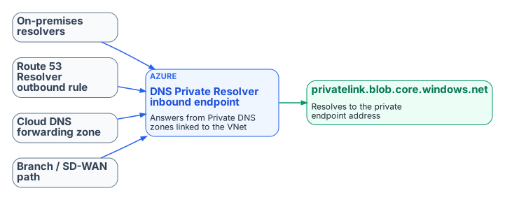
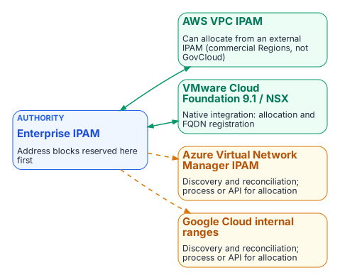

# Chapter 07 — Cloud Private Endpoints, SDN and IPAM Consistency

*Keeping names and addresses consistent across Azure, AWS, Google Cloud and VMware.*

::: {.callout-tip}
## Download this chapter
**[next-generation-ddi-ch07-bundle.docx](../../downloads/next-generation-ddi-ch07-bundle.docx)**: this chapter as a Word document, with its figures. The [whole book](../../downloads/next-generation-ddi-bundle.docx) is also available.
:::

## Azure DNS and Private Endpoints

{fig-alt="On-premises resolvers, a Route 53 Resolver outbound rule, a Cloud DNS forwarding zone and the branch SD-WAN path all forward to the Azure DNS Private Resolver inbound endpoint, which answers from the Private DNS zone privatelink.blob.core.windows.net with the private endpoint address."}

Azure private endpoints are the most common source of private-IP split-brain in hybrid environments. Getting them right takes deliberate DNS design rather than reliance on Azure's default public resolution.

### Core Behavior

When a private endpoint is created with DNS integration, Azure records the service's address in a privatelink Private DNS zone (for example `privatelink.blob.core.windows.net` or `privatelink.database.windows.net`), and the public name gains a CNAME into that zone.[^c07-azpe] A query resolves to the private address only if it reaches a resolver that can see the zone: the Azure-provided resolver in a VNet linked to the zone, or an Azure DNS Private Resolver inbound endpoint (or another resolver forwarding to one). Queries that fall through to public recursion get the public address instead. Private Resolver inbound and outbound endpoints each need their own dedicated subnet in the VNet.[^c07-azpr]

### Recommended Pattern with a Unified Control Plane

- Make the DDI policy plane the system of record for the private namespaces and their forwarding rules.
- Configure conditional forwarding so that on-premises resolvers, Route 53 Resolver outbound endpoints, Google Cloud DNS forwarding zones and branch SD-WAN paths all send the relevant privatelink zones to the Azure DNS Private Resolver inbound endpoint, or to an agency resolver that forwards there.
- Link the Private DNS zones to the VNets that must resolve the private endpoints natively.[^c07-azpdns]
- Validate end to end, from every major origin (on-premises, AWS, Google Cloud, branches), that the FQDN returns the private address and that traffic stays on the private path.
- Monitor for resolution-path anomalies, so that a missing or stale forwarding rule is found before it causes a silent fallback to the public path.

DDI platforms that synchronize records with Azure DNS each have documented limits on which record types, routing policies and zone records they synchronize. Review the current vendor documentation before relying on synchronization for a given zone; selective zone ownership or forwarding may be the better choice for edge cases.

## SDN–IPAM Consistency Across Cloud Providers and VMware

{fig-alt="Enterprise IPAM, where address blocks are reserved first, feeds AWS VPC IPAM, which can allocate from an external IPAM in commercial Regions but not GovCloud, and VMware Cloud Foundation 9.1 and NSX, which have native allocation and FQDN registration. Azure Virtual Network Manager IPAM and Google Cloud internal ranges rely on discovery and reconciliation, with process or API for allocation."}

Each cloud provider, and VMware, has its own software-defined networking constructs and native address management. Unintegrated, they allocate address space independently of the enterprise DDI plane, recreating for addresses the same divergence that split-brain DNS creates for names.

### The Consistency Problem

AWS VPCs, Azure VNets, Google Cloud VPCs and VMware NSX segments each have their own address pools and allocation logic. When cloud teams create networks directly in a provider console or in VCF Automation, the resulting CIDRs can overlap with on-premises space, with other clouds or with other divisions, and the enterprise DDI system does not know until discovery runs or a conflict appears. DNS shows the same pattern: private zones and records are created inside the provider or NSX with no synchronized policy or inventory in the central control plane.

### AWS VPC IPAM Integration

Amazon VPC IPAM can use an external IPAM as its source of address space. Since November 2025 it has integrated with Infoblox Universal IPAM: cloud teams request address space through the AWS console, CLI or SDK, the external IPAM checks uniqueness and returns a conflict-free CIDR, and VPC IPAM organizes it into regional pools. The integration applies to private scopes and is not available in the AWS GovCloud (US) or China Regions, so it does not help a GovCloud estate today.[^c07-awsipam]

### Azure and Google Cloud

Azure Virtual Network Manager has its own IPAM pools for non-overlapping CIDR assignment inside Azure,[^c07-avnmipam] and Google Cloud has internal ranges for reserving and protecting address space in a VPC.[^c07-gcpir] DDI discovery and cloud federation bring these networks, subnets and their DNS zones into the central inventory, so that overlaps and policy gaps become visible. Neither offers an equivalent of the AWS external-IPAM pattern today. On Azure and Google Cloud the main controls are discovery, inventory reconciliation and DNS-side policy, and address-block governance still needs an explicit process or API integration.

### VMware Cloud Foundation and NSX

VMware Cloud Foundation 9.1 added native integration between NSX and Infoblox DDI. NSX imports Infoblox network containers as external IP address blocks. When vCenter administrators or VCF Automation tenants provision networks or workloads, subnets and addresses are drawn from those blocks and FQDN records can be registered automatically. The enterprise IPAM thus stays the source of truth for both physical and NSX address space while cloud teams keep self-service.[^c07-vmw] Confirm the current scope of the integration, including IPv6 support and certificate requirements, against VMware and Infoblox documentation before relying on it.

### Operational Implications

- Treat the enterprise IPAM as the authoritative source for address blocks used across on-premises, cloud and VMware environments.
- Where native integration exists (AWS VPC IPAM in commercial Regions, VCF 9.1 and NSX), enable it so that cloud and VCF tenants allocate from the central authority rather than inventing CIDRs.
- Where only discovery is available (Azure, Google Cloud, and AWS GovCloud), run continuous discovery and reconciliation, and require address blocks to be reserved in the enterprise IPAM before cloud or NSX networks are created.
- Pair address consistency with DNS consistency: private zones and records created in cloud or NSX DNS services must be synchronized or conditionally forwarded, so that resolution matches the address that was allocated.
- Monitor synchronization health. Integration reduces independent authoring but adds a failure mode if the central IPAM is unreachable or sync lag allows a conflicting allocation.

SDN–IPAM consistency is the address-layer counterpart to split-brain DNS. A single authoritative DDI plane that federates with cloud and VMware networking prevents the overlaps and inventory gaps that otherwise surface only when connectivity fails or an audit finds undocumented address space.

## IPv6 Lifecycle and Dual-Stack Considerations

OMB M-21-07 sets IPv6-only targets for IP-enabled assets on federal networks: 20% by the end of FY2023, 50% by the end of FY2024 and 80% by the end of FY2025.[^c07-m2107] A unified DDI plane supports dual-stack and IPv6-only operation through:

- Unified IPv4 and IPv6 address planning and allocation, to prevent overlaps.
- DHCPv6, router advertisement governance and dynamic DNS with consistent lifecycle management for both protocols.
- DNS views and conditional forwarding that handle dual-stack resolution paths correctly, including AAAA records for private endpoints where the cloud service supports them.
- Hygiene and discovery that surface dual-stack assets for inventory and Zero Trust policy.

Split-brain risk rises in dual-stack environments when IPv4 and IPv6 resolution paths are managed separately; a single control plane reduces it.

---

**Previous:** [Chapter 06 — DNS Identity, Certificates and DNSSEC](06-dns-identity-and-dnssec.md)  
**Next:** [Chapter 08 — Reference Architecture and the Five Critical Decisions](08-reference-architecture.md)

[^c07-azpe]: Microsoft Learn, "Azure Private Endpoint DNS Integration Scenarios" and "Azure Private Endpoint private DNS zone values." <https://learn.microsoft.com/en-us/azure/private-link/private-endpoint-dns-integration>; <https://learn.microsoft.com/en-us/azure/private-link/private-endpoint-dns>
[^c07-azpr]: Microsoft Learn, "Azure DNS Private Resolver Overview" (inbound and outbound endpoints and their dedicated subnets). <https://learn.microsoft.com/en-us/azure/dns/dns-private-resolver-overview>
[^c07-azpdns]: Microsoft Learn, "Azure Private DNS: Secure DNS for Virtual Networks." <https://learn.microsoft.com/en-us/azure/dns/private-dns-overview>
[^c07-avnmipam]: Microsoft Learn, "What is IP address management (IPAM) in Azure Virtual Network Manager?" <https://learn.microsoft.com/en-us/azure/virtual-network-manager/concept-ip-address-management>
[^c07-gcpir]: Google Cloud, "Internal ranges overview" (VPC). <https://cloud.google.com/vpc/docs/internal-ranges>
[^c07-awsipam]: AWS, "Amazon VPC IPAM automates IP assignments from Infoblox IPAM," November 17, 2025, and *Amazon VPC IPAM User Guide*, "Integrate VPC IPAM with Infoblox infrastructure" (private scopes; not in the China or AWS GovCloud (US) Regions). <https://aws.amazon.com/about-aws/whats-new/2025/11/amazon-vpc-ipam-automates-ip-from-infoblox/>; <https://docs.aws.amazon.com/vpc/latest/ipam/integrate-infoblox-ipam.html>
[^c07-vmw]: **Third-party source (vendor blog).** VMware Cloud Foundation blog, "VCF 9.1 Networking: Seamless DDI Integration with Infoblox," May 15, 2026. <https://blogs.vmware.com/cloud-foundation/2026/05/15/vcf-networking-9-1-seamless-ddi-integration-with-infoblox/>
[^c07-m2107]: OMB M-21-07, *Completing the Transition to Internet Protocol Version 6 (IPv6)*, November 19, 2020. <https://www.whitehouse.gov/wp-content/uploads/2020/11/M-21-07.pdf>
