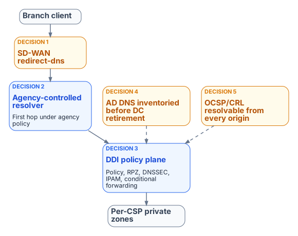

# Chapter 08 — Reference Architecture and the Five Critical Decisions

*One authoritative policy plane, and the decisions that carry the operational risk.*

::: {.callout-tip}
## Download this chapter
**[next-generation-ddi-ch08-bundle.docx](../../downloads/next-generation-ddi-ch08-bundle.docx)**: this chapter as a Word document, with its figures. The [whole book](../../downloads/next-generation-ddi-bundle.docx) is also available.
:::

## The End-to-End Resolution Flow and Five Decisions

{fig-alt="A branch client's query passes the SD-WAN redirect-dns edge (Decision 1) to an agency-controlled resolver that is the first hop under agency policy (Decision 2), then to the DDI policy plane holding policy, RPZ, DNSSEC, IPAM and conditional forwarding (Decision 3), and on to per-cloud private zones. AD DNS is inventoried before decommissioning (Decision 4), and OCSP and CRL endpoints resolve from every origin (Decision 5)."}

The end-to-end resolution flow runs from the SD-WAN branch edge, through a network-addressable agency-controlled resolver, into the DDI policy plane (policy, response policy zones, DNSSEC, IPAM) and on to per-cloud private zones and authoritative services. Internet-bound recursion leaves through CISA Protective DNS.[^c08-cisapdns] Five decisions carry almost all of the operational risk:

- **Decision 1 — the redirect-dns destination.** It must be a network-addressable resolver under agency control (a DDI resolver or forwarding proxy at the branch or in a regional hub), never a client-side loopback stub such as an endpoint agent listening on 127.0.0.1, which the edge cannot reach.
- **Decision 2 — forwarding chain order.** Any additional resolver, such as a SASE provider's DNS service, must be a forwarding target of the agency-controlled resolver, never the redirect-dns target. The agency resolver is always the first hop under agency policy control.
- **Decision 3 — per-cloud conditional forwarding.** The policy plane holds the authoritative forwarding rules for every private namespace (Chapter 07).
- **Decision 4 — AD DNS inventory before deprecation.** SRV records, conditional forwarders and namespace delegations are inventoried and reprovisioned before any domain controller is decommissioned (Chapter 04).
- **Decision 5 — OCSP and CRL reachability from every origin.** PKI validation endpoints must resolve consistently from on-premises, every cloud and every branch (Chapter 06).

## Moving from Per-Cloud Local Syncs to a Unified Control Plane

Agencies that already copy DNS records into each cloud provider should change the operating model from "author copies in every silo" to "one authoritative policy and state plane that the silos consume."

### Target Operating Model

- The DDI policy plane holds the system of record for zones, forwarding rules, IPAM data and security policy.
- Cloud DNS services (Route 53, Azure Private DNS, Google Cloud DNS and others) become synchronized targets or forwarding destinations rather than independently authored sources.
- SD-WAN redirect-dns and other edge interceptors point at network-addressable resolvers inside the governed path.
- AD DNS is inventoried and either coexists during the transition or is migrated; Entra ID does not inherit SRV, LDAP or Kerberos records.

### Expected Improvements

- Far less unintentional split-brain for private endpoints and SaaS resolution.
- Faster, safer change: a new private endpoint or application namespace is published once.
- Uniform Protective DNS, logging and, where required, DNSSEC validation for the queries that matter.
- One hybrid inventory instead of islands of address and name data.
- A cleaner AD retirement path and fewer "works in one cloud but not another" incidents.

---

**Previous:** [Chapter 07 — Cloud Private Endpoints, SDN and IPAM Consistency](07-cloud-private-endpoints-and-ipam.md)  
**Next:** [Chapter 09 — The Migration Sequence](09-migration-sequence.md)

[^c08-cisapdns]: CISA, Protective Domain Name System (DNS) Resolver service. <https://www.cisa.gov/resources-tools/services/protective-domain-name-system-dns-resolver>
