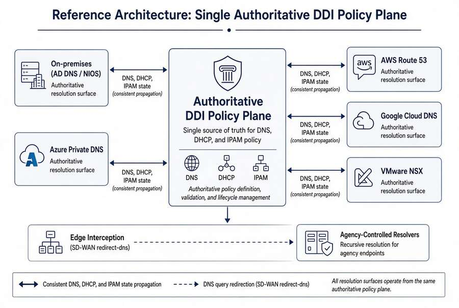

# Chapter 08 — Reference Architecture and the Five Critical Decisions

*One authoritative policy plane, and the decisions that carry the operational risk.*

::: {.callout-tip}
## Download this chapter
**[next-generation-ddi-ch08-bundle.docx](../../downloads/next-generation-ddi-ch08-bundle.docx)**: this chapter as a Word document, with its figures. The [whole book](../../downloads/next-generation-ddi-bundle.docx) is also available.
:::

## The End-to-End Resolution Flow and Five Decisions

{fig-alt="Single Authoritative DDI Policy Plane."}

The end-to-end resolution flow runs from the Cisco Catalyst SD-WAN
branch edge through a network-addressable Infoblox resolver into
Universal DDI (policy, RPZ, DNSSEC, IPAM) and onward to per-CSP private
zones and authoritative services. The five decisions that carry
essentially all operational risk are:

- **Decision 1 — redirect-dns destination.** Must target a
  network-addressable Infoblox resolver (NIOS-X or DNS Forwarding
  Proxy), not a client-side loopback stub.

- **Decision 2 — forwarding chain order.** Any additional resolver (for
  example Cisco Umbrella) must be a forwarding target of the
  agency-controlled resolver, never the redirect-dns target. The agency
  resolver must be the first hop under agency policy control.

- **Decision 3 — per-CSP conditional forwarding.** Universal DDI must
  hold authoritative forwarding rules for all private namespaces.

- **Decision 4 — AD DNS record inventory before deprecation.** SRV
  records, conditional forwarding, and namespace authorizations must be
  inventoried and reprovisioned before any domain controller is
  decommissioned.

- **Decision 5 — OCSP and CRL reachability from all origins.** PKI
  validation endpoints must resolve consistently from on-premises, every
  CSP, and every branch.

## Moving from Per-CSP Local Syncs to a Unified Control Plane

Agencies that already synchronize DNS records into each Cloud Service
Provider should change the operating model from “author copies in every
silo” to “one authoritative policy and state plane that the silos
consume.”

### Target Operating Model

- Universal DDI holds the system of record for zones, forwarding rules,
  IPAM data, and security policy.

- Cloud DNS services (Route 53, Azure Private DNS, Cloud DNS, etc.)
  become synchronized targets or consumers rather than independently
  authored sources.

- SD-WAN redirect-dns and other edge interceptors point at
  network-addressable resolvers inside the governed path.

- AD DNS is inventoried and either coexists during transition or is
  migrated; Entra ID does not automatically inherit SRV, LDAP, or
  Kerberos records.

### Expected Improvements

- Sharp reduction in unintentional split-brain for private endpoints and
  SaaS resolution.

- Faster, safer change: a new private endpoint or application namespace
  is published once.

- Uniform Protective DNS, logging, and (where required) DNSSEC
  validation across the queries that actually matter.

- Single hybrid inventory view instead of islands of address and name
  data.

- Cleaner AD retirement path and fewer “works in one cloud but not
  another” incidents.

---

**Previous:** [Chapter 07 — Cloud Private Endpoints, SDN and IPAM Consistency](07-cloud-private-endpoints-and-ipam.md)  
**Next:** [Chapter 09 — The Migration Sequence](09-migration-sequence.md)
