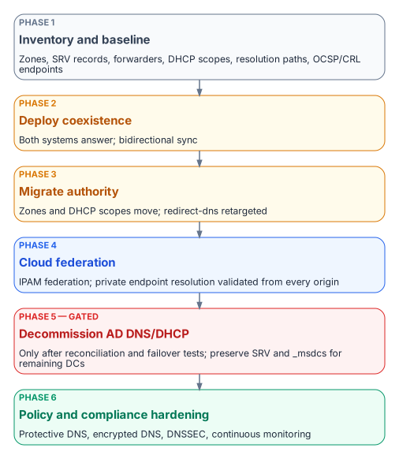

# Chapter 09 — The Migration Sequence

*Six phases from AD-integrated DNS/DHCP to a unified control plane.*

::: {.callout-tip}
## Download this chapter
**[next-generation-ddi-ch09-bundle.docx](../../downloads/next-generation-ddi-ch09-bundle.docx)**: this chapter as a Word document, with its figures. The [whole book](../../downloads/next-generation-ddi-bundle.docx) is also available.
:::

## Phased Migration and Cutover Sequence

{fig-alt="Six phases top to bottom: inventory and baseline; deploy coexistence; migrate authority; cloud federation; decommission AD DNS and DHCP; policy and compliance hardening."}

A practical sequence for moving from AD-integrated DNS and DHCP plus independent cloud DNS to a unified DDI plane, while keeping services running:

- **Phase 1 — Inventory and baseline.** Export every AD DNS zone, SRV record, conditional forwarder and DHCP scope. Document current resolution paths, including SD-WAN redirect-dns targets, and the OCSP and CRL endpoints in use.
- **Phase 2 — Deploy coexistence.** Stand up the DDI platform's resolvers and its Microsoft DNS and DHCP synchronization. Establish conditional forwarding so that both systems can answer during the transition.
- **Phase 3 — Migrate authority.** Move authoritative zones and DHCP scopes to the DDI platform, zone by zone. Retarget SD-WAN redirect-dns to network-addressable agency resolvers (Chapter 08, Decision 1).
- **Phase 4 — Cloud federation.** Enable cloud discovery and IPAM federation with AWS, Azure and Google Cloud, and VMware where it applies. Validate private endpoint resolution end to end from every origin.
- **Phase 5 — Decommission AD DNS and DHCP.** Only after full inventory reconciliation and successful failover testing. Preserve the SRV and `_msdcs` records that remaining domain controllers and domain-joined systems still need.
- **Phase 6 — Policy and compliance hardening.** Enable Protective DNS forwarding, encrypted DNS, DNSSEC signing and validation where required, and continuous monitoring dashboards, and assemble the evidence in Chapter 10.

Each phase should end with a rollback point and a resolution-path consistency test (Chapter 11), not with a calendar date.

---

**Previous:** [Chapter 08 — Reference Architecture and the Five Critical Decisions](08-reference-architecture.md)  
**Next:** [Chapter 10 — Operating the Control Plane: Delegation, Automation and Evidence](10-operating-the-control-plane.md)
