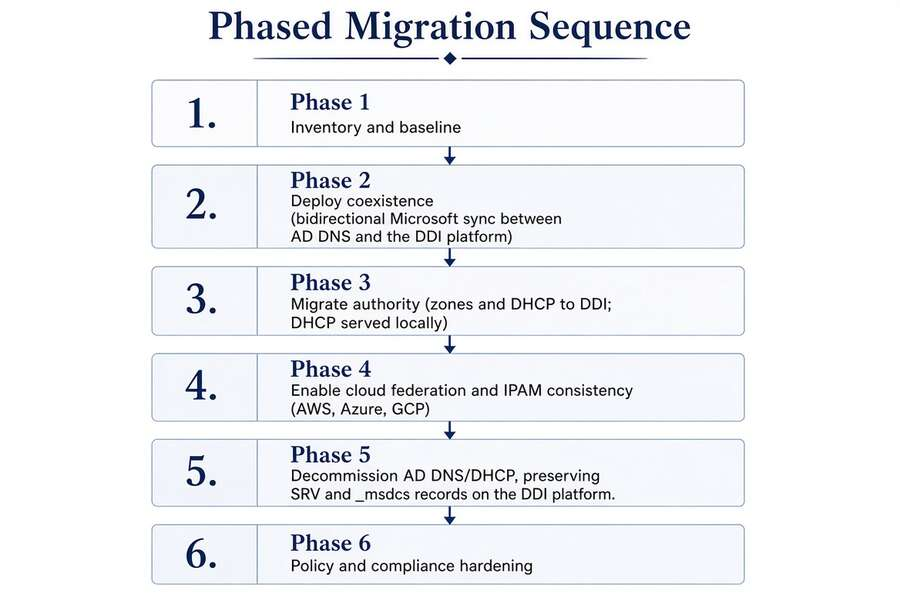

# Chapter 09 — The Migration Sequence

*Six phases from AD-integrated DNS/DHCP to a unified control plane.*

::: {.callout-tip}
## Download this chapter
**[next-generation-ddi-ch09-bundle.docx](../../downloads/next-generation-ddi-ch09-bundle.docx)**: this chapter as a Word document, with its figures. The [whole book](../../downloads/next-generation-ddi-bundle.docx) is also available.
:::

## Phased Migration and Cutover Sequence

{fig-alt="Six phases: inventory, coexistence with AD DNS and DDI, migrate authority with local DHCP, IPAM federation, decommission preserving SRV and _msdcs, policy hardening."}

A practical sequence for moving from AD-integrated DNS/DHCP plus
independent CSP DNS to Universal DDI while preserving service
continuity:

- **Phase 1 — Inventory and baseline.** Export all AD DNS zones, SRV
  records, conditional forwarders, and DHCP scopes. Document current
  resolution paths and OCSP/CRL endpoints.

- **Phase 2 — Deploy coexistence.** Stand up Universal DDI / NIOS-X with
  bidirectional Microsoft sync. Establish conditional forwarding so both
  systems can answer during transition.

- **Phase 3 — Migrate authority.** Move authoritative zones and DHCP
  scopes to Infoblox. Update SD-WAN redirect-dns targets to
  network-addressable Infoblox resolvers.

- **Phase 4 — Cloud federation.** Enable Universal Asset Insights and
  IPAM federation with AWS, Azure, and GCP. Validate private endpoint
  resolution end-to-end.

- **Phase 5 — Decommission AD DNS/DHCP.** Only after full inventory
  reconciliation and successful failover testing. Preserve SRV records
  required by remaining domain controllers.

- **Phase 6 — Policy and compliance hardening.** Enable Protective DNS,
  encrypted DNS, DNSSEC where required, and continuous monitoring
  dashboards.

---

**Previous:** [Chapter 08 — Reference Architecture and the Five Critical Decisions](08-reference-architecture.md)  
**Next:** [Chapter 10 — Operating the Control Plane: Delegation, Automation and Evidence](10-operating-the-control-plane.md)
