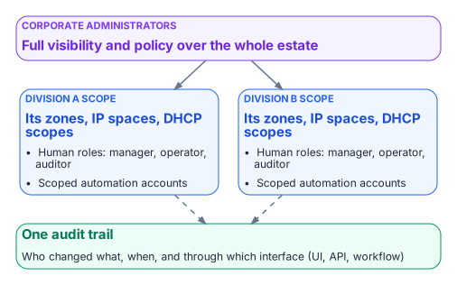

# Chapter 10 — Operating the Control Plane: Delegation, Automation and Evidence

*Divisional autonomy, ITSM integration, certificate automation and compliance evidence.*

::: {.callout-tip}
## Download this chapter
**[next-generation-ddi-ch10-bundle.docx](../../downloads/next-generation-ddi-ch10-bundle.docx)**: this chapter as a Word document, with its figures. The [whole book](../../downloads/next-generation-ddi-bundle.docx) is also available.
:::

A single policy plane only works if the divisions that own their own networks can still operate them. This chapter sets out what the plane must support for delegated administration, automation, ITSM and identity integration, certificate automation and compliance evidence. Where it names products, they illustrate the requirement; equivalent capabilities should be confirmed in current vendor documentation for any platform under evaluation.

## Delegated Administration Across Divisions

{fig-alt="Corporate administrators have full visibility and policy over the whole estate. Division A and Division B each have a scope covering their own zones, IP spaces and DHCP scopes, with human roles (manager, operator, auditor) and scoped automation accounts. Everything feeds one audit trail."}

The policy plane should let corporate administrators keep full visibility while giving divisional teams scoped autonomy:

- Corporate administrators see and manage the entire estate.
- Each divisional team is assigned a scope that limits it to the zones, IP spaces, address blocks, DHCP scopes and other objects that belong to the division, including zones synchronized from cloud DNS services. Child objects inherit their parent's scope.
- Predefined roles cover DNS, DHCP and IPAM functions (for example manager, operator and auditor), and custom roles can combine granular create, read, update and delete permissions.
- Divisional users and automation accounts cannot see or change objects outside their scope.
- The result is fewer tickets and faster divisional change, with one authoritative control plane and a full audit trail for corporate oversight.

::: {.callout-note}
## Illustrative implementation
Infoblox Universal DDI implements this model as Access Views combined with role-based access control in the Infoblox Portal. Other enterprise DDI platforms provide comparable delegation models under different names.
:::

## API and Automation

Every object in the policy plane should be reachable through a documented API, so that infrastructure as code, ITSM workflows, certificate automation and CI pipelines all go through the same authority and the same audit trail:

- API coverage for IPAM, DHCP, DNS configuration and DNS data.
- Non-interactive service accounts for automation, bound by the same role and scope restrictions as human users and unable to log in to the console.
- A migration path for existing automation, so scripts written against the legacy grid keep working while authority moves (some platforms proxy legacy API calls through the new control plane).
- Supported Terraform and Ansible integrations, so network and cloud teams can manage DDI objects in the same pipelines as the rest of their infrastructure.

Divisions can then automate their own DDI operations through scoped service accounts, while corporate teams keep policy, audit and cross-estate visibility.

## ITSM Integration

Integration with the agency's ITSM platform, commonly ServiceNow, should let change requests, catalog items and incidents drive or draw on authoritative DDI data rather than manual updates:

- Synchronizing networks, IP addresses and devices into the CMDB, and continuously reconciling live network and cloud asset data against CMDB records to find missing, stale or misclassified configuration items.
- Workflow actions to reserve and release IP addresses, register DNS records and manage DDI objects from change and catalog workflows.
- Pushing correlated security events, such as Protective DNS blocks, into incident management.

Enterprise DDI vendors publish their own ServiceNow integrations; confirm which of these functions each one covers.

## Certificate Automation (ACME DNS-01)

DDI platforms generally do not provide full certificate lifecycle management. What they provide is the authoritative DNS control that automated issuance and renewal through ACME DNS-01 challenges depends on:

- ACME clients and plug-ins (cert-manager webhooks, Posh-ACME, lego and similar) call the DDI API to create and remove the TXT records that DNS-01 validation needs.
- Issuance and renewal can then be automated without exposing web servers, provided the automation account's permissions are scoped to the names it serves.
- DNSSEC, CAA records and consistent private endpoint resolution (Chapters 06 and 07) remain prerequisites for trustworthy certificate validation after issuance.
- Certificate inventory, multi-CA orchestration and post-issuance deployment still need a dedicated certificate lifecycle platform or process that uses the DNS control plane.

## Identity Governance Integration

Identity governance platforms such as SailPoint typically reach DDI through APIs rather than packaged connectors: a custom connector or workflow calls the DDI API directly, or the identity platform opens ITSM requests that in turn call DDI workflow actions. This supports joiner, mover and leaver automation for network resources (IP allocation, DNS registration), but expect custom development. Confirm whether a supported connector exists for the platforms in use.

## Monitoring, Telemetry and Compliance Evidence

The policy plane should produce the continuous telemetry and audit trail that FedRAMP, NIST and Zero Trust reporting require:

- DNS query logs (source, query name, response, policy action, timestamp) for Protective DNS, M-21-31 logging and incident response, exported to the SIEM and SOAR platforms.
- Response policy and Protective DNS hit data.
- IPAM discovery and inventory reports for CM-8 asset accounting, and continuous discovery data for CMDB reconciliation.
- Configuration change and role audit trails (who changed what, when and through which interface) for AU-2 and AU-6.
- Resolution-path consistency metrics: the percentage of queries answered by the governed resolver.
- Stale record and dangling CNAME rates for hygiene reporting.

These artifacts support the control mapping in Chapter 03, continuous monitoring, FedRAMP evidence packages and Zero Trust maturity assessments.

## Sample Evidence Checklist

For a program office or an authorization package:

- Documented redirect-dns targets for every branch, all of them network-addressable agency-controlled resolvers.
- Forwarding chain order verified in the running configuration: the agency-controlled resolver is the redirect-dns target, and any additional resolvers are its forwarding targets.
- AD DNS inventory completed and reconciled before any domain controller is decommissioned.
- OCSP and CRL endpoints resolvable from on-premises, every cloud and every branch.
- Protective DNS and encrypted DNS configuration evidence aligned with M-22-09, CISA guidance and SP 800-81r3.
- IPAM inventory and discovery reports covering the hybrid address space.
- Query logs and policy audit trails retained for continuous monitoring.
- Rogue DHCP and router advertisement detection, and option 6 and RDNSS consistency controls, documented.

---

**Previous:** [Chapter 09 — The Migration Sequence](09-migration-sequence.md)  
**Next:** [Chapter 11 — Platform Selection, Cost and Residual Risk](11-selection-cost-and-residual-risk.md)
