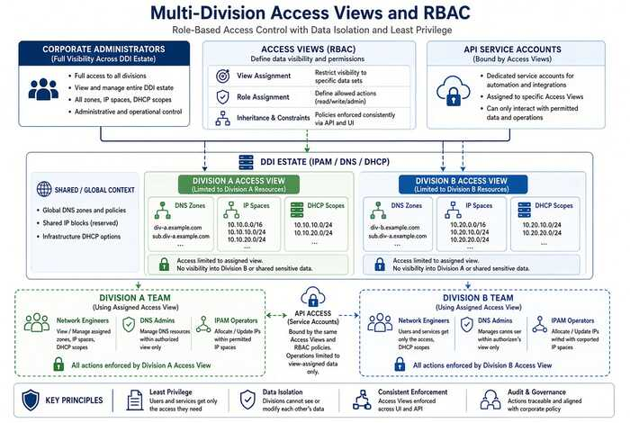

# Chapter 10 — Operating the Control Plane: Delegation, Automation and Evidence

*Divisional autonomy, ITSM integration, certificate automation and compliance evidence.*

::: {.callout-tip}
## Download this chapter
**[next-generation-ddi-ch10-bundle.docx](../../downloads/next-generation-ddi-ch10-bundle.docx)**: this chapter as a Word document, with its figures. The [whole book](../../downloads/next-generation-ddi-bundle.docx) is also available.
:::

## Multi-Division Governance, ITSM Integration and Certificate Automation

{fig-alt="Multi-division governance."}

Universal DDI is the control plane for DNS, DHCP, and IPAM. It supports
delegated administration across organizational divisions, integrates
with ITSM platforms such as ServiceNow, enables DNS-dependent
certificate automation via API, and supplies the continuous telemetry
and audit trails required for compliance.

### Delegated Administration Across Divisions (Access Views and RBAC)

Infoblox Universal DDI and the Infoblox Portal provide Access Views and
role-based access control that allow corporate administrators to retain
full visibility while granting divisional teams scoped autonomy.

- Corporate (root) administrators see and manage the entire estate.

- Divisional teams are assigned Access Views that limit them to the
  zones, IP spaces, address blocks, DHCP scopes, and objects that belong
  to their division.

- Supported objects that can be explicitly assigned to Access Views
  include IP spaces, address blocks, DNS views, and DNS zones (including
  those synchronized from Route 53, Azure DNS, Google Cloud DNS,
  Cloudflare, Akamai, and Microsoft DNS). Child objects inherit the
  Access View of their parent.

- Predefined roles cover DNS, DHCP, and IPAM functions (Manager,
  Operator, Auditor, User variants). Custom roles can combine granular
  create/read/update/delete permissions across services.

- Divisional users and service accounts cannot view or modify objects
  outside their assigned Access Views. Corporate admins retain full
  cross-division visibility.

- This model reduces ticket volume, improves operational speed for the
  divisions, and maintains a single authoritative control plane with
  full auditability for corporate oversight.

### API Capabilities for Automation and Integration

Universal DDI exposes a RESTful API (base path /ddi/v1) documented via
Swagger in the Infoblox Cloud Services Portal. It supports
infrastructure-as-code, ITSM workflows, certificate automation, and
continuous integration pipelines.

- The API covers IPAM, DHCP, DNS configuration, DNS data, DNS Traffic
  Control, Anycast, and related objects.

- Authentication uses API keys. Service API keys are intended for
  non-interactive automation accounts and are bound by the same RBAC and
  Access View restrictions as human users. Interactive user API keys are
  also supported. Requests use the header Authorization: Token \<key\>.

- WAPI Passthrough allows the cloud portal to securely proxy NIOS WAPI
  calls to on-premises Grids, enabling existing automation to continue
  during migration without rearchitecting scripts.

- Official Terraform provider and Ansible modules consume these APIs.
  ServiceNow Activity Packs and Ecosystem integrations also call the API
  for IP reservation, DNS registration, and CMDB synchronization.

- Service accounts cannot log into the portal UI; they exist solely for
  API-driven automation under controlled permissions.

These capabilities allow divisions to automate their own DDI operations
(via scoped service accounts) while corporate teams retain policy,
audit, and cross-estate visibility.

### ServiceNow Integration

Infoblox provides official Ecosystem integrations with ServiceNow that
support CMDB accuracy, incident and change management, and workflow
automation:

- **Universal DDI Integration for ServiceNow Discovery** — synchronizes
  networks, IP addresses, and devices into the ServiceNow CMDB and
  supports discovery bootstrap.

- **Universal Asset Insights for ServiceNow** — continuously reconciles
  live network and cloud asset data against CMDB records, highlighting
  missing, stale, or misclassified configuration items.

- **NIOS DDI ServiceNow Spoke / Activity Packs** — enable ServiceNow
  workflows to reserve/release IP addresses, register DNS records, and
  manage DDI objects through pre-built activities.

- **SOC Insights for ServiceNow** — pushes correlated security events
  (for example from Protective DNS) into ServiceNow for incident
  creation and enrichment.

These integrations allow change requests, service catalog items, and
incident workflows to drive or be informed by authoritative DDI data
rather than manual updates.

### Certificate Management Integration (DNS-01 / ACME)

Infoblox does not ship a full Certificate Lifecycle Management product.
It supplies the authoritative DNS control plane required for automated
certificate issuance and renewal via DNS-01 challenges.

- Third-party tools (cert-manager webhooks, Posh-ACME, lego, and
  similar) use the Infoblox WAPI/REST API to create and remove the TXT
  records needed for ACME DNS-01 validation.

- This enables automated certificate issuance and renewal without
  exposing web servers, provided the automation account has
  appropriately scoped permissions (ideally limited via Access Views or
  RBAC).

- DNSSEC, CAA records, and consistent private-endpoint resolution
  (covered earlier) remain prerequisites for trustworthy certificate
  validation once the certificates are issued.

- Full certificate inventory, multi-CA orchestration, and post-issuance
  deployment still require a dedicated CLM platform or process that
  consumes the DNS control plane Infoblox provides.

### SailPoint (Identity Governance)

No native Infoblox–SailPoint connector was identified in official
documentation as of this writing. Integration is achievable through
APIs:

- Infoblox WAPI/REST can be called from a SailPoint custom connector,
  IdentityIQ rule, or Identity Security Cloud transform or workflow.
  There is no native SailPoint connector.

- Alternatively, ServiceNow can act as an intermediary: SailPoint drives
  identity workflows that open ServiceNow requests, which in turn call
  Infoblox activities to allocate addresses or create DNS records.

- This pattern supports joiner/mover/leaver automation for network
  resources (IP allocation, DNS registration) but requires custom
  development or professional services rather than an out-of-the-box
  connector.

### Continuous Reporting and Compliance Evidence

Universal DDI and NIOS supply the continuous telemetry and audit trails
required for FedRAMP, NIST, and Zero Trust reporting:

- NIOS Reporting & Analytics (Splunk-based) provides 100+ preconfigured
  and customizable reports covering DNS activity, DHCP leases, IPAM
  inventory, discovery, and security events, with long-term retention.

- Audit logs record who changed what, when, and from which interface
  (UI, API, or workflow).

- Universal Asset Insights supplies continuous discovery and CMDB
  reconciliation data.

- Query logs, RPZ/Protective DNS hits, and CDC exports feed SIEM/SOAR
  platforms for continuous monitoring.

- These artifacts directly support the evidence needs identified in the
  control mapping (Chapter 03) and the sample evidence checklist at the end of this chapter.

Together, Access Views, ServiceNow integration, API-driven certificate
automation, and continuous reporting allow an agency to operate a single
DDI control plane that is both centrally governed and divisionally
operational, while producing the audit and inventory evidence required
for authorization and continuous monitoring.

## Monitoring, Telemetry, and Compliance Evidence

Key evidence sources include:

- DNS query logs (source, query name, response, policy action,
  timestamp) for Protective DNS and incident response.

- IPAM discovery and inventory reports for CM-8 asset accounting.

- Configuration change and RBAC audit trails for AU-2/AU-6.

- Resolution-path consistency metrics (percentage of queries answered by
  the governed resolver).

- Stale record and dangling CNAME rates for hygiene reporting.

These artifacts support continuous monitoring, FedRAMP evidence
packages, and Zero Trust maturity assessments.

## Sample Evidence Checklist

Use this checklist for program office or authorization package
preparation:

- Documented redirect-dns targets for all branches (network-addressable
  Infoblox resolvers only).

- Forwarding chain order verified in running configuration
  (agency-controlled resolver is the redirect-dns target; any additional
  resolvers are forwarding targets of it).

- AD DNS inventory completed and reconciled before any DC
  decommissioning.

- OCSP/CRL endpoints resolvable from on-premises, all CSPs, and
  branches.

- Protective DNS and encrypted DNS configuration evidence aligned with
  M-22-09 and SP 800-81r3.

- IPAM inventory and discovery reports covering hybrid address space.

- Query logs and policy audit trails retained for continuous monitoring.

- Rogue DHCP detection and Option-6 consistency controls documented.

---

**Previous:** [Chapter 09 — The Migration Sequence](09-migration-sequence.md)  
**Next:** [Chapter 11 — Platform Selection, Cost and Residual Risk](11-selection-cost-and-residual-risk.md)
