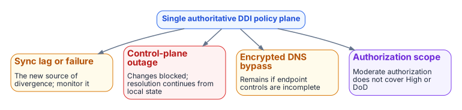

# Chapter 11 — Platform Selection, Cost and Residual Risk

*How to choose, what it costs to run, and what risk remains.*

::: {.callout-tip}
## Download this chapter
**[next-generation-ddi-ch11-bundle.docx](../../downloads/next-generation-ddi-ch11-bundle.docx)**: this chapter as a Word document, with its figures. The [whole book](../../downloads/next-generation-ddi-bundle.docx) is also available.
:::

## Cost, Staffing and Success Measures

Adopting a single authoritative DDI policy plane needs a view of cost, staffing and how success will be measured. Licensing and operating cost vary with the deployment model (SaaS management with local resolvers, or on-premises appliances) and with the number of resolvers and IP address objects under management. Staffing goes mainly to operating the control plane, monitoring synchronization and the initial migration.

The headline success measure is **resolution-path consistency**: the percentage of tested names that return the same answer, or the intentionally different internal and external answers, from every governed origin. Baseline the current rate, set a target and report progress to the authorizing official. Secondary measures are address-block overlap incidents and the certificate and access errors traced to wrong DNS answers.

## Selection Criteria

Selection should follow the architectural requirements, not a vendor list:

- **A single authoritative policy plane** for DNS, DHCP and IPAM across on-premises, every cloud and VMware.
- **Authorization status** at the impact level and in the cloud environment where it will be used ([Applicability](00-applicability.md)).
- **Consistent resolution and security policy** (response policy zones and Protective DNS forwarding, encrypted DNS, DNSSEC validation, logging) across every hybrid surface.
- **Support for the five configuration decisions** in Chapter 08, including network-addressable resolvers that SD-WAN redirect-dns can target at every branch.
- **Delegated administration, APIs and ITSM integration** as described in Chapter 10.
- **Scale**: resolver sizing and policy distribution for the agency's full branch estate.

Options to evaluate against these criteria include:

- **Enterprise DDI platforms.** Infoblox, BlueCat and EfficientIP are the most widely deployed. Check each one's FedRAMP Marketplace status for the specific offering and deployment model, its sovereign-cloud support, its SD-WAN and SASE integration depth, and its multi-cloud federation. As of this writing Infoblox Government Cloud is listed at FedRAMP Moderate (Chapter 03); confirm current status for every candidate on the FedRAMP Marketplace rather than relying on vendor claims.
- **Cloud-native resolvers managed as code.** Route 53 Resolver, Azure DNS Private Resolver and their equivalents, managed through infrastructure as code with a CI drift gate. This path is common and reduces independent authoring, but it still needs explicit controls to prevent split-brain between clouds and to enforce consistent security policy. By itself it provides neither a single multi-cloud IPAM source of truth nor a multi-division delegation model.

## Residual Risk and Limitations

{fig-alt="Four risks around a single authoritative DDI policy plane: sync lag or failure, the new source of divergence; control-plane outage, where changes are blocked but resolution continues from local state; encrypted DNS bypass if endpoint controls are incomplete; and authorization scope, since a Moderate authorization does not cover High or DoD."}

The residual risks are real:

- **Sync lag and sync failure** between the control plane and per-cloud DNS or IPAM services become the new source of divergence. Monitor synchronization health.
- **Control-plane concentration.** If the management plane is unavailable, changes cannot be made, but existing resolution should continue from local resolver state. Define the operational response and any local override procedures.
- **Authorization scope.** A Moderate authorization does not cover High or DoD environments ([Applicability](00-applicability.md)).
- **Commercial-only optimizations.** Microsoft 365 INR is unavailable in GCC-Moderate, GCC High and DoD; Microsoft 365 optimization there relies on local breakout and application-aware routing.
- **Loopback endpoint agents.** A client-side DNS agent listening on loopback cannot be a redirect-dns target; a network-addressable resolver is required.
- **Encrypted DNS bypass** remains possible where endpoint and network controls are incomplete.
- **Open engineering questions** for very large branch estates, such as resolver and forwarding-proxy sizing and source-address behavior under redirect-dns, need vendor engagement and testing.

None of these negates the architecture. They define the operational controls and vendor engagements still required.

## Conclusion

DNS is no longer a name-lookup utility. It is the identity substrate, the security enforcement plane and the definition of the application surface for the hybrid multi-cloud agency. Independent DNS systems produce structural split-brain that breaks private connectivity, certificate trust and Zero Trust policy. A single authoritative DDI policy plane, authorized at the right impact level, keeps DNS, DHCP and IPAM consistent across the enterprise, cloud and internet perspectives. It puts the NIST SP 800-81r3 recommendations and the M-22-09 requirements into practice, carries the AD-to-Entra and VMware transitions, and works with SD-WAN edges that are configured correctly. The five configuration decisions in Chapter 08 remain the highest-leverage actions. Governing DNS is a strategic security and architecture task, not an operations afterthought.

---

**Previous:** [Chapter 10 — Operating the Control Plane: Delegation, Automation and Evidence](10-operating-the-control-plane.md)  
**Next:** [Appendix A — DNS Record Types and Ecosystem Integrations](appendix-a-dns-record-types.md)
