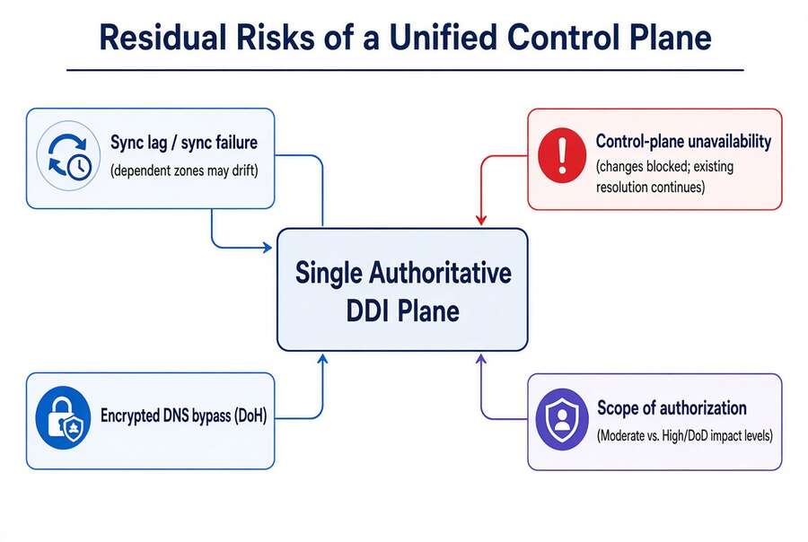

# Chapter 11 — Platform Selection, Cost and Residual Risk

*How to choose, what it costs to run, and what risk remains.*

::: {.callout-tip}
## Download this chapter
**[next-generation-ddi-ch11-bundle.docx](../../downloads/next-generation-ddi-ch11-bundle.docx)**: this chapter as a Word document, with its figures. The [whole book](../../downloads/next-generation-ddi-bundle.docx) is also available.
:::

## Cost, Staffing, and Success Measures

A decision to adopt a single authoritative DDI policy plane requires
some sense of cost, staffing, and how success will be measured.
Licensing and operational cost will vary by deployment model (SaaS vs.
on-premises appliances) and by the number of resolvers and IP address
objects under management. Staffing impact is primarily the ongoing
operation of the control plane, synchronization monitoring, and the
initial migration effort. The headline success measure is
resolution-path consistency: the percentage of tested names that return
the same answer (or the intentionally different internal vs. external
answer) from every governed origin. Baseline the current consistency
rate, set a target, and report progress to the authorizing official.
Address-block overlap incidents and certificate/access errors
attributable to wrong DNS answers are secondary measures.

Any selection should be driven by the architectural requirements (single
authoritative policy plane, FedRAMP authorization status, ability to
enforce consistent resolution and security policy across hybrid
surfaces, and support for the five configuration decisions).
Representative options include:

- **Infoblox Universal DDI:** Unified control plane with FedRAMP
  Moderate authorization in AWS GovCloud, Access Views for
  multi-division governance, native cloud federation, and documented
  ServiceNow integrations. Evaluate current sovereign-cloud status for
  GCC High/DoD.

- **BlueCat:** Strong Microsoft and multi-cloud automation focus.
  Confirm current FedRAMP and sovereign-cloud authorization status for
  the specific deployment model under consideration.

- **EfficientIP:** DNS security and multi-cloud capabilities. Confirm
  current FedRAMP Marketplace status and sovereign-cloud support.

- **Cloud-native resolvers + IaC:** Route 53 Resolver, Azure Private
  Resolver, and equivalent services managed through
  infrastructure-as-code with a CI drift gate. This path is common and
  reduces some independent authoring, but still requires explicit
  controls to prevent split-brain between clouds and to enforce
  consistent security policy (RPZ, DNSSEC validation, logging). It does
  not by itself provide a single multi-cloud IPAM source of truth or
  multi-division Access View model.

Infoblox, BlueCat, and EfficientIP are the primary enterprise DDI
platforms. For federal and large distributed environments the
differentiators include:

- **Infoblox:** FedRAMP Moderate Government Cloud, deep Cisco SD-WAN
  integration guidance, co-authorship of NIST SP 800-81r3, strong
  Protective DNS / Threat Defense, and broad multi-cloud federation.

- **BlueCat:** Strong Microsoft and multi-cloud automation focus; check
  current FedRAMP and sovereign-cloud status for the specific deployment
  model.

- **EfficientIP:** Solid DNS security and IPAM features; evaluate SD-WAN
  integration depth and federal authorization status against agency
  requirements.

Selection should be driven by FedRAMP/authorization status, SD-WAN and
SASE integration requirements, and the ability to enforce consistent
policy across 1,500+ branches.

## Residual Risk and Limitations

{fig-alt="Sync lag, control-plane unavailability that blocks changes while resolution continues, DoH bypass, and authorization scope."}

Honest residual risks include:

- Sync lag and sync failure between the central control plane and
  per-CSP DNS or IPAM services become the new source of divergence.
  Monitor synchronization health.

- Control-plane concentration risk: if the Universal DDI portal is
  unavailable, new changes cannot be made, but existing resolution
  should continue from local or cached state. Define the operational
  response and any local override procedures.

- Microsoft INR is unavailable in GCC Moderate, GCC High, and DoD; M365
  optimization relies on direct breakout and application-aware routing.

- Client-side Infoblox Endpoint is a loopback stub and cannot be the
  target of network-level redirect-dns; a network-addressable resolver
  is required.

- Encrypted DNS bypass remains possible if endpoint and network controls
  are incomplete.

- Open vendor questions remain around exact DFP sizing for very large
  branch estates and certain source-IP behaviors under redirect-dns.

These do not negate the architecture; they define the operational
controls and vendor engagements still required.

## Conclusion

DNS is no longer a name-lookup utility. It is the identity substrate,
the security enforcement plane, and the application surface definition
layer of the modern hybrid multi-cloud enterprise. Fragmented
independent DNS systems produce structural split-brain that breaks
private connectivity, certificate trust, and Zero Trust policy. Infoblox
Universal DDI, now authorizable under FedRAMP Moderate, supplies the
single control plane that keeps DNS, DHCP, and IPAM consistent across
enterprise, cloud, and internet perspectives, supports the NIST SP
800-81 Rev. 3 Secure DNS recommendations, integrates with VMware and the
AD-to-Entra transition, and works with correctly configured Cisco
Catalyst SD-WAN. The five configuration decisions above remain the
highest-leverage actions. Governing DNS is a strategic security and
architecture task, not an IT operations afterthought.

---

**Previous:** [Chapter 10 — Operating the Control Plane: Delegation, Automation and Evidence](10-operating-the-control-plane.md)  
**Next:** [Appendix A — DNS Record Types and Ecosystem Integrations](appendix-a-dns-record-types.md)
