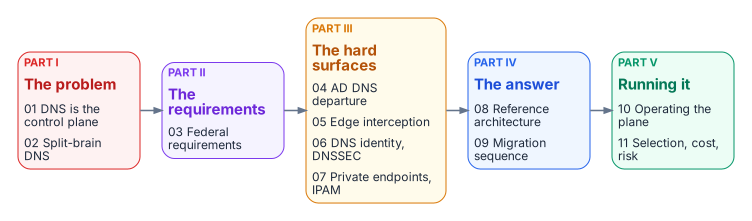

# Next Generation DDI {.unnumbered}

**Governing DNS, DHCP and IPAM as the hybrid multi-cloud control plane**

*How DNS evolved from a name-lookup service into the application surface, the security enforcement plane and the identity substrate of the hybrid multi-cloud enterprise, and what federal agencies must do to govern it.*

Michael Stratton · Updated October 2026

::: {.callout-tip}
## Download the book
**[next-generation-ddi-bundle.docx](../../downloads/next-generation-ddi-bundle.docx)**: every chapter in one Word document, with its figures. Each chapter page also has its own download. Regenerated on every site deploy.
:::

## Why this book exists

DNS was designed to answer one question: what is the address for this name? In a hybrid multi-cloud agency it now does far more. It publishes private endpoints, selects SaaS front doors, enforces security policy, anchors certificate validation and defines the application surface that Zero Trust policy is written against. Most agencies still run it as a commodity utility spread across five independent platforms: Active Directory DNS or an on-premises DDI grid, AWS Route 53, Azure DNS, Google Cloud DNS and VMware NSX.

The result is split-brain DNS that breaks private connectivity, certificate trust and Layer 7 policy at once, and that shows up as certificate errors and access denials rather than DNS errors. This book makes the case for one authoritative DDI policy plane, and walks through what it takes to get there and run it.

## The arc

{fig-alt="Five parts left to right: Part I the problem (chapters 01 and 02), Part II the requirements (03), Part III the hard surfaces (04 to 07), Part IV the answer (08 and 09), and Part V running it (10 and 11)."}

Start with **[Applicability](00-applicability.md)** if you work in GCC High, DoD or an air-gapped environment. It sets out which statements in later chapters change at higher impact levels.

### Part I · The problem
- **[01 — DNS Is Now the Control Plane](01-dns-is-the-control-plane.md)**: problem, solution and ask; the three DNS perspectives; IPAM and DHCP as the address layer of the inventory.
- **[02 — Split-Brain DNS: The Structural Problem](02-split-brain-dns.md)**: private-IP, security-policy and SaaS-endpoint split-brain, and what fragmented DDI costs.

### Part II · The requirements
- **[03 — Federal Requirements](03-federal-requirements.md)**: FedRAMP Moderate, NIST SP 800-81 Rev. 3, OMB M-22-09 and the control mapping.

### Part III · The hard surfaces
- **[04 — The Active Directory DNS Departure](04-active-directory-dns-departure.md)**: the records AD maintains, and what the Entra ID transition does not carry over.
- **[05 — Edge Interception, Encrypted DNS and Rogue DHCP](05-edge-interception-and-bypass.md)**: where queries escape the governed resolver path.
- **[06 — DNS Identity, Certificates and DNSSEC](06-dns-identity-and-dnssec.md)**: the name layer as the first link in the trust chain.
- **[07 — Cloud Private Endpoints, SDN and IPAM Consistency](07-cloud-private-endpoints-and-ipam.md)**: Azure Private Endpoints, cloud IPAM, VMware NSX and dual-stack.

### Part IV · The answer
- **[08 — Reference Architecture and the Five Critical Decisions](08-reference-architecture.md)**: one authoritative policy plane and the decisions that carry the operational risk.
- **[09 — The Migration Sequence](09-migration-sequence.md)**: six phases from AD-integrated DNS/DHCP to a unified control plane.

### Part V · Running it
- **[10 — Operating the Control Plane](10-operating-the-control-plane.md)**: delegated administration, ITSM and certificate automation, and compliance evidence.
- **[11 — Platform Selection, Cost and Residual Risk](11-selection-cost-and-residual-risk.md)**: how to choose, how to measure success, and what risk remains.

### Reference
- **[Appendix A — DNS Record Types and Ecosystem Integrations](appendix-a-dns-record-types.md)**: the record-type catalog, ecosystem integrations and glossary.

## How to read this book

| Audience | Recommended path |
|----------|------------------|
| CIO / CISO / authorizing official | 01 → 03 → 08 → 11 |
| Enterprise or network architect | 01 → 02 → 07 → 08 → 09 |
| Identity architect | 04 → 06 → 10 |
| Network or security engineer | 05 → 06 → 07 → 09 |
| Program manager | 01 → 09 → 10 → 11 |
| GCC High, DoD or air-gapped reader | Applicability → 03 → 05 → 07 → 11 |

## Chapters

::: {#chapters}
:::

## Related reading

- [Client-Server to Hybrid-Cloud, Chapter 06 — DNS, DHCP and IPAM in Hybrid Cloud](../client-server-to-hybrid-cloud/06-network-services.md): the services view of the same transition, inside the wider AD modernization program.
- [Next Generation DNS (full-depth whitepaper)](../whitepapers/infoblox-hybrid-dns-unified-ddi.md): the earlier, longer vendor-specific paper this book builds on, with the platform-by-platform DNS detail and the open vendor questions.
- [Federal Compliance Series, Volume VIII — Multi-Cloud DDI](../compliance/Vol_VIII_Book_00_DDI_Automation_Overview.md): the implementation and control-closure volume for DDI automation.
- [DNS Modernization operational guide](../operational-guides/network-transformation/dns-modernization.md): the phased operational runbook view.

## Source note

This book restructures the October 2026 *Next Generation DDI* whitepaper (Word edition) into chapters. Platform-specific examples are illustrative; evaluate every option against the architectural requirement of a single authoritative policy plane.
