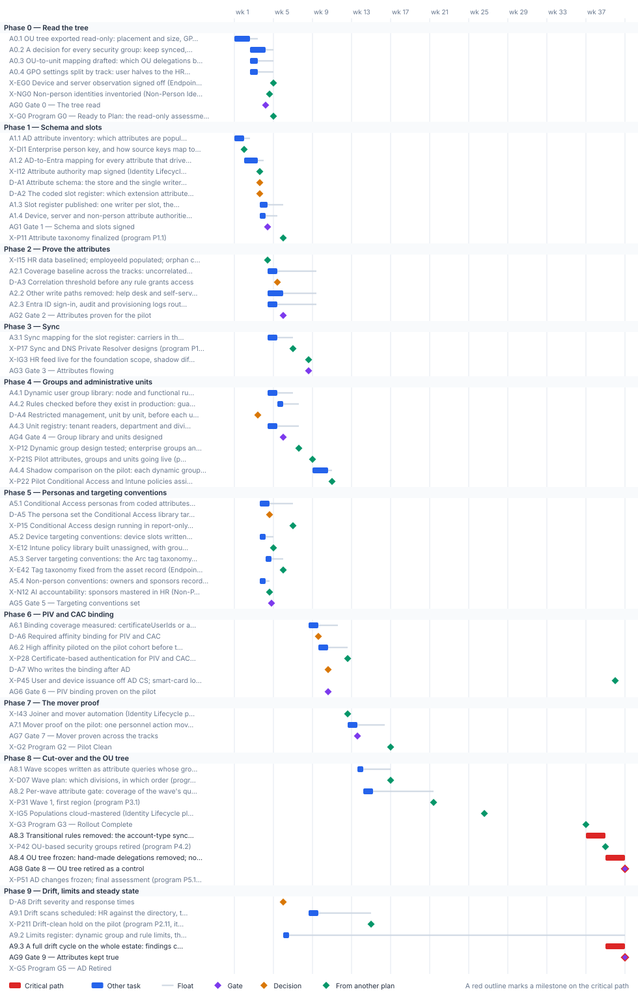

<!-- Generated by scripts/project_plans/build.py from data/project-plans/attribute-driven-migration.yaml. Edit the YAML, not this page. -->

# Attribute-Driven Migration: The Cross-Track Attribute Foundation {.unnumbered}

::: {.callout-note}
## A sample plan, not a commitment
This is an illustrative plan built from the workbook's books, in the form a project manager would baseline: a work breakdown, a schedule network, a computed critical path, decision points, gates and risks. The durations are illustrative, sized to the books' roadmap weeks. Replace them with the agency's own estimates, then baseline the result. The plan names roles, not people, and no specific agency.
:::

## Plan at a glance

| | |
|---|---|
| **Plan type** | Project: The nine stages of the companion guide, PIV binding and the mover proof: the parts the four tracks share, with the tracks themselves handed to their own plans |
| **Built from** | Books 01, 02, 03, 04, 05 and 07; the companion guide |
| **Sponsor** | Executive sponsor and CIO; CISO |
| **Plan manager** | Identity engineering lead, with the data architect, the HR integrated project team lead and the endpoint lead |
| **Duration** | 40 weeks (200 working days), computed from the network |
| **Work** | 30 tasks, 10 gates, 8 decision points, 28 milestones from other plans |
| **Critical path** | 5 of 76 items; 11 more within 5 days of it |
| **Calendar** | Week 1 = the program's Phase 0 approval; five working days a week |

: Plan at a glance {.striped}

This plan runs the shared foundation of the [Attribute-Driven Migration companion guide](../books/guides/attribute-driven-migration.md): the part of the move from Active Directory to Entra ID that no single track owns. In AD, an object's place in the OU tree decided what applied to it. In Entra ID, what the object says about itself decides. So the attributes have to be defined once, written by exactly one source, proved true, and only then read by groups, administrative units, Conditional Access, Intune and Azure Policy. The plan follows the guide's [nine stages](../books/guides/attribute-driven-migration.md#the-path-on-one-page) in the order the two technical deep-dive decks present them: [Part 1, the model and the HR track](../presentations/index.md#technical-attribute-driven-migration) ([▶ watch](../presentations/watch.html?v=Attribute_Driven_Migration_Technical_Part_1_Narrated)), and [Part 2, devices, servers, non-person identities and running the migration](../presentations/index.md#technical-attribute-driven-migration-part-2) ([▶ watch](../presentations/watch.html?v=Attribute_Driven_Migration_Technical_Part_2_Narrated)). The step-by-step work, with the validation kit check that proves each gate, is in [Attribute-Driven Migration: An Implementation Guide](developer-workbooks/attribute-driven-migration/implementation-guide.md), and the three-part Deeper Dive Implementation series walks those gates at working level ([Part 1](../presentations/index.md#deeper-dive-attribute-driven-migration-part-1), [Part 2](../presentations/index.md#deeper-dive-attribute-driven-migration-part-2), [Part 3](../presentations/index.md#deeper-dive-attribute-driven-migration-part-3)).

It doesn't re-plan the four tracks. The HR track is the [Identity Lifecycle & Provisioning plan](identity-lifecycle.md), built through the research page [Building Book 03's HR Pipeline](../research/hcm-entra-implementation.md). The Intune and Arc tracks are the [Endpoint & Device plan](endpoint-device.md), with servers under Arc as its Phase 4. The non-person track is the [Non-Person Identity Modernization plan](non-person-identity.md). This plan takes from them the decisions it builds on (the HR plan's person key, authority map and mover automation) and hands them the conventions they build on (the slot register, device and server targeting, the key that records owners and sponsors). It runs inside the [program master schedule](program-master-schedule.md). Most of its work lands just before the program task that uses it: the attribute taxonomy (P1.1), the group and unit design (P1.2), the Conditional Access design (P1.5), the sync design (P1.7), the pilot assignments (P2.2) and PIV sign-in (P2.8). Its last phases follow the program's rollout to G3 and retire the OU tree before the program freezes AD (P5.1).

## Schedule

{fig-alt="Gantt chart of the Attribute-Driven Migration plan over 40 weeks, grouped by phase. Critical-path tasks are red bars, other tasks are blue bars with a grey line showing their float, gates are violet diamonds, decisions are amber diamonds and milestones from other plans are green diamonds. The tables below give every date and float."}

## Critical path

The computed critical path doesn't start in week 1. This plan's early work lands ahead of the program and track tasks that use it, so it carries float, and its finish is set by the program's rollout. The zero-float chain starts at the program's G3 (end of week 36). First the transitional sync rules that still read OU placement come out (A8.3). Once the program has retired the OU-based groups (P4.2, week 38), the OU tree is frozen (A8.4). The last full drift cycle then closes Gates 8 and 9 in week 40. The only way to finish sooner is a shorter rollout.

Before G3, the plan works against deadlines in the program and the track plans, and the margins are what to watch. The tightest are two working days each: the pilot's shadow comparison (A4.4) before the program assigns the pilot's policies (P2.2), and the non-person conventions (A5.4) before the [Non-Person Identity](non-person-identity.md) plan starts recording sponsors (N1.2). Next, with four days each, come the device targeting conventions (A5.2) before the [Endpoint](endpoint-device.md) plan builds its policy library (E1.2), and Gate 0 before the program's G0. The schema waits on the [Identity Lifecycle](identity-lifecycle.md) plan's person key (D-I1) and attribute authority map (I1.2, week 3), and Gate 1 still reaches the program's attribute taxonomy (P1.1) with eight days in hand. The group library and unit design reach the program's group design (P1.2) with eight, the persona set reaches the Conditional Access design (P1.5) with twelve, and the PIV binding pilot reaches the program's PIV sign-in (P2.8) with ten. The mover proof waits on the HR plan's mover automation (I4.3, week 12) and closes 17 days before the program's G2. Gate 8 lands 20 working days before the program freezes AD (P5.1), and Gate 9 40 before G5. The writer of the PIV binding after AD (D-A7) can wait until week 39, when the program moves issuance off AD CS (P4.5). Deciding it earlier leaves time for the open pilot to report.

The critical path, in order. Each item has zero total float: a day lost on any of them is a day lost at the finish.

| # | ID | Item | Owner or approver | When |
|---|---|---|---|---|
| 1 | A8.3 | Transitional rules removed: the account-type sync rule that reads OU placement, OU-based scoping filters and the provisioning OU computation for cloud-mastered populations | Identity engineering | wk 37–38 |
| 2 | A8.4 | OU tree frozen: hand-made delegations removed; no OU drives access, scoping or policy; the tree's final export archived in Git as the record | Identity engineering | wk 39–40 |
| 3 | A9.3 | A full drift cycle on the whole estate: findings closed at the source; the nightly plan zero-action | Security operations, with HR | wk 39–40 |
| 4 | AG8 | Gate 8 — OU tree retired as a control | CISO | end of wk 40 |
| 5 | AG9 | Gate 9 — Attributes kept true | CISO | end of wk 40 |

: The critical path {.striped .hover}

**Near-critical.** These items have 5 working days of float or less. Track them weekly: once their float is spent, they join the critical path.

| ID | Item | Float | When |
|---|---|---|---|
| D-A1 | Attribute schema: the store and the single writer for every attribute that drives access, in all four tracks | 2 d | end of wk 3 |
| A5.4 | Non-person conventions: owners and sponsors recorded by the enterprise person key; custom security attributes for service principals (system, environment, tier) defined | 2 d | wk 3–4 |
| A4.4 | Shadow comparison on the pilot: each dynamic group against the group it replaces, every add and remove explained; membership-delta alerts on | 2 d | wk 9–10 |
| A1.1 | AD attribute inventory: which attributes are populated, by whom and how fully; which extension attributes are free to carry codes | 3 d | wk 1 |
| A1.2 | AD-to-Entra mapping for every attribute that drives access, per object type: users, devices, Arc servers, service principals; the store for each from the store table | 3 d | wk 2–3 |
| A0.1 | OU tree exported read-only: placement and size, GPO links at domain, OU and site, inheritance, and hand-made delegations; every OU and each GPO half tagged with its track | 4 d | wk 1–2 |
| A0.2 | A decision for every security group: keep synced, convert to cloud-only, convert to dynamic, or retire | 4 d | wk 2–4 |
| D-A2 | The coded slot register: which extension attribute carries which code, on users and on devices | 4 d | end of wk 3 |
| A5.2 | Device targeting conventions: device slots written at registration by the provisioning service; dynamic device groups only where a rule reads tier or role; filters otherwise; no dynamic device group as an exclusion | 4 d | wk 3–4 |
| AG0 | Gate 0 — The tree read | 4 d | end of wk 4 |
| AG3 | Gate 3 — Attributes flowing | 4 d | end of wk 8 |

: Near-critical items {.striped .hover}

## Decision points

Each decision is a zero-duration milestone in the network. *Decide by* is its late finish: the last week it can be made without moving the plan's finish. A decision with zero float sits on the critical path, so the meeting that makes it should be booked before the plan is baselined. Decision rights follow [Book 01, Chapter 09](../books/b01-transformation-arc/09-who-leads-the-transformation.md#decision-rights-across-the-program).

| ID | Decision | Decides | Needed by | Decide by | Float | Options | If it's late |
|---|---|---|---|---|---|---|---|
| D-A1 | Attribute schema: the store and the single writer for every attribute that drives access, in all four tracks | Data architect | D-A2, A1.4, A5.4 | end of wk 3 | 2 d | Native properties first, then extension attributes 1–15 for what rules read, directory extensions for more slots, custom security attributes for sensitive values rules don't need, device properties, Azure tags and certificateUserIds (the store table); or a broader use of directory extensions from the start | No slot can be assigned, and every group rule, persona and targeting convention waits |
| D-A2 | The coded slot register: which extension attribute carries which code, on users and on devices | Data architect, with HR for the code lists | A1.3, A5.1, A5.2 | end of wk 4 | 4 d | The program attribute map (organization, worker type and position category in extensionAttribute10 to 12; region, cost center, division, account type, clearance and DoNotSync in their slots; device tier, role and environment on the device object); or an agency map that keeps the same rule: codes, never names, one writer per slot | Rules and filters are written against slots that may move, and every one is rewritten later |
| D-A4 | Restricted management, unit by unit, before each unit exists | Identity engineering | A4.3 | end of wk 6 | 16 d | No (the default): the unit scopes writes and stays in governance automation; yes, for a small set of sensitive accounts, accepting that they leave PIM, entitlement management, Lifecycle Workflows and access reviews | A unit is created without the decision, and restriction can't be changed afterward |
| D-A5 | The persona set the Conditional Access library targets | CISO | X-P15, AG5 | end of wk 6 | 12 d | The program's personas, built from the worker type and account type codes; personas plus division-specific overlays; fewer personas with more exclusions (not recommended) | The Conditional Access design runs in report-only without the groups it will enforce on |
| D-A3 | Correlation threshold before any rule grants access | Authorizing official, through the agency's risk governance | AG2 | end of wk 9 | 20 d | 99% of the pilot cohort correlated (a proposed starting point); a risk-tiered threshold, stricter for privileged and leaver-sensitive populations; 100% with a dated exception list | No group can be piloted, because nobody has said how true the attributes must be |
| D-A6 | Required affinity binding for PIV and CAC | CISO | A6.2 | end of wk 11 | 10 d | High affinity in production (the program's position), with a custom rule per issuer during the pilot; low affinity until coverage is complete, with a dated end; mixed by issuer | PIV sign-in goes to the pilot at the tenant default, which is low affinity |
| D-A8 | Drift severity and response times | CISO | A9.1 | end of wk 13 | 40 d | The program's classes (missing identity, stale access, orphan, attribute drift, unauthorized write, credential drift, schema drift) with high severity closed in days and the rest on a dated plan; a stricter clock for unauthorized writes to the access slots | Drift findings pile up with nobody obliged to close them |
| D-A7 | Who writes the binding after AD | ICAM governance body | X-P45 | end of wk 39 | 147 d | The card management system writes certificateUserIds through Microsoft Graph at issuance (design guidance, an open pilot); Entra Connect keeps syncing from altSecurityIdentities while any AD remains; manual entry by a Privileged Authentication Administrator (not at scale) | User issuance can't move off AD CS, because nothing writes the binding without AD |

: Decision points, by decide-by date {.striped .hover}

## Gates

Each gate is the next phase's entry condition. The approver signs it against the criteria, from evidence in the repository.

| Gate | When | Approver | Criteria |
|---|---|---|---|
| [Gate 0 — The tree read](../books/b02-identity/10-migrating-and-governing.md#phase-0-assessment) | end of wk 4 | Identity engineering lead | Inventory in Git, site-linked GPOs included; every OU and every GPO half tagged with its track; a decision for every group; the OU-to-unit mapping drafted; nothing changed in the forest |
| [Gate 1 — Schema and slots signed](../books/b03-hr-identity/12-execution-plan.md#phase-1-attribute-authority-and-schema) | end of wk 4 | ICAM governance body | Every attribute that drives access has one store, one writer and one owner, in all four tracks; the slot register published; the person key carried in employeeId in both directories; codes, never display names, in anything a rule reads |
| [Gate 2 — Attributes proven for the pilot](../books/b03-hr-identity/12-execution-plan.md#phase-1-attribute-authority-and-schema) | end of wk 5 | CISO | Correlation threshold met on the pilot cohort; every enabled account correlated or on a dated exception list; no duplicate keys; every other write path to the access slots removed in AD and Entra ID; logs leaving Entra ID |
| [Gate 3 — Attributes flowing](../books/b02-identity/10-migrating-and-governing.md#phase-1-sync-deployment-and-initial-sync) | end of wk 8 | Identity engineering lead | Object counts within ±1%; no sync errors; every slot in the register arrives in Entra ID with the value HR sent; shadow-mode differences explained; both match types blocked outside a planned window |
| [Gate 4 — Group library and units designed](../books/b01-transformation-arc/04-identity-transformation.md#verification) | end of wk 5 | Identity engineering lead | Every governed group on one of the two patterns, on codes, with guards; every unit rule mirroring its group rule; restriction decided for every unit; every role assignment in the matrix |
| [Gate 5 — Targeting conventions set](../books/guides/attribute-driven-migration.md#attribute-to-mechanism-crosswalk) | end of wk 4 | CISO | Personas from authoritative codes, grant and block in pairs, empty slots reported; device and server conventions published and handed to the Endpoint plan; non-person owners and sponsors keyed to the person key |
| [Gate 6 — PIV binding proven on the pilot](../books/guides/attribute-driven-migration.md#pki-binding) | end of wk 10 | CISO | Every pilot card holder bound; high affinity piloted with no lockouts; phishing-resistant strength for CBA users; the leaver removes the binding as well as revoking the card |
| [Gate 7 — Mover proven across the tracks](../books/guides/attribute-driven-migration.md#worked-example-one-user-and-one-mover-event) | end of wk 13 | CISO | The test mover's access changed only through the attributes, within the measured latency; nothing assigned by hand; the device's groups unchanged; the sponsor of any non-person identity the user sponsors notified; the change traced from the personnel action to the drift report |
| [Gate 8 — OU tree retired as a control](../books/guides/attribute-driven-migration.md#stage-7-cut-over-in-phases) | end of wk 40 | CISO | Every population cut over by attribute query with its gate passed; no sync rule, scoping filter, group, delegation or policy reads OU placement; the final tree archived; rollback by re-enabling, never by re-creating |
| [Gate 9 — Attributes kept true](../books/b03-hr-identity/12-execution-plan.md#phase-6-sustained-posture) | end of wk 40 | CISO | Valid attributes for every HR-listed worker; every group on one of the two patterns; every unit rule mirroring its group with processing on; every policy targeting only governed groups; zero open high-severity drift findings; logs outside Entra ID; the six lifecycle metrics on the ConMon cadence |

: Gates {.striped .hover}

## Links to other plans

- **X-EG0, Device and server observation signed off (Endpoint plan, Gate 0),** is EG0 in the [Endpoint & Device Modernization](endpoint-device.md) plan (Gate 0 — Observation signed off), end of wk 4. This plan must finish A0.4 by then: a margin of 8 d. The Endpoint plan triages Group Policy without knowing which halves belong to people.
- **X-NG0, Non-person identities inventoried (Non-Person Identity plan, Gate 0),** is NG0 in the [Non-Person Identity Modernization](non-person-identity.md) plan (Gate 0 — Non-person identities inventoried), end of wk 4. This plan must finish A0.1 by then: a margin of 10 d. Service accounts in the tree are inventoried without their OU placement and delegations.
- **X-G0, Program G0 — Ready to Plan: the read-only assessment committed,** is G0 in the [Program master schedule](program-master-schedule.md) plan (G0 — Ready to Plan), end of wk 4. This plan must finish AG0 by then: a margin of 4 d. The program plans Phase 1 without knowing what the OU tree encodes.
- **X-DI1, Enterprise person key, and how source keys map to it (Identity Lifecycle plan, D-I1),** is D-I1 in the [Identity Lifecycle & Provisioning](identity-lifecycle.md) plan (Enterprise person key, and how source keys map to it), end of wk 1. This plan waits for it; it can slip 3 d before it moves this plan. The mapping has no key to carry in employeeId.
- **X-I12, Attribute authority map signed (Identity Lifecycle plan, I1.2),** is I1.2 in the [Identity Lifecycle & Provisioning](identity-lifecycle.md) plan (Attribute authority map signed), end of wk 3. This plan waits for it; it can slip 2 d before it moves this plan. The schema can't name a writer for an attribute whose authority isn't decided.
- **X-P11, Attribute taxonomy finalized (program P1.1),** is P1.1 in the [Program master schedule](program-master-schedule.md) plan (Attribute taxonomy finalized (M-014)), end of wk 5. This plan must finish AG1 by then: a margin of 8 d. The program's taxonomy is finalized without the cross-track slot register.
- **X-I15, HR data baselined; employeeId populated; orphan candidates owned (Identity Lifecycle plan, I1.5),** is I1.5 in the [Identity Lifecycle & Provisioning](identity-lifecycle.md) plan (HR data baselined; employeeId populated; orphan candidates owned), end of wk 4. This plan waits for it; it can slip 20 d before it moves this plan. The coverage baseline measures data the HR plan hasn't yet corrected.
- **X-P17, Sync and DNS Private Resolver designs (program P1.7),** is P1.7 in the [Program master schedule](program-master-schedule.md) plan (Sync and DNS Private Resolver designs; resolver deployed (M-018, M-019)), end of wk 6. This plan must finish A3.1 by then: a margin of 8 d. The sync design is approved without the attribute flow for the coded slots.
- **X-IG3, HR feed live for the foundation scope, shadow differences explained (Identity Lifecycle plan, Gate 3),** is IG3 in the [Identity Lifecycle & Provisioning](identity-lifecycle.md) plan (Gate 3 — HR feed live for the foundation scope), end of wk 8. This plan waits for it; it can slip 4 d before it moves this plan. The coded slots have no live writer, so the group library can't be shadowed on real data.
- **X-P12, Dynamic group design tested; enterprise groups and administrative units built (program P1.2),** is P1.2 in the [Program master schedule](program-master-schedule.md) plan (Dynamic group design tested; enterprise groups and administrative units built (M-015)), end of wk 7. This plan must finish AG4 by then: a margin of 8 d. The program builds groups and units from a design that hasn't been checked.
- **X-P21S, Pilot attributes, groups and units going live (program P2.1, its start),** is the start of P2.1 in the [Program master schedule](program-master-schedule.md) plan (Sync deployed; pilot attributes, groups, AUs and delegated roles live (M-022)), end of wk 8. This plan waits for it; it can slip 2 d before it moves this plan. There's no live pilot data to shadow the rules against.
- **X-P22, Pilot Conditional Access and Intune policies assigned (program P2.2, its start),** is the start of P2.2 in the [Program master schedule](program-master-schedule.md) plan (Pilot Conditional Access and Intune policies assigned (M-024, M-025)), end of wk 10. This plan must finish A4.4 by then: a margin of 2 d. Later work in this plan waits for it. Policies are assigned to groups whose membership hasn't been reconciled.
- **X-P15, Conditional Access design running in report-only (program P1.5),** is P1.5 in the [Program master schedule](program-master-schedule.md) plan (Conditional Access design running in report-only (M-017)), end of wk 6. This plan must finish D-A5 by then: a margin of 12 d. Report-only runs against personas that may change.
- **X-E12, Intune policy library built unassigned, with groups, filters and scope tags (Endpoint plan, E1.2, its start),** is the start of E1.2 in the [Endpoint & Device Modernization](endpoint-device.md) plan (Policy library built unassigned: compliance, configuration, endpoint security, app protection; groups, filters and scope tags), end of wk 4. This plan must finish A5.2 by then: a margin of 4 d. The policy library is built on targeting the foundation may change.
- **X-E42, Tag taxonomy fixed from the asset record (Endpoint plan, E4.2),** is E4.2 in the [Endpoint & Device Modernization](endpoint-device.md) plan (Tag taxonomy fixed from the asset record: Environment, Workload, Criticality, Owner, CostCenter, PatchGroup, ArcOnboardedDate; SQL Server opt-out tag where needed), end of wk 5. This plan must finish A5.3 by then: a margin of 6 d. Arc servers are tagged with a taxonomy the device and user sides don't share.
- **X-N12, AI accountability: sponsors mastered in HR (Non-Person Identity plan, N1.2, its start),** is the start of N1.2 in the [Non-Person Identity Modernization](non-person-identity.md) plan (AI accountability: a federal sponsor mastered in HR, a small sponsoring group, a technical owner who isn't the sponsor, and a matching inventory record), end of wk 4. This plan must finish A5.4 by then: a margin of 2 d. Sponsors are recorded by name rather than by key, and a sponsor's move or departure can't be matched.
- **X-P28, Certificate-based authentication for PIV and CAC holders (program P2.8),** is P2.8 in the [Program master schedule](program-master-schedule.md) plan (Certificate-based authentication for PIV and CAC holders (M-029)), end of wk 12. This plan must finish A6.2 by then: a margin of 10 d. PIV sign-in reaches the pilot with bindings nobody has measured.
- **X-P45, User and device issuance off AD CS; smart-card logon GPO retired (program P4.5),** is P4.5 in the [Program master schedule](program-master-schedule.md) plan (User and device issuance off AD CS; smart-card logon GPO retired), end of wk 39. This plan must finish D-A7 by then: a margin of 147 d. Issuance moves off AD CS with no writer for the binding.
- **X-I43, Joiner and mover automation (Identity Lifecycle plan, I4.3),** is I4.3 in the [Identity Lifecycle & Provisioning](identity-lifecycle.md) plan (Joiner and mover automation; rehire and conversion matching validated), end of wk 12. This plan waits for it; it can slip 14 d before it moves this plan. There's no mover workflow to prove the foundation against.
- **X-G2, Program G2 — Pilot Clean,** is G2 in the [Program master schedule](program-master-schedule.md) plan (G2 — Pilot Clean), end of wk 16. This plan must finish AG7 by then: a margin of 17 d. The pilot is called clean without a mover having been proved.
- **X-D07, Wave plan: which divisions, in which order (program D07),** is D07 in the [Program master schedule](program-master-schedule.md) plan (Wave plan: which divisions, in which order), end of wk 16. This plan must finish A8.1 by then: a margin of 14 d. Waves are drawn by OU, not by attribute value.
- **X-P31, Wave 1, first region (program P3.1),** is P3.1 in the [Program master schedule](program-master-schedule.md) plan (Wave 1, first region, about 25% (M-032)), end of wk 21. This plan must finish A8.2 by then: a margin of 31 d. Wave 1 closes with no attribute gate.
- **X-IG5, Populations cloud-mastered (Identity Lifecycle plan, Gate 5),** is IG5 in the [Identity Lifecycle & Provisioning](identity-lifecycle.md) plan (Gate 5 — Populations cloud-mastered), end of wk 26. Shown for reference.
- **X-G3, Program G3 — Rollout Complete,** is G3 in the [Program master schedule](program-master-schedule.md) plan (G3 — Rollout Complete), end of wk 36. This plan waits for it; it can slip 0 before it moves this plan. The transitional sync rules that read OU placement can't come out while any population still depends on them.
- **X-P42, OU-based security groups retired (program P4.2),** is P4.2 in the [Program master schedule](program-master-schedule.md) plan (OU-based security groups retired), end of wk 38. This plan waits for it; it can slip 0 before it moves this plan. The OU tree still grants access through its groups.
- **X-P51, AD changes frozen; final assessment (program P5.1, its start),** is the start of P5.1 in the [Program master schedule](program-master-schedule.md) plan (AD changes frozen; final assessment and evidence packet), end of wk 44. This plan must finish AG8 by then: a margin of 20 d. AD is frozen while something still reads the OU tree.
- **X-P211, Drift-clean hold on the pilot (program P2.11, its start),** is the start of P2.11 in the [Program master schedule](program-master-schedule.md) plan (Drift-clean hold (14 days, illustrative); success criteria met (M-031)), end of wk 14. This plan must finish A9.1 by then: a margin of 27 d. The drift-clean hold has no scan to measure it.
- **X-G5, Program G5 — AD Retired,** is G5 in the [Program master schedule](program-master-schedule.md) plan (G5 — AD Retired), end of wk 48. This plan must finish AG9 by then: a margin of 40 d. AD is retired with attribute drift still open.

## Work breakdown and schedule

Every row, by phase. *Float* is total float in working days; **bold** rows are on the critical path. Each row links to the chapter it comes from.

### Phase 0 — Read the tree

| ID | Item | Type | Owner or approver | Days | Predecessors | When | Float |
|---|---|---|---|---|---|---|---|
| A0.1 | [OU tree exported read-only: placement and size, GPO links at domain, OU and site, inheritance, and hand-made delegations; every OU and each GPO half tagged with its track](../books/guides/attribute-driven-migration.md#stage-0-read-what-the-ou-tree-encodes) | Task | Identity engineering | 8 | — | wk 1–2 | 4 d |
| A0.2 | [A decision for every security group: keep synced, convert to cloud-only, convert to dynamic, or retire](../books/b02-identity/09-building-the-entra-target.md#the-per-group-decision) | Task | Identity engineering, with application owners | 8 | A0.1 | wk 2–4 | 4 d |
| A0.3 | [OU-to-unit mapping drafted: which OU delegations become administrative units, and which become Azure RBAC scopes for servers](../books/b02-identity/09-building-the-entra-target.md#organizational-units) | Task | Identity engineering | 4 | A0.1 | wk 2–3 | 8 d |
| A0.4 | [GPO settings split by track: user halves to the HR track's policy design, computer halves to the Endpoint plan](../books/guides/attribute-driven-migration.md#four-tracks) | Task | Identity engineering, with the endpoint lead | 4 | A0.1 | wk 2–3 | 8 d |
| X-EG0 | [Device and server observation signed off (Endpoint plan, Gate 0)](endpoint-device.md) | External | ISSO (Endpoint plan) | — | A0.4 | end of wk 4 | fixed date |
| X-NG0 | [Non-person identities inventoried (Non-Person Identity plan, Gate 0)](non-person-identity.md) | External | ISSO (Non-Person Identity plan) | — | A0.1 | end of wk 4 | fixed date |
| AG0 | [Gate 0 — The tree read](../books/b02-identity/10-migrating-and-governing.md#phase-0-assessment) | Gate | Identity engineering lead | — | A0.2, A0.3, A0.4 | end of wk 4 | 4 d |
| X-G0 | [Program G0 — Ready to Plan: the read-only assessment committed](program-master-schedule.md) | External | Steward (program) | — | AG0 | end of wk 4 | fixed date |

: Phase 0 — Read the tree {.striped .hover}

### Phase 1 — Schema and slots

| ID | Item | Type | Owner or approver | Days | Predecessors | When | Float |
|---|---|---|---|---|---|---|---|
| A1.1 | [AD attribute inventory: which attributes are populated, by whom and how fully; which extension attributes are free to carry codes](../books/guides/attribute-driven-migration.md#compared-with-active-directory) | Task | Identity engineering | 5 | — | wk 1 | 3 d |
| X-DI1 | [Enterprise person key, and how source keys map to it (Identity Lifecycle plan, D-I1)](identity-lifecycle.md) | External | ICAM governance body (Identity Lifecycle plan) | — | — | end of wk 1 | 3 d |
| A1.2 | [AD-to-Entra mapping for every attribute that drives access, per object type: users, devices, Arc servers, service principals; the store for each from the store table](../books/guides/attribute-driven-migration.md#the-attribute-stores-in-the-order-to-reach-for-them) | Task | Data architect, with identity engineering | 7 | A1.1, X-DI1 | wk 2–3 | 3 d |
| X-I12 | [Attribute authority map signed (Identity Lifecycle plan, I1.2)](identity-lifecycle.md) | External | ICAM governance body (Identity Lifecycle plan) | — | — | end of wk 3 | 2 d |
| D-A1 | [Attribute schema: the store and the single writer for every attribute that drives access, in all four tracks](../books/guides/attribute-driven-migration.md#attributes) | Decision | Data architect | — | A1.2, X-I12 | end of wk 3 | 2 d |
| D-A2 | [The coded slot register: which extension attribute carries which code, on users and on devices](../books/b03-hr-identity/06-canonical-attribute-schema.md#program-attribute-map) | Decision | Data architect, with HR for the code lists | — | D-A1 | end of wk 3 | 4 d |
| A1.3 | [Slot register published: one writer per slot, the code list owner, what reads it; the help desk, self-service and Exchange write paths listed for removal](../books/b03-hr-identity/06-canonical-attribute-schema.md#writers) | Task | Data architect | 4 | D-A2 | wk 3–4 | 8 d |
| A1.4 | [Device, server and non-person attribute authorities named: the procurement record through the Autopilot group tag, the asset record through Arc onboarding tags, the owning system's record](../books/guides/attribute-driven-migration.md#stage-1-source-the-attributes) | Task | Data architect, with the endpoint lead | 3 | D-A1 | wk 3–4 | 6 d |
| AG1 | [Gate 1 — Schema and slots signed](../books/b03-hr-identity/12-execution-plan.md#phase-1-attribute-authority-and-schema) | Gate | ICAM governance body | — | A1.3, A1.4 | end of wk 4 | 8 d |
| X-P11 | [Attribute taxonomy finalized (program P1.1)](program-master-schedule.md) | External | Data architect (program) | — | AG1 | end of wk 5 | fixed date |

: Phase 1 — Schema and slots {.striped .hover}

### Phase 2 — Prove the attributes

| ID | Item | Type | Owner or approver | Days | Predecessors | When | Float |
|---|---|---|---|---|---|---|---|
| X-I15 | [HR data baselined; employeeId populated; orphan candidates owned (Identity Lifecycle plan, I1.5)](identity-lifecycle.md) | External | HR data steward (Identity Lifecycle plan) | — | — | end of wk 4 | 20 d |
| A2.1 | [Coverage baseline across the tracks: uncorrelated accounts, empty coded slots, counts per organization code against an HR export, duplicate keys; device and server attribute coverage](../books/guides/attribute-driven-migration.md#stage-2-prove-the-attributes-are-true-before-anything-depends-on-them) | Task | Identity engineering | 5 | AG1, X-I15 | wk 4–5 | 20 d |
| D-A3 | [Correlation threshold before any rule grants access](../books/b03-hr-identity/12-execution-plan.md#sequencing-principle) | Decision | Authorizing official, through the agency's risk governance | — | A2.1 | end of wk 5 | 20 d |
| A2.2 | [Other write paths removed: help desk and self-service edits to the access slots, Exchange custom-attribute cmdlets, write rights on the target OUs](../books/b03-hr-identity/06-canonical-attribute-schema.md#writers) | Task | Identity engineering, with security | 8 | A1.3 | wk 4–5 | 17 d |
| A2.3 | [Entra ID sign-in, audit and provisioning logs routed outside Entra ID before the pilot's first change](../books/b03-hr-identity/11-drift-metrics-and-evidence.md#the-evidence-each-event-leaves) | Task | Security operations | 5 | AG1 | wk 4–5 | 20 d |
| AG2 | [Gate 2 — Attributes proven for the pilot](../books/b03-hr-identity/12-execution-plan.md#phase-1-attribute-authority-and-schema) | Gate | CISO | — | D-A3, A2.2, A2.3 | end of wk 5 | 17 d |

: Phase 2 — Prove the attributes {.striped .hover}

### Phase 3 — Sync

| ID | Item | Type | Owner or approver | Days | Predecessors | When | Float |
|---|---|---|---|---|---|---|---|
| A3.1 | [Sync mapping for the slot register: carriers in the provisioning apps' target lists, date mappings, the transitional account-type rule, the DoNotSync filter; soft and hard match blocked](../books/guides/attribute-driven-migration.md#stage-3-map-the-attributes-through-sync) | Task | Identity engineering | 5 | AG1 | wk 4–5 | 8 d |
| X-P17 | [Sync and DNS Private Resolver designs (program P1.7)](program-master-schedule.md) | External | Identity engineering (program) | — | A3.1 | end of wk 6 | fixed date |
| X-IG3 | [HR feed live for the foundation scope, shadow differences explained (Identity Lifecycle plan, Gate 3)](identity-lifecycle.md) | External | ISSO (Identity Lifecycle plan) | — | — | end of wk 8 | 4 d |
| AG3 | [Gate 3 — Attributes flowing](../books/b02-identity/10-migrating-and-governing.md#phase-1-sync-deployment-and-initial-sync) | Gate | Identity engineering lead | — | A3.1, X-IG3, AG2 | end of wk 8 | 4 d |

: Phase 3 — Sync {.striped .hover}

### Phase 4 — Groups and administrative units

| ID | Item | Type | Owner or approver | Days | Predecessors | When | Float |
|---|---|---|---|---|---|---|---|
| A4.1 | [Dynamic user group library: node and functional rules on codes; every access rule guarded by accountEnabled and userType and excluding agents' accounts; nesting flattened; no memberOf](../books/guides/attribute-driven-migration.md#stage-4-materialize-ou-subtrees-as-dynamic-groups) | Task | Identity engineering, with application owners | 5 | AG1, A0.2 | wk 4–5 | 8 d |
| A4.2 | [Rules checked before they exist in production: guards, codes not names, paused processing; each rule tested against named users](../books/b06-data-platform/17-dynamic-membership-delegation-and-privilege.md#writing-naming-and-testing-rules) | Task | Identity engineering | 3 | A4.1 | wk 5 | 8 d |
| D-A4 | [Restricted management, unit by unit, before each unit exists](../books/b02-identity/05-delegation-without-ous.md#restricted-management-a-per-au-decision) | Decision | Identity engineering | — | A0.3 | end of wk 3 | 16 d |
| A4.3 | [Unit registry: tenant readers, department and division units whose rules mirror the group rules; scoped roles to PIM-eligible role-assignable groups; each unit created before the groups it holds](../books/guides/attribute-driven-migration.md#stage-5-delegate-with-administrative-units) | Task | Identity engineering | 5 | D-A4, AG1 | wk 4–5 | 11 d |
| AG4 | [Gate 4 — Group library and units designed](../books/b01-transformation-arc/04-identity-transformation.md#verification) | Gate | Identity engineering lead | — | A4.2, A4.3 | end of wk 5 | 8 d |
| X-P12 | [Dynamic group design tested; enterprise groups and administrative units built (program P1.2)](program-master-schedule.md) | External | Identity engineering (program) | — | AG4 | end of wk 7 | fixed date |
| X-P21S | [Pilot attributes, groups and units going live (program P2.1, its start)](program-master-schedule.md) | External | Identity engineering (program) | — | — | end of wk 8 | 2 d |
| A4.4 | [Shadow comparison on the pilot: each dynamic group against the group it replaces, every add and remove explained; membership-delta alerts on](../books/guides/attribute-driven-migration.md#dynamic-user-groups-hr-track) | Task | Identity engineering, with application owners | 8 | X-P21S, AG3 | wk 9–10 | 2 d |
| X-P22 | [Pilot Conditional Access and Intune policies assigned (program P2.2, its start)](program-master-schedule.md) | External | Identity engineering (program) | — | A4.4 | end of wk 10 | fixed date |

: Phase 4 — Groups and administrative units {.striped .hover}

### Phase 5 — Personas and targeting conventions

| ID | Item | Type | Owner or approver | Days | Predecessors | When | Float |
|---|---|---|---|---|---|---|---|
| A5.1 | [Conditional Access personas from coded attributes (worker type for internals and externals); every grant paired with a block; empty-slot users reported; emergency access excluded](../books/guides/attribute-driven-migration.md#stage-6-replace-gpo-inheritance-with-conditional-access-and-intune-targeting) | Task | Identity engineering | 5 | D-A2 | wk 3–4 | 12 d |
| D-A5 | [The persona set the Conditional Access library targets](../books/b04-access/03-the-conditional-access-model.md#naming-and-the-persona-model) | Decision | CISO | — | A5.1 | end of wk 4 | 12 d |
| X-P15 | [Conditional Access design running in report-only (program P1.5)](program-master-schedule.md) | External | Identity engineering (program) | — | D-A5 | end of wk 6 | fixed date |
| A5.2 | [Device targeting conventions: device slots written at registration by the provisioning service; dynamic device groups only where a rule reads tier or role; filters otherwise; no dynamic device group as an exclusion](../books/guides/attribute-driven-migration.md#intune-track) | Task | Endpoint lead, with the data architect | 3 | D-A2 | wk 3–4 | 4 d |
| X-E12 | [Intune policy library built unassigned, with groups, filters and scope tags (Endpoint plan, E1.2, its start)](endpoint-device.md) | External | Endpoint lead (Endpoint plan) | — | A5.2 | end of wk 4 | fixed date |
| A5.3 | [Server targeting conventions: the Arc tag taxonomy drawn from the asset record and aligned with the device slots; resource groups as the delegation scope](../books/guides/attribute-driven-migration.md#arc-track) | Task | Server infrastructure, with the data architect | 3 | A1.4 | wk 4 | 6 d |
| X-E42 | [Tag taxonomy fixed from the asset record (Endpoint plan, E4.2)](endpoint-device.md) | External | Server infrastructure (Endpoint plan) | — | A5.3 | end of wk 5 | fixed date |
| A5.4 | [Non-person conventions: owners and sponsors recorded by the enterprise person key; custom security attributes for service principals (system, environment, tier) defined](../books/guides/attribute-driven-migration.md#what-microsoft-documents-for-targeting-service-principals-by-attribute-partly) | Task | Identity engineering, with the identity governance officer | 3 | D-A1 | wk 3–4 | 2 d |
| X-N12 | [AI accountability: sponsors mastered in HR (Non-Person Identity plan, N1.2, its start)](non-person-identity.md) | External | Identity governance officer (Non-Person Identity plan) | — | A5.4 | end of wk 4 | fixed date |
| AG5 | [Gate 5 — Targeting conventions set](../books/guides/attribute-driven-migration.md#attribute-to-mechanism-crosswalk) | Gate | CISO | — | D-A5, A5.2, A5.3, A5.4 | end of wk 4 | 53 d |

: Phase 5 — Personas and targeting conventions {.striped .hover}

### Phase 6 — PIV and CAC binding

| ID | Item | Type | Owner or approver | Days | Predecessors | When | Float |
|---|---|---|---|---|---|---|---|
| A6.1 | [Binding coverage measured: certificateUserIds or altSecurityIdentities present and correct for every pilot card holder; the card management system named as the binding writer](../books/guides/attribute-driven-migration.md#pki-binding) | Task | Identity engineering, with the PIV program office | 5 | AG3 | wk 8–9 | 10 d |
| D-A6 | [Required affinity binding for PIV and CAC](../books/b07-pki/06-device-and-user-certificates.md#username-bindings-and-affinity) | Decision | CISO | — | A6.1 | end of wk 9 | 10 d |
| A6.2 | [High affinity piloted on the pilot cohort before the tenant setting changes; multifactor binding rule by issuer or policy OID](../books/b03-hr-identity/09-credentials-and-certificates.md#binding-the-piv-certificate-to-the-entra-user) | Task | Identity engineering | 5 | D-A6 | wk 9–10 | 10 d |
| X-P28 | [Certificate-based authentication for PIV and CAC holders (program P2.8)](program-master-schedule.md) | External | Identity engineering (program) | — | A6.2 | end of wk 12 | fixed date |
| D-A7 | [Who writes the binding after AD](../books/guides/attribute-driven-migration.md#pki-binding) | Decision | ICAM governance body | — | A6.2 | end of wk 10 | 147 d |
| X-P45 | [User and device issuance off AD CS; smart-card logon GPO retired (program P4.5)](program-master-schedule.md) | External | PKI lead (program) | — | D-A7 | end of wk 39 | fixed date |
| AG6 | [Gate 6 — PIV binding proven on the pilot](../books/guides/attribute-driven-migration.md#pki-binding) | Gate | CISO | — | A6.2 | end of wk 10 | 29 d |

: Phase 6 — PIV and CAC binding {.striped .hover}

### Phase 7 — The mover proof

| ID | Item | Type | Owner or approver | Days | Predecessors | When | Float |
|---|---|---|---|---|---|---|---|
| X-I43 | [Joiner and mover automation (Identity Lifecycle plan, I4.3)](identity-lifecycle.md) | External | Identity engineering (Identity Lifecycle plan) | — | — | end of wk 12 | 14 d |
| A7.1 | [Mover proof on the pilot: one personnel action moves a test user's organization code; groups, unit, persona and access packages change with no ticket; the device stays put; a drift scan comes back clean](../books/guides/attribute-driven-migration.md#worked-example-one-user-and-one-mover-event) | Task | Identity engineering, with HR | 5 | X-I43, X-P22, AG5 | wk 12–13 | 14 d |
| AG7 | [Gate 7 — Mover proven across the tracks](../books/guides/attribute-driven-migration.md#worked-example-one-user-and-one-mover-event) | Gate | CISO | — | A7.1, AG6 | end of wk 13 | 14 d |
| X-G2 | [Program G2 — Pilot Clean](program-master-schedule.md) | External | Steward (program) | — | AG7 | end of wk 16 | fixed date |

: Phase 7 — The mover proof {.striped .hover}

### Phase 8 — Cut-over and the OU tree

| ID | Item | Type | Owner or approver | Days | Predecessors | When | Float |
|---|---|---|---|---|---|---|---|
| A8.1 | [Wave scopes written as attribute queries whose groups already exist; leaver automation first in every wave](../books/guides/attribute-driven-migration.md#stage-7-cut-over-in-phases) | Task | Identity engineering | 3 | AG7 | wk 13–14 | 14 d |
| X-D07 | [Wave plan: which divisions, in which order (program D07)](program-master-schedule.md) | External | Executive sponsor (program) | — | A8.1 | end of wk 16 | fixed date |
| A8.2 | [Per-wave attribute gate: coverage of the wave's query, shadow diff, a dry run with writes off, then seven days in which every change traces to HR before the ticket path closes](../books/b03-hr-identity/appendix-c-acceptance-and-cutover.md#proving-hr-is-the-sole-source) | Task | Identity engineering | 5 | A8.1 | wk 14–15 | 31 d |
| X-P31 | [Wave 1, first region (program P3.1)](program-master-schedule.md) | External | Identity engineering (program) | — | A8.2 | end of wk 21 | fixed date |
| X-IG5 | [Populations cloud-mastered (Identity Lifecycle plan, Gate 5)](identity-lifecycle.md) | External | ISSO (Identity Lifecycle plan) | — | — | end of wk 26 | fixed date |
| X-G3 | [Program G3 — Rollout Complete](program-master-schedule.md) | External | Steward (program) | — | — | end of wk 36 | 0 |
| A8.3 | **[Transitional rules removed: the account-type sync rule that reads OU placement, OU-based scoping filters and the provisioning OU computation for cloud-mastered populations](../books/b02-identity/09-building-the-entra-target.md#attribute-flow-and-transformations)** | Task | Identity engineering | 10 | X-G3 | wk 37–38 | 0 |
| X-P42 | [OU-based security groups retired (program P4.2)](program-master-schedule.md) | External | Identity engineering (program) | — | — | end of wk 38 | 0 |
| A8.4 | **[OU tree frozen: hand-made delegations removed; no OU drives access, scoping or policy; the tree's final export archived in Git as the record](../books/b01-transformation-arc/04-identity-transformation.md#phase-4-legacy-retirement)** | Task | Identity engineering | 10 | A8.3, X-P42 | wk 39–40 | 0 |
| AG8 | **[Gate 8 — OU tree retired as a control](../books/guides/attribute-driven-migration.md#stage-7-cut-over-in-phases)** | Gate | CISO | — | A8.4 | end of wk 40 | 0 |
| X-P51 | [AD changes frozen; final assessment (program P5.1, its start)](program-master-schedule.md) | External | Steward (program) | — | AG8 | end of wk 44 | fixed date |

: Phase 8 — Cut-over and the OU tree {.striped .hover}

### Phase 9 — Drift, limits and steady state

| ID | Item | Type | Owner or approver | Days | Predecessors | When | Float |
|---|---|---|---|---|---|---|---|
| D-A8 | [Drift severity and response times](../books/b03-hr-identity/11-drift-metrics-and-evidence.md#drift-between-hr-and-the-directory) | Decision | CISO | — | AG2 | end of wk 5 | 40 d |
| A9.1 | [Drift scans scheduled: HR against the directory, the unit and role registry against the tenant, membership deltas; each track's own reconciliation pointed at the same findings queue](../books/guides/attribute-driven-migration.md#stage-8-detect-and-correct-drift) | Task | Security operations | 5 | AG4, AG3, D-A8 | wk 8–9 | 27 d |
| X-P211 | [Drift-clean hold on the pilot (program P2.11, its start)](program-master-schedule.md) | External | Steward (program) | — | A9.1 | end of wk 14 | fixed date |
| A9.2 | [Limits register: dynamic group and rule limits, the 100-workflow Lifecycle Workflows budget, administrative unit limits, dynamic units' cloud availability; reviewed with every design change](../books/guides/attribute-driven-migration.md#limits) | Task | Identity engineering | 3 | AG4 | wk 6 | 172 d |
| A9.3 | **[A full drift cycle on the whole estate: findings closed at the source; the nightly plan zero-action](../books/b01-transformation-arc/04-identity-transformation.md#verification)** | Task | Security operations, with HR | 10 | A9.1, A8.3 | wk 39–40 | 0 |
| AG9 | **[Gate 9 — Attributes kept true](../books/b03-hr-identity/12-execution-plan.md#phase-6-sustained-posture)** | Gate | CISO | — | A9.2, A9.3, AG8 | end of wk 40 | 0 |
| X-G5 | [Program G5 — AD Retired](program-master-schedule.md) | External | Executive sponsor and CIO (program) | — | AG9 | end of wk 48 | fixed date |

: Phase 9 — Drift, limits and steady state {.striped .hover}

## Responsibility

Who owns what in this plan. Each row has one owner; consulted and informed parties follow the [decision matrix](../books/b01-transformation-arc/09-who-leads-the-transformation.md#decision-rights-across-the-program).

| Owner or approver | Tasks | Decisions | Gates |
|---|---|---|---|
| Identity engineering | 14 | 1 | — |
| CISO | — | 3 | 6 |
| Identity engineering (program) | 8 | — | — |
| Steward (program) | 5 | — | — |
| Identity engineering lead | — | — | 3 |
| Identity engineering, with application owners | 3 | — | — |
| Data architect | 1 | 1 | — |
| ICAM governance body | — | 1 | 1 |
| ICAM governance body (Identity Lifecycle plan) | 2 | — | — |
| ISSO (Identity Lifecycle plan) | 2 | — | — |
| Security operations | 2 | — | — |
| Authorizing official, through the agency's risk governance | — | 1 | — |
| Data architect (program) | 1 | — | — |
| Data architect, with HR for the code lists | — | 1 | — |
| Data architect, with identity engineering | 1 | — | — |
| Data architect, with the endpoint lead | 1 | — | — |
| Endpoint lead (Endpoint plan) | 1 | — | — |
| Endpoint lead, with the data architect | 1 | — | — |
| Executive sponsor (program) | 1 | — | — |
| Executive sponsor and CIO (program) | 1 | — | — |
| HR data steward (Identity Lifecycle plan) | 1 | — | — |
| ISSO (Endpoint plan) | 1 | — | — |
| ISSO (Non-Person Identity plan) | 1 | — | — |
| Identity engineering (Identity Lifecycle plan) | 1 | — | — |
| Identity engineering, with HR | 1 | — | — |
| Identity engineering, with security | 1 | — | — |
| Identity engineering, with the PIV program office | 1 | — | — |
| Identity engineering, with the endpoint lead | 1 | — | — |
| Identity engineering, with the identity governance officer | 1 | — | — |
| Identity governance officer (Non-Person Identity plan) | 1 | — | — |
| PKI lead (program) | 1 | — | — |
| Security operations, with HR | 1 | — | — |
| Server infrastructure (Endpoint plan) | 1 | — | — |
| Server infrastructure, with the data architect | 1 | — | — |

: Ownership {.striped .hover}

## Assumptions

- The person key is decided in the [Identity Lifecycle plan](identity-lifecycle.md) (D-I1). This plan carries it in `employeeId` in both directories. Where the agency already has a long-standing enterprise identifier, such as a Mainframe PIN, that is the natural candidate ([Book 03, Chapter 04](../books/b03-hr-identity/04-attribute-authority.md#one-person-layered-identifiers)).
- Attribute slots follow the [program attribute map](../books/b03-hr-identity/06-canonical-attribute-schema.md#program-attribute-map): organization, worker type and position category in `extensionAttribute10` to `12`. Codes such as `FIN-LED` stand in for the agency's own code lists.
- Users stay AD-mastered and synced through most of this plan, so their attribute values are written in AD and read-only in Entra ID until each population becomes cloud-mastered ([companion guide, Stage 1](../books/guides/attribute-driven-migration.md#building-the-attributes-from-federal-hr-2.0)).
- The validation kit's checks are read-only and fixture-tested, not proven against a live tenant. Sync (VK-SYNC-01), the Conditional Access personas (VK-CA-01) and the PIV binding (VK-PIV-01) have checks that cover part of their gates; the rest of each gate's evidence is the export or report named in the implementation guide.
- Durations are illustrative. Most of this plan is design and verification work that lands just before a program task uses it; its finish follows the program's rollout.

## Schedule risks

| Risk | Effect on the schedule | Response |
|---|---|---|
| A rule reads an attribute that more than one system writes | Access changes with whichever writer ran last, and drift can't be fixed at the source | One writer per attribute in the slot register; other write paths removed before the first rule grants access (A1.3, A2.2; [Book 03, Chapter 06](../books/b03-hr-identity/06-canonical-attribute-schema.md#writers)) |
| A dynamic rule is written on a display name, or without guards | The group breaks when someone retypes a name, or includes disabled accounts and guests | Rules on codes only, every rule with `accountEnabled` and `userType` guards, checked by the validation kit before any rule grants access (A4.2; [companion guide](../books/guides/attribute-driven-migration.md#dynamic-group-dangers)) |
| A soft or hard match overwrites cloud values with stale AD values | Coded attributes revert across a population at the next sync | Clean AD first, keep both match types blocked outside a planned window (A3.1; [Book 02, Chapter 09](../books/b02-identity/09-building-the-entra-target.md#soft-match-and-hard-match)) |
| A Conditional Access persona includes a group built from an empty attribute | Users whose attribute is empty are silently outside the policy | Pair every grant with a block, and report empty slots before enforcement (A5.1; [Book 04, Chapter 03](../books/b04-access/03-the-conditional-access-model.md#exclusions)) |
| The tenant is set to high-affinity PIV binding before every account's value is right | Card holders are locked out | Measure binding coverage, then pilot high affinity before the tenant setting changes (A6.2; [companion guide](../books/guides/attribute-driven-migration.md#pki-binding)) |
| Entra ID's logs expire before an assessor asks for them | The evidence for the pilot's changes is gone, and the logs aren't retroactive | Route logs outside Entra ID from the pilot's first day (A2.3; [Book 03, Chapter 11](../books/b03-hr-identity/11-drift-metrics-and-evidence.md#the-evidence-each-event-leaves)) |

: Schedule risks {.striped .hover}

## Baseline and change control

- **Baseline** the plan when its first gate is approved: the YAML file, as merged, is the baseline.
- **Report** weekly, green, yellow or red, against the baseline ([Book 01, Chapter 12](../books/b01-transformation-arc/12-migration-roadmap.md#phase-3-general-rollout-weeks-1736)). Report float, not percent complete: a task's float says how much slip the plan can still absorb.
- **Change** the plan only through a reviewed pull request that edits the YAML and regenerates this page, so every change to a date or a dependency has an author, a reviewer and a reason.
- **Re-baseline** at each gate, after the approver signs it, and whenever a critical-path decision is made late.

## Download and adapt

| File | Use it for |
|---|---|
| [attribute-driven-migration.xml](files/attribute-driven-migration.xml) | Microsoft Project desktop (open the XML file; it keeps the dependencies, milestones and owners). The dates start on a placeholder Monday: change the project start date. |
| [attribute-driven-migration.csv](files/attribute-driven-migration.csv) | Excel or any other scheduling tool: every row with its dependencies, early and late dates and float |
| [attribute-driven-migration-azure-boards.csv](files/attribute-driven-migration-azure-boards.csv) | Azure DevOps Boards: an Epic per phase and a Feature per task, gate and decision, with dates and tags (see below) |
| [attribute-driven-migration-dependencies.csv](files/attribute-driven-migration-dependencies.csv) · [add-azure-boards-links.ps1](files/add-azure-boards-links.ps1) | The plan's predecessor links, and a script that adds them in Azure Boards after the import |
| [attribute-driven-migration-jira.csv](files/attribute-driven-migration-jira.csv) | Jira: an Epic per phase and a Task per task, gate and decision, with dates, labels and Blocks links (see below) |
| [attribute-driven-migration.yaml](https://github.com/WhalerMike/modernization-workbook/blob/main/data/project-plans/attribute-driven-migration.yaml) | The source. Edit the durations, owners and dependencies, then run `python scripts/project_plans/build.py` to recompute the critical path and regenerate this page, the chart and the downloads. |

: Downloads {.striped}

::: {.callout-tip}
## Importing this plan into Azure DevOps Boards
1. In the project, select **Boards** > **Queries** > **Import work items**, choose [attribute-driven-migration-azure-boards.csv](files/attribute-driven-migration-azure-boards.csv), check the results and select **Save items**. It creates one Epic per phase with a Feature under it for each task, gate and decision, with start and target dates, which is what Delivery Plans show. Epic and Feature exist in the Agile, Scrum and CMMI processes; in the Basic process, change *Feature* to *Issue* in the file first.
2. The import can't create dependency links or assign people. To add the predecessor links, sign in with `az login`, add the CLI extension with `az extension add --name azure-devops`, and run `./add-azure-boards-links.ps1 -Organization https://dev.azure.com/<org> -Project <project> -Plan attribute-driven-migration` beside [attribute-driven-migration-dependencies.csv](files/attribute-driven-migration-dependencies.csv). It finds the imported items by their `fmw-id-` tags and links each one to its predecessors.
3. Assign people in Boards: each item carries its owner role as an *Owner - …* tag, and critical-path items carry *Critical path*. Azure Boards links don't hold lag or start-to-start timing; each item's description keeps them.

The dates count from the plan's placeholder start; shift them when you set the real start. The script hasn't been run against a live organization yet: test it on a scratch project first.
:::

::: {.callout-tip}
## Importing this plan into Jira
1. Run the CSV importer (in Jira Cloud, **Settings** > **System** > **External system import** > **CSV**) with [attribute-driven-migration-jira.csv](files/attribute-driven-migration-jira.csv). On the second step, set **Date format in import file** to `yyyy-MM-dd`.
2. Map the columns: *Work item ID* to Work item ID, *Work type* to Work type, *Parent* to Parent, *Summary*, *Description* and every *Labels* column to their fields, *Start date* to the Start date field, *Due date* to Due date, and every *Blocks* column to the **Blocks** link type. Each phase becomes an Epic with a Task under it for each task, gate and decision; each Blocks column makes that row's item block the item it names, which carries the plan's dependencies.
3. Assign people in Jira: each item carries its owner role as an `owner-…` label, and critical-path items carry `critical-path`. Jira links don't hold lag or start-to-start timing; each description keeps them.

Test the import on a scratch project with a few rows first: the importer doesn't remove duplicate links and Jira has no bulk delete for them. If the Blocks links don't come through on your site, import the items first and add the links from the plan's dependency list in a second pass, as Atlassian recommends. The dates count from the plan's placeholder start.
:::

::: {.callout-tip}
## Opening this plan in Project or Planner
- **Microsoft Project desktop** opens the XML file directly, with every dependency, milestone and owner.
- **Microsoft Planner** has no file import of its own: it doesn't read XML, CSV or Excel. To bring this plan into a Planner premium plan, open the XML file in Project desktop, save it as an `.mpp` file, and import that through the Project Power App. Tasks, durations, dependencies and milestones come across; resources and baselines don't, so assign owners again in Planner.
- **Without Project desktop**, the CSV can feed a Power Automate flow that creates the tasks one by one, but dependencies in a premium plan need Microsoft's Project schedule APIs, so that's a build, not an import.
- **In a government cloud tenant**, check that premium plans are available before relying on Planner for this schedule: Microsoft notes that converting a basic plan to a premium plan isn't available in GCC.

Project for the web was retired on August 1, 2025, and Project Online on September 30, 2026; Planner is their successor. Project desktop is unaffected.
:::

