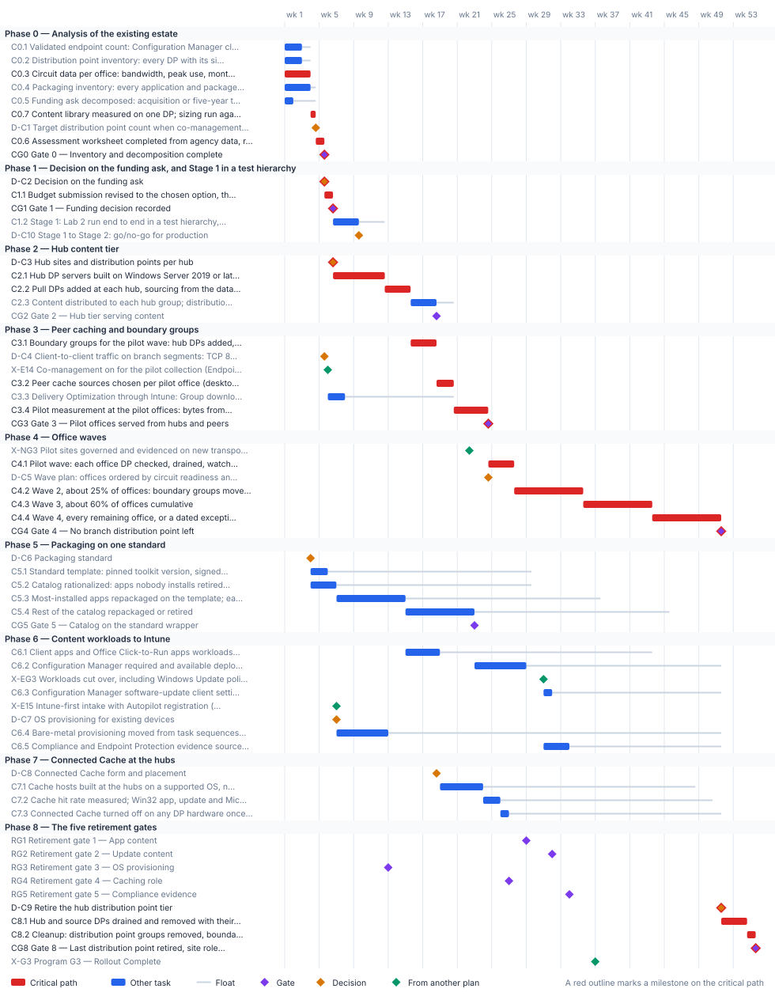

<!-- Generated by scripts/project_plans/build.py from data/project-plans/content-delivery.yaml. Edit the YAML, not this page. -->

# Content Delivery Modernization: Distribution Point Consolidation {.unnumbered}

::: {.callout-note}
## A sample plan, not a commitment
This is an illustrative plan built from the workbook's books, in the form a project manager would baseline: a work breakdown, a schedule network, a computed critical path, decision points, gates and risks. The durations are illustrative, sized to the books' roadmap weeks. Replace them with the agency's own estimates, then baseline the result. The plan names roles, not people, and no specific agency.
:::

## Plan at a glance

| | |
|---|---|
| **Plan type** | Project: From the analysis of the existing estate to the last distribution point retired and its site roles cleaned up, through the five retirement gates |
| **Built from** | Book 09, Chapter 11; Book 05 |
| **Sponsor** | Executive sponsor and CIO |
| **Plan manager** | Content delivery project lead, with the endpoint lead, the Configuration Manager lead, the packaging lead and the network engineering lead |
| **Duration** | 55 weeks (273 working days), computed from the network |
| **Work** | 34 tasks, 12 gates, 10 decision points, 5 milestones from other plans |
| **Critical path** | 23 of 61 items; 4 more within 5 days of it |
| **Calendar** | Week 1 = the program's Phase 0 approval; five working days a week |

: Plan at a glance {.striped}

This plan builds the [Content Delivery Modernization](../books/b00-orientation/06-the-project-portfolio.md#content-delivery-modernization) project from the [Distribution Point Consolidation decision guide](../books/guides/dp-consolidation.md), its [implementation guide](../books/guides/dp-consolidation-implementation.md) (every task links to the step that carries it out, and each step names the Microsoft Learn page it relies on), the [scripts kit](https://github.com/WhalerMike/modernization-workbook/tree/main/examples/dp-consolidation), and the worked case in [Book 09, Chapter 11](../books/b09-network/11-field-office-wan-transformation.md). It starts where any distribution point refresh should start: a validated endpoint count, a distribution point inventory, circuit data and a packaging inventory, then a recorded decision on the funding ask. Then it consolidates the existing Configuration Manager footprint to a small hub tier, keeps content local with peer cache, BranchCache and Delivery Optimization, retires branch distribution points in waves as offices are ready, and puts every application on one standard wrapper so the same package works from Configuration Manager or Intune. The last distribution point retires only when the guide's [five gates](../books/guides/dp-consolidation.md#retirement-gates) have closed. The plan doesn't add Configuration Manager infrastructure for new assets: [Book 05, Chapter 04](../books/b05-devices/04-intune-first-onboarding.md#the-five-pillars) allows none. It takes three dates from the [Endpoint & Device Modernization](endpoint-device.md) plan and one from the [Network & Access Modernization](network-access.md) plan, and it runs inside the [program master schedule](program-master-schedule.md).

## Schedule

{fig-alt="Gantt chart of the Content Delivery Modernization plan over 55 weeks, grouped by phase. Critical-path tasks are red bars, other tasks are blue bars with a grey line showing their float, gates are violet diamonds, decisions are amber diamonds and milestones from other plans are green diamonds. The tables below give every date and float."}

## Critical path

The computed path runs through the office waves. Phase 0 and the funding decision come first and are short: the circuit data is the longest Phase 0 input, and the decision on the ask can be made at the end of week 5, once the inventory, the sizing and the decomposition are in. The hub tier then takes about twelve weeks to build, distribute and validate; Stage 1, the full run in a test hierarchy, fits inside the time the hub servers take to build, and its go/no-go must come before the first production change. Peer caching is then proved at the pilot offices on top of the hub tier. The first wave of branch retirements waits for two things: the hub tier and peers serving the pilot offices (this plan's Gate 3), and the Network & Access plan's Gate 3, which puts the ten pilot sites on governed transport. That gate is the input with the least room; a slip there moves the first wave, and every wave after it, week for week. The three later waves follow circuit readiness, so their dates are placeholders until the agency's own circuit renewal dates replace them.

Packaging and the content workloads carry float against the office waves but bind the retirement gates. The client apps and Office Click-to-Run workloads can't move until the most-installed applications are on the standard wrapper, and Configuration Manager deployments can't be withdrawn until the rest of the catalog is repackaged or retired. Connected Cache at the hubs waits for the decision on its form and for the first Intune Win32 apps. The five retirement gates are milestones, not dates: this sample shows where they land on its own durations, and the last distribution point retires in the week they have all closed, whatever week that turns out to be.

The critical path, in order. Each item has zero total float: a day lost on any of them is a day lost at the finish.

| # | ID | Item | Owner or approver | When |
|---|---|---|---|---|
| 1 | C0.3 | Circuit data per office: bandwidth, peak use, monthly cost and renewal date, from telecom contract records | Network engineering | wk 1–3 |
| 2 | C0.7 | Content library measured on one DP; sizing run against 4,000 clients per DP with a draft hub design and office wave order | Endpoint engineering | wk 4 |
| 3 | C0.6 | Assessment worksheet completed from agency data, reviewed by the endpoint lead, ISSO and budget officer, and kept inside the boundary | Content delivery project lead | wk 4–5 |
| 4 | CG0 | Gate 0 — Inventory and decomposition complete | Content delivery project lead and ISSO | end of wk 5 |
| 5 | D-C2 | Decision on the funding ask | Executive sponsor and CIO | end of wk 5 |
| 6 | C1.1 | Budget submission revised to the chosen option, the worked case's planning assumptions replaced by Phase 0 data, and its consistency with Intune-first stated | Budget officer | wk 5–6 |
| 7 | CG1 | Gate 1 — Funding decision recorded | Executive sponsor and CIO | end of wk 6 |
| 8 | D-C3 | Hub sites and distribution points per hub | Endpoint lead and network engineering lead | end of wk 6 |
| 9 | C2.1 | Hub DP servers built on Windows Server 2019 or later: IIS, BITS and Remote Differential Compression; CM-6 baseline applied and scanned; HTTPS with a PKI certificate; added to the inventory and the SSP | Configuration Manager team | wk 6–12 |
| 10 | C2.2 | Pull DPs added at each hub, sourcing from the data center DPs; one distribution point group per hub (New-DpcHubTier.ps1 -Apply) | Configuration Manager team | wk 12–15 |
| 11 | C3.1 | Boundary groups for the pilot wave: hub DPs added, peer options set, the other hubs as timed fallback, never to the default site group (Set-DpcBoundaryGroups.ps1 -Apply) | Configuration Manager team | wk 15–18 |
| 12 | C3.2 | Peer cache sources chosen per pilot office (desktop chassis, disk, always on); client settings deployed; partial download on; BranchCache enabled | Configuration Manager team | wk 18–20 |
| 13 | C3.4 | Pilot measurement at the pilot offices: bytes from peers, from the hub and from the office DP, for a month of deployments | Configuration Manager team | wk 20–24 |
| 14 | CG3 | Gate 3 — Pilot offices served from hubs and peers | Endpoint lead | end of wk 24 |
| 15 | C4.1 | Pilot wave: each office DP checked, drained, watched 30 days, removed with its site system; disks sanitized; inventory and SSP updated | Configuration Manager team | wk 24–27 |
| 16 | C4.2 | Wave 2, about 25% of offices: boundary groups moved, peers enabled, office DPs read-only, then retired after 30 clean days | Configuration Manager team | wk 27–35 |
| 17 | C4.3 | Wave 3, about 60% of offices cumulative | Configuration Manager team | wk 35–43 |
| 18 | C4.4 | Wave 4, every remaining office, or a dated exception with its reason | Configuration Manager team | wk 43–51 |
| 19 | CG4 | Gate 4 — No branch distribution point left | Executive sponsor and CIO | end of wk 51 |
| 20 | D-C9 | Retire the hub distribution point tier | Executive sponsor and CIO | end of wk 51 |
| 21 | C8.1 | Hub and source DPs drained and removed with their site systems (Invoke-DpcOfficeRetirement.ps1 -GatesPath); media sanitized; inventory and SSP entries closed | Configuration Manager team | wk 51–54 |
| 22 | C8.2 | Cleanup: distribution point groups removed, boundary group site-system references cleared, peer cache client settings and deployments retired; no DP role left in the hierarchy | Configuration Manager team | wk 54–55 |
| 23 | CG8 | Gate 8 — Last distribution point retired, site roles cleaned up, evidence complete | CISO and ISSO | end of wk 55 |

: The critical path {.striped .hover}

**Near-critical.** These items have 5 working days of float or less. Track them weekly: once their float is spent, they join the critical path.

| ID | Item | Float | When |
|---|---|---|---|
| C0.4 | Packaging inventory: every application and package, its installer type, install count, active deployments and last change | 3 d | wk 1–3 |
| C0.1 | Validated endpoint count: Configuration Manager clients reconciled with Intune and the asset record, duplicates and stale records removed | 5 d | wk 1–2 |
| C0.2 | Distribution point inventory: every DP with its site, office, OS version, hardware age and warranty, PXE and Connected Cache roles, and content library size | 5 d | wk 1–2 |
| D-C1 | Target distribution point count when co-management completes, and the fiscal year | 5 d | end of wk 4 |

: Near-critical items {.striped .hover}

## Decision points

Each decision is a zero-duration milestone in the network. *Decide by* is its late finish: the last week it can be made without moving the plan's finish. A decision with zero float sits on the critical path, so the meeting that makes it should be booked before the plan is baselined. Decision rights follow [Book 01, Chapter 09](../books/b01-transformation-arc/09-who-leads-the-transformation.md#decision-rights-across-the-program).

| ID | Decision | Decides | Needed by | Decide by | Float | Options | If it's late |
|---|---|---|---|---|---|---|---|
| D-C1 | Target distribution point count when co-management completes, and the fiscal year | Executive sponsor and CIO | CG0 | end of wk 5 | 5 d | A dated target count from the validated endpoint count and Microsoft's 4,000-clients-per-DP limit (about 24 in the worked case); keep the current count (then say why the office count, not the client count, sizes it) | No refresh or consolidation can be sized, and the decision on the funding ask waits |
| D-C2 | Decision on the funding ask | Executive sponsor and CIO | C1.1 | end of wk 5 | **0 (critical)** | Refresh in place; consolidate to a hub tier (the guide's recommendation where the circuits allow); cloud-first with Connected Cache, keeping a hub tier only until the five gates close | Refresh money is committed by default, or the hub build can't start |
| D-C3 | Hub sites and distribution points per hub | Endpoint lead and network engineering lead | C2.1 | end of wk 6 | **0 (critical)** | Existing regional facilities inside the current boundary, two pull DPs each, with source DPs at the two data centers (the worked case: 12 sites, 24 DPs); more hubs where latency or headcount needs them | Hub servers can't be ordered or built |
| D-C10 | Stage 1 to Stage 2: go/no-go for production | Content delivery project lead and ISSO | C2.2 | end of wk 12 | 15 d | Go when Lab 2 ran end to end with its back-out, every cmdlet ran on the agency's Configuration Manager version, the inventory matched the console and the change board approved the production plan; no-go repeats Stage 1 | No production change can start, and the hub build waits |
| D-C4 | Client-to-client traffic on branch segments: TCP 8003, UDP 8004 and TCP 7680 | CISO | C3.2, C3.3 | end of wk 18 | 65 d | Allow within each office's subnet only; allow for named peer cache sources only; block, and size circuits for hub pulls | Peer cache and Delivery Optimization peering can't be configured, and the pilot measures nothing |
| D-C5 | Wave plan: offices ordered by circuit readiness and renewal date | Content delivery project lead | C4.2 | end of wk 27 | 15 d | By circuit readiness and renewal (the guide's order); by region (simpler, but waits on the slowest circuit in each) | Wave 2 can't be scheduled, and offices keep DPs they no longer need |
| D-C6 | Packaging standard | Endpoint lead | C5.1 | end of wk 27 | 118 d | PSAppDeployToolkit as the standard wrapper, version pinned, for every app that isn't a clean MSI; vendor installers with Intune's PowerShell script installer only; a mix by app class | Repackaging can't start, and the client apps workload waits |
| D-C8 | Connected Cache form and placement | Endpoint lead and ISSO | C7.1 | end of wk 43 | 125 d | Connected Cache for Enterprise and Education on its own host at each hub, its Azure resource placed in the boundary analysis; the Configuration Manager-integrated cache on a hub DP with no other roles (then retirement gate 4 binds it); none, where measured circuits carry cloud content | Cloud content keeps crossing every hub circuit, and gate 4 has no plan |
| D-C7 | OS provisioning for existing devices | Endpoint lead | C6.4 | end of wk 45 | 193 d | Windows Autopilot for every rebuild, with reset where it applies; keep task sequences for a named exception class on a hub DP until it can move | Imaging keeps a PXE distribution point alive, and retirement gate 3 stays open |
| D-C9 | Retire the hub distribution point tier | Executive sponsor and CIO | C8.1 | end of wk 51 | **0 (critical)** | Retire it in the week the last gate closes; keep it while any gate is open. Never on a date alone | Twenty-odd servers stay in the boundary to be patched, scanned and accredited for no workload |

: Decision points, by decide-by date {.striped .hover}

## Gates

A gate opens the work that names it as a predecessor, which is usually the next phase but not always. The approver signs it against the criteria, from evidence in the repository.

| Gate | When | Approver | Criteria |
|---|---|---|---|
| [Gate 0 — Inventory and decomposition complete](../books/guides/dp-consolidation-implementation.md#step-0-4) | end of wk 5 | Content delivery project lead and ISSO | Endpoint count validated and dated; every distribution point in the inventory and the system component inventory; circuit cost and renewal date recorded per office; packaging inventory complete; the ask stated as acquisition or five-year cost with scope itemized; a dated target DP count; the worksheet reviewed and stored inside the boundary |
| [Gate 1 — Funding decision recorded](../books/guides/dp-consolidation-implementation.md#step-2) | end of wk 6 | Executive sponsor and CIO | Option chosen with the decision table and worksheet as its evidence; budget submission revised; target DP count and fiscal year recorded; the decision filed in the program's decision register |
| [Gate 2 — Hub tier serving content](../books/guides/dp-consolidation-implementation.md#step-3-3) | end of wk 18 | Configuration Manager lead and ISSO | Every hub DP in production, baselined, scanned and in the SSP; every package distributed to its region's group with no failures; load per DP under 3,200 clients (80% of the published 4,000); change records for every server |
| [Gate 3 — Pilot offices served from hubs and peers](../books/guides/dp-consolidation-implementation.md#go-no-go) | end of wk 24 | Endpoint lead | Pilot offices' content served by the hub and peers, with the office DP in read-only fallback and serving under a threshold the endpoint lead sets; no deployment failure traced to content location; measurement report filed |
| [Gate 4 — No branch distribution point left](../books/guides/dp-consolidation-implementation.md#step-6-5) | end of wk 51 | Executive sponsor and CIO | Every office DP retired or in the exception register with a date and reason; every retired server's media sanitized and its inventory and SSP entries closed; hub load per DP still under 80% of the published limit |
| [Gate 5 — Catalog on the standard wrapper](../books/guides/dp-consolidation-implementation.md#step-7-1) | end of wk 22 | Endpoint lead | Every kept app has an owner, a package on the template, a tested detection rule and a change record; the same package installs from either tool; retired apps removed from both |
| [Retirement gate 1 — App content](../books/guides/dp-consolidation-implementation.md#step-10-1) | end of wk 28 | Endpoint lead | Client apps and Office Click-to-Run workloads on Intune for the whole validated population, and no required or available deployment still published from Configuration Manager |
| [Retirement gate 2 — Update content](../books/guides/dp-consolidation-implementation.md#step-10-1) | end of wk 31 | Endpoint lead | Windows Update policies and device configuration workloads on Intune, and Configuration Manager's software-update client setting off for those devices |
| [Retirement gate 3 — OS provisioning](../books/guides/dp-consolidation-implementation.md#step-10-1) | end of wk 12 | Endpoint lead | Bare-metal provisioning on Autopilot; no task sequence or PXE service still in use |
| [Retirement gate 4 — Caching role](../books/guides/dp-consolidation-implementation.md#step-10-1) | end of wk 26 | Endpoint lead and ISSO | No Connected Cache instance runs on distribution-point hardware, or none is needed on the measured circuits |
| [Retirement gate 5 — Compliance evidence](../books/guides/dp-consolidation-implementation.md#step-10-1) | end of wk 33 | ISSO | Compliance and Endpoint Protection reporting no longer cite the Configuration Manager site database as their evidence source |
| [Gate 8 — Last distribution point retired, site roles cleaned up, evidence complete](../books/guides/dp-consolidation-implementation.md#step-10-3) | end of wk 55 | CISO and ISSO | All five retirement gates closed in a gates run; no distribution point role left in Get-CMSiteRole; every DP's decommission record, sanitization record and SSP change filed; the content delivery evidence set in the guide's requirements table complete |

: Gates {.striped .hover}

## Links to other plans

- **X-E14, Co-management on for the pilot collection (Endpoint plan E1.4),** is E1.4 in the [Endpoint & Device Modernization](endpoint-device.md) plan (Co-management on for the pilot collection; MDMWinsOverGP decided per population), end of wk 5. This plan waits for it; it can slip 63 d before it moves this plan. Pilot devices have no Intune channel for Delivery Optimization policy.
- **X-NG3, Pilot sites governed and evidenced on new transport (Network plan Gate 3),** is NG3 in the [Network & Access Modernization](network-access.md) plan (Gate 3 — Pilot governed and evidenced), end of wk 22. This plan waits for it; it can slip 11 d before it moves this plan. The pilot offices are still on their old circuits, and the first wave of DP retirements waits.
- **X-EG3, Workloads cut over, including Windows Update policies and device configuration (Endpoint plan Gate 3),** is EG3 in the [Endpoint & Device Modernization](endpoint-device.md) plan (Gate 3 — Workloads cut over), end of wk 30. This plan waits for it; it can slip 88 d before it moves this plan. Update content still comes from Configuration Manager, and retirement gate 2 can't close.
- **X-E15, Intune-first intake with Autopilot registration (Endpoint plan E1.5),** is E1.5 in the [Endpoint & Device Modernization](endpoint-device.md) plan (Intune-first intake: procurement fields, Autopilot registration with group tags, enrollment restrictions), end of wk 6. This plan waits for it; it can slip 193 d before it moves this plan. There's no Autopilot path to move bare-metal provisioning onto.
- **X-G3, Program G3 — Rollout Complete,** is G3 in the [Program master schedule](program-master-schedule.md) plan (G3 — Rollout Complete), end of wk 36. Shown for reference.

## Work breakdown and schedule

Every row, by phase. *Float* is total float in working days; **bold** rows are on the critical path. Each row links to the chapter it comes from.

### Phase 0 — Analysis of the existing estate

| ID | Item | Type | Owner or approver | Days | Predecessors | When | Float |
|---|---|---|---|---|---|---|---|
| C0.1 | [Validated endpoint count: Configuration Manager clients reconciled with Intune and the asset record, duplicates and stale records removed](../books/guides/dp-consolidation-implementation.md#step-0-3) | Task | Endpoint engineering | 10 | — | wk 1–2 | 5 d |
| C0.2 | [Distribution point inventory: every DP with its site, office, OS version, hardware age and warranty, PXE and Connected Cache roles, and content library size](../books/guides/dp-consolidation-implementation.md#step-0-3) | Task | Configuration Manager team | 10 | — | wk 1–2 | 5 d |
| C0.3 | **[Circuit data per office: bandwidth, peak use, monthly cost and renewal date, from telecom contract records](../books/guides/dp-consolidation-implementation.md#step-0-1)** | Task | Network engineering | 15 | — | wk 1–3 | 0 |
| C0.4 | [Packaging inventory: every application and package, its installer type, install count, active deployments and last change](../books/guides/dp-consolidation-implementation.md#step-0-3) | Task | Packaging team | 15 | — | wk 1–3 | 3 d |
| C0.5 | [Funding ask decomposed: acquisition or five-year total cost of ownership, and every item beyond the distribution point itemized](../books/guides/dp-consolidation-implementation.md#step-2) | Task | Budget officer | 5 | — | wk 1 | 13 d |
| C0.7 | **[Content library measured on one DP; sizing run against 4,000 clients per DP with a draft hub design and office wave order](../books/guides/dp-consolidation-implementation.md#step-1-2)** | Task | Endpoint engineering | 3 | C0.1, C0.2, C0.3 | wk 4 | 0 |
| D-C1 | [Target distribution point count when co-management completes, and the fiscal year](../books/guides/dp-consolidation-implementation.md#step-1-2) | Decision | Executive sponsor and CIO | — | C0.7 | end of wk 4 | 5 d |
| C0.6 | **[Assessment worksheet completed from agency data, reviewed by the endpoint lead, ISSO and budget officer, and kept inside the boundary](../books/guides/dp-consolidation-implementation.md#step-2)** | Task | Content delivery project lead | 5 | C0.4, C0.5, C0.7 | wk 4–5 | 0 |
| CG0 | **[Gate 0 — Inventory and decomposition complete](../books/guides/dp-consolidation-implementation.md#step-0-4)** | Gate | Content delivery project lead and ISSO | — | C0.6, D-C1 | end of wk 5 | 0 |

: Phase 0 — Analysis of the existing estate {.striped .hover}

### Phase 1 — Decision on the funding ask, and Stage 1 in a test hierarchy

| ID | Item | Type | Owner or approver | Days | Predecessors | When | Float |
|---|---|---|---|---|---|---|---|
| D-C2 | **[Decision on the funding ask](../books/guides/dp-consolidation-implementation.md#step-2)** | Decision | Executive sponsor and CIO | — | CG0 | end of wk 5 | 0 |
| C1.1 | **[Budget submission revised to the chosen option, the worked case's planning assumptions replaced by Phase 0 data, and its consistency with Intune-first stated](../books/guides/dp-consolidation-implementation.md#step-2)** | Task | Budget officer | 5 | D-C2 | wk 5–6 | 0 |
| CG1 | **[Gate 1 — Funding decision recorded](../books/guides/dp-consolidation-implementation.md#step-2)** | Gate | Executive sponsor and CIO | — | C1.1 | end of wk 6 | 0 |
| C1.2 | [Stage 1: Lab 2 run end to end in a test hierarchy, every change applied and then backed out from its plan.csv](../books/guides/dp-consolidation-implementation.md#lab-2) | Task | Configuration Manager team | 15 | CG1 | wk 6–9 | 15 d |
| D-C10 | [Stage 1 to Stage 2: go/no-go for production](../books/guides/dp-consolidation-implementation.md#go-no-go) | Decision | Content delivery project lead and ISSO | — | C1.2 | end of wk 9 | 15 d |

: Phase 1 — Decision on the funding ask, and Stage 1 in a test hierarchy {.striped .hover}

### Phase 2 — Hub content tier

| ID | Item | Type | Owner or approver | Days | Predecessors | When | Float |
|---|---|---|---|---|---|---|---|
| D-C3 | **[Hub sites and distribution points per hub](../books/guides/dp-consolidation-implementation.md#step-1-1)** | Decision | Endpoint lead and network engineering lead | — | CG1, C0.3 | end of wk 6 | 0 |
| C2.1 | **[Hub DP servers built on Windows Server 2019 or later: IIS, BITS and Remote Differential Compression; CM-6 baseline applied and scanned; HTTPS with a PKI certificate; added to the inventory and the SSP](../books/guides/dp-consolidation-implementation.md#step-3-1)** | Task | Configuration Manager team | 30 | D-C3 | wk 6–12 | 0 |
| C2.2 | **[Pull DPs added at each hub, sourcing from the data center DPs; one distribution point group per hub (New-DpcHubTier.ps1 -Apply)](../books/guides/dp-consolidation-implementation.md#step-3-2)** | Task | Configuration Manager team | 15 | C2.1, D-C10 | wk 12–15 | 0 |
| C2.3 | [Content distributed to each hub group; distribution status clean; content validation run; inventory rerun](../books/guides/dp-consolidation-implementation.md#step-3-3) | Task | Configuration Manager team | 15 | C2.2 | wk 15–18 | 10 d |
| CG2 | [Gate 2 — Hub tier serving content](../books/guides/dp-consolidation-implementation.md#step-3-3) | Gate | Configuration Manager lead and ISSO | — | C2.3 | end of wk 18 | 10 d |

: Phase 2 — Hub content tier {.striped .hover}

### Phase 3 — Peer caching and boundary groups

| ID | Item | Type | Owner or approver | Days | Predecessors | When | Float |
|---|---|---|---|---|---|---|---|
| C3.1 | **[Boundary groups for the pilot wave: hub DPs added, peer options set, the other hubs as timed fallback, never to the default site group (Set-DpcBoundaryGroups.ps1 -Apply)](../books/guides/dp-consolidation-implementation.md#step-4-2)** | Task | Configuration Manager team | 15 | C2.2 | wk 15–18 | 0 |
| D-C4 | [Client-to-client traffic on branch segments: TCP 8003, UDP 8004 and TCP 7680](../books/guides/dp-consolidation-implementation.md#step-5) | Decision | CISO | — | CG0 | end of wk 5 | 65 d |
| X-E14 | [Co-management on for the pilot collection (Endpoint plan E1.4)](endpoint-device.md) | External | Endpoint & Device project | — | — | end of wk 5 | 63 d |
| C3.2 | **[Peer cache sources chosen per pilot office (desktop chassis, disk, always on); client settings deployed; partial download on; BranchCache enabled](../books/guides/dp-consolidation-implementation.md#step-5-2)** | Task | Configuration Manager team | 10 | C3.1, D-C4 | wk 18–20 | 0 |
| C3.3 | [Delivery Optimization through Intune: Group download mode with a group ID per office, or subnet restriction, for the pilot devices](../books/guides/dp-consolidation-implementation.md#step-5-3) | Task | Endpoint engineering | 10 | D-C4, X-E14 | wk 6–7 | 63 d |
| C3.4 | **[Pilot measurement at the pilot offices: bytes from peers, from the hub and from the office DP, for a month of deployments](../books/guides/dp-consolidation-implementation.md#step-5-4)** | Task | Configuration Manager team | 20 | C3.2, C3.3, CG2 | wk 20–24 | 0 |
| CG3 | **[Gate 3 — Pilot offices served from hubs and peers](../books/guides/dp-consolidation-implementation.md#go-no-go)** | Gate | Endpoint lead | — | C3.4 | end of wk 24 | 0 |

: Phase 3 — Peer caching and boundary groups {.striped .hover}

### Phase 4 — Office waves

| ID | Item | Type | Owner or approver | Days | Predecessors | When | Float |
|---|---|---|---|---|---|---|---|
| X-NG3 | [Pilot sites governed and evidenced on new transport (Network plan Gate 3)](network-access.md) | External | Network & Access project | — | — | end of wk 22 | 11 d |
| C4.1 | **[Pilot wave: each office DP checked, drained, watched 30 days, removed with its site system; disks sanitized; inventory and SSP updated](../books/guides/dp-consolidation-implementation.md#step-6)** | Task | Configuration Manager team | 15 | CG3, X-NG3 | wk 24–27 | 0 |
| D-C5 | [Wave plan: offices ordered by circuit readiness and renewal date](../books/guides/dp-consolidation-implementation.md#step-1-2) | Decision | Content delivery project lead | — | CG3, C0.3 | end of wk 24 | 15 d |
| C4.2 | **[Wave 2, about 25% of offices: boundary groups moved, peers enabled, office DPs read-only, then retired after 30 clean days](../books/guides/dp-consolidation-implementation.md#step-6)** | Task | Configuration Manager team | 40 | C4.1, D-C5 | wk 27–35 | 0 |
| C4.3 | **[Wave 3, about 60% of offices cumulative](../books/guides/dp-consolidation-implementation.md#step-6)** | Task | Configuration Manager team | 40 | C4.2 | wk 35–43 | 0 |
| C4.4 | **[Wave 4, every remaining office, or a dated exception with its reason](../books/guides/dp-consolidation-implementation.md#step-6)** | Task | Configuration Manager team | 40 | C4.3 | wk 43–51 | 0 |
| CG4 | **[Gate 4 — No branch distribution point left](../books/guides/dp-consolidation-implementation.md#step-6-5)** | Gate | Executive sponsor and CIO | — | C4.4 | end of wk 51 | 0 |

: Phase 4 — Office waves {.striped .hover}

### Phase 5 — Packaging on one standard

| ID | Item | Type | Owner or approver | Days | Predecessors | When | Float |
|---|---|---|---|---|---|---|---|
| D-C6 | [Packaging standard](../books/guides/dp-consolidation-implementation.md#step-7) | Decision | Endpoint lead | — | C0.4 | end of wk 3 | 118 d |
| C5.1 | [Standard template: pinned toolkit version, signed scripts, one log path, exit codes mapped, detection rule pattern; held under change control](../books/guides/dp-consolidation-implementation.md#step-7-2) | Task | Packaging team | 10 | D-C6 | wk 4–5 | 118 d |
| C5.2 | [Catalog rationalized: apps nobody installs retired, duplicate versions removed, an owner for every app kept](../books/guides/dp-consolidation-implementation.md#step-7-1) | Task | Packaging team | 15 | C0.4 | wk 4–6 | 113 d |
| C5.3 | [Most-installed apps repackaged on the template; each tested from Configuration Manager and as an .intunewin from Intune](../books/guides/dp-consolidation-implementation.md#step-7-5) | Task | Packaging team | 40 | C5.1, C5.2 | wk 7–14 | 113 d |
| C5.4 | [Rest of the catalog repackaged or retired](../books/guides/dp-consolidation-implementation.md#step-7-5) | Task | Packaging team | 40 | C5.3 | wk 15–22 | 113 d |
| CG5 | [Gate 5 — Catalog on the standard wrapper](../books/guides/dp-consolidation-implementation.md#step-7-1) | Gate | Endpoint lead | — | C5.4 | end of wk 22 | 143 d |

: Phase 5 — Packaging on one standard {.striped .hover}

### Phase 6 — Content workloads to Intune

| ID | Item | Type | Owner or approver | Days | Predecessors | When | Float |
|---|---|---|---|---|---|---|---|
| C6.1 | [Client apps and Office Click-to-Run apps workloads: Pilot Intune, then Intune; apps published as Win32 apps from the standard packages](../books/guides/dp-consolidation-implementation.md#step-8-1) | Task | Endpoint engineering | 20 | C5.3, X-E14 | wk 15–18 | 123 d |
| C6.2 | [Configuration Manager required and available deployments withdrawn as each app moves; the count reported weekly](../books/guides/dp-consolidation-implementation.md#step-8-2) | Task | Configuration Manager team | 30 | C6.1, C5.4 | wk 23–28 | 113 d |
| X-EG3 | [Workloads cut over, including Windows Update policies and device configuration (Endpoint plan Gate 3)](endpoint-device.md) | External | Endpoint & Device project | — | — | end of wk 30 | 88 d |
| C6.3 | [Configuration Manager software-update client setting turned off for every device on the Windows Update workload](../books/guides/dp-consolidation-implementation.md#step-8-3) | Task | Configuration Manager team | 5 | X-EG3 | wk 31 | 98 d |
| X-E15 | [Intune-first intake with Autopilot registration (Endpoint plan E1.5)](endpoint-device.md) | External | Endpoint & Device project | — | — | end of wk 6 | 193 d |
| D-C7 | [OS provisioning for existing devices](../books/guides/dp-consolidation-implementation.md#step-8-4) | Decision | Endpoint lead | — | X-E15, C0.2 | end of wk 6 | 193 d |
| C6.4 | [Bare-metal provisioning moved from task sequences to Autopilot; PXE turned off on every DP](../books/guides/dp-consolidation-implementation.md#step-8-4) | Task | Endpoint engineering | 30 | D-C7 | wk 7–12 | 193 d |
| C6.5 | [Compliance and Endpoint Protection evidence sourced from Intune and Defender, not the Configuration Manager site database; ISSO confirms](../books/guides/dp-consolidation-implementation.md#step-8-5) | Task | ISSO | 15 | X-EG3 | wk 31–33 | 88 d |

: Phase 6 — Content workloads to Intune {.striped .hover}

### Phase 7 — Connected Cache at the hubs

| ID | Item | Type | Owner or approver | Days | Predecessors | When | Float |
|---|---|---|---|---|---|---|---|
| D-C8 | [Connected Cache form and placement](../books/guides/dp-consolidation-implementation.md#step-9) | Decision | Endpoint lead and ISSO | — | CG2 | end of wk 18 | 125 d |
| C7.1 | [Cache hosts built at the hubs on a supported OS, nothing else on port 80; Delivery Optimization pointed at each office's hub cache](../books/guides/dp-consolidation-implementation.md#step-9-1) | Task | Endpoint engineering | 25 | D-C8, C6.1 | wk 19–23 | 123 d |
| C7.2 | [Cache hit rate measured; Win32 app, update and Microsoft 365 Apps content confirmed served from the hubs](../books/guides/dp-consolidation-implementation.md#step-9-2) | Task | Endpoint engineering | 10 | C7.1 | wk 24–25 | 123 d |
| C7.3 | [Connected Cache turned off on any DP hardware once the hub cache serves that office](../books/guides/dp-consolidation-implementation.md#step-9-3) | Task | Configuration Manager team | 5 | C7.2 | wk 26 | 123 d |

: Phase 7 — Connected Cache at the hubs {.striped .hover}

### Phase 8 — The five retirement gates

| ID | Item | Type | Owner or approver | Days | Predecessors | When | Float |
|---|---|---|---|---|---|---|---|
| RG1 | [Retirement gate 1 — App content](../books/guides/dp-consolidation-implementation.md#step-10-1) | Gate | Endpoint lead | — | C6.2 | end of wk 28 | 113 d |
| RG2 | [Retirement gate 2 — Update content](../books/guides/dp-consolidation-implementation.md#step-10-1) | Gate | Endpoint lead | — | C6.3 | end of wk 31 | 98 d |
| RG3 | [Retirement gate 3 — OS provisioning](../books/guides/dp-consolidation-implementation.md#step-10-1) | Gate | Endpoint lead | — | C6.4 | end of wk 12 | 193 d |
| RG4 | [Retirement gate 4 — Caching role](../books/guides/dp-consolidation-implementation.md#step-10-1) | Gate | Endpoint lead and ISSO | — | C7.3 | end of wk 26 | 123 d |
| RG5 | [Retirement gate 5 — Compliance evidence](../books/guides/dp-consolidation-implementation.md#step-10-1) | Gate | ISSO | — | C6.5 | end of wk 33 | 88 d |
| D-C9 | **[Retire the hub distribution point tier](../books/guides/dp-consolidation-implementation.md#step-10-1)** | Decision | Executive sponsor and CIO | — | RG1, RG2, RG3, RG4, RG5, CG4, CG5 | end of wk 51 | 0 |
| C8.1 | **[Hub and source DPs drained and removed with their site systems (Invoke-DpcOfficeRetirement.ps1 -GatesPath); media sanitized; inventory and SSP entries closed](../books/guides/dp-consolidation-implementation.md#step-10-2)** | Task | Configuration Manager team | 15 | D-C9 | wk 51–54 | 0 |
| C8.2 | **[Cleanup: distribution point groups removed, boundary group site-system references cleared, peer cache client settings and deployments retired; no DP role left in the hierarchy](../books/guides/dp-consolidation-implementation.md#step-10-3)** | Task | Configuration Manager team | 5 | C8.1 | wk 54–55 | 0 |
| CG8 | **[Gate 8 — Last distribution point retired, site roles cleaned up, evidence complete](../books/guides/dp-consolidation-implementation.md#step-10-3)** | Gate | CISO and ISSO | — | C8.2 | end of wk 55 | 0 |
| X-G3 | [Program G3 — Rollout Complete](program-master-schedule.md) | External | Executive sponsor and steering committee | — | — | end of wk 36 | fixed date |

: Phase 8 — The five retirement gates {.striped .hover}

## Responsibility

Who owns what in this plan. Each row has one owner; consulted and informed parties follow the [decision matrix](../books/b01-transformation-arc/09-who-leads-the-transformation.md#decision-rights-across-the-program).

| Owner or approver | Tasks | Decisions | Gates |
|---|---|---|---|
| Configuration Manager team | 17 | — | — |
| Endpoint engineering | 7 | — | — |
| Endpoint lead | — | 2 | 5 |
| Executive sponsor and CIO | — | 3 | 2 |
| Packaging team | 5 | — | — |
| Endpoint & Device project | 3 | — | — |
| Budget officer | 2 | — | — |
| Content delivery project lead | 1 | 1 | — |
| Content delivery project lead and ISSO | — | 1 | 1 |
| Endpoint lead and ISSO | — | 1 | 1 |
| ISSO | 1 | — | 1 |
| CISO | — | 1 | — |
| CISO and ISSO | — | — | 1 |
| Configuration Manager lead and ISSO | — | — | 1 |
| Endpoint lead and network engineering lead | — | 1 | — |
| Executive sponsor and steering committee | 1 | — | — |
| Network & Access project | 1 | — | — |
| Network engineering | 1 | — | — |

: Ownership {.striped .hover}

## Assumptions

- The estate has a Configuration Manager hierarchy with a distribution point in most offices, as in [Book 09, Chapter 11](../books/b09-network/11-field-office-wan-transformation.md#scope). The case's figures, about 70,000 endpoints, about 1,500 offices and 24 hub distribution points, are its planning assumptions; Phase 0 replaces them with the agency's own.
- Hub distribution points and any Connected Cache host run Windows Server 2019 or later, the workbook's minimum server standard (a planning assumption). Microsoft supports the distribution point role on Windows Server 2019, 2022 and 2025; Connected Cache for Enterprise and Education needs Windows Server 2022 or later, Windows 11 or Ubuntu 24.04 ([decision guide](../books/guides/dp-consolidation.md#target-architecture)).
- Office waves follow circuit readiness. The Network & Access plan covers the ten-site pilot only; the circuit waves for the remaining offices, keyed to renewal dates over months 18 to 48 in Book 09, Chapter 11, aren't in any sample plan. Each wave here assumes its offices are on circuits sized to pull from a hub, or that measured peer traffic shows they don't need to.
- Air-gapped and separately accredited enclaves keep Configuration Manager and local distribution points, as in Book 09, Chapter 11, and are outside this plan.
- The tenant is GCC (Moderate), which uses the commercial Intune service; Connected Cache for Enterprise and Education is listed as unavailable only in GCC High and DoD.
- Durations are illustrative, including the four office waves and the packaging work, which scale with office count and catalog size.

## Schedule risks

| Risk | Effect on the schedule | Response |
|---|---|---|
| The funding ask can't be decomposed: acquisition and five-year cost stay blended | No option can be compared fairly, and the decision on the ask (D-C2) slips | Make decomposition a Gate 0 criterion; the budget officer owns it from week 1 (decision guide, question 1) |
| Branch segmentation blocks client-to-client traffic | Peer cache, BranchCache and Delivery Optimization peering don't work; every client pulls from the hub | Decide the ports in D-C4; peering is an optimization, so size the waves on circuits that can carry hub pulls without it (Book 09, Chapter 11) |
| Bare-metal imaging still needs a local distribution point | Retirement gate 3 stays open, and a 'just in case' distribution point survives everything else | Decide the Autopilot path in D-C7 and measure PXE use per office in Phase 0 |
| Apps are moved to Intune but their Configuration Manager deployments are left in place | Clients keep downloading from distribution points; retirement gate 1 never closes | Withdraw each Configuration Manager deployment as its app moves (C6.2), and report the count weekly |
| Packaging capacity is too small for the catalog | The client apps workload waits, and so does gate 1 | Rationalize the catalog first (C5.2); repackage by install count; retire what nobody installs |
| Network circuit waves slip | Office waves 2 to 4 slip with them | Order the waves by circuit readiness (D-C5), not geography; an office on an adequate circuit can go early |

: Schedule risks {.striped .hover}

## Baseline and change control

- **Baseline** the plan when its first gate is approved: the YAML file, as merged, is the baseline.
- **Report** weekly, green, yellow or red, against the baseline ([Book 01, Chapter 12](../books/b01-transformation-arc/12-migration-roadmap.md#phase-3-general-rollout-weeks-1736)). Report float, not percent complete: a task's float says how much slip the plan can still absorb.
- **Change** the plan only through a reviewed pull request that edits the YAML and regenerates this page, so every change to a date or a dependency has an author, a reviewer and a reason.
- **Re-baseline** at each gate, after the approver signs it, and whenever a critical-path decision is made late.

## Download and adapt

| File | Use it for |
|---|---|
| [content-delivery.xml](files/content-delivery.xml) | Microsoft Project desktop (open the XML file; it keeps the dependencies, milestones and owners). The dates start on a placeholder Monday: change the project start date. |
| [content-delivery.csv](files/content-delivery.csv) | Excel or any other scheduling tool: every row with its dependencies, early and late dates and float |
| [content-delivery-azure-boards.csv](files/content-delivery-azure-boards.csv) | Azure DevOps Boards: an Epic per phase and a Feature per task, gate and decision, with dates and tags (see below) |
| [content-delivery-dependencies.csv](files/content-delivery-dependencies.csv) · [add-azure-boards-links.ps1](files/add-azure-boards-links.ps1) | The plan's predecessor links, and a script that adds them in Azure Boards after the import |
| [content-delivery-jira.csv](files/content-delivery-jira.csv) | Jira: an Epic per phase and a Task per task, gate and decision, with dates, labels and Blocks links (see below) |
| [content-delivery.yaml](https://github.com/WhalerMike/modernization-workbook/blob/main/data/project-plans/content-delivery.yaml) | The source. Edit the durations, owners and dependencies, then run `python scripts/project_plans/build.py` to recompute the critical path and regenerate this page, the chart and the downloads. |

: Downloads {.striped}

::: {.callout-tip}
## Importing this plan into Azure DevOps Boards
1. In the project, select **Boards** > **Queries** > **Import work items**, choose [content-delivery-azure-boards.csv](files/content-delivery-azure-boards.csv), check the results and select **Save items**. It creates one Epic per phase with a Feature under it for each task, gate and decision, with start and target dates, which is what Delivery Plans show. Epic and Feature exist in the Agile, Scrum and CMMI processes; in the Basic process, change *Feature* to *Issue* in the file first.
2. The import can't create dependency links or assign people. To add the predecessor links, sign in with `az login`, add the CLI extension with `az extension add --name azure-devops`, and run `./add-azure-boards-links.ps1 -Organization https://dev.azure.com/<org> -Project <project> -Plan content-delivery` beside [content-delivery-dependencies.csv](files/content-delivery-dependencies.csv). It finds the imported items by their `fmw-id-` tags and links each one to its predecessors.
3. Assign people in Boards: each item carries its owner role as an *Owner - …* tag, and critical-path items carry *Critical path*. Azure Boards links don't hold lag or start-to-start timing; each item's description keeps them.

The dates count from the plan's placeholder start; shift them when you set the real start. The script hasn't been run against a live organization yet: test it on a scratch project first.
:::

::: {.callout-tip}
## Importing this plan into Jira
1. Run the CSV importer (in Jira Cloud, **Settings** > **System** > **External system import** > **CSV**) with [content-delivery-jira.csv](files/content-delivery-jira.csv). On the second step, set **Date format in import file** to `yyyy-MM-dd`.
2. Map the columns: *Work item ID* to Work item ID, *Work type* to Work type, *Parent* to Parent, *Summary*, *Description* and every *Labels* column to their fields, *Start date* to the Start date field, *Due date* to Due date, and every *Blocks* column to the **Blocks** link type. Each phase becomes an Epic with a Task under it for each task, gate and decision; each Blocks column makes that row's item block the item it names, which carries the plan's dependencies.
3. Assign people in Jira: each item carries its owner role as an `owner-…` label, and critical-path items carry `critical-path`. Jira links don't hold lag or start-to-start timing; each description keeps them.

Test the import on a scratch project with a few rows first: the importer doesn't remove duplicate links and Jira has no bulk delete for them. If the Blocks links don't come through on your site, import the items first and add the links from the plan's dependency list in a second pass, as Atlassian recommends. The dates count from the plan's placeholder start.
:::

::: {.callout-tip}
## Opening this plan in Project or Planner
- **Microsoft Project desktop** opens the XML file directly, with every dependency, milestone and owner.
- **Microsoft Planner** has no file import of its own: it doesn't read XML, CSV or Excel. To bring this plan into a Planner premium plan, open the XML file in Project desktop, save it as an `.mpp` file, and import that through the Project Power App. Tasks, durations, dependencies and milestones come across; resources and baselines don't, so assign owners again in Planner.
- **Without Project desktop**, the CSV can feed a Power Automate flow that creates the tasks one by one, but dependencies in a premium plan need Microsoft's Project schedule APIs, so that's a build, not an import.
- **In a government cloud tenant**, check that premium plans are available before relying on Planner for this schedule: Microsoft notes that converting a basic plan to a premium plan isn't available in GCC.

Project for the web was retired on August 1, 2025, and Project Online on September 30, 2026; Planner is their successor. Project desktop is unaffected.
:::

