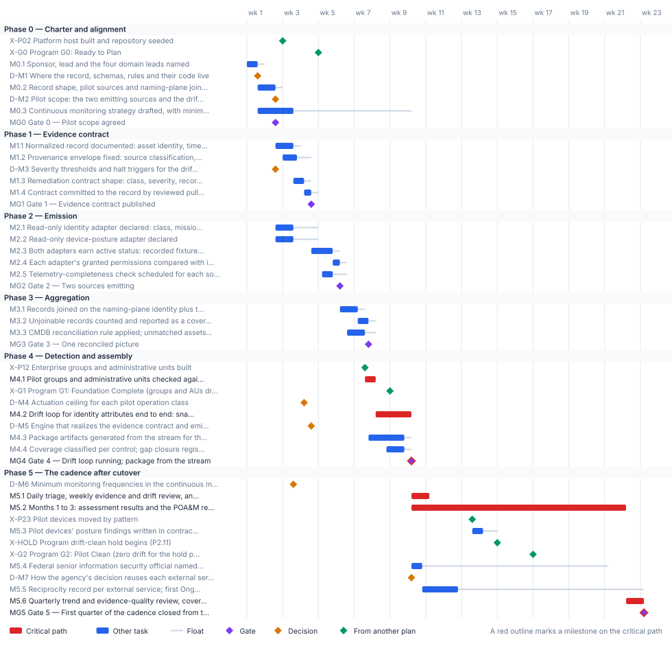

<!-- Generated by scripts/project_plans/build.py from data/project-plans/continuous-monitoring.yaml. Edit the YAML, not this page. -->

# Continuous Monitoring & Evidence Fabric: Evidence From the Systems {.unnumbered}

::: {.callout-note}
## A sample plan, not a commitment
This is an illustrative plan built from the workbook's books, in the form a project manager would baseline: a work breakdown, a schedule network, a computed critical path, decision points, gates and risks. The durations are illustrative, sized to the books' roadmap weeks. Replace them with the agency's own estimates, then baseline the result. The plan names roles, not people, and no specific agency.
:::

## Plan at a glance

| | |
|---|---|
| **Plan type** | Project: Book 13, Chapter 12 phases 0 to 4, plus the first quarter of the cadence after cutover |
| **Built from** | Book 13, with Books 14 and 15 |
| **Sponsor** | Executive sponsor and CIO; the senior accountable official for risk management approves the strategy |
| **Plan manager** | Steward (program office), with domain leads for the evidence contract, aggregation, drift detection and the authorization package |
| **Duration** | 23 weeks (111 working days), computed from the network |
| **Work** | 25 tasks, 6 gates, 7 decision points, 7 milestones from other plans |
| **Critical path** | 7 of 45 items; 20 more within 5 days of it |
| **Calendar** | Week 1 = the program's Phase 0 approval; five working days a week |

: Plan at a glance {.striped}

This plan builds the evidence fabric [Book 13, Chapter 12](../books/b13-governance/12-governance-at-scale.md#the-continuous-monitoring-program-as-a-project) charters: one evidence contract, at least two sources emitting normalized records, one reconciled picture joined on asset identity, a drift loop for one object class, and authorization artifacts generated from the stream. It follows the chapter's phases gate for gate, and adds the first quarter of the cadence that [Book 14, Chapter 11](../books/b14-compliance/11-the-authorization-package.md#the-cadence) and [Book 15, Chapter 12](../books/b15-day2-operations/12-the-day-two-runbook.md) run after cutover. [Book 00, Chapter 06](../books/b00-orientation/06-the-project-portfolio.md#continuous-monitoring-evidence-fabric) places this project fourth, but the [program master schedule](program-master-schedule.md) can't wait that long: its G1 and G2 criteria are drift-clean, measured from data, so this plan starts in week 1 and is timed against them.

## Schedule

{fig-alt="Gantt chart of the Continuous Monitoring &amp; Evidence Fabric plan over 23 weeks, grouped by phase. Critical-path tasks are red bars, other tasks are blue bars with a grey line showing their float, gates are violet diamonds, decisions are amber diamonds and milestones from other plans are green diamonds. The tables below give every date and float."}

## Critical path

The computed path doesn't start in this plan. It starts in the program: the first drift run on the pilot groups and administrative units can't begin until the program builds them (its P1.2, end of week 7, which is on the program's own critical path). From there the path runs through that drift run, the drift loop for identity attributes, Gate 4, the first quarter of the cadence and the quarterly review to Gate 5. The build chain from the charter to one reconciled picture (Gates 0 to 3) carries only 2 days of float against it, so a slip of more than 2 days in the contract, the adapters or the join moves Gate 4 and everything after it.

The margin against the program is the number to watch, because the program file can't show it. The drift run on the groups and administrative units ends in week 8, 4 working days before G1. On the G2 side, the pilot devices move at the end of week 13 (P2.3), and their posture findings land in contract shape 3 days later: 4 days before the program's 14-day drift-clean hold begins, and 14 days before G2 itself. The hold, not G2, is the real deadline, because G2's zero-drift criterion is measured across it. If either margin is spent, G1 or G2 is judged on findings people recorded by hand, which Book 13 allows only when they are written in the contract's shape. Both margins are computed: they're the deadlines listed under *Links to other plans*.

The critical path, in order. Each item has zero total float: a day lost on any of them is a day lost at the finish.

| # | ID | Item | Owner or approver | When |
|---|---|---|---|---|
| 1 | M4.1 | Pilot groups and administrative units checked against the record; findings written in contract shape | Drift detection lead | wk 7–8 |
| 2 | M4.2 | Drift loop for identity attributes end to end: snapshot, compare, classify, alert, remediate, verify | Drift detection lead | wk 8–10 |
| 3 | MG4 | Gate 4 — Drift loop running; package from the stream | CISO | end of wk 10 |
| 4 | M5.1 | Daily triage, weekly evidence and drift review, and the human-only closure review running | Program office | wk 10–11 |
| 5 | M5.2 | Months 1 to 3: assessment results and the POA&M regenerated, POA&M reviewed, posture report to the AO | ISSO | wk 10–22 |
| 6 | M5.6 | Quarterly trend and evidence-quality review, covering the pilot's drift-clean hold | ISSM | wk 22–23 |
| 7 | MG5 | Gate 5 — First quarter of the cadence closed from the stream | Authorizing official | end of wk 23 |

: The critical path {.striped .hover}

**Near-critical.** These items have 5 working days of float or less. Track them weekly: once their float is spent, they join the critical path.

| ID | Item | Float | When |
|---|---|---|---|
| M0.1 | Sponsor, lead and the four domain leads named | 2 d | wk 1 |
| M0.2 | Record shape, pilot sources and naming-plane join key confirmed | 2 d | wk 1–2 |
| D-M2 | Pilot scope: the two emitting sources and the drift object class | 2 d | end of wk 2 |
| MG0 | Gate 0 — Pilot scope agreed | 2 d | end of wk 2 |
| M1.1 | Normalized record documented: asset identity, time, control, verdict, evidence reference | 2 d | wk 2–3 |
| M1.3 | Remediation contract shape: class, severity, record version, ladder ceiling, named escalation role | 2 d | wk 3–4 |
| M1.4 | Contract committed to the record by reviewed pull request, with a decision record | 2 d | wk 4 |
| MG1 | Gate 1 — Evidence contract published | 2 d | end of wk 4 |
| M2.3 | Both adapters earn active status: recorded fixtures, live non-production tenant, reference deployment in the boundary | 2 d | wk 4–5 |
| M2.4 | Each adapter's granted permissions compared with its declaration | 2 d | wk 5–6 |
| MG2 | Gate 2 — Two sources emitting | 2 d | end of wk 6 |
| M3.1 | Records joined on the naming-plane identity plus time for the pilot scope | 2 d | wk 6–7 |
| M3.2 | Unjoinable records counted and reported as a coverage gap | 2 d | wk 7 |
| MG3 | Gate 3 — One reconciled picture | 2 d | end of wk 7 |
| M4.3 | Package artifacts generated from the stream for the pilot: SSP, assessment plan, results, POA&M in OSCAL | 2 d | wk 7–9 |
| M4.4 | Coverage classified per control; gap closure register opened; proven and asserted counted | 2 d | wk 8–9 |
| M3.3 | CMDB reconciliation rule applied; unmatched assets worked in the exception queue | 3 d | wk 6–7 |
| M1.2 | Provenance envelope fixed: source classification, transformation chain, lineage hash | 4 d | wk 3 |
| M2.5 | Telemetry-completeness check scheduled for each source | 4 d | wk 5 |
| M5.3 | Pilot devices' posture findings written in contract shape, before the program's drift-clean hold | 4 d | wk 13–14 |

: Near-critical items {.striped .hover}

## Decision points

Each decision is a zero-duration milestone in the network. *Decide by* is its late finish: the last week it can be made without moving the plan's finish. A decision with zero float sits on the critical path, so the meeting that makes it should be booked before the plan is baselined. Decision rights follow [Book 01, Chapter 09](../books/b01-transformation-arc/09-who-leads-the-transformation.md#decision-rights-across-the-program).

| ID | Decision | Decides | Needed by | Decide by | Float | Options | If it's late |
|---|---|---|---|---|---|---|---|
| D-M1 | Where the record, schemas, rules and their code live | Program office (steward) | MG0 | end of wk 2 | 7 d | One repository and one merge gate for the record, schemas, runtime code and tests; several repositories | The contract can't be committed; a whole class of drift between the record and the code that reads it stays possible |
| D-M2 | Pilot scope: the two emitting sources and the drift object class | CISO | MG0 | end of wk 2 | 2 d | Two of the identity, endpoint, network and data-platform sources; identity attributes or device posture as the object class | Emission and the drift loop can't be scoped; every later phase waits |
| D-M3 | Severity thresholds and halt triggers for the drift classifier | Steward, after board review and an outside reviewer | M1.3 | end of wk 3 | 7 d | The default rule (severity from drift class and whether the claim is in active use; P1 halts and is never remediated automatically); a severity pinned by the owning book's check | The remediation contract has no severity or window, and can't be published |
| D-M4 | Actuation ceiling for each pilot operation class | Authorizing official | M4.2 | end of wk 8 | 20 d | Every class at L3 gated actuation, the default; a named low-blast-radius class at L4 under written conditions, such as re-applying a dynamic membership rule from the registry | The loop's remediate step can't be configured; the drift loop waits |
| D-M5 | Engine that realizes the evidence contract and emits the package | Program office (steward) | M4.3 | end of wk 8 | 18 d | A purpose-built governance platform; a commercial governance, risk and compliance product (buy the native applications first, build only the gaps); native OSCAL tooling | Package artifacts can't be generated; Gate 4 waits |
| D-M6 | Minimum monitoring frequencies in the continuous monitoring strategy | Senior accountable official for risk management | M5.1 | end of wk 10 | 33 d | The program's cadence as the minimums; agency-set minimums, which the program may exceed but not undercut | The cadence can't start; Phase 5 waits |
| D-M7 | How the agency's decision reuses each external service's package | Authorizing official | M5.5 | end of wk 21 | 55 d | An ATO for the agency's own system using a FedRAMP Certified offering; an authorization to use for a shared service another federal entity authorized; a joint authorization under CA-6(2) | The reciprocity records can't be written; Gate 5 waits |

: Decision points, by decide-by date {.striped .hover}

## Gates

Each gate is the next phase's entry condition. The approver signs it against the criteria, from evidence in the repository.

| Gate | When | Approver | Criteria |
|---|---|---|---|
| [Gate 0 — Pilot scope agreed](../books/b13-governance/12-governance-at-scale.md#phases-and-success-measures) | end of wk 2 | CISO | Sponsor, lead and domain leads named; record shape, pilot sources and join key confirmed; pilot scope agreed |
| [Gate 1 — Evidence contract published](../books/b13-governance/12-governance-at-scale.md#phases-and-success-measures) | end of wk 4 | CISO | The normalized record and its binding to controls are documented; the contract is published and versioned in the authoritative record |
| [Gate 2 — Two sources emitting](../books/b13-governance/12-governance-at-scale.md#phases-and-success-measures) | end of wk 6 | CISO | Two sources emitting normalized records on their own cadence; each adapter holds no more than its declaration; a silent source raises an alert |
| [Gate 3 — One reconciled picture](../books/b13-governance/12-governance-at-scale.md#phases-and-success-measures) | end of wk 7 | CISO | One reconciled picture for the pilot scope, joined on asset identity, with unjoinable records counted, not dropped |
| [Gate 4 — Drift loop running; package from the stream](../books/b13-governance/12-governance-at-scale.md#phases-and-success-measures) | end of wk 10 | CISO | Drift loop running for one class; package artifacts generated for the pilot; coverage report separates proven from asserted claims |
| [Gate 5 — First quarter of the cadence closed from the stream](../books/b14-compliance/11-the-authorization-package.md#what-the-authorizing-official-should-find) | end of wk 23 | Authorizing official | Three monthly regenerations from current evidence; every failing item open, excepted with an expiry or reverted to open; each provider report has a named reviewer and a record of review; controls tools can't monitor have a manual assessment at a stated frequency |

: Gates {.striped .hover}

## Links to other plans

- **X-P02, Platform host built and repository seeded,** is P0.2 in the [Program master schedule](program-master-schedule.md) plan (Platform host built, repository seeded, host connected through Arc), end of wk 2. This plan waits for it; it can slip 8 d before it moves this plan. The contract has no record to be committed to; Gate 1 waits.
- **X-G0, Program G0: Ready to Plan,** is G0 in the [Program master schedule](program-master-schedule.md) plan (G0 — Ready to Plan), end of wk 4. Shown for reference.
- **X-P12, Enterprise groups and administrative units built,** is P1.2 in the [Program master schedule](program-master-schedule.md) plan (Dynamic group design tested; enterprise groups and administrative units built (M-015)), end of wk 7. This plan waits for it; it can slip 0 before it moves this plan. There is nothing to drift-check before G1; the drift run moves day for day.
- **X-G1, Program G1: Foundation Complete (groups and AUs drift-clean),** is G1 in the [Program master schedule](program-master-schedule.md) plan (G1 — Foundation Complete), end of wk 8. This plan must finish M4.1 by then: a margin of 4 d. M4.1 must finish before it, or G1's drift-clean criterion rests on findings recorded by hand.
- **X-P23, Pilot devices moved by pattern,** is P2.3 in the [Program master schedule](program-master-schedule.md) plan (Pilot devices moved by pattern (M-023)), end of wk 13. This plan waits for it; it can slip 4 d before it moves this plan. Device-posture findings can't start; the margin to the G2 hold shrinks day for day.
- **X-HOLD, Program drift-clean hold begins (P2.11),** is the start of P2.11 in the [Program master schedule](program-master-schedule.md) plan (Drift-clean hold (14 days, illustrative); success criteria met (M-031)), end of wk 14. This plan must finish M5.3 by then: a margin of 4 d. The hold can't be measured from data, so G2 can't pass on evidence.
- **X-G2, Program G2: Pilot Clean (zero drift for the hold period),** is G2 in the [Program master schedule](program-master-schedule.md) plan (G2 — Pilot Clean), end of wk 16. This plan waits for it; it can slip 26 d before it moves this plan. M5.3 must finish before the 14-day hold that ends at G2.

Other plans that take a date from this one. *Waits for it*: that plan can't move until this item finishes, and its float says how far this item can slip before it moves that plan. *Must finish by it*: that plan's work has to be done before this item, and the margin says by how much.

| This plan's item | When | Linked plan | Relationship | Float or margin |
|---|---|---|---|---|
| MG1  Gate 1 — Evidence contract published | end of wk 4 | [Supply Chain & SBOM](supply-chain-sbom.md) (X-CM1) | Waits for it | 27 d |
| MG4  Gate 4 — Drift loop running; package from the stream | end of wk 10 | [Supply Chain & SBOM](supply-chain-sbom.md) (X-CM4) | Waits for it | 4 d |

: Plans that take a date from this one {.striped .hover}

## Work breakdown and schedule

Every row, by phase. *Float* is total float in working days; **bold** rows are on the critical path. Each row links to the chapter it comes from.

### Phase 0 — Charter and alignment

| ID | Item | Type | Owner or approver | Days | Predecessors | When | Float |
|---|---|---|---|---|---|---|---|
| X-P02 | [Platform host built and repository seeded](../books/b13-governance/03-one-authoritative-record.md#where-the-record-lives) | External | Platform teams | — | — | end of wk 2 | 8 d |
| X-G0 | [Program G0: Ready to Plan](../books/b00-orientation/06-the-project-portfolio.md#how-the-projects-fit-the-program) | External | Steward | — | — | end of wk 4 | fixed date |
| M0.1 | [Sponsor, lead and the four domain leads named](../books/b13-governance/12-governance-at-scale.md#phases-and-success-measures) | Task | Executive sponsor and CIO | 3 | — | wk 1 | 2 d |
| D-M1 | [Where the record, schemas, rules and their code live](../books/b13-governance/12-governance-at-scale.md#one-repository-one-merge-gate) | Decision | Program office (steward) | — | M0.1 | end of wk 1 | 7 d |
| M0.2 | [Record shape, pilot sources and naming-plane join key confirmed](../books/b13-governance/12-governance-at-scale.md#phases-and-success-measures) | Task | Program office | 5 | M0.1 | wk 1–2 | 2 d |
| D-M2 | [Pilot scope: the two emitting sources and the drift object class](../books/b13-governance/12-governance-at-scale.md#objectives-and-scope) | Decision | CISO | — | M0.2 | end of wk 2 | 2 d |
| M0.3 | [Continuous monitoring strategy drafted, with minimum frequencies and manual assessment of what tools can't see](../books/b13-governance/09-who-governs.md#where-the-roles-come-from) | Task | CISO | 10 | M0.1 | wk 1–3 | 33 d |
| MG0 | [Gate 0 — Pilot scope agreed](../books/b13-governance/12-governance-at-scale.md#phases-and-success-measures) | Gate | CISO | — | M0.2, D-M1, D-M2 | end of wk 2 | 2 d |

: Phase 0 — Charter and alignment {.striped .hover}

### Phase 1 — Evidence contract

| ID | Item | Type | Owner or approver | Days | Predecessors | When | Float |
|---|---|---|---|---|---|---|---|
| M1.1 | [Normalized record documented: asset identity, time, control, verdict, evidence reference](../books/b15-day2-operations/11-attestation-and-the-compliance-app.md#one-record-every-source) | Task | Evidence contract lead | 5 | MG0 | wk 2–3 | 2 d |
| M1.2 | [Provenance envelope fixed: source classification, transformation chain, lineage hash](../books/b13-governance/07-evidence-over-attestation.md#the-provenance-envelope) | Task | Evidence contract lead | 4 | M1.1 (SS) +2 d | wk 3 | 4 d |
| D-M3 | [Severity thresholds and halt triggers for the drift classifier](../books/b13-governance/09-who-governs.md#who-approves-rule-changes) | Decision | Steward, after board review and an outside reviewer | — | MG0 | end of wk 2 | 7 d |
| M1.3 | [Remediation contract shape: class, severity, record version, ladder ceiling, named escalation role](../books/b13-governance/06-the-drift-engine.md#the-remediation-contract) | Task | Drift detection lead | 3 | M1.1, D-M3 | wk 3–4 | 2 d |
| M1.4 | [Contract committed to the record by reviewed pull request, with a decision record](../books/b13-governance/04-change-control-and-provenance.md#changing-the-record-pull-requests) | Task | Steward | 2 | M1.2, M1.3, X-P02 | wk 4 | 2 d |
| MG1 | [Gate 1 — Evidence contract published](../books/b13-governance/12-governance-at-scale.md#phases-and-success-measures) | Gate | CISO | — | M1.4 | end of wk 4 | 2 d |

: Phase 1 — Evidence contract {.striped .hover}

### Phase 2 — Emission

| ID | Item | Type | Owner or approver | Days | Predecessors | When | Float |
|---|---|---|---|---|---|---|---|
| M2.1 | [Read-only identity adapter declared: class, mission, pinned API version, permissions](../books/b13-governance/08-the-adapter-model.md#the-contract) | Task | Platform teams | 5 | MG0 | wk 2–3 | 7 d |
| M2.2 | [Read-only device-posture adapter declared](../books/b13-governance/08-the-adapter-model.md#the-contract) | Task | Platform teams | 5 | MG0 | wk 2–3 | 7 d |
| M2.3 | [Both adapters earn active status: recorded fixtures, live non-production tenant, reference deployment in the boundary](../books/b13-governance/08-the-adapter-model.md#earning-active-status-and-retiring) | Task | Platform teams | 6 | M2.1, M2.2, MG1 | wk 4–5 | 2 d |
| M2.4 | [Each adapter's granted permissions compared with its declaration](../books/b13-governance/08-the-adapter-model.md#read-only-first) | Task | CISO's staff | 2 | M2.3 | wk 5–6 | 2 d |
| M2.5 | [Telemetry-completeness check scheduled for each source](../books/b15-day2-operations/12-the-day-two-runbook.md#the-telemetry-completeness-check) | Task | Security operations | 3 | M2.3 (SS) +3 d | wk 5 | 4 d |
| MG2 | [Gate 2 — Two sources emitting](../books/b13-governance/12-governance-at-scale.md#phases-and-success-measures) | Gate | CISO | — | M2.4, M2.5 | end of wk 6 | 2 d |

: Phase 2 — Emission {.striped .hover}

### Phase 3 — Aggregation

| ID | Item | Type | Owner or approver | Days | Predecessors | When | Float |
|---|---|---|---|---|---|---|---|
| M3.1 | [Records joined on the naming-plane identity plus time for the pilot scope](../books/b15-day2-operations/07-the-cmdb-and-asset-identity.md#the-join-key-identity-plus-time) | Task | Aggregation lead | 5 | MG2 | wk 6–7 | 2 d |
| M3.2 | [Unjoinable records counted and reported as a coverage gap](../books/b13-governance/12-governance-at-scale.md#risks-and-assumptions) | Task | Aggregation lead | 3 | M3.1 | wk 7 | 2 d |
| M3.3 | [CMDB reconciliation rule applied; unmatched assets worked in the exception queue](../books/b15-day2-operations/07-the-cmdb-and-asset-identity.md#how-the-platform-reconciles-and-what-the-program-adds) | Task | CMDB owner | 5 | M3.1 (SS) +2 d | wk 6–7 | 3 d |
| MG3 | [Gate 3 — One reconciled picture](../books/b13-governance/12-governance-at-scale.md#phases-and-success-measures) | Gate | CISO | — | M3.2, M3.3 | end of wk 7 | 2 d |

: Phase 3 — Aggregation {.striped .hover}

### Phase 4 — Detection and assembly

| ID | Item | Type | Owner or approver | Days | Predecessors | When | Float |
|---|---|---|---|---|---|---|---|
| X-P12 | [Enterprise groups and administrative units built](../books/b13-governance/06-the-drift-engine.md#one-model-many-domain-checks) | External | Platform teams | — | — | end of wk 7 | 0 |
| M4.1 | **[Pilot groups and administrative units checked against the record; findings written in contract shape](../books/b13-governance/06-the-drift-engine.md#what-is-built-today)** | Task | Drift detection lead | 3 | X-P12, MG2, M1.3 | wk 7–8 | 0 |
| X-G1 | [Program G1: Foundation Complete (groups and AUs drift-clean)](../books/b13-governance/12-governance-at-scale.md#the-continuous-monitoring-program-as-a-project) | External | Steward | — | M4.1 | end of wk 8 | fixed date |
| D-M4 | [Actuation ceiling for each pilot operation class](../books/b13-governance/10-ticket-to-machine.md#approval-gates-keep-humans-on-the-decisions-that-matter) | Decision | Authorizing official | — | M1.3 | end of wk 4 | 20 d |
| M4.2 | **[Drift loop for identity attributes end to end: snapshot, compare, classify, alert, remediate, verify](../books/b13-governance/06-the-drift-engine.md#what-the-engine-remediates-and-what-it-doesnt)** | Task | Drift detection lead | 10 | M4.1, D-M4, MG3 | wk 8–10 | 0 |
| D-M5 | [Engine that realizes the evidence contract and emits the package](../books/b15-day2-operations/11-attestation-and-the-compliance-app.md#build-buy-or-both) | Decision | Program office (steward) | — | MG1 | end of wk 4 | 18 d |
| M4.3 | [Package artifacts generated from the stream for the pilot: SSP, assessment plan, results, POA&M in OSCAL](../books/b14-compliance/11-the-authorization-package.md#one-oscal-model-per-artifact) | Task | Authorization package lead | 10 | D-M5, MG3 | wk 7–9 | 2 d |
| M4.4 | [Coverage classified per control; gap closure register opened; proven and asserted counted](../books/b13-governance/12-governance-at-scale.md#classify-coverage) | Task | Authorization package lead | 5 | M3.2, M4.3 (SS) +5 d | wk 8–9 | 2 d |
| MG4 | **[Gate 4 — Drift loop running; package from the stream](../books/b13-governance/12-governance-at-scale.md#phases-and-success-measures)** | Gate | CISO | — | M4.2, M4.3, M4.4 | end of wk 10 | 0 |

: Phase 4 — Detection and assembly {.striped .hover}

### Phase 5 — The cadence after cutover

| ID | Item | Type | Owner or approver | Days | Predecessors | When | Float |
|---|---|---|---|---|---|---|---|
| D-M6 | [Minimum monitoring frequencies in the continuous monitoring strategy](../books/b13-governance/09-who-governs.md#the-responsibility-matrix) | Decision | Senior accountable official for risk management | — | M0.3 | end of wk 3 | 33 d |
| M5.1 | **[Daily triage, weekly evidence and drift review, and the human-only closure review running](../books/b13-governance/09-who-governs.md#cadence)** | Task | Program office | 5 | MG4, D-M6 | wk 10–11 | 0 |
| M5.2 | **[Months 1 to 3: assessment results and the POA&M regenerated, POA&M reviewed, posture report to the AO](../books/b14-compliance/11-the-authorization-package.md#the-cadence)** | Task | ISSO | 60 | M5.1 (SS) | wk 10–22 | 0 |
| X-P23 | [Pilot devices moved by pattern](../books/b13-governance/06-the-drift-engine.md#cadence) | External | Platform teams | — | — | end of wk 13 | 4 d |
| M5.3 | [Pilot devices' posture findings written in contract shape, before the program's drift-clean hold](../books/b13-governance/06-the-drift-engine.md#what-is-built-today) | Task | Platform teams | 3 | X-P23, M2.3, M1.3 | wk 13–14 | 4 d |
| X-HOLD | [Program drift-clean hold begins (P2.11)](../books/b00-orientation/09-design-pilot-and-rollout.md#gate-g2-pilot-clean) | External | Program office | — | M5.3 | end of wk 14 | fixed date |
| X-G2 | [Program G2: Pilot Clean (zero drift for the hold period)](../books/b13-governance/12-governance-at-scale.md#the-continuous-monitoring-program-as-a-project) | External | Steward and executive sponsor | — | — | end of wk 16 | 26 d |
| M5.4 | [Federal senior information security official named to review each provider's Ongoing Certification Report](../books/b14-compliance/11-the-authorization-package.md#what-fedramps-2026-rules-expect) | Task | CISO | 3 | MG4 | wk 10 | 52 d |
| D-M7 | [How the agency's decision reuses each external service's package](../books/b13-governance/11-reciprocity-and-one-authorization.md#one-package-for-a-shared-service) | Decision | Authorizing official | — | MG4 | end of wk 10 | 55 d |
| M5.5 | [Reciprocity record per external service; first Ongoing Certification Report reviewed and recorded](../books/b13-governance/11-reciprocity-and-one-authorization.md#what-fedramps-2026-rules-add) | Task | ISSM | 10 | D-M7, M5.4 | wk 10–12 | 52 d |
| M5.6 | **[Quarterly trend and evidence-quality review, covering the pilot's drift-clean hold](../books/b15-day2-operations/12-the-day-two-runbook.md#weekly-monthly-and-quarterly)** | Task | ISSM | 5 | M5.2, M5.3, X-G2 | wk 22–23 | 0 |
| MG5 | **[Gate 5 — First quarter of the cadence closed from the stream](../books/b14-compliance/11-the-authorization-package.md#what-the-authorizing-official-should-find)** | Gate | Authorizing official | — | M5.5, M5.6 | end of wk 23 | 0 |

: Phase 5 — The cadence after cutover {.striped .hover}

## Responsibility

Who owns what in this plan. Each row has one owner; consulted and informed parties follow the [decision matrix](../books/b01-transformation-arc/09-who-leads-the-transformation.md#decision-rights-across-the-program).

| Owner or approver | Tasks | Decisions | Gates |
|---|---|---|---|
| CISO | 2 | 1 | 5 |
| Platform teams | 7 | — | — |
| Authorizing official | — | 2 | 1 |
| Drift detection lead | 3 | — | — |
| Program office | 3 | — | — |
| Steward | 3 | — | — |
| Aggregation lead | 2 | — | — |
| Authorization package lead | 2 | — | — |
| Evidence contract lead | 2 | — | — |
| ISSM | 2 | — | — |
| Program office (steward) | — | 2 | — |
| CISO's staff | 1 | — | — |
| CMDB owner | 1 | — | — |
| Executive sponsor and CIO | 1 | — | — |
| ISSO | 1 | — | — |
| Security operations | 1 | — | — |
| Senior accountable official for risk management | — | 1 | — |
| Steward and executive sponsor | 1 | — | — |
| Steward, after board review and an outside reviewer | — | 1 | — |

: Ownership {.striped .hover}

## Assumptions

- The pilot object class for the drift loop is identity attributes; device posture follows for the program's G2 ([Book 13, Chapter 12](../books/b13-governance/12-governance-at-scale.md#phases-and-success-measures) lets the agency pick either).
- Authorization and identity drift aren't detected by a runtime engine yet; the domain books' checks and people find them, and record them in the remediation contract's shape ([Book 13, Chapter 06](../books/b13-governance/06-the-drift-engine.md#what-is-built-today)).
- An authoritative naming and addressing plane exists, or will, as the join key ([Book 13, Chapter 12](../books/b13-governance/12-governance-at-scale.md#risks-and-assumptions)); unjoinable records are counted, not dropped.
- Stakeholders accept honest coverage reporting, proven separated from asserted; Book 13 calls this the assumption most often violated.
- Durations are illustrative. Replacing the agency's monitoring tools and evidencing every FedRAMP indicator are out of scope for the first phase.

## Schedule risks

| Risk | Effect on the schedule | Response |
|---|---|---|
| The program's P1.2 or P2.3 slips | The drift run or the device findings move with it; G1 or G2 is judged on hand-recorded findings | Track the 4-day margin weekly; record any hand-found finding in the remediation contract's shape (Book 13, Chapter 06) |
| Sources emit proprietary telemetry that can't be normalized without synthesis | Phase 2 can't close on two sources | An adapter per source translates to the contract; derived values are labeled derived (Book 13, Chapter 08) |
| Drift detection produces more findings than the agency can remediate | Window adherence falls; the drift trend the board reviews rises | Severity sets the order; routine classes move to the machine tempo; the rest enter the gap register (Book 13, Chapters 10 and 12) |
| Authorization-package format requirements change | Generated artifacts stop validating | Artifacts are generated from the stream, so a format change is a generator change, not a rewrite (Book 13, Chapter 12) |

: Schedule risks {.striped .hover}

## Baseline and change control

- **Baseline** the plan when its first gate is approved: the YAML file, as merged, is the baseline.
- **Report** weekly, green, yellow or red, against the baseline ([Book 01, Chapter 12](../books/b01-transformation-arc/12-migration-roadmap.md#phase-3-general-rollout-weeks-1736)). Report float, not percent complete: a task's float says how much slip the plan can still absorb.
- **Change** the plan only through a reviewed pull request that edits the YAML and regenerates this page, so every change to a date or a dependency has an author, a reviewer and a reason.
- **Re-baseline** at each gate, after the approver signs it, and whenever a critical-path decision is made late.

## Download and adapt

| File | Use it for |
|---|---|
| [continuous-monitoring.xml](files/continuous-monitoring.xml) | Microsoft Project (open the XML file; it keeps the dependencies, milestones and owners). The dates start on a placeholder Monday: change the project start date. |
| [continuous-monitoring.csv](files/continuous-monitoring.csv) | Excel or any other scheduling tool: every row with its dependencies, early and late dates and float |
| [continuous-monitoring.yaml](https://github.com/WhalerMike/modernization-workbook/blob/main/data/project-plans/continuous-monitoring.yaml) | The source. Edit the durations, owners and dependencies, then run `python scripts/project_plans/build.py` to recompute the critical path and regenerate this page, the chart and the downloads. |

: Downloads {.striped}

