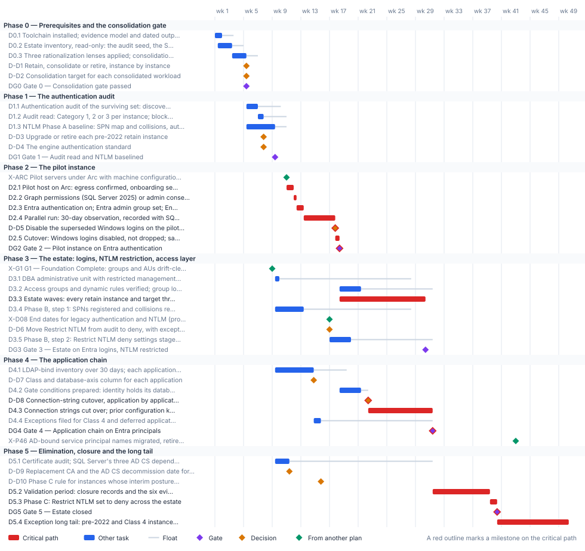

<!-- Generated by scripts/project_plans/build.py from data/project-plans/data-platform.yaml. Edit the YAML, not this page. -->

# Data Platform Identity Transformation: SQL Server from Windows Authentication to Entra ID {.unnumbered}

::: {.callout-note}
## A sample plan, not a commitment
This is an illustrative plan built from the workbook's books, in the form a project manager would baseline: a work breakdown, a schedule network, a computed critical path, decision points, gates and risks. The durations are illustrative, sized to the books' roadmap weeks. Replace them with the agency's own estimates, then baseline the result. The plan names roles, not people, and no specific agency.
:::

## Plan at a glance

| | |
|---|---|
| **Plan type** | Project: Book 06 Runbooks R01 to R10, from estate discovery to the closure record and the exception long tail |
| **Built from** | Book 06 |
| **Sponsor** | CIO and data leadership |
| **Plan manager** | Data platform project lead, with the Database Authentication, Application-Tier Identity, Secrets Lifecycle and Evidence domain leads |
| **Duration** | 50 weeks (247 working days), computed from the network |
| **Work** | 24 tasks, 6 gates, 10 decision points, 4 milestones from other plans |
| **Critical path** | 15 of 44 items; 2 more within 5 days of it |
| **Calendar** | Week 1 = the program's Phase 0 approval; five working days a week |

: Plan at a glance {.striped}

This plan builds the [Data Platform Identity Transformation](../projects/data-platform-charter.md) project from [Book 06](../books/b06-data-platform/index.md): SQL Server moved from Windows and SQL authentication to Microsoft Entra ID, NTLM removed after audit, and the result kept as a continuously verified [closure record](../books/b06-data-platform/20-the-closure-condition.md). Its phases follow the book's [runbook order](../books/b06-data-platform/r01-prerequisites.md#step-5-the-run-order): discovery and the consolidation gate, the authentication audit, Arc and the parallel run on a pilot instance, the estate with NTLM restriction and the access layer, the application chain, then elimination and closure. It runs inside the [program master schedule](program-master-schedule.md): discovery belongs to the program's Pre-flight, the pilot host follows the program's server Arc pattern (P2.9), the group work builds on Gate G1, and NTLM restriction waits for the authorizing official's end dates (D08). Its tail, the instances that can only close by upgrade or retirement, runs past the program's week 48.

## Schedule

{fig-alt="Gantt chart of the Data Platform Identity Transformation plan over 50 weeks, grouped by phase. Critical-path tasks are red bars, other tasks are blue bars with a grey line showing their float, gates are violet diamonds, decisions are amber diamonds and milestones from other plans are green diamonds. The tables below give every date and float."}

## Critical path

The computed path starts with the program's Arc pattern for pilot servers (P2.9, week 10). The pilot SQL Server host goes onto Arc after it; then come the Graph permissions, Entra authentication, the 30-day parallel run, the disable decision and Gate 2 in week 18. From there the path runs through the estate waves (D3.3), because a connection string can move only once its Entra login exists, then the application cutovers, Gate 4, the validation period, the Phase C block and Gate 5 in week 40. The exception long tail then runs to week 50, past the program's G5 in week 48. Book 06 supports that: the estate closes when every production instance has a satisfying record or a registered exception with a sunset date, and each excepted instance closes later by its own record. Discovery, the consolidation gate and the audit carry only about eight days of float against the Arc milestone, so the gate verdicts are near the path; Gate 3 and the application gate conditions (D4.2) are within five days of it. The NTLM deny step waits on the authorizing official's end dates (program D08, week 16). The application chain must be on Entra principals before the program finishes retiring AD-bound service principal names (P4.6, week 42); Gate 4 meets that with about eleven weeks of margin. Read against Book 06's own calendar date for the block, 2027-04-01, this sample's placeholder start puts the block in week 13, before the pilot's parallel run ends; that conflict is settled through D08, not by compressing the parallel run.

The critical path, in order. Each item has zero total float: a day lost on any of them is a day lost at the finish.

| # | ID | Item | Owner or approver | When |
|---|---|---|---|---|
| 1 | D2.1 | Pilot host on Arc: egress confirmed, onboarding service principal, managed-identity token validated, SQL Server extension deployed | Server infrastructure | wk 11 |
| 2 | D2.2 | Graph permissions (SQL Server 2025) or admin consent (SQL Server 2022) granted by a Privileged Role Administrator | Identity team | wk 12 |
| 3 | D2.3 | Entra authentication on; Entra admin group set; Entra logins and users created beside the Windows ones | Data platform team | wk 12–13 |
| 4 | D2.4 | Parallel run: 30-day observation, recorded with SQL Server Audit | Data platform team | wk 13–17 |
| 5 | D-D5 | Disable the superseded Windows logins on the pilot instance | Data platform team | end of wk 17 |
| 6 | D2.5 | Cutover: Windows logins disabled, not dropped; sa disabled and renamed; scheduled audit started | Data platform team | wk 17–18 |
| 7 | DG2 | Gate 2 — Pilot instance on Entra authentication | ISSO | end of wk 18 |
| 8 | D3.3 | Estate waves: every retain instance and target through Arc, Entra authentication, the parallel run and cutover | Data platform team | wk 18–30 |
| 9 | D-D8 | Connection-string cutover, application by application | Application owners | end of wk 22 |
| 10 | D4.3 | Connection strings cut over; prior configuration kept; legacy logins disabled, not dropped | Application owners | wk 22–31 |
| 11 | DG4 | Gate 4 — Application chain on Entra principals | ISSO | end of wk 31 |
| 12 | D5.2 | Validation period: closure records and the six evidence sets live and satisfied; drift treated as a violation | Data platform team | wk 31–39 |
| 13 | D5.3 | Phase C: Restrict NTLM set to deny across the estate | Server infrastructure | wk 39–40 |
| 14 | DG5 | Gate 5 — Estate closed | CIO and data leadership | end of wk 40 |
| 15 | D5.4 | Exception long tail: pre-2022 and Class 4 instances upgraded, re-platformed or retired by their sunset dates | Data platform team | wk 40–50 |

: The critical path {.striped .hover}

**Near-critical.** These items have 5 working days of float or less. Track them weekly: once their float is spent, they join the critical path.

| ID | Item | Float | When |
|---|---|---|---|
| D4.2 | Gate conditions prepared: identity holds its database role; change tested on a production-matching Arc stack | 5 d | wk 18–21 |
| DG3 | Gate 3 — Estate on Entra logins, NTLM restricted | 5 d | end of wk 30 |

: Near-critical items {.striped .hover}

## Decision points

Each decision is a zero-duration milestone in the network. *Decide by* is its late finish: the last week it can be made without moving the plan's finish. A decision with zero float sits on the critical path, so the meeting that makes it should be booked before the plan is baselined. Decision rights follow [Book 01, Chapter 09](../books/b01-transformation-arc/09-who-leads-the-transformation.md#decision-rights-across-the-program).

| ID | Decision | Decides | Needed by | Decide by | Float | Options | If it's late |
|---|---|---|---|---|---|---|---|
| D-D1 | Retain, consolidate or retire, instance by instance | CIO and data leadership | DG0 | end of wk 6 | 8 d | Retain; consolidate into a target (the source is then retired); retire | No login may be touched: the audit, Arc and login work all wait on the classified inventory |
| D-D2 | Consolidation target for each consolidated workload | CIO and data leadership | DG0 | end of wk 6 | 8 d | SQL Server 2022 or 2025 on an Arc-enabled host; Azure SQL Managed Instance; Azure SQL Database or elastic pools. A dedicated target where a constraint blocks shared hosting | Authentication would be migrated twice, once on the source and again on the target |
| D-D3 | Upgrade or retire each pre-2022 retain instance | CIO and data leadership | DG1, D5.4 | end of wk 10 | 16 d | Upgrade to SQL Server 2022 or later and follow the Category 2-to-1 path; retire or consolidate it; keep it on a sunset-dated exception with the certificate-based interim posture (the authorizing official decides the exception) | Category 3 instances have no path to Entra logins, and the exception long tail can't be sized |
| D-D4 | The engine authentication standard | CISO | DG1 | end of wk 10 | 16 d | SQL authentication refused and sa disabled and renamed on every production instance, with break-glass as an empty Windows group; a type-S login kept past migration only as a dated exception with a named compensating control. Open-ended retention isn't an option | Instances have no standard to cut over against, and the pilot can't be signed off |
| D-D5 | Disable the superseded Windows logins on the pilot instance | Data platform team | D2.5 | end of wk 17 | **0 (critical)** | Disable, don't drop, once the window's exit criteria are met; extend the observation window | The pilot can't cut over, and the estate waves have no proven pattern |
| D-D7 | Class and database-axis column for each application | Application owners | D4.2, D4.4 | end of wk 19 | 23 d | User axis: Class 3 OIDC, Class 2 SAML, Class 1 Application Proxy, Class 4 Entra Domain Services (last resort). Database axis: A configuration only, B code change, C vendor-dependent, D no Entra path today | Neither migration track can be sequenced for the application |
| D-D8 | Connection-string cutover, application by application | Application owners | D4.3 | end of wk 22 | **0 (critical)** | Cut over in a change window once all three gate conditions hold; fund the code change (column B); carry a dated exception (columns C and D, and Class 4) | The application keeps its stored credential, and its host instance can't close |
| D-D6 | Move Restrict NTLM from audit to deny, with exceptions from the Phase A baseline | Authorizing official | D3.5 | end of wk 28 | 57 d | Deny, with the excepted instances in the domain controller and client lists; stay in audit; if a missed dependency surfaces, relax to audit or add a scoped exception | NTLMv2 stays open, and Phase C has no restricted baseline to tighten |
| D-D10 | Phase C rule for instances whose interim posture isn't in place | Authorizing official | D5.2 | end of wk 31 | 78 d | The Phase C date holds for them; dated exceptions with network-level isolation | The long tail has no rule on the block date, and its exceptions can't be closed |
| D-D9 | Replacement CA and the AD CS decommission date for SQL Server's certificates | CIO and data leadership | D-D10 | end of wk 31 | 100 d | Book 07's issuers: the retained AD CS hierarchy through CyberArk Certificate Manager, moving to a standalone AD CS issuing CA under the same root when the forest retires; Microsoft Cloud PKI, which would need another enrollment path for SQL Server hosts. Either way, no decommission date until the replacement is issuing | No decommission date can be set, and the certificate-based interim posture has no assured issuer |

: Decision points, by decide-by date {.striped .hover}

## Gates

Each gate is the next phase's entry condition. The approver signs it against the criteria, from evidence in the repository.

| Gate | When | Approver | Criteria |
|---|---|---|---|
| [Gate 0 — Consolidation gate passed](../books/b06-data-platform/r02-estate-discovery-and-consolidation-gate.md#step-3-the-retain-consolidate-retire-decision-the-gate) | end of wk 5 | CIO and data leadership | One row per instance, classified retain, consolidate or retire and justified by the three lenses; a target named for every consolidated workload; collation, vendor-version, compliance-isolation, failover-cluster and dependency constraints recorded; only retain instances and targets go on |
| [Gate 1 — Audit read and NTLM baselined](../books/b06-data-platform/08-reading-the-audit.md) | end of wk 9 | ISSO | Every retain instance and target audited and placed in Category 1, 2 or 3 with its blockers; failover cluster instances treated as Category 3; the Phase A NTLM baseline ingested by compliance monitoring; the authentication standard set |
| [Gate 2 — Pilot instance on Entra authentication](../books/b06-data-platform/r04-arc-deployment-and-managed-identity.md#verification-checklist) | end of wk 18 | ISSO | Arc agent Connected; token audience https://database.windows.net/; SQL Server extension Succeeded; Entra admin set; every application and job seen on its Entra login; no remote NTLM rows; no connection arriving only on a legacy Windows login |
| [Gate 3 — Estate on Entra logins, NTLM restricted](../books/b06-data-platform/15-the-three-phases-of-ntlm-elimination.md#phase-b-restriction) | end of wk 30 | ISSO | Every retain instance and target cut over after a clean parallel run; zero critical SPN collisions; Restrict NTLM deny in place with only documented exceptions; DBA administrative unit and group logins verified; a non-compliant sign-in to the SQL resource denied a token |
| [Gate 4 — Application chain on Entra principals](../books/b06-data-platform/r08-application-chain-and-connection-strings.md#verification-and-rollback) | end of wk 31 | ISSO | Every application in Classes 1 to 3 connects as its Entra principal, with no NTLM or KERBEROS rows; every Class 4 or deferred application's host instance carries a dated exception; no stored secret left in a production connection string outside a documented exception |
| [Gate 5 — Estate closed](../books/b06-data-platform/20-the-closure-condition.md#the-five-closure-conditions) | end of wk 40 | CIO and data leadership | All five closure conditions hold at once on every production instance; the six evidence sets satisfied across the validation period; every excepted instance in the registry with its justification, sunset date and own closure record; the scheduled audit still running |

: Gates {.striped .hover}

## Links to other plans

- **X-ARC, Pilot servers under Arc with machine configuration (program P2.9),** is P2.9 in the [Program master schedule](program-master-schedule.md) plan (Pilot servers under Arc with machine configuration (M-030)), end of wk 10. This plan waits for it; it can slip 0 before it moves this plan. The pilot SQL Server host has no Arc pattern to follow, and the pilot waits.
- **X-G1, G1 — Foundation Complete: groups and AUs drift-clean, Conditional Access baseline enforced (program),** is G1 in the [Program master schedule](program-master-schedule.md) plan (G1 — Foundation Complete), end of wk 8. This plan waits for it; it can slip 94 d before it moves this plan. The DBA administrative unit and the SQL group logins have no foundation to build on.
- **X-D08, End dates for legacy authentication and NTLM (program D08),** is D08 in the [Program master schedule](program-master-schedule.md) plan (End dates for legacy authentication and NTLM), end of wk 16. This plan waits for it; it can slip 57 d before it moves this plan. Phase B's deny step and the Phase C block have no date to plan against.
- **X-P46, AD-bound service principal names migrated, retired or islanded (program P4.6),** is P4.6 in the [Program master schedule](program-master-schedule.md) plan (AD-bound service principal names migrated, retired or islanded, app by app), end of wk 42. This plan must finish DG4 by then: a margin of 58 d. SQL Server's applications still hold Windows-authenticated connections when the program measures AD authentication for G4.

## Work breakdown and schedule

Every row, by phase. *Float* is total float in working days; **bold** rows are on the critical path. Each row links to the chapter it comes from.

### Phase 0 — Prerequisites and the consolidation gate

| ID | Item | Type | Owner or approver | Days | Predecessors | When | Float |
|---|---|---|---|---|---|---|---|
| D0.1 | [Toolchain installed; evidence model and dated output directories under version control](../books/b06-data-platform/r01-prerequisites.md#step-2-the-evidence-model) | Task | Data platform team | 5 | — | wk 1 | 8 d |
| D0.2 | [Estate inventory, read-only: the audit seed, the SPN trail and the wider sweep, fused into one inventory](../books/b06-data-platform/r02-estate-discovery-and-consolidation-gate.md#step-1-build-the-estate-inventory-read-only) | Task | Data platform team | 10 | D0.1 (SS) +2 d | wk 1–3 | 8 d |
| D0.3 | [Three rationalization lenses applied; consolidation constraints recorded](../books/b06-data-platform/r02-estate-discovery-and-consolidation-gate.md#step-2-apply-the-three-rationalization-lenses-read-only) | Task | Data platform team | 10 | D0.2 | wk 3–5 | 8 d |
| D-D1 | [Retain, consolidate or retire, instance by instance](../books/b06-data-platform/06-retain-consolidate-retire.md#the-three-classifications) | Decision | CIO and data leadership | — | D0.3 | end of wk 5 | 8 d |
| D-D2 | [Consolidation target for each consolidated workload](../books/b06-data-platform/06-retain-consolidate-retire.md#target-state-options) | Decision | CIO and data leadership | — | D0.3 | end of wk 5 | 8 d |
| DG0 | [Gate 0 — Consolidation gate passed](../books/b06-data-platform/r02-estate-discovery-and-consolidation-gate.md#step-3-the-retain-consolidate-retire-decision-the-gate) | Gate | CIO and data leadership | — | D-D1, D-D2 | end of wk 5 | 8 d |

: Phase 0 — Prerequisites and the consolidation gate {.striped .hover}

### Phase 1 — The authentication audit

| ID | Item | Type | Owner or approver | Days | Predecessors | When | Float |
|---|---|---|---|---|---|---|---|
| D1.1 | [Authentication audit of the surviving set: discovery pass, then the deep audit](../books/b06-data-platform/r03-the-authentication-audit.md#the-primary-script-spec3-d1.8-get-sqlserverauthaudit.ps1) | Task | Data platform team | 8 | DG0 | wk 5–6 | 16 d |
| D1.2 | [Audit read: Category 1, 2 or 3 per instance; blockers listed; failover cluster instances flagged](../books/b06-data-platform/r03-the-authentication-audit.md#reading-the-result-migration-readiness) | Task | Data platform team | 4 | D1.1 | wk 7 | 16 d |
| D1.3 | [NTLM Phase A baseline: SPN map and collisions, auth_scheme, host Security logs, Restrict NTLM audit policies, enhanced NTLM logging](../books/b06-data-platform/15-the-three-phases-of-ntlm-elimination.md#phase-a-discovery) | Task | Data platform team | 20 | DG0 | wk 5–9 | 8 d |
| D-D3 | [Upgrade or retire each pre-2022 retain instance](../books/b06-data-platform/12-the-engine-authentication-decision.md#decision-4-pre-2022-instances-are-upgrade-or-except) | Decision | CIO and data leadership | — | D1.2 | end of wk 7 | 16 d |
| D-D4 | [The engine authentication standard](../books/b06-data-platform/12-the-engine-authentication-decision.md#decision-3-sql-authentication-eliminated-sa-disabled-and-renamed) | Decision | CISO | — | D1.2 | end of wk 7 | 16 d |
| DG1 | [Gate 1 — Audit read and NTLM baselined](../books/b06-data-platform/08-reading-the-audit.md) | Gate | ISSO | — | D1.3, D-D3, D-D4 | end of wk 9 | 8 d |

: Phase 1 — The authentication audit {.striped .hover}

### Phase 2 — The pilot instance

| ID | Item | Type | Owner or approver | Days | Predecessors | When | Float |
|---|---|---|---|---|---|---|---|
| X-ARC | [Pilot servers under Arc with machine configuration (program P2.9)](program-master-schedule.md) | External | Platform teams (program) | — | — | end of wk 10 | 0 |
| D2.1 | **[Pilot host on Arc: egress confirmed, onboarding service principal, managed-identity token validated, SQL Server extension deployed](../books/b06-data-platform/r04-arc-deployment-and-managed-identity.md#step-1-enroll-the-host)** | Task | Server infrastructure | 5 | DG1, X-ARC | wk 11 | 0 |
| D2.2 | **[Graph permissions (SQL Server 2025) or admin consent (SQL Server 2022) granted by a Privileged Role Administrator](../books/b06-data-platform/r04-arc-deployment-and-managed-identity.md#roles-and-permissions)** | Task | Identity team | 2 | D2.1 | wk 12 | 0 |
| D2.3 | **[Entra authentication on; Entra admin group set; Entra logins and users created beside the Windows ones](../books/b06-data-platform/r05-login-migration-and-parallel-run.md#step-2-create-the-entra-database-users-beside-the-windows-users)** | Task | Data platform team | 5 | D2.2 | wk 12–13 | 0 |
| D2.4 | **[Parallel run: 30-day observation, recorded with SQL Server Audit](../books/b06-data-platform/r05-login-migration-and-parallel-run.md#step-3-the-parallel-run)** | Task | Data platform team | 22 | D2.3 | wk 13–17 | 0 |
| D-D5 | **[Disable the superseded Windows logins on the pilot instance](../books/b06-data-platform/r05-login-migration-and-parallel-run.md#step-4-cutover)** | Decision | Data platform team | — | D2.4 | end of wk 17 | 0 |
| D2.5 | **[Cutover: Windows logins disabled, not dropped; sa disabled and renamed; scheduled audit started](../books/b06-data-platform/r05-login-migration-and-parallel-run.md#the-sa-account)** | Task | Data platform team | 3 | D-D5 | wk 17–18 | 0 |
| DG2 | **[Gate 2 — Pilot instance on Entra authentication](../books/b06-data-platform/r04-arc-deployment-and-managed-identity.md#verification-checklist)** | Gate | ISSO | — | D2.5 | end of wk 18 | 0 |

: Phase 2 — The pilot instance {.striped .hover}

### Phase 3 — The estate: logins, NTLM restriction, access layer

| ID | Item | Type | Owner or approver | Days | Predecessors | When | Float |
|---|---|---|---|---|---|---|---|
| X-G1 | [G1 — Foundation Complete: groups and AUs drift-clean, Conditional Access baseline enforced (program)](program-master-schedule.md) | External | Steward (program) | — | — | end of wk 8 | 94 d |
| D3.1 | [DBA administrative unit with restricted management; Groups Administrator scoped to it, eligible through PIM](../books/b06-data-platform/r07-groups-aus-and-the-conditional-access-perimeter.md#sequencing-the-administrative-unit-comes-first) | Task | Identity team | 3 | X-G1, DG1 | wk 9 | 92 d |
| D3.2 | [Access groups and dynamic rules verified; group logins bound; Conditional Access perimeter confirmed on the pilot](../books/b06-data-platform/r07-groups-aus-and-the-conditional-access-perimeter.md#provision-attribute-based-dynamic-groups-entra-dynamic-groups) | Task | Identity team | 15 | D3.1, DG2 | wk 18–21 | 50 d |
| D3.3 | **[Estate waves: every retain instance and target through Arc, Entra authentication, the parallel run and cutover](../books/b06-data-platform/11-three-principal-types.md#the-parallel-run-migration-pattern)** | Task | Data platform team | 60 | DG2 | wk 18–30 | 0 |
| D3.4 | [Phase B, step 1: SPNs registered and collisions repaired, linked-server passthrough replaced, LM and NTLMv1 refused](../books/b06-data-platform/r06-ntlm-detection-and-remediation.md#phase-2-remediation-review-required-patterns) | Task | Data platform team | 20 | DG1 | wk 9–13 | 75 d |
| X-D08 | [End dates for legacy authentication and NTLM (program D08)](program-master-schedule.md) | External | Authorizing official (program) | — | — | end of wk 16 | 57 d |
| D-D6 | [Move Restrict NTLM from audit to deny, with exceptions from the Phase A baseline](../books/b06-data-platform/15-the-three-phases-of-ntlm-elimination.md#phase-b-restriction) | Decision | Authorizing official | — | D3.4, X-D08 | end of wk 16 | 57 d |
| D3.5 | [Phase B, step 2: Restrict NTLM deny settings staged on clients, servers and domain controllers](../books/b06-data-platform/r06-ntlm-detection-and-remediation.md#phased-group-policy-restriction) | Task | Server infrastructure | 15 | D-D6 | wk 17–19 | 57 d |
| DG3 | [Gate 3 — Estate on Entra logins, NTLM restricted](../books/b06-data-platform/15-the-three-phases-of-ntlm-elimination.md#phase-b-restriction) | Gate | ISSO | — | D3.2, D3.3, D3.5 | end of wk 30 | 5 d |

: Phase 3 — The estate: logins, NTLM restriction, access layer {.striped .hover}

### Phase 4 — The application chain

| ID | Item | Type | Owner or approver | Days | Predecessors | When | Float |
|---|---|---|---|---|---|---|---|
| D4.1 | [LDAP-bind inventory over 30 days; each application placed on both axes](../books/b06-data-platform/r08-application-chain-and-connection-strings.md#phase-1-inventory-the-ldap-bind-dependency-read-only-script-backed) | Task | Application owners | 27 | DG1 | wk 9–14 | 23 d |
| D-D7 | [Class and database-axis column for each application](../books/b06-data-platform/18-the-four-class-pattern-for-applications.md#two-axes-user-sign-in-and-the-database-connection) | Decision | Application owners | — | D4.1 | end of wk 14 | 23 d |
| D4.2 | [Gate conditions prepared: identity holds its database role; change tested on a production-matching Arc stack](../books/b06-data-platform/r08-application-chain-and-connection-strings.md#the-three-gate-conditions) | Task | Application owners | 15 | D-D7, DG2 | wk 18–21 | 5 d |
| D-D8 | **[Connection-string cutover, application by application](../books/b06-data-platform/19-connection-string-migration.md#the-gate-conditions)** | Decision | Application owners | — | D4.2, D3.3 (SS) +20 d | end of wk 22 | 0 |
| D4.3 | **[Connection strings cut over; prior configuration kept; legacy logins disabled, not dropped](../books/b06-data-platform/r08-application-chain-and-connection-strings.md#verification-and-rollback)** | Task | Application owners | 45 | D-D8 | wk 22–31 | 0 |
| D4.4 | [Exceptions filed for Class 4 and deferred applications, sunset dates reconciled against the NTLM block](../books/b06-data-platform/r08-application-chain-and-connection-strings.md#the-four-class-triage) | Task | ISSO | 5 | D-D7 | wk 14–15 | 78 d |
| DG4 | **[Gate 4 — Application chain on Entra principals](../books/b06-data-platform/r08-application-chain-and-connection-strings.md#verification-and-rollback)** | Gate | ISSO | — | D4.3, D4.4 | end of wk 31 | 0 |
| X-P46 | [AD-bound service principal names migrated, retired or islanded (program P4.6)](program-master-schedule.md) | External | Application owners (program) | — | DG4 | end of wk 42 | fixed date |

: Phase 4 — The application chain {.striped .hover}

### Phase 5 — Elimination, closure and the long tail

| ID | Item | Type | Owner or approver | Days | Predecessors | When | Float |
|---|---|---|---|---|---|---|---|
| D5.1 | [Certificate audit; SQL Server's three AD CS dependencies mapped; CA-migration order derived](../books/b06-data-platform/r10-certificate-discovery-for-adcs.md#step-2-map-the-audit-to-sql-servers-three-dependencies) | Task | Server infrastructure | 10 | DG1 | wk 9–11 | 100 d |
| D-D9 | [Replacement CA and the AD CS decommission date for SQL Server's certificates](../books/b06-data-platform/22-where-sql-server-touches-adcs.md#book-07-has-since-made-the-decision) | Decision | CIO and data leadership | — | D5.1 | end of wk 11 | 100 d |
| D-D10 | [Phase C rule for instances whose interim posture isn't in place](../books/b06-data-platform/15-the-three-phases-of-ntlm-elimination.md#phase-c-elimination) | Decision | Authorizing official | — | D4.4, D-D9 | end of wk 15 | 78 d |
| D5.2 | **[Validation period: closure records and the six evidence sets live and satisfied; drift treated as a violation](../books/b06-data-platform/r09-continuous-monitoring-and-closure.md#the-six-live-evidence-sets)** | Task | Data platform team | 40 | DG3, DG4, D-D10 | wk 31–39 | 0 |
| D5.3 | **[Phase C: Restrict NTLM set to deny across the estate](../books/b06-data-platform/15-the-three-phases-of-ntlm-elimination.md#phase-c-elimination)** | Task | Server infrastructure | 5 | D5.2, X-D08 | wk 39–40 | 0 |
| DG5 | **[Gate 5 — Estate closed](../books/b06-data-platform/20-the-closure-condition.md#the-five-closure-conditions)** | Gate | CIO and data leadership | — | D5.3 | end of wk 40 | 0 |
| D5.4 | **[Exception long tail: pre-2022 and Class 4 instances upgraded, re-platformed or retired by their sunset dates](../books/b06-data-platform/21-what-done-looks-like.md#a-consequence-not-a-completion-date)** | Task | Data platform team | 50 | DG5, D-D3 | wk 40–50 | 0 |

: Phase 5 — Elimination, closure and the long tail {.striped .hover}

## Responsibility

Who owns what in this plan. Each row has one owner; consulted and informed parties follow the [decision matrix](../books/b01-transformation-arc/09-who-leads-the-transformation.md#decision-rights-across-the-program).

| Owner or approver | Tasks | Decisions | Gates |
|---|---|---|---|
| Data platform team | 13 | 1 | — |
| CIO and data leadership | — | 4 | 2 |
| Application owners | 3 | 2 | — |
| ISSO | 1 | — | 4 |
| Server infrastructure | 4 | — | — |
| Identity team | 3 | — | — |
| Authorizing official | — | 2 | — |
| Application owners (program) | 1 | — | — |
| Authorizing official (program) | 1 | — | — |
| CISO | — | 1 | — |
| Platform teams (program) | 1 | — | — |
| Steward (program) | 1 | — | — |

: Ownership {.striped .hover}

## Assumptions

- Book 06 carries SQL Server. Other engines are inventoried only; the charter excludes non-relational platforms beyond inventory ([charter](../projects/data-platform-charter.md)).
- Executing a large consolidation is outside this plan. The verdict is in scope, but moving databases onto targets needs its own funding decision ([Book 06, Chapter 13](../books/b06-data-platform/13-who-owns-the-data-platform.md#where-the-roles-come-from)).
- Book 06 fixes the Phase C NTLM block at 2027-04-01, a program date, not a Microsoft one. This sample's calendar counts from Phase 0 approval, so the block sits where the network puts it, after the validation period; the authorizing official sets the actual date through program D08.
- The 30-day observation window holds in production; non-production may shorten it only with documented owner sign-off ([Book 06, Chapter 12](../books/b06-data-platform/12-the-engine-authentication-decision.md#decision-2-the-parallel-run-sequence-is-required)).
- Durations are illustrative. The estate waves run alongside the program's server Arc work (P3.7) and finish before its application-by-application SPN retirement (P4.6).

## Schedule risks

| Risk | Effect on the schedule | Response |
|---|---|---|
| The pre-2022 long tail is larger than the audit first suggests | The long tail outlasts the program; more instances run on the interim posture | Decide upgrade or retire (D-D3) as soon as the audit is read; make most Category 3 instances retire or consolidation candidates (Book 06, Chapter 12) |
| The parallel-run evidence is misread | A login is cut over while a client still uses Windows authentication, or a clean instance looks dirty | Confirm on the pilot what auth_scheme shows for an Entra connection and filter out local connections before relying on the exit criteria (Runbook R05) |
| AD CS is retired before a replacement CA issues | TLS certificates can't renew and the certificate-based interim posture is lost when it's needed most | Run the certificate audit in week 9 (D5.1) and decide the issuer before any decommission date is set (Runbook R10) |
| Conditional Access doesn't reach Arc-enabled SQL Server sign-ins as assumed | The MFA closure condition can't be evidenced; Gate 5 waits | Confirm the Azure SQL Database target on the pilot instance (Runbook R07) |
| An application has no Entra path today | Its host instance can't close | Give it an owner, an effort band and a dated exception at triage (Book 06, Chapter 18) |

: Schedule risks {.striped .hover}

## Baseline and change control

- **Baseline** the plan when its first gate is approved: the YAML file, as merged, is the baseline.
- **Report** weekly, green, yellow or red, against the baseline ([Book 01, Chapter 12](../books/b01-transformation-arc/12-migration-roadmap.md#phase-3-general-rollout-weeks-1736)). Report float, not percent complete: a task's float says how much slip the plan can still absorb.
- **Change** the plan only through a reviewed pull request that edits the YAML and regenerates this page, so every change to a date or a dependency has an author, a reviewer and a reason.
- **Re-baseline** at each gate, after the approver signs it, and whenever a critical-path decision is made late.

## Download and adapt

| File | Use it for |
|---|---|
| [data-platform.xml](files/data-platform.xml) | Microsoft Project desktop (open the XML file; it keeps the dependencies, milestones and owners). The dates start on a placeholder Monday: change the project start date. |
| [data-platform.csv](files/data-platform.csv) | Excel or any other scheduling tool: every row with its dependencies, early and late dates and float |
| [data-platform.yaml](https://github.com/WhalerMike/modernization-workbook/blob/main/data/project-plans/data-platform.yaml) | The source. Edit the durations, owners and dependencies, then run `python scripts/project_plans/build.py` to recompute the critical path and regenerate this page, the chart and the downloads. |

: Downloads {.striped}

::: {.callout-tip}
## Opening this plan in Project or Planner
- **Microsoft Project desktop** opens the XML file directly, with every dependency, milestone and owner.
- **Microsoft Planner** has no file import of its own: it doesn't read XML, CSV or Excel. To bring this plan into a Planner premium plan, open the XML file in Project desktop, save it as an `.mpp` file, and import that through the Project Power App. Tasks, durations, dependencies and milestones come across; resources and baselines don't, so assign owners again in Planner.
- **Without Project desktop**, the CSV can feed a Power Automate flow that creates the tasks one by one, but dependencies in a premium plan need Microsoft's Project schedule APIs, so that's a build, not an import.
- **In a government cloud tenant**, check that premium plans are available before relying on Planner for this schedule: Microsoft notes that converting a basic plan to a premium plan isn't available in GCC.

Project for the web was retired on August 1, 2025, and Project Online on September 30, 2026; Planner is their successor. Project desktop is unaffected.
:::

