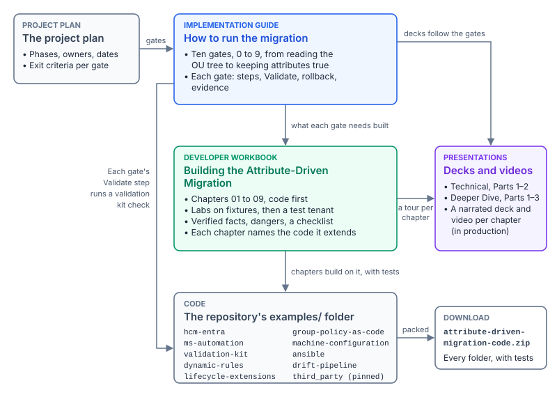

# Building the Attribute-Driven Migration {.unnumbered}

*A developer workbook for the Attribute-Driven Migration project*

::: {.callout-important appearance="default"}
## Status: approved
All nine chapters are written, and the owner approved every page on October 31, 2026. A page that changes after its approval goes back on the weekly source watch list until it is approved again. Each chapter has a narrated deck and video, listed under [Narrated chapter tours](#narrated-chapter-tours). Every external claim was checked against Microsoft Learn or a workbook chapter on October 30, 2026 and carries a note, and each chapter keeps its verification log in the repository. The code is illustrative. Its tests pass against fixtures, but it has not been run against a production tenant.
:::

The [Attribute-Driven Migration](../../../books/guides/attribute-driven-migration.md) moves an agency from Active Directory to Microsoft Entra ID by placing every person, device and server in policy through attributes instead of OU placement. Its operator material already exists: the companion guide, the [implementation guide](implementation-guide.md) with its ten gates, the [project plan](../../attribute-driven-migration.md) and the narrated decks. Those tell an operator what to do and how to prove it was done. They don't teach anyone to build the software the migration runs on: the middleware between the HR system and Entra ID, the Graph clients, the checks that prove each gate, the rule library, the workflow extensions, and the pipelines that catch drift and hand evidence to the ISSO.

This workbook is for the developers who build those pieces. It is code first. Each chapter starts from working code in the repository's [`examples`](https://github.com/WhalerMike/modernization-workbook/tree/main/examples) folder, extends it where the chapter needs to, and adds tests. Each has a lab that runs on a laptop against fixtures with no tenant at all, then a short step in a test tenant. Each lists the Graph and Azure facts the code depends on (endpoints, the least-privileged permission, availability in the US Government clouds), footnoted to Microsoft Learn with the date the page was read, then the dangers and a checklist.

## The pieces and how they connect

{#fig-adm-pieces fig-alt="Six boxes. The project plan, top left, sets the gates of the implementation guide, top center, which runs the migration as ten gates from reading the OU tree to keeping attributes true. An arrow from the guide down to this developer workbook, center, is labeled what each gate needs built; the workbook's nine chapters are code first. An arrow from the workbook down to the code, bottom center, the repository's examples folder with its kits and pinned Microsoft samples, is labeled chapters build on it, with tests. A line from the guide around the left side to the code is labeled each gate's Validate step runs a validation kit check. On the right, presentations, decks and narrated videos, receive arrows from the guide, decks follow the gates, and from the workbook, a tour per chapter. The code points right to one download, attribute-driven-migration-code.zip, every folder with its tests."}

| Piece | What it is | Where |
|---|---|---|
| Project plan | The phases, owners, dates and exit criteria the gates are scheduled against | [Attribute-Driven Migration project plan](../../attribute-driven-migration.md) |
| Implementation guide | The operator's guide: ten gates, each with steps, a **Validate** step, rollback and evidence. It says what has to be true at each gate; this workbook builds the software that makes it true | [Attribute-Driven Migration: An Implementation Guide](implementation-guide.md) |
| Developer workbook | This workbook: nine chapters, each building on code in the repository, with labs and tests | [Chapters](#chapters-table) below |
| Presentations | The two-part technical deep dive and the three-part deeper dive follow the guide's gates. Each chapter also has a narrated tour: a deck and a video | [Presentations](../../../presentations/index.md) · [Narrated chapter tours](#narrated-chapter-tours) |
| Code | The `examples` folders the chapters build on, and the Microsoft samples they start from, pinned unmodified under `third_party` with their licenses | [`examples` on GitHub](https://github.com/WhalerMike/modernization-workbook/tree/main/examples) |
| Code download | Every folder the nine chapters use, in one zip, with its tests and fixtures. Each script also has a `.txt` copy for mail systems that block scripts | [attribute-driven-migration-code.zip](../../../../downloads/attribute-driven-migration-code.zip) |

The zip holds `hcm-entra` (Chapters 01, 02 and 09), `ms-automation` (02), `validation-kit` (02, 03 and 06), `dynamic-rules` (02, 04 and 09), `lifecycle-extensions` (05), `group-policy-as-code` (06), `machine-configuration` (07 and 09), `ansible` (08) and `drift-pipeline` (09), and the pinned samples each chapter starts from.

## How each chapter is built

| Section | What it holds |
|---|---|
| Goal and audience | What you will build, and who should read it |
| The code | The example it builds on, what this chapter adds, and the tests |
| Lab 1: fixtures, no tenant | Steps you can run anywhere, with the expected output |
| Lab 2: test tenant | The smallest change a test tenant needs, and how to back it out |
| Verified facts | Endpoints, least-privileged permissions, national cloud availability and release stage, each footnoted |
| Dangers | What breaks in production, and the guard the code has for it |
| Checklist | What a reviewer checks before the code ships |

*Design guidance* in this workbook is marked as such: it is the program's position, not a vendor statement. Preview and beta features carry their stage wherever they appear.

## Chapters {#chapters-table}

| # | Chapter | Builds on | What you build | Status |
|---|---|---|---|---|
| 01 | [The HR-to-Entra middleware](01-the-hr-to-entra-middleware.md) | Microsoft's CSV2SCIM sample (pinned in `examples/third_party/csv2scim`), then `examples/hcm-entra` | Start from Microsoft's sample, then add what it leaves to you: validation that fails closed, quarantine, ordering, a mass-disable hold, pacing, the US Government clouds, least privilege, and a provenance manifest | Written |
| 02 | [Graph clients for the government clouds](02-graph-clients-for-government-clouds.md) | Microsoft's Graph SDK national cloud snippets (pinned in `examples/third_party/msgraph-snippets-python`), then `examples/ms-automation` | One client pattern for worldwide, GCC, GCC High and DoD: GCC on the worldwide endpoints with commercial Resource Manager, the token authority and hosts per cloud, every call declared with its least-privileged permission and checked against the token, paging with `@odata.nextLink`, `Retry-After`, and beta calls the run doesn't depend on | Written |
| 03 | [Writing a validation kit check](03-writing-a-validation-kit-check.md) | `examples/validation-kit` | A new check, VK-SYNC-02, from the catalog entry through pass and fail fixtures and Pester tests to the GET-only safety rule, and what to do when the read needs a privileged role | Written |
| 04 | [Dynamic rules as code](04-dynamic-rules-as-code.md) | Learn's dynamic membership processing samples (pinned in `examples/third_party/dynamic-membership-samples`), then `examples/dynamic-rules` | A rule library in Git: one file per group with tests, an offline evaluator and a linter for the guards every user rule needs, a shadow diff in the pull request, comparison with the beta `evaluateDynamicMembership` action (VK-DG-03), and an incident path that resumes only what it paused | Written |
| 05 | [Lifecycle Workflows custom extensions](05-lifecycle-workflows-custom-extensions.md) | Learn's Logic App definition for custom task extensions (pinned in `examples/third_party/lifecycle-workflows-logic-app`), then `examples/lifecycle-extensions` | Start from Learn's definition, then add what it leaves to you: one reusable Logic App per integration with its own managed identity, a checked callback path, a callback on failure, the Graph host for each US cloud, idempotency, retries inside the callback timeout, proof-of-possession authorization from a reviewed registry, and Book 03's leaver order | Written |
| 06 | [Moving Group Policy as code](06-group-policy-as-code.md) | Microsoft's settings catalog samples (pinned in `examples/third_party/mggraph-intune-samples`), `examples/validation-kit` (VK-INT-07), then `examples/group-policy-as-code` | Read Group Policy analytics (beta) into a per-setting move plan, keep settings catalog policies as reviewed JSON with an owner and decisions, lint them, diff them against the tenant, and create only what is missing, with least privilege per call and a host per cloud | Written |
| 07 | [Machine configuration packages](07-machine-configuration-packages.md) | Learn's GuestConfiguration procedure and Microsoft's samples (pinned in `examples/third_party/guest-configuration-samples`), then `examples/machine-configuration` | Follow Learn's cmdlets from DSC configuration to policy definition, then add what they leave to you: a MOF free of build-host data that compiles to the same bytes every time, package and definition checks against a release registry, the owner tag filter, Arc scope, and a provenance manifest | Written |
| 08 | [Ansible beside Arc](08-ansible-beside-arc.md) | Microsoft's `azure_arc` role (pinned in `examples/third_party/azure-arc-role`), then `examples/ansible` | Start from Microsoft's role, then add what it leaves to you: the `patch_owner` column and a CMDB inventory that reads both owners into the `ConfigOwner` and `PatchOwner` tags, a wave plan before every run, a dry run the role can't do, canary batches, and commercial Azure for a GCC estate | Written |
| 09 | [Drift pipelines and evidence to the ISSO](09-drift-pipelines-and-evidence.md) | Learn's Azure Login OIDC sample workflows (pinned in `examples/third_party/azure-login-oidc-sample`), then the kits' run outputs in `examples/drift-pipeline` | Start from Learn's sample, then add what it leaves to you: a schedule, pinned actions, sign-in and Graph hosts for GCC, GCC High and DoD, a comparison of each run with the last that never treats a failed read as a fix, findings opened and closed by fingerprint without names, and an evidence package with a SHA-256 per file, the other kits' provenance and a hash chain | Written |

Chapter 02 is the foundation the other chapters lean on: read it before you build a new Graph or Azure client of your own. Chapters 01, 03, 04 and 07 were written first, because their code already existed.

### Changes from the first outline

- **Chapter 01 starts from Microsoft's sample.** Microsoft publishes CSV2SCIM for this integration and documents it on Learn. The chapter runs it first, on the same HR fixture, and builds the hardened client only for what the sample leaves out. The repository keeps a pinned copy so the labs stay stable.
- **Chapter 03's worked example is a new check.** The outline proposed walking through an existing check. The chapter builds VK-SYNC-02 instead, because its live read needs Global Administrator, which makes it the clearest case for the kit's rule that a read-only check still has to ask for the least privilege it can.
- **Chapter 04 is written without the agents' user account clause.** Learn says an agent's user account is evaluated by user-based membership rules like any other user, and that a rule can exclude such accounts, but its rule property tables, read again on October 30, 2026, don't name the property to use.[^i-agentusers] The chapter says so instead of guessing; the clause, and VK-DG-01's and DR-03's guards, follow when Learn documents it. The chapter also starts from Learn's dynamic membership processing samples, the only Microsoft samples for this area.
- **Chapter 07 follows Learn's procedure and checks between its steps.** The outline had the chapter build its own pipeline around the cmdlets. Running Learn's commands showed the gaps sit between the steps, not in them, so the build calls the cmdlets in Learn's order and checks each output. Signing stays Learn's procedure, unwrapped, and the agent-side test runs on a disposable server in Lab 2, because Learn says it installs the agent and needs elevation.
- **Chapter 08 added one input first.** The [Ansible guide](../../../books/guides/ansible-configuration-automation.md) names a `patch_owner` field in the CMDB, which the sample CMDB export in `examples/ansible` didn't carry. The chapter added the column, with tests, before relying on it.

<!-- tour:begin (generated by the tour build; not part of the reviewed page) -->

## Narrated chapter tours

Every chapter has a narrated tour: a deck in Why, What, Who and How order, a self-running edition with captions, and a video. The tours were recorded on October 31, 2026 from the approved chapters, and a tour is re-recorded when its chapter changes. All of them are also on the [Watch page](../../../presentations/watch.md).

| # | Chapter | Watch | Length | Deck | Narrated deck |
|---|---|---|---|---|---|
| 01 | [The HR-to-Entra Middleware](01-the-hr-to-entra-middleware.md) | [▶ Watch](../../../presentations/watch.html?v=DW_ADM_01_HR_Entra_Middleware_Narrated) · [MP4](https://github.com/WhalerMike/modernization-workbook/releases/download/videos-2026-10-23/DW_ADM_01_HR_Entra_Middleware_Narrated.mp4) | 11 min | [DW_ADM_01_HR_Entra_Middleware.pptx](../../../../presentations/dw-adm-01-hr-entra-middleware/DW_ADM_01_HR_Entra_Middleware.pptx) | [Narrated](../../../../presentations/dw-adm-01-hr-entra-middleware/DW_ADM_01_HR_Entra_Middleware_Narrated.pptx) |
| 02 | [Graph Clients for the Government Clouds](02-graph-clients-for-government-clouds.md) | [▶ Watch](../../../presentations/watch.html?v=DW_ADM_02_Graph_Clients_Narrated) · [MP4](https://github.com/WhalerMike/modernization-workbook/releases/download/videos-2026-10-23/DW_ADM_02_Graph_Clients_Narrated.mp4) | 11 min | [DW_ADM_02_Graph_Clients.pptx](../../../../presentations/dw-adm-02-graph-clients/DW_ADM_02_Graph_Clients.pptx) | [Narrated](../../../../presentations/dw-adm-02-graph-clients/DW_ADM_02_Graph_Clients_Narrated.pptx) |
| 03 | [Writing a Validation Kit Check](03-writing-a-validation-kit-check.md) | [▶ Watch](../../../presentations/watch.html?v=DW_ADM_03_Validation_Kit_Check_Narrated) · [MP4](https://github.com/WhalerMike/modernization-workbook/releases/download/videos-2026-10-23/DW_ADM_03_Validation_Kit_Check_Narrated.mp4) | 11 min | [DW_ADM_03_Validation_Kit_Check.pptx](../../../../presentations/dw-adm-03-validation-kit-check/DW_ADM_03_Validation_Kit_Check.pptx) | [Narrated](../../../../presentations/dw-adm-03-validation-kit-check/DW_ADM_03_Validation_Kit_Check_Narrated.pptx) |
| 04 | [Dynamic Rules as Code](04-dynamic-rules-as-code.md) | [▶ Watch](../../../presentations/watch.html?v=DW_ADM_04_Dynamic_Rules_Narrated) · [MP4](https://github.com/WhalerMike/modernization-workbook/releases/download/videos-2026-10-23/DW_ADM_04_Dynamic_Rules_Narrated.mp4) | 11 min | [DW_ADM_04_Dynamic_Rules.pptx](../../../../presentations/dw-adm-04-dynamic-rules/DW_ADM_04_Dynamic_Rules.pptx) | [Narrated](../../../../presentations/dw-adm-04-dynamic-rules/DW_ADM_04_Dynamic_Rules_Narrated.pptx) |
| 05 | [Lifecycle Workflows Custom Extensions](05-lifecycle-workflows-custom-extensions.md) | [▶ Watch](../../../presentations/watch.html?v=DW_ADM_05_Lifecycle_Extensions_Narrated) · [MP4](https://github.com/WhalerMike/modernization-workbook/releases/download/videos-2026-10-23/DW_ADM_05_Lifecycle_Extensions_Narrated.mp4) | 12 min | [DW_ADM_05_Lifecycle_Extensions.pptx](../../../../presentations/dw-adm-05-lifecycle-extensions/DW_ADM_05_Lifecycle_Extensions.pptx) | [Narrated](../../../../presentations/dw-adm-05-lifecycle-extensions/DW_ADM_05_Lifecycle_Extensions_Narrated.pptx) |
| 06 | [Moving Group Policy as Code](06-group-policy-as-code.md) | [▶ Watch](../../../presentations/watch.html?v=DW_ADM_06_Group_Policy_as_Code_Narrated) · [MP4](https://github.com/WhalerMike/modernization-workbook/releases/download/videos-2026-10-23/DW_ADM_06_Group_Policy_as_Code_Narrated.mp4) | 11 min | [DW_ADM_06_Group_Policy_as_Code.pptx](../../../../presentations/dw-adm-06-group-policy-code/DW_ADM_06_Group_Policy_as_Code.pptx) | [Narrated](../../../../presentations/dw-adm-06-group-policy-code/DW_ADM_06_Group_Policy_as_Code_Narrated.pptx) |
| 07 | [Machine Configuration Packages](07-machine-configuration-packages.md) | [▶ Watch](../../../presentations/watch.html?v=DW_ADM_07_Machine_Configuration_Narrated) · [MP4](https://github.com/WhalerMike/modernization-workbook/releases/download/videos-2026-10-23/DW_ADM_07_Machine_Configuration_Narrated.mp4) | 11 min | [DW_ADM_07_Machine_Configuration.pptx](../../../../presentations/dw-adm-07-machine-configuration/DW_ADM_07_Machine_Configuration.pptx) | [Narrated](../../../../presentations/dw-adm-07-machine-configuration/DW_ADM_07_Machine_Configuration_Narrated.pptx) |
| 08 | [Ansible Beside Arc](08-ansible-beside-arc.md) | [▶ Watch](../../../presentations/watch.html?v=DW_ADM_08_Ansible_Beside_Arc_Narrated) · [MP4](https://github.com/WhalerMike/modernization-workbook/releases/download/videos-2026-10-23/DW_ADM_08_Ansible_Beside_Arc_Narrated.mp4) | 11 min | [DW_ADM_08_Ansible_Beside_Arc.pptx](../../../../presentations/dw-adm-08-ansible-beside-arc/DW_ADM_08_Ansible_Beside_Arc.pptx) | [Narrated](../../../../presentations/dw-adm-08-ansible-beside-arc/DW_ADM_08_Ansible_Beside_Arc_Narrated.pptx) |
| 09 | [Drift Pipelines and Evidence to the ISSO](09-drift-pipelines-and-evidence.md) | [▶ Watch](../../../presentations/watch.html?v=DW_ADM_09_Drift_Pipelines_Evidence_Narrated) · [MP4](https://github.com/WhalerMike/modernization-workbook/releases/download/videos-2026-10-23/DW_ADM_09_Drift_Pipelines_Evidence_Narrated.mp4) | 11 min | [DW_ADM_09_Drift_Pipelines_Evidence.pptx](../../../../presentations/dw-adm-09-drift-pipelines-evidence/DW_ADM_09_Drift_Pipelines_Evidence.pptx) | [Narrated](../../../../presentations/dw-adm-09-drift-pipelines-evidence/DW_ADM_09_Drift_Pipelines_Evidence_Narrated.pptx) |

<!-- tour:end -->

## Reading paths

- **Developers new to the migration:** the [companion guide](../../../books/guides/attribute-driven-migration.md) first, then Chapter 01.
- **Developers extending the validation kit:** Chapter 03, then Chapter 04.
- **Platform and pipeline engineers:** Chapter 07, then 08 and 09.
- **ISSOs and reviewers of the code:** the checklists at the end of each chapter, and Chapter 09.

## Where this workbook sits

This is the developer workbook for the [Attribute-Driven Migration project](../../attribute-driven-migration.md), one of the [developer workbooks](../index.md) under Projects in the Federal Modernization Workbook. The HR side of the migration, its schema and its lifecycle rules are [Book 03](../../../books/b03-hr-identity/index.md). The directory, sync and matching are [Book 02](../../../books/b02-identity/index.md). Devices, Intune and Azure Arc are [Book 05](../../../books/b05-devices/index.md). Change control, provenance and the drift engine are [Book 13](../../../books/b13-governance/index.md). The gates each chapter's code proves are in the [implementation guide](implementation-guide.md).

## Chapters

::: {#chapters}
:::

[^i-agentusers]: Microsoft Learn, "Manage rules for dynamic membership groups in Microsoft Entra ID," <https://learn.microsoft.com/entra/identity/users/groups-dynamic-membership> (accessed Oct 30, 2026).
