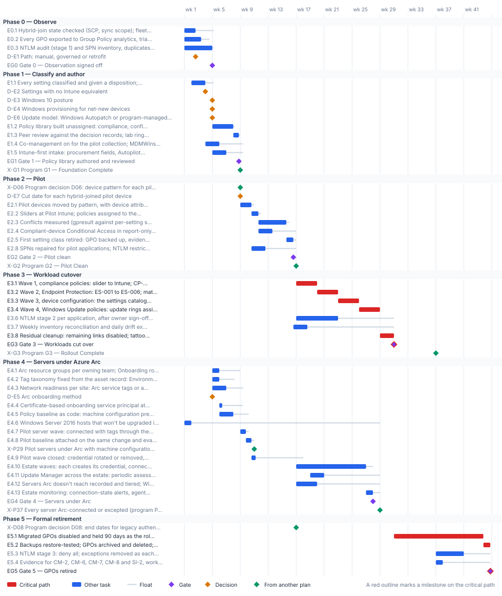

<!-- Generated by scripts/project_plans/build.py from data/project-plans/endpoint-device.yaml. Edit the YAML, not this page. -->

# Endpoint & Device Modernization: Group Policy to Intune and Azure Arc {.unnumbered}

::: {.callout-note}
## A sample plan, not a commitment
This is an illustrative plan built from the workbook's books, in the form a project manager would baseline: a work breakdown, a schedule network, a computed critical path, decision points, gates and risks. The durations are illustrative, sized to the books' roadmap weeks. Replace them with the agency's own estimates, then baseline the result. The plan names roles, not people, and no specific agency.
:::

## Plan at a glance

| | |
|---|---|
| **Plan type** | Project: Observe, author, pilot, workload cutover and formal retirement (Book 05, Chapter 08's seven phases) |
| **Built from** | Book 05 |
| **Sponsor** | Executive sponsor and CIO |
| **Plan manager** | Project lead, with the four domain leads: device identity, Group Policy sunset, Conditional Access and NTLM |
| **Duration** | 44 weeks (219 working days), computed from the network |
| **Work** | 28 tasks, 5 gates, 7 decision points, 5 milestones from other plans |
| **Critical path** | 9 of 45 items; 11 more within 5 days of it |
| **Calendar** | Week 1 = the program's Phase 0 approval; five working days a week |

: Plan at a glance {.striped}

This plan moves the existing fleet from Group Policy and domain join to the governed device lifecycle in [Book 05](../books/b05-devices/index.md): workstations under Intune, servers under Azure Arc, and every setting owned by exactly one policy. It runs the GPO sunset in [Chapter 07](../books/b05-devices/07-the-gpo-sunset-program.md) at the working level of [Chapter 08](../books/b05-devices/08-gpo-to-intune-policy-migration.md), with [Chapter 09](../books/b05-devices/09-servers-under-azure-arc.md) for servers and [Chapter 10](../books/b05-devices/10-operating-and-evidencing-the-fleet.md) for the evidence. Net-new devices take the Intune-first path in [Chapter 04](../books/b05-devices/04-intune-first-onboarding.md) from the start. The plan feeds the [program master schedule](program-master-schedule.md): its pilot gate comes before the program's G2, its workload waves run in the program's Phase 3, and its GPO retirement closes in Phase 4. Domain unjoin of the existing fleet is a separate decision, outside this plan, as the [charter](https://github.com/WhalerMike/modernization-workbook/blob/main/docs/projects/endpoint-device-charter.md) sets out.

## Schedule

{fig-alt="Gantt chart of the Endpoint &amp; Device Modernization plan over 44 weeks, grouped by phase. Critical-path tasks are red bars, other tasks are blue bars with a grey line showing their float, gates are violet diamonds, decisions are amber diamonds and milestones from other plans are green diamonds. The tables below give every date and float."}

## Critical path

Two program gates bound the first half. The program's G1 (end of week 8) needs the Intune policy design, so the GPO export, the classification of every setting, the policy library and its peer review have to finish by then: they do, with one working day to spare, which is why the program carries its own Intune design on its critical path. The NTLM audit and Gate 0 sit one day off that path. The pilot then has to clear the program's G2 (end of week 16): devices moved, policies assigned beside the still-linked GPOs, four weeks of conflict and application testing, and the first setting class retired, with two days to spare.

After G2 the computed critical path is the four workload waves in their fixed order (Endpoint Protection before device configuration, because the device configuration slider carries it), the residual cleanup, the 90-day hold on the disabled GPOs, and their archiving and deletion. The hold is the longest single item. It starts when the cleanup ends, in week 31, so the last deletions land at the end of week 44, with the program's G4. Waiting for G3 to start it would push the deletions to about week 50, past G5. The server waves, the NTLM stages and the inventory reconciliation all carry float.

The critical path, in order. Each item has zero total float: a day lost on any of them is a day lost at the finish.

| # | ID | Item | Owner or approver | When |
|---|---|---|---|---|
| 1 | E3.1 | Wave 1, compliance policies: slider to Intune; CP-001 to CP-005 in rings, each watched 72 hours | Endpoint engineering | wk 17–19 |
| 2 | E3.2 | Wave 2, Endpoint Protection: ES-001 to ES-006; matching GPO links disabled | Endpoint engineering | wk 20–22 |
| 3 | E3.3 | Wave 3, device configuration: the settings catalog profiles; matching GPO links disabled | Endpoint engineering | wk 23–25 |
| 4 | E3.4 | Wave 4, Windows Update policies: update rings assigned; WSUS stopped for migrated devices | Endpoint engineering | wk 26–28 |
| 5 | E3.8 | Residual cleanup: remaining links disabled; tattooed preference items cleared or owned | Endpoint engineering | wk 29–30 |
| 6 | EG3 | Gate 3 — Workloads cut over | Endpoint engineering | end of wk 30 |
| 7 | E4.1 | Migrated GPOs disabled and held 90 days as the rollback net | Endpoint engineering | wk 31–43 |
| 8 | E4.2 | Backups restore-tested; GPOs archived and deleted; exception register closed | Endpoint engineering | wk 43–44 |
| 9 | EG4 | Gate 4 — GPOs retired | CISO / ISSO | end of wk 44 |

: The critical path {.striped .hover}

**Near-critical.** These items have 5 working days of float or less. Track them weekly: once their float is spent, they join the critical path.

| ID | Item | Float | When |
|---|---|---|---|
| E0.3 | NTLM audit (stage 1) and SPN inventory, duplicates and stale owners flagged | 1 d | wk 1–4 |
| EG0 | Gate 0 — Observation signed off | 1 d | end of wk 4 |
| D-E3 | Windows 10 posture | 1 d | end of wk 4 |
| E1.2 | Policy library built unassigned: compliance, configuration, endpoint security, app protection; groups, filters and scope tags | 1 d | wk 5–7 |
| E1.3 | Peer review against the decision records; lab ring reports Succeeded for every setting | 1 d | wk 8 |
| E2.1 | Pilot devices moved by pattern, with device attributes populated | 2 d | wk 9–10 |
| E2.2 | Sliders at Pilot Intune; policies assigned to the 5% cohort with a 7-day grace period; GPOs left linked | 2 d | wk 10–11 |
| E2.3 | Conflicts measured (gpresult against per-setting status); application and user tests against the baseline | 2 d | wk 11–15 |
| E2.5 | First setting class retired: GPO backed up, evidence checked, links disabled on the pilot OUs | 2 d | wk 15–16 |
| EG2 | Gate 2 — Pilot clean | 2 d | end of wk 16 |
| EG1 | Gate 1 — Policy library authored and reviewed | 3 d | end of wk 8 |

: Near-critical items {.striped .hover}

## Decision points

Each decision is a zero-duration milestone in the network. *Decide by* is its late finish: the last week it can be made without moving the plan's finish. A decision with zero float sits on the critical path, so the meeting that makes it should be booked before the plan is baselined. Decision rights follow [Book 01, Chapter 09](../books/b01-transformation-arc/09-who-leads-the-transformation.md#decision-rights-across-the-program).

| ID | Decision | Decides | Needed by | Decide by | Float | Options | If it's late |
|---|---|---|---|---|---|---|---|
| D-E3 | Windows 10 posture | CISO / ISSO | E1.2 | end of wk 5 | 1 d | Upgrade to Windows 11 before the device's wave; keep the device as an exception with an upgrade date | The compliance policies can't set their OS floor, so baseline authoring waits |
| D-E1 | Path: manual, governed or retrofit | Sponsor / CIO | E1.4 | end of wk 7 | 24 d | Manual (small estate or pilot, no control plane yet); governed (larger estate, or the authorizing official must sign); retrofit (estate already modernized by hand) | Nobody knows who holds the decision record; co-management for the pilot can't start |
| D-E4 | Windows provisioning for net-new devices | Endpoint engineering | E1.5 | end of wk 7 | 12 d | Classic Windows Autopilot, user-driven, Entra join, OEM or reseller registration with a group tag (the program's GCC default); Autopilot device preparation, with the attribute carried by the serial-number mapping table | New hardware has no governed path and keeps arriving as tomorrow's migration |
| D-E2 | Settings with no Intune equivalent | CISO / ISSO | E1.3 | end of wk 8 | 21 d | A Remediation script, reviewed later for a native replacement; a Configuration Manager baseline on co-managed devices; a dated exception with its GPO linked for that population only; a standing exception, accepted by the authorizing official | Decision records stay open and the baseline review can't sign off |
| D-E5 | Arc onboarding method | Server infrastructure | E2.6 | end of wk 13 | 45 d | A certificate-based service principal through the tool the server team already runs (Configuration Manager, Ansible or Group Policy); the portal script for a handful of servers or a pilot; Arc-enabled VMware vSphere; the multicloud connector for AWS | The pilot server wave can't create its credential |
| D-E7 | Cut date for each hybrid-joined pilot device | Sponsor / CIO | EG2 | end of wk 16 | 40 d | The device's refresh date; an OS upgrade; a troubleshooting rebuild (each needs a reset to reach Entra join) | The pilot fails its no-hybrid-join-without-a-cut-date criterion, and so does the program's G2 |
| D-E6 | Update model: Windows Autopatch or program-managed rings | CISO / ISSO | E3.4 | end of wk 25 | 105 d | Autopatch groups configured to the program's ring table, where the license allows; Intune update rings built from SC-005 | The Windows Update wave can't be built, and WSUS stays |

: Decision points, by decide-by date {.striped .hover}

## Gates

Each gate is the next phase's entry condition. The approver signs it against the criteria, from evidence in the repository.

| Gate | When | Approver | Criteria |
|---|---|---|---|
| [Gate 0 — Observation signed off](../books/b05-devices/05-the-governed-manual-and-retrofit-paths.md#four-phases-observe-first) | end of wk 4 | CISO / ISSO | Every linked GPO and setting inventoried; the NTLM audit window closed; SPNs inventoried with duplicates flagged; device records correlated and the loss ledger run |
| [Gate 1 — Policy library authored and reviewed](../books/b05-devices/08-gpo-to-intune-policy-migration.md#testing-at-each-gate) | end of wk 8 | CISO / ISSO | A decision record for every setting; every required setting owned by exactly one policy; peer review signed off; lab devices report Succeeded; pilot devices co-managed and syncing |
| [Gate 2 — Pilot clean](../books/b05-devices/08-gpo-to-intune-policy-migration.md#testing-at-each-gate) | end of wk 16 | Endpoint engineering | No unexplained Conflict or Error; no application regressions against the baseline; one setting class retired with evidence; every hybrid-joined pilot device has a cut date; pilot servers connected with their baseline evaluated; an NTLM restriction plan per application |
| [Gate 3 — Workloads cut over](../books/b05-devices/08-gpo-to-intune-policy-migration.md#testing-at-each-gate) | end of wk 30 | Endpoint engineering | Each wave's settings report success on its population; no migrated device processes an in-scope GPO; every preference item cleared or owned; every server Arc-connected or excepted; evidence filed |
| [Gate 4 — GPOs retired](../books/b05-devices/07-the-gpo-sunset-program.md#the-end-state) | end of wk 44 | CISO / ISSO | No GPO in scope linked to an OU with migrated devices; every retired GPO backed up with a decision record; only dated exceptions remain, each with an owner and review date; workload sliders at Intune |

: Gates {.striped .hover}

## Links to other plans

- **X-G1, Program G1 — Foundation Complete,** is G1 in the [Program master schedule](program-master-schedule.md) plan (G1 — Foundation Complete), end of wk 8. This plan must finish E1.3 by then: a margin of 1 d. Later work in this plan waits for it. The pilot can't start: groups, AUs and the Conditional Access baseline aren't in place.
- **X-D06, Program decision D06: device pattern for each pilot cohort,** is D06 in the [Program master schedule](program-master-schedule.md) plan (Device pattern for each pilot cohort), end of wk 8. This plan waits for it; it can slip 2 d before it moves this plan. Pilot devices can't move, and this plan's pilot waits.
- **X-G2, Program G2 — Pilot Clean,** is G2 in the [Program master schedule](program-master-schedule.md) plan (G2 — Pilot Clean), end of wk 16. This plan must finish EG2 by then: a margin of 2 d. Later work in this plan waits for it. The workload waves can't start.
- **X-G3, Program G3 — Rollout Complete,** is G3 in the [Program master schedule](program-master-schedule.md) plan (G3 — Rollout Complete), end of wk 36. This plan waits for it; it can slip 19 d before it moves this plan. Formal retirement and NTLM stage 3 can't close.
- **X-D08, Program decision D08: end dates for legacy authentication and NTLM,** is D08 in the [Program master schedule](program-master-schedule.md) plan (End dates for legacy authentication and NTLM), end of wk 16. This plan waits for it; it can slip 119 d before it moves this plan. NTLM stage 3 has no date for application owners to plan against.

## Work breakdown and schedule

Every row, by phase. *Float* is total float in working days; **bold** rows are on the critical path. Each row links to the chapter it comes from.

### Phase 0 — Observe

| ID | Item | Type | Owner or approver | Days | Predecessors | When | Float |
|---|---|---|---|---|---|---|---|
| E0.1 | [Hybrid-join state checked (SCP, sync scope); fleet run against the loss ledger](../books/b05-devices/02-the-hybrid-join-trap.md#what-to-do-first) | Task | Endpoint engineering | 8 | — | wk 1–2 | 13 d |
| E0.2 | [Every GPO exported to Group Policy analytics, triaged to Intune or Arc scope; baseline per tier captured](../books/b05-devices/08-gpo-to-intune-policy-migration.md#phase-1-inventory-and-classify) | Task | Endpoint engineering | 12 | — | wk 1–3 | 6 d |
| E0.3 | [NTLM audit (stage 1) and SPN inventory, duplicates and stale owners flagged](../books/b05-devices/05-the-governed-manual-and-retrofit-paths.md#phase-1-baseline-the-estate) | Task | Server infrastructure | 20 | — | wk 1–4 | 1 d |
| D-E1 | [Path: manual, governed or retrofit](../books/b05-devices/05-the-governed-manual-and-retrofit-paths.md#how-to-choose) | Decision | Sponsor / CIO | — | E0.1 | end of wk 2 | 24 d |
| EG0 | [Gate 0 — Observation signed off](../books/b05-devices/05-the-governed-manual-and-retrofit-paths.md#four-phases-observe-first) | Gate | CISO / ISSO | — | E0.1, E0.2, E0.3 | end of wk 4 | 1 d |

: Phase 0 — Observe {.striped .hover}

### Phase 1 — Classify and author

| ID | Item | Type | Owner or approver | Days | Predecessors | When | Float |
|---|---|---|---|---|---|---|---|
| E1.1 | [Every setting classified and given a disposition; a decision record per setting](../books/b05-devices/07-the-gpo-sunset-program.md#step-2-classify-each-setting) | Task | Endpoint engineering | 10 | E0.2 (SS) +5 d | wk 2–3 | 6 d |
| D-E2 | [Settings with no Intune equivalent](../books/b05-devices/07-the-gpo-sunset-program.md#step-2-classify-each-setting) | Decision | CISO / ISSO | — | E1.1 | end of wk 3 | 21 d |
| D-E3 | [Windows 10 posture](../books/b05-devices/08-gpo-to-intune-policy-migration.md) | Decision | CISO / ISSO | — | EG0 | end of wk 4 | 1 d |
| D-E4 | [Windows provisioning for net-new devices](../books/b05-devices/04-intune-first-onboarding.md#which-one-in-a-gcc-tenant) | Decision | Endpoint engineering | — | EG0 | end of wk 4 | 12 d |
| D-E5 | [Arc onboarding method](../books/b05-devices/09-servers-under-azure-arc.md#choose-a-method) | Decision | Server infrastructure | — | EG0 | end of wk 4 | 45 d |
| D-E6 | [Update model: Windows Autopatch or program-managed rings](../books/b05-devices/10-operating-and-evidencing-the-fleet.md#windows-autopatch) | Decision | CISO / ISSO | — | EG0 | end of wk 4 | 105 d |
| E1.2 | [Policy library built unassigned: compliance, configuration, endpoint security, app protection; groups, filters and scope tags](../books/b05-devices/08-gpo-to-intune-policy-migration.md#phase-3-baseline-authoring) | Task | Endpoint engineering | 15 | E1.1, D-E3 | wk 5–7 | 1 d |
| E1.3 | [Peer review against the decision records; lab ring reports Succeeded for every setting](../books/b05-devices/08-gpo-to-intune-policy-migration.md#testing-at-each-gate) | Task | Endpoint engineering | 4 | E1.2, D-E2 | wk 8 | 1 d |
| E1.4 | [Co-management on for the pilot collection; MDMWinsOverGP decided per population](../books/b05-devices/08-gpo-to-intune-policy-migration.md#phase-2-coexistence-planning) | Task | Endpoint engineering | 10 | E1.1, D-E1 | wk 4–5 | 17 d |
| E1.5 | [Intune-first intake: procurement fields, Autopilot registration with group tags, enrollment restrictions](../books/b05-devices/04-intune-first-onboarding.md#the-five-phase-process) | Task | Endpoint engineering | 10 | D-E4 | wk 5–6 | 12 d |
| EG1 | [Gate 1 — Policy library authored and reviewed](../books/b05-devices/08-gpo-to-intune-policy-migration.md#testing-at-each-gate) | Gate | CISO / ISSO | — | E1.3, E1.4, E1.5 | end of wk 8 | 3 d |
| X-G1 | [Program G1 — Foundation Complete](program-master-schedule.md) | External | Steward | — | E1.3 | end of wk 8 | fixed date |

: Phase 1 — Classify and author {.striped .hover}

### Phase 2 — Pilot

| ID | Item | Type | Owner or approver | Days | Predecessors | When | Float |
|---|---|---|---|---|---|---|---|
| X-D06 | [Program decision D06: device pattern for each pilot cohort](program-master-schedule.md) | External | Program office | — | — | end of wk 8 | 2 d |
| D-E7 | [Cut date for each hybrid-joined pilot device](../books/b05-devices/02-the-hybrid-join-trap.md#the-governed-path) | Decision | Sponsor / CIO | — | X-D06 | end of wk 8 | 40 d |
| E2.1 | [Pilot devices moved by pattern, with device attributes populated](../books/b05-devices/02-the-hybrid-join-trap.md#the-governed-path) | Task | Endpoint engineering | 8 | EG1, X-G1, X-D06 | wk 9–10 | 2 d |
| E2.2 | [Sliders at Pilot Intune; policies assigned to the 5% cohort with a 7-day grace period; GPOs left linked](../books/b05-devices/08-gpo-to-intune-policy-migration.md#phase-4-pilot) | Task | Endpoint engineering | 5 | E2.1 | wk 10–11 | 2 d |
| E2.3 | [Conflicts measured (gpresult against per-setting status); application and user tests against the baseline](../books/b05-devices/08-gpo-to-intune-policy-migration.md#phase-4-pilot) | Task | Endpoint engineering | 20 | E2.2 | wk 11–15 | 2 d |
| E2.4 | [Compliant-device Conditional Access in report-only for the pilot; coverage reconciled](../books/b05-devices/10-operating-and-evidencing-the-fleet.md#compliance-and-the-conditional-access-hand-off) | Task | Identity team | 10 | E2.2 | wk 11–13 | 17 d |
| E2.5 | [First setting class retired: GPO backed up, evidence checked, links disabled on the pilot OUs](../books/b05-devices/07-the-gpo-sunset-program.md#freezing-and-unlinking-gpos) | Task | Endpoint engineering | 5 | E2.3 | wk 15–16 | 2 d |
| E2.6 | [Pilot server wave: resource group, tags, network check, certificate credential, connect, license attestation](../books/b05-devices/09-servers-under-azure-arc.md#onboarding) | Task | Server infrastructure | 8 | X-G1, D-E5 | wk 9–10 | 25 d |
| E2.7 | [Day-one baseline on pilot servers: machine configuration, Update Manager, Defender for Servers; wave closed](../books/b05-devices/09-servers-under-azure-arc.md#the-day-one-baseline) | Task | Server infrastructure | 7 | E2.6 | wk 10–11 | 25 d |
| E2.8 | [SPNs repaired for pilot applications; NTLM restriction plan per application](../books/b05-devices/05-the-governed-manual-and-retrofit-paths.md#phase-3-repair-spns-before-enforcing-kerberos) | Task | Application owners | 10 | E2.1, EG0 | wk 10–12 | 22 d |
| EG2 | [Gate 2 — Pilot clean](../books/b05-devices/08-gpo-to-intune-policy-migration.md#testing-at-each-gate) | Gate | Endpoint engineering | — | E2.5, E2.4, E2.7, E2.8, D-E7 | end of wk 16 | 2 d |
| X-G2 | [Program G2 — Pilot Clean](program-master-schedule.md) | External | Steward and executive sponsor | — | EG2 | end of wk 16 | fixed date |

: Phase 2 — Pilot {.striped .hover}

### Phase 3 — Workload cutover

| ID | Item | Type | Owner or approver | Days | Predecessors | When | Float |
|---|---|---|---|---|---|---|---|
| E3.1 | **[Wave 1, compliance policies: slider to Intune; CP-001 to CP-005 in rings, each watched 72 hours](../books/b05-devices/08-gpo-to-intune-policy-migration.md#phase-5-workload-cutover-in-waves)** | Task | Endpoint engineering | 15 | EG2, X-G2 | wk 17–19 | 0 |
| E3.2 | **[Wave 2, Endpoint Protection: ES-001 to ES-006; matching GPO links disabled](../books/b05-devices/08-gpo-to-intune-policy-migration.md#phase-5-workload-cutover-in-waves)** | Task | Endpoint engineering | 15 | E3.1 | wk 20–22 | 0 |
| E3.3 | **[Wave 3, device configuration: the settings catalog profiles; matching GPO links disabled](../books/b05-devices/08-gpo-to-intune-policy-migration.md#phase-5-workload-cutover-in-waves)** | Task | Endpoint engineering | 15 | E3.2 | wk 23–25 | 0 |
| E3.4 | **[Wave 4, Windows Update policies: update rings assigned; WSUS stopped for migrated devices](../books/b05-devices/08-gpo-to-intune-policy-migration.md#phase-5-workload-cutover-in-waves)** | Task | Endpoint engineering | 15 | E3.3, D-E6 | wk 26–28 | 0 |
| E3.5 | [Every remaining server Arc-connected or excepted, wave by wave; Windows Server 2016 enrolled in ESUs](../books/b05-devices/09-servers-under-azure-arc.md#extended-security-updates) | Task | Server infrastructure | 60 | X-G2, E2.7 | wk 17–28 | 10 d |
| E3.6 | [NTLM stage 2 per application, after owner sign-off: LM and NTLMv1 refused](../books/b05-devices/05-the-governed-manual-and-retrofit-paths.md#phase-3-restrict-ntlm-in-stages) | Task | Application owners | 30 | E2.8, X-G2 | wk 17–22 | 40 d |
| E3.7 | [Weekly inventory reconciliation and daily drift export running; alerts set](../books/b05-devices/10-operating-and-evidencing-the-fleet.md#device-inventory-reconciliation) | Task | Endpoint engineering | 10 | EG2 | wk 16–18 | 62 d |
| E3.8 | **[Residual cleanup: remaining links disabled; tattooed preference items cleared or owned](../books/b05-devices/08-gpo-to-intune-policy-migration.md#phase-6-verification-and-residual-cleanup)** | Task | Endpoint engineering | 10 | E3.4 | wk 29–30 | 0 |
| EG3 | **[Gate 3 — Workloads cut over](../books/b05-devices/08-gpo-to-intune-policy-migration.md#testing-at-each-gate)** | Gate | Endpoint engineering | — | E3.8, E3.5, E3.6, E3.7 | end of wk 30 | 0 |
| X-G3 | [Program G3 — Rollout Complete](program-master-schedule.md) | External | Executive sponsor and steering committee | — | — | end of wk 36 | 19 d |

: Phase 3 — Workload cutover {.striped .hover}

### Phase 4 — Formal retirement

| ID | Item | Type | Owner or approver | Days | Predecessors | When | Float |
|---|---|---|---|---|---|---|---|
| X-D08 | [Program decision D08: end dates for legacy authentication and NTLM](program-master-schedule.md) | External | Authorizing official | — | — | end of wk 16 | 119 d |
| E4.1 | **[Migrated GPOs disabled and held 90 days as the rollback net](../books/b05-devices/08-gpo-to-intune-policy-migration.md#phase-7-formal-retirement)** | Task | Endpoint engineering | 64 | EG3 | wk 31–43 | 0 |
| E4.2 | **[Backups restore-tested; GPOs archived and deleted; exception register closed](../books/b05-devices/08-gpo-to-intune-policy-migration.md#phase-7-formal-retirement)** | Task | Endpoint engineering | 5 | E4.1, X-G3 | wk 43–44 | 0 |
| E4.3 | [NTLM stage 3: deny all; exceptions removed as each dependency retires](../books/b05-devices/05-the-governed-manual-and-retrofit-paths.md#phase-3-restrict-ntlm-in-stages) | Task | Application owners | 20 | E3.6, X-D08, X-G3 | wk 37–40 | 19 d |
| E4.4 | [Evidence for CM-2, CM-6, CM-7, CM-8 and SI-2 handed to the ISSO](../books/b05-devices/10-operating-and-evidencing-the-fleet.md#reporting-and-the-evidence-an-assessor-reads) | Task | Endpoint engineering | 5 | E3.7, X-G3 | wk 37 | 34 d |
| EG4 | **[Gate 4 — GPOs retired](../books/b05-devices/07-the-gpo-sunset-program.md#the-end-state)** | Gate | CISO / ISSO | — | E4.2, E4.3, E4.4 | end of wk 44 | 0 |

: Phase 4 — Formal retirement {.striped .hover}

## Responsibility

Who owns what in this plan. Each row has one owner; consulted and informed parties follow the [decision matrix](../books/b01-transformation-arc/09-who-leads-the-transformation.md#decision-rights-across-the-program).

| Owner or approver | Tasks | Decisions | Gates |
|---|---|---|---|
| Endpoint engineering | 20 | 1 | 2 |
| CISO / ISSO | — | 3 | 3 |
| Server infrastructure | 4 | 1 | — |
| Application owners | 3 | — | — |
| Sponsor / CIO | — | 2 | — |
| Authorizing official | 1 | — | — |
| Executive sponsor and steering committee | 1 | — | — |
| Identity team | 1 | — | — |
| Program office | 1 | — | — |
| Steward | 1 | — | — |
| Steward and executive sponsor | 1 | — | — |

: Ownership {.striped .hover}

## Assumptions

- The fleet has a Configuration Manager estate, which is what Book 05's durations assume; a fleet without one skips most of the coexistence planning ([Chapter 08](../books/b05-devices/08-gpo-to-intune-policy-migration.md#the-seven-phases-at-working-level)).
- The pilot cohort is about 5% of the fleet, representative across tiers, regions and departments; the ring sizes in each wave are a program design choice.
- Domain unjoin of the existing fleet is out of scope; the sponsor schedules it separately ([Chapter 06](../books/b05-devices/06-who-owns-the-endpoint.md#the-roles)).
- The 90-day GPO retention window is the program's design choice, sized to the fleet's patch and refresh cycle ([Chapter 07](../books/b05-devices/07-the-gpo-sunset-program.md#freezing-and-unlinking-gpos)); here it is taken as 64 working days.
- Durations are illustrative. Replace them with the agency's own estimates once the GPO inventory and the NTLM audit are in.

## Schedule risks

| Risk | Effect on the schedule | Response |
|---|---|---|
| NTLM is restricted before the audit window closes | Legacy applications break; the stage is rolled back and the NTLM track slips | Restrict only after a 14 to 30 day audit shows no dependencies and the application owner signs off ([Chapter 05](../books/b05-devices/05-the-governed-manual-and-retrofit-paths.md#phase-3-restrict-ntlm-in-stages)) |
| A setting outside the Policy CSP (Defender, Windows Hello for Business) is configured in both a GPO and Intune | A race with no guaranteed winner; unexplained conflicts fail the pilot gate | Never configure those settings in both places; unlink the GPO first or exclude the population ([Chapter 07](../books/b05-devices/07-the-gpo-sunset-program.md#coexistence-who-wins)) |
| Device attributes are incomplete | Devices fall outside every policy's scope, and the compliant-device policies can't be enforced | Mark devices with no compliance policy as not compliant; reconcile the inventories weekly ([Chapter 10](../books/b05-devices/10-operating-and-evidencing-the-fleet.md#tenant-wide-compliance-settings)) |
| Pilot Intune doesn't remove policies when they are unassigned | A pilot rollback takes longer than planned | Plan rollback as reassigning a policy that sets the old value, not as removing the assignment ([Chapter 08](../books/b05-devices/08-gpo-to-intune-policy-migration.md#rollback)) |
| An onboarding secret is left in plain text in a startup script | Anyone who reads SYSVOL can register servers into the subscription | Onboard with a certificate-based service principal and remove the credential when each wave closes ([Chapter 09](../books/b05-devices/09-servers-under-azure-arc.md#create-the-onboarding-service-principal)) |

: Schedule risks {.striped .hover}

## Baseline and change control

- **Baseline** the plan when its first gate is approved: the YAML file, as merged, is the baseline.
- **Report** weekly, green, yellow or red, against the baseline ([Book 01, Chapter 12](../books/b01-transformation-arc/12-migration-roadmap.md#phase-3-general-rollout-weeks-1736)). Report float, not percent complete: a task's float says how much slip the plan can still absorb.
- **Change** the plan only through a reviewed pull request that edits the YAML and regenerates this page, so every change to a date or a dependency has an author, a reviewer and a reason.
- **Re-baseline** at each gate, after the approver signs it, and whenever a critical-path decision is made late.

## Download and adapt

| File | Use it for |
|---|---|
| [endpoint-device.xml](files/endpoint-device.xml) | Microsoft Project desktop (open the XML file; it keeps the dependencies, milestones and owners). The dates start on a placeholder Monday: change the project start date. |
| [endpoint-device.csv](files/endpoint-device.csv) | Excel or any other scheduling tool: every row with its dependencies, early and late dates and float |
| [endpoint-device-azure-boards.csv](files/endpoint-device-azure-boards.csv) | Azure DevOps Boards: an Epic per phase and a Feature per task, gate and decision, with dates and tags (see below) |
| [endpoint-device-dependencies.csv](files/endpoint-device-dependencies.csv) · [add-azure-boards-links.ps1](files/add-azure-boards-links.ps1) | The plan's predecessor links, and a script that adds them in Azure Boards after the import |
| [endpoint-device.yaml](https://github.com/WhalerMike/modernization-workbook/blob/main/data/project-plans/endpoint-device.yaml) | The source. Edit the durations, owners and dependencies, then run `python scripts/project_plans/build.py` to recompute the critical path and regenerate this page, the chart and the downloads. |

: Downloads {.striped}

::: {.callout-tip}
## Importing this plan into Azure DevOps Boards
1. In the project, select **Boards** > **Queries** > **Import work items**, choose [endpoint-device-azure-boards.csv](files/endpoint-device-azure-boards.csv), check the results and select **Save items**. It creates one Epic per phase with a Feature under it for each task, gate and decision, with start and target dates, which is what Delivery Plans show. Epic and Feature exist in the Agile, Scrum and CMMI processes; in the Basic process, change *Feature* to *Issue* in the file first.
2. The import can't create dependency links or assign people. To add the predecessor links, sign in with `az login`, add the CLI extension with `az extension add --name azure-devops`, and run `./add-azure-boards-links.ps1 -Organization https://dev.azure.com/<org> -Project <project> -Plan endpoint-device` beside [endpoint-device-dependencies.csv](files/endpoint-device-dependencies.csv). It finds the imported items by their `fmw-id-` tags and links each one to its predecessors.
3. Assign people in Boards: each item carries its owner role as an *Owner - …* tag, and critical-path items carry *Critical path*. Azure Boards links don't hold lag or start-to-start timing; each item's description keeps them.

The dates count from the plan's placeholder start; shift them when you set the real start. The script hasn't been run against a live organization yet: test it on a scratch project first.
:::

::: {.callout-tip}
## Opening this plan in Project or Planner
- **Microsoft Project desktop** opens the XML file directly, with every dependency, milestone and owner.
- **Microsoft Planner** has no file import of its own: it doesn't read XML, CSV or Excel. To bring this plan into a Planner premium plan, open the XML file in Project desktop, save it as an `.mpp` file, and import that through the Project Power App. Tasks, durations, dependencies and milestones come across; resources and baselines don't, so assign owners again in Planner.
- **Without Project desktop**, the CSV can feed a Power Automate flow that creates the tasks one by one, but dependencies in a premium plan need Microsoft's Project schedule APIs, so that's a build, not an import.
- **In a government cloud tenant**, check that premium plans are available before relying on Planner for this schedule: Microsoft notes that converting a basic plan to a premium plan isn't available in GCC.

Project for the web was retired on August 1, 2025, and Project Online on September 30, 2026; Planner is their successor. Project desktop is unaffected.
:::

