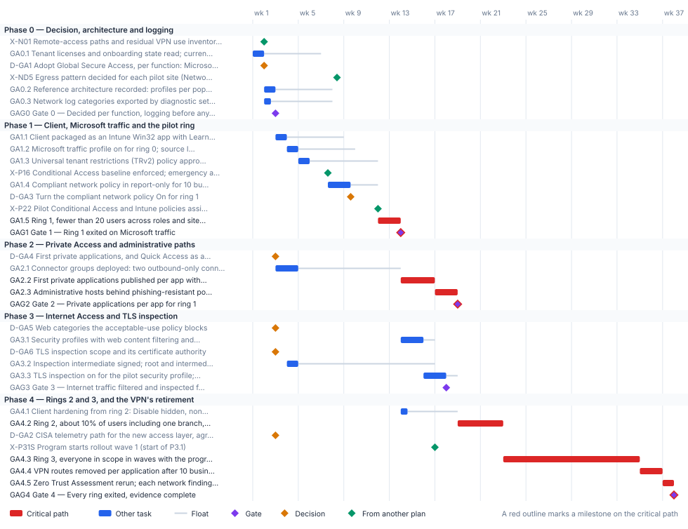

<!-- Generated by scripts/project_plans/build.py from data/project-plans/global-secure-access.yaml. Edit the YAML, not this page. -->

# Global Secure Access: Identity-Aware Network Access, Ring by Ring {.unnumbered}

::: {.callout-note}
## A sample plan, not a commitment
This is an illustrative plan built from the workbook's books, in the form a project manager would baseline: a work breakdown, a schedule network, a computed critical path, decision points, gates and risks. The durations are illustrative, sized to the books' roadmap weeks. Replace them with the agency's own estimates, then baseline the result. The plan names roles, not people, and no specific agency.
:::

## Plan at a glance

| | |
|---|---|
| **Plan type** | Project: The decision and licensing, the pilot ring, Private Access, Internet Access and TLS inspection, and rings 2 and 3 to the VPN's retirement |
| **Built from** | Global Secure Access guide; Book 09 |
| **Sponsor** | Executive sponsor and CIO; CISO |
| **Plan manager** | Technical program manager, with the service owner, the network security engineer and the identity engineer |
| **Duration** | 37 weeks (185 working days), computed from the network |
| **Work** | 19 tasks, 5 gates, 6 decision points, 5 milestones from other plans |
| **Critical path** | 10 of 35 items; 3 more within 5 days of it |
| **Calendar** | Week 1 = the program's Phase 0 approval; five working days a week |

: Plan at a glance {.striped}

This plan schedules the [Global Secure Access implementation guide](../books/guides/global-secure-access-implementation.md): Microsoft Entra Internet Access and Private Access as the agency's identity-aware network layer, from the decision per function to every user in scope and the VPN's retirement. [Book 09, Chapter 05](../books/b09-network/05-sd-wan-sase-and-governed-transport.md#microsofts-security-service-edge-global-secure-access) holds the argument and the gates; the guide's twelve steps hold the commands; the developer workbook [*Building Global Secure Access*](developer-workbooks/global-secure-access/index.md) holds the labs. The plan follows the guide's recommendation for order: the Microsoft traffic profile, the compliant network check and universal tenant restrictions first, because they come with Entra ID P1; then Private Access for the VPN's most-used applications; then Internet Access and TLS inspection, the step most likely to break applications and the one that needs the privacy officer. Its rings are the guide's [Step 11](../books/guides/global-secure-access-implementation.md#step-11-coexistence-and-migration) rings, and its last ring moves with the [program master schedule](program-master-schedule.md)'s waves.

It is a plan of its own rather than a phase of the [Network & Access plan](network-access.md), because the two move different things. That plan moves sites (circuits, edges, the path to a domain controller, NAC on each port) and is owned by network engineering; this one moves users and devices through Conditional Access and the client, and the guide's [RACI](../books/guides/global-secure-access-implementation.md#raci) gives it a service owner and identity engineers as well. They meet at three linked milestones rather than repeated work: this plan reads the remote-access inventory from the Network plan's N0.1, decides adoption per function before that plan picks each pilot site's egress pattern (D-N5, where agent-delivered SASE is pattern D), and takes its pilot cohort and its waves from the program.

## Schedule

{fig-alt="Gantt chart of the Global Secure Access plan over 37 weeks, grouped by phase. Critical-path tasks are red bars, other tasks are blue bars with a grey line showing their float, gates are violet diamonds, decisions are amber diamonds and milestones from other plans are green diamonds. The tables below give every date and float."}

## Critical path

The computed path runs through the pilot ring, not the decision. The decision, the architecture and the logging are done by week 2, but ring 1 waits for the program's pilot Conditional Access and Intune policies (P2.2, end of week 11), because the pilot ring is the program's pilot cohort on managed devices. From there it runs through ring 1's ten business days, Gate 1, the per-app publication of the first private applications and the administrative paths, Gate 2, ring 2's twenty business days, ring 3 in waves with the program's divisions, the VPN's retirement and the Zero Trust Assessment rerun. A week lost in the program's pilot moves this plan's finish week for week. Internet Access and TLS inspection run beside Private Access with a week of float, so they are near-critical; the TLS inspection scope (D-GA6) needs the privacy officer, so it is booked early. The adoption decision has to be made before the Network plan's egress decision (D-N5, week 8) and has several weeks of margin.

The critical path, in order. Each item has zero total float: a day lost on any of them is a day lost at the finish.

| # | ID | Item | Owner or approver | When |
|---|---|---|---|---|
| 1 | GA1.5 | Ring 1, fewer than 20 users across roles and sites: client, Microsoft traffic, TRv2 and compliant network for 10 business days; emergency access exclusion tested at ring start | Network security engineering | wk 12–13 |
| 2 | GAG1 | Gate 1 — Ring 1 exited on Microsoft traffic | Service owner | end of wk 13 |
| 3 | GA2.2 | First private applications published per app with their own segments, assignment and Conditional Access, for ring 1; application discovery run | Network security engineering | wk 14–16 |
| 4 | GA2.3 | Administrative hosts behind phishing-resistant policies; domain controller sensors moved from Audit to Enforce for application SPNs | Identity engineering | wk 17–18 |
| 5 | GAG2 | Gate 2 — Private applications per app for ring 1 | Service owner | end of wk 18 |
| 6 | GA4.2 | Ring 2, about 10% of users including one branch, for 20 business days, every function at once | Network security engineering | wk 19–22 |
| 7 | GA4.3 | Ring 3, everyone in scope in waves with the program's divisions; each wave on the ring 2 criteria | Network security engineering | wk 23–34 |
| 8 | GA4.4 | VPN routes removed per application after 10 business days with no VPN traffic; the VPN's web path retired; residual VPN use in the exception register | Network engineering | wk 35–36 |
| 9 | GA4.5 | Zero Trust Assessment rerun; each network finding's closure chain updated with evidence for every applicable state | ISSO | wk 37 |
| 10 | GAG4 | Gate 4 — Every ring exited, evidence complete | Service owner, with the ISSO | end of wk 37 |

: The critical path {.striped .hover}

**Near-critical.** These items have 5 working days of float or less. Track them weekly: once their float is spent, they join the critical path.

| ID | Item | Float | When |
|---|---|---|---|
| GA3.1 | Security profiles with web content filtering and threat intelligence, linked by Conditional Access for ring 1; the baseline profile last | 5 d | wk 14–15 |
| GA3.3 | TLS inspection on for the pilot security profile; pinned applications bypassed; failure rate measured | 5 d | wk 16–17 |
| GAG3 | Gate 3 — Internet traffic filtered and inspected for ring 1 | 5 d | end of wk 17 |

: Near-critical items {.striped .hover}

## Decision points

Each decision is a zero-duration milestone in the network. *Decide by* is its late finish: the last week it can be made without moving the plan's finish. A decision with zero float sits on the critical path, so the meeting that makes it should be booked before the plan is baselined. Decision rights follow [Book 01, Chapter 09](../books/b01-transformation-arc/09-who-leads-the-transformation.md#decision-rights-across-the-program).

| ID | Decision | Decides | Needed by | Decide by | Float | Options | If it's late |
|---|---|---|---|---|---|---|---|
| D-GA1 | Adopt Global Secure Access, per function: Microsoft traffic, internet, private, branch | Service owner, approved by the authorizing official | X-ND5, GA0.2 | end of wk 6 | 25 d | Adopt the function; keep the current VPN or SSE for it; run both with each traffic type sent to one service. Recorded with license count, availability quote, compensating controls and exit criteria | No license count can be ordered, and the Network plan's egress decision (D-N5) can't weigh agent-delivered SASE |
| D-GA3 | Turn the compliant network policy On for ring 1 | Service owner | GA1.5 | end of wk 11 | 12 d | On, ring by ring; stay in report-only until every reportOnlyFailure is explained | Ring 1 runs without the network condition, and its exit waits |
| D-GA4 | First private applications, and Quick Access as a bridge or per-app from the start | Service owner | GA2.1 | end of wk 11 | 45 d | Quick Access over the VPN's ranges as a transition, then per-app; per-app from the start for the VPN's most-used applications. DirectAccess can't coexist with Private Access on the same device | Connector groups can't be sized or placed, and Private Access waits |
| D-GA5 | Web categories the acceptable-use policy blocks | Service owner, with the ISSO | GA3.1 | end of wk 14 | 60 d | Block the categories the acceptable-use policy names; decide AI categories separately; every bypass to the exception register | Security profiles can't be built, and Internet Access waits |
| D-GA6 | TLS inspection scope and its certificate authority | Service owner, approved by the privacy officer | GA3.2 | end of wk 15 | 65 d | Microsoft-managed certificate; the agency's own intermediate signed by a dedicated CA, not the production PKI. Learn's recommended bypass categories kept, plus those the privacy officer names; no prompt or file content capture without a separate decision | Inspection can't start, URL and file rules stay unavailable, and Gate 3 waits |
| D-GA2 | CISA telemetry path for the new access layer, agreed with the TIC delegates | ISSO, with the agency's TIC delegates | GA4.4 | end of wk 34 | 160 d | CLAW; another path CISA confirms. Agreed before the VPN's web path is retired | The VPN's web path can't be retired, and Gate 4 waits |

: Decision points, by decide-by date {.striped .hover}

## Gates

A gate opens the work that names it as a predecessor, which is usually the next phase but not always. The approver signs it against the criteria, from evidence in the repository.

| Gate | When | Approver | Criteria |
|---|---|---|---|
| [Gate 0 — Decided per function, logging before any pilot traffic](../books/guides/global-secure-access-implementation.md#checklist) | end of wk 2 | Service owner | Decision record approved per function, with a license count no smaller than the pilot and first ring, an availability quote dated within 30 days and an approver; architecture record and the first configuration export with its hash manifest; the four network log categories reaching the workspace |
| [Gate 1 — Ring 1 exited on Microsoft traffic](../books/guides/global-secure-access-implementation.md#step-11-coexistence-and-migration) | end of wk 13 | Service owner | Every step's Validate passed for ring 0 and break-glass rehearsed; ring 1 for 10 business days with no unresolved Sev-2 ticket; client active on every pilot device; report-only results clean; compliant network On for ring 1 |
| [Gate 2 — Private applications per app for ring 1](../books/guides/global-secure-access-implementation.md#checklist) | end of wk 18 | Service owner | Each published application has its own segments, group assignment and Conditional Access; Quick Access residual at zero for the moved applications; administrative hosts reachable only under phishing-resistant policies; sensors enforcing |
| [Gate 3 — Internet traffic filtered and inspected for ring 1](../books/guides/global-secure-access-implementation.md#checklist) | end of wk 17 | CISO and ISSO | Security profiles with web filtering and threat intelligence; bypasses in the exception register; TLS inspection from a dedicated CA with the privacy officer's approval and user notice; TLS failure rate under 1% |
| [Gate 4 — Every ring exited, evidence complete](../books/guides/global-secure-access-implementation.md#checklist) | end of wk 37 | Service owner, with the ISSO | Each ring exited on its recorded criteria with measured values; VPN routes removed only after each wave held; CISA telemetry agreed; emergency access exclusion tested at each ring start; evidence package for each finding ready for the assessor (closure is the authorizing official's decision) |

: Gates {.striped .hover}

## Links to other plans

- **X-N01, Remote-access paths and residual VPN use inventoried (Network & Access N0.1),** is N0.1 in the [Network & Access Modernization](network-access.md) plan (Naming-plane owner confirmed; pilot population defined; remote-access paths and residual VPN use inventoried), end of wk 1. This plan waits for it; it can slip 25 d before it moves this plan. The adoption decision has no inventory of the VPN's applications and users to weigh.
- **X-ND5, Egress pattern decided for each pilot site (Network & Access D-N5),** is D-N5 in the [Network & Access Modernization](network-access.md) plan (Egress pattern for each pilot site), end of wk 8. This plan must finish D-GA1 by then: a margin of 32 d. The pilot sites' egress is chosen without knowing whether pattern D, agent-delivered SASE, is available.
- **X-P16, Conditional Access baseline enforced; emergency access accounts vaulted and tested (program P1.6),** is P1.6 in the [Program master schedule](program-master-schedule.md) plan (Baseline enforced; emergency access accounts vaulted and tested), end of wk 7. This plan waits for it; it can slip 12 d before it moves this plan. The compliant network policy has no tested emergency access exclusion, and its report-only run waits.
- **X-P22, Pilot Conditional Access and Intune policies assigned (program P2.2),** is P2.2 in the [Program master schedule](program-master-schedule.md) plan (Pilot Conditional Access and Intune policies assigned (M-024, M-025)), end of wk 11. This plan waits for it; it can slip 0 before it moves this plan. The pilot cohort's devices can't take the client through Intune, and ring 1 waits.
- **X-P31S, Program starts rollout wave 1 (start of P3.1),** is the start of P3.1 in the [Program master schedule](program-master-schedule.md) plan (Wave 1, first region, about 25% (M-032)), end of wk 16. This plan waits for it; it can slip 30 d before it moves this plan. Ring 3 has no divisions to follow.

## Work breakdown and schedule

Every row, by phase. *Float* is total float in working days; **bold** rows are on the critical path. Each row links to the chapter it comes from.

### Phase 0 — Decision, architecture and logging

| ID | Item | Type | Owner or approver | Days | Predecessors | When | Float |
|---|---|---|---|---|---|---|---|
| X-N01 | [Remote-access paths and residual VPN use inventoried (Network & Access N0.1)](network-access.md) | External | Executive sponsor and CIO (Network & Access Modernization plan) | — | — | end of wk 1 | 25 d |
| GA0.1 | [Tenant licenses and onboarding state read; current VPN and SSE functions mapped to the four traffic types](../books/guides/global-secure-access-implementation.md#step-1-decision-and-licensing) | Task | Network security engineering | 5 | — | wk 1 | 25 d |
| D-GA1 | [Adopt Global Secure Access, per function: Microsoft traffic, internet, private, branch](../books/guides/global-secure-access-implementation.md#step-1-decision-and-licensing) | Decision | Service owner, approved by the authorizing official | — | GA0.1, X-N01 | end of wk 1 | 25 d |
| X-ND5 | [Egress pattern decided for each pilot site (Network & Access D-N5)](network-access.md) | External | Network engineering (Network & Access Modernization plan) | — | D-GA1 | end of wk 8 | fixed date |
| GA0.2 | [Reference architecture recorded: profiles per population, connector groups, branch pattern; first configuration export with its hash manifest](../books/guides/global-secure-access-implementation.md#step-2-reference-architecture) | Task | Network security engineering | 5 | D-GA1 | wk 2 | 25 d |
| GA0.3 | [Network log categories exported by diagnostic setting; Sentinel solution installed; traffic-drop alert on; freshness query clean](../books/guides/global-secure-access-implementation.md#step-12-telemetry-and-evidence) | Task | Security operations | 3 | GA0.1 | wk 2 | 27 d |
| GAG0 | [Gate 0 — Decided per function, logging before any pilot traffic](../books/guides/global-secure-access-implementation.md#checklist) | Gate | Service owner | — | GA0.2, GA0.3 | end of wk 2 | 25 d |

: Phase 0 — Decision, architecture and logging {.striped .hover}

### Phase 1 — Client, Microsoft traffic and the pilot ring

| ID | Item | Type | Owner or approver | Days | Predecessors | When | Float |
|---|---|---|---|---|---|---|---|
| GA1.1 | [Client packaged as an Intune Win32 app with Learn's commands and detection rule; DoH off; ring 0, the implementing team](../books/guides/global-secure-access-implementation.md#step-3-client-deployment) | Task | Platform operations | 5 | GAG0 | wk 3 | 25 d |
| GA1.2 | [Microsoft traffic profile on for ring 0; source IP restoration and Conditional Access signaling on; sign-in share measured](../books/guides/global-secure-access-implementation.md#step-4-microsoft-traffic) | Task | Network security engineering | 5 | GA1.1 | wk 4 | 25 d |
| GA1.3 | [Universal tenant restrictions (TRv2) policy approved, tagging on, four-case test recorded](../books/guides/global-secure-access-implementation.md#step-8-tenant-restrictions) | Task | Identity engineering | 5 | GA1.2 | wk 5 | 30 d |
| X-P16 | [Conditional Access baseline enforced; emergency access accounts vaulted and tested (program P1.6)](program-master-schedule.md) | External | Platform teams (program) | — | — | end of wk 7 | 12 d |
| GA1.4 | [Compliant network policy in report-only for 10 business days; break-glass scripts staged](../books/guides/global-secure-access-implementation.md#step-7-compliant-network) | Task | Identity engineering | 10 | GA1.2, X-P16 | wk 7–9 | 12 d |
| D-GA3 | [Turn the compliant network policy On for ring 1](../books/guides/global-secure-access-implementation.md#step-7-compliant-network) | Decision | Service owner | — | GA1.4 | end of wk 9 | 12 d |
| X-P22 | [Pilot Conditional Access and Intune policies assigned (program P2.2)](program-master-schedule.md) | External | Platform teams (program) | — | — | end of wk 11 | 0 |
| GA1.5 | **[Ring 1, fewer than 20 users across roles and sites: client, Microsoft traffic, TRv2 and compliant network for 10 business days; emergency access exclusion tested at ring start](../books/guides/global-secure-access-implementation.md#step-11-coexistence-and-migration)** | Task | Network security engineering | 10 | GA1.3, D-GA3, X-P22 | wk 12–13 | 0 |
| GAG1 | **[Gate 1 — Ring 1 exited on Microsoft traffic](../books/guides/global-secure-access-implementation.md#step-11-coexistence-and-migration)** | Gate | Service owner | — | GA1.5 | end of wk 13 | 0 |

: Phase 1 — Client, Microsoft traffic and the pilot ring {.striped .hover}

### Phase 2 — Private Access and administrative paths

| ID | Item | Type | Owner or approver | Days | Predecessors | When | Float |
|---|---|---|---|---|---|---|---|
| D-GA4 | [First private applications, and Quick Access as a bridge or per-app from the start](../books/b09-network/05-sd-wan-sase-and-governed-transport.md#private-access-as-the-vpn-and-directaccess-replacement) | Decision | Service owner | — | GAG0 | end of wk 2 | 45 d |
| GA2.1 | [Connector groups deployed: two outbound-only connectors per group on Windows Server 2019 or later, TLS 1.2, no inline inspection; private DNS](../books/guides/global-secure-access-implementation.md#step-6-private-applications) | Task | Platform operations | 10 | D-GA4 | wk 3–4 | 45 d |
| GA2.2 | **[First private applications published per app with their own segments, assignment and Conditional Access, for ring 1; application discovery run](../books/guides/global-secure-access-implementation.md#step-6-private-applications)** | Task | Network security engineering | 15 | GA2.1, GAG1 | wk 14–16 | 0 |
| GA2.3 | **[Administrative hosts behind phishing-resistant policies; domain controller sensors moved from Audit to Enforce for application SPNs](../books/guides/global-secure-access-implementation.md#step-10-privileged-protocols)** | Task | Identity engineering | 10 | GA2.2 | wk 17–18 | 0 |
| GAG2 | **[Gate 2 — Private applications per app for ring 1](../books/guides/global-secure-access-implementation.md#checklist)** | Gate | Service owner | — | GA2.3 | end of wk 18 | 0 |

: Phase 2 — Private Access and administrative paths {.striped .hover}

### Phase 3 — Internet Access and TLS inspection

| ID | Item | Type | Owner or approver | Days | Predecessors | When | Float |
|---|---|---|---|---|---|---|---|
| D-GA5 | [Web categories the acceptable-use policy blocks](../books/guides/global-secure-access-implementation.md#step-5-internet-traffic) | Decision | Service owner, with the ISSO | — | GAG0 | end of wk 2 | 60 d |
| GA3.1 | [Security profiles with web content filtering and threat intelligence, linked by Conditional Access for ring 1; the baseline profile last](../books/guides/global-secure-access-implementation.md#step-5-internet-traffic) | Task | Network security engineering | 10 | D-GA5, GAG1 | wk 14–15 | 5 d |
| D-GA6 | [TLS inspection scope and its certificate authority](../books/guides/global-secure-access-implementation.md#step-9-tls-inspection) | Decision | Service owner, approved by the privacy officer | — | GAG0 | end of wk 2 | 65 d |
| GA3.2 | [Inspection intermediate signed; root and intermediate trusted on pilot devices by Intune profile; user notice sent](../books/guides/global-secure-access-implementation.md#step-9-tls-inspection) | Task | PKI and CA administrators | 5 | D-GA6, GA1.1 | wk 4 | 60 d |
| GA3.3 | [TLS inspection on for the pilot security profile; pinned applications bypassed; failure rate measured](../books/guides/global-secure-access-implementation.md#step-9-tls-inspection) | Task | Network security engineering | 10 | GA3.1, GA3.2 | wk 16–17 | 5 d |
| GAG3 | [Gate 3 — Internet traffic filtered and inspected for ring 1](../books/guides/global-secure-access-implementation.md#checklist) | Gate | CISO and ISSO | — | GA3.3 | end of wk 17 | 5 d |

: Phase 3 — Internet Access and TLS inspection {.striped .hover}

### Phase 4 — Rings 2 and 3, and the VPN's retirement

| ID | Item | Type | Owner or approver | Days | Predecessors | When | Float |
|---|---|---|---|---|---|---|---|
| GA4.1 | [Client hardening from ring 2: Disable hidden, non-privileged users restricted, help desk elevation path](../books/guides/global-secure-access-implementation.md#step-3-client-deployment) | Task | Platform operations | 3 | GAG1 | wk 14 | 22 d |
| GA4.2 | **[Ring 2, about 10% of users including one branch, for 20 business days, every function at once](../books/guides/global-secure-access-implementation.md#step-11-coexistence-and-migration)** | Task | Network security engineering | 20 | GAG2, GAG3, GA4.1 | wk 19–22 | 0 |
| D-GA2 | [CISA telemetry path for the new access layer, agreed with the TIC delegates](../books/guides/global-secure-access-implementation.md#tic-alignment) | Decision | ISSO, with the agency's TIC delegates | — | GAG0 | end of wk 2 | 160 d |
| X-P31S | [Program starts rollout wave 1 (start of P3.1)](program-master-schedule.md) | External | Platform teams (program) | — | — | end of wk 16 | 30 d |
| GA4.3 | **[Ring 3, everyone in scope in waves with the program's divisions; each wave on the ring 2 criteria](../books/guides/global-secure-access-implementation.md#step-11-coexistence-and-migration)** | Task | Network security engineering | 60 | GA4.2, X-P31S | wk 23–34 | 0 |
| GA4.4 | **[VPN routes removed per application after 10 business days with no VPN traffic; the VPN's web path retired; residual VPN use in the exception register](../books/guides/global-secure-access-implementation.md#step-11-coexistence-and-migration)** | Task | Network engineering | 10 | GA4.3, D-GA2 | wk 35–36 | 0 |
| GA4.5 | **[Zero Trust Assessment rerun; each network finding's closure chain updated with evidence for every applicable state](../books/guides/global-secure-access-implementation.md#control-states)** | Task | ISSO | 5 | GA4.4 | wk 37 | 0 |
| GAG4 | **[Gate 4 — Every ring exited, evidence complete](../books/guides/global-secure-access-implementation.md#checklist)** | Gate | Service owner, with the ISSO | — | GA4.5 | end of wk 37 | 0 |

: Phase 4 — Rings 2 and 3, and the VPN's retirement {.striped .hover}

## Responsibility

Who owns what in this plan. Each row has one owner; consulted and informed parties follow the [decision matrix](../books/b01-transformation-arc/09-who-leads-the-transformation.md#decision-rights-across-the-program).

| Owner or approver | Tasks | Decisions | Gates |
|---|---|---|---|
| Network security engineering | 9 | — | — |
| Service owner | — | 2 | 3 |
| Identity engineering | 3 | — | — |
| Platform operations | 3 | — | — |
| Platform teams (program) | 3 | — | — |
| Service owner, with the ISSO | — | 1 | 1 |
| CISO and ISSO | — | — | 1 |
| Executive sponsor and CIO (Network & Access Modernization plan) | 1 | — | — |
| ISSO | 1 | — | — |
| ISSO, with the agency's TIC delegates | — | 1 | — |
| Network engineering | 1 | — | — |
| Network engineering (Network & Access Modernization plan) | 1 | — | — |
| PKI and CA administrators | 1 | — | — |
| Security operations | 1 | — | — |
| Service owner, approved by the authorizing official | — | 1 | — |
| Service owner, approved by the privacy officer | — | 1 | — |

: Ownership {.striped .hover}

## Assumptions

- The tenant is GCC-Moderate. Learn states that Global Secure Access is available in GCC for the whole product and narrows it for no feature, so every generally available feature here is treated as available in GCC; preview features (cloud firewall for clients, the Purview DLP integration, Intelligent Local Access) aren't scheduled ([guide](../books/guides/global-secure-access-implementation.md#availability)).
- Internet Access and Private Access are licensed per user, standalone or in Microsoft Entra Suite, on top of Entra ID P1 or P2; the Microsoft traffic profile, compliant network and universal tenant restrictions need only P1 ([Book 09, Chapter 05](../books/b09-network/05-sd-wan-sase-and-governed-transport.md#the-gates-come-first)).
- Ring 1 is drawn from the program's pilot cohort, whose devices are Intune-managed once the program's P2.2 is done. If the agency pilots on devices it already manages, ring 1 can start about two weeks sooner, when the compliant network decision (D-GA3) is made.
- Ring 3 runs in four waves with the program's divisions (D07), about three weeks each. The agency's own wave count sets this length.
- Remote networks (branch IPsec tunnels) aren't scheduled: the guide keeps the client on managed devices at branches for TIC parity and uses a remote network only for devices without one. Branch transport is the Network & Access plan's.
- Durations are illustrative. Ring 1's ten business days and ring 2's twenty are the guide's exit criteria; the rest are sized to the guide's steps.

## Schedule risks

| Risk | Effect on the schedule | Response |
|---|---|---|
| TLS inspection breaks pinned or mission applications | Gate 3 can't sign; ring 2 waits for it | Inspect only the pilot's security profile first, keep Learn's recommended bypass categories, and add custom bypass rules for pinned destinations (guide, Step 9) |
| The privacy officer's approval of the inspection scope takes longer than the plan allows | TLS inspection slips, and with it Gate 3 and ring 2 | Book D-GA6 at Gate 0; ring 2 can carry Internet Access without inspection if the authorizing official accepts it as an interim state |
| CISA telemetry for the new path isn't agreed with the TIC delegates | The VPN's web path can't be retired; Gate 4 waits | Raise D-GA2 at Gate 0 and agree the path (CLAW or another CISA confirms) before ring 3 starts (guide, Step 12) |
| Users disable the client to reach a site or a parallel VPN | Compliant network sign-ins fail and help desk volume breaches the ring's threshold | Hide Disable and restrict non-privileged users from ring 2, with a help desk elevation path (guide, Step 3) |
| An expired inspection certificate turns off TLS inspection across the tenant | Inspection stops for every ring at once | Track the intermediate's expiry in the certificate lifecycle platform and roll it with Learn's procedure: trust first, then activation |

: Schedule risks {.striped .hover}

## Baseline and change control

- **Baseline** the plan when its first gate is approved: the YAML file, as merged, is the baseline.
- **Report** weekly, green, yellow or red, against the baseline ([Book 01, Chapter 12](../books/b01-transformation-arc/12-migration-roadmap.md#phase-3-general-rollout-weeks-1736)). Report float, not percent complete: a task's float says how much slip the plan can still absorb.
- **Change** the plan only through a reviewed pull request that edits the YAML and regenerates this page, so every change to a date or a dependency has an author, a reviewer and a reason.
- **Re-baseline** at each gate, after the approver signs it, and whenever a critical-path decision is made late.

## Download and adapt

| File | Use it for |
|---|---|
| [global-secure-access.xml](files/global-secure-access.xml) | Microsoft Project desktop (open the XML file; it keeps the dependencies, milestones and owners). The dates start on a placeholder Monday: change the project start date. |
| [global-secure-access.csv](files/global-secure-access.csv) | Excel or any other scheduling tool: every row with its dependencies, early and late dates and float |
| [global-secure-access-azure-boards.csv](files/global-secure-access-azure-boards.csv) | Azure DevOps Boards: an Epic per phase and a Feature per task, gate and decision, with dates and tags (see below) |
| [global-secure-access-dependencies.csv](files/global-secure-access-dependencies.csv) · [add-azure-boards-links.ps1](files/add-azure-boards-links.ps1) | The plan's predecessor links, and a script that adds them in Azure Boards after the import |
| [global-secure-access-jira.csv](files/global-secure-access-jira.csv) | Jira: an Epic per phase and a Task per task, gate and decision, with dates, labels and Blocks links (see below) |
| [global-secure-access.yaml](https://github.com/WhalerMike/modernization-workbook/blob/main/data/project-plans/global-secure-access.yaml) | The source. Edit the durations, owners and dependencies, then run `python scripts/project_plans/build.py` to recompute the critical path and regenerate this page, the chart and the downloads. |

: Downloads {.striped}

::: {.callout-tip}
## Importing this plan into Azure DevOps Boards
1. In the project, select **Boards** > **Queries** > **Import work items**, choose [global-secure-access-azure-boards.csv](files/global-secure-access-azure-boards.csv), check the results and select **Save items**. It creates one Epic per phase with a Feature under it for each task, gate and decision, with start and target dates, which is what Delivery Plans show. Epic and Feature exist in the Agile, Scrum and CMMI processes; in the Basic process, change *Feature* to *Issue* in the file first.
2. The import can't create dependency links or assign people. To add the predecessor links, sign in with `az login`, add the CLI extension with `az extension add --name azure-devops`, and run `./add-azure-boards-links.ps1 -Organization https://dev.azure.com/<org> -Project <project> -Plan global-secure-access` beside [global-secure-access-dependencies.csv](files/global-secure-access-dependencies.csv). It finds the imported items by their `fmw-id-` tags and links each one to its predecessors.
3. Assign people in Boards: each item carries its owner role as an *Owner - …* tag, and critical-path items carry *Critical path*. Azure Boards links don't hold lag or start-to-start timing; each item's description keeps them.

The dates count from the plan's placeholder start; shift them when you set the real start. The script hasn't been run against a live organization yet: test it on a scratch project first.
:::

::: {.callout-tip}
## Importing this plan into Jira
1. Run the CSV importer (in Jira Cloud, **Settings** > **System** > **External system import** > **CSV**) with [global-secure-access-jira.csv](files/global-secure-access-jira.csv). On the second step, set **Date format in import file** to `yyyy-MM-dd`.
2. Map the columns: *Work item ID* to Work item ID, *Work type* to Work type, *Parent* to Parent, *Summary*, *Description* and every *Labels* column to their fields, *Start date* to the Start date field, *Due date* to Due date, and every *Blocks* column to the **Blocks** link type. Each phase becomes an Epic with a Task under it for each task, gate and decision; each Blocks column makes that row's item block the item it names, which carries the plan's dependencies.
3. Assign people in Jira: each item carries its owner role as an `owner-…` label, and critical-path items carry `critical-path`. Jira links don't hold lag or start-to-start timing; each description keeps them.

Test the import on a scratch project with a few rows first: the importer doesn't remove duplicate links and Jira has no bulk delete for them. If the Blocks links don't come through on your site, import the items first and add the links from the plan's dependency list in a second pass, as Atlassian recommends. The dates count from the plan's placeholder start.
:::

::: {.callout-tip}
## Opening this plan in Project or Planner
- **Microsoft Project desktop** opens the XML file directly, with every dependency, milestone and owner.
- **Microsoft Planner** has no file import of its own: it doesn't read XML, CSV or Excel. To bring this plan into a Planner premium plan, open the XML file in Project desktop, save it as an `.mpp` file, and import that through the Project Power App. Tasks, durations, dependencies and milestones come across; resources and baselines don't, so assign owners again in Planner.
- **Without Project desktop**, the CSV can feed a Power Automate flow that creates the tasks one by one, but dependencies in a premium plan need Microsoft's Project schedule APIs, so that's a build, not an import.
- **In a government cloud tenant**, check that premium plans are available before relying on Planner for this schedule: Microsoft notes that converting a basic plan to a premium plan isn't available in GCC.

Project for the web was retired on August 1, 2025, and Project Online on September 30, 2026; Planner is their successor. Project desktop is unaffected.
:::

