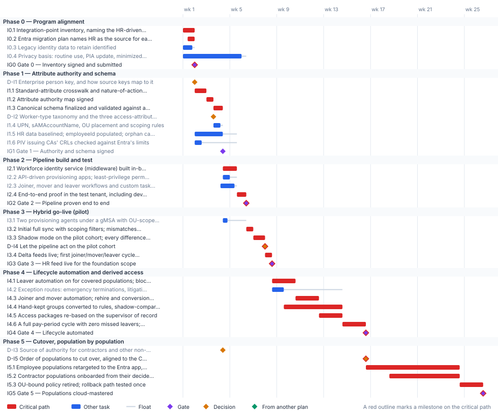

<!-- Generated by scripts/project_plans/build.py from data/project-plans/identity-lifecycle.yaml. Edit the YAML, not this page. -->

# Identity Lifecycle & Provisioning: HR-Driven Identity {.unnumbered}

::: {.callout-note}
## A sample plan, not a commitment
This is an illustrative plan built from the workbook's books, in the form a project manager would baseline: a work breakdown, a schedule network, a computed critical path, decision points, gates and risks. The durations are illustrative, sized to the books' roadmap weeks. Replace them with the agency's own estimates, then baseline the result. The plan names roles, not people, and no specific agency.
:::

## Plan at a glance

| | |
|---|---|
| **Plan type** | Project: Book 03 Phases 0 to 5 (Phase 6 is sustained posture) |
| **Built from** | Book 03 |
| **Sponsor** | Executive sponsor and CIO; HR leadership |
| **Plan manager** | Identity engineering lead, with the agency HR 2.0 integrated project team point of contact |
| **Duration** | 26 weeks (128 working days), computed from the network |
| **Work** | 27 tasks, 6 gates, 5 decision points |
| **Critical path** | 25 of 38 items; 7 more within 5 days of it |
| **Calendar** | Week 1 = the program's Phase 0 approval; five working days a week |

: Plan at a glance {.striped}

This plan builds [Book 03](../books/b03-hr-identity/index.md)'s pipeline: HR as the source of authority, a middleware in the agency's boundary, provisioning into Active Directory or Entra ID, and Lifecycle Workflows acting on the accounts. It follows Book 03's [phase model](../books/b03-hr-identity/12-execution-plan.md) gate for gate, and it feeds the [program master schedule](program-master-schedule.md): the program's Gate G1 needs this plan's Gate 3, the HR feed live for the foundation scope. The [implementation guide for Oracle Fusion Cloud HCM](../research/hcm-entra-implementation.md) shows the same pipeline on named products.

## Schedule

{fig-alt="Gantt chart of the Identity Lifecycle &amp; Provisioning plan over 26 weeks, grouped by phase. Critical-path tasks are red bars, other tasks are blue bars with a grey line showing their float, gates are violet diamonds, decisions are amber diamonds and milestones from other plans are green diamonds. The tables below give every date and float."}

## Critical path

The computed path runs through the integration-point inventory, the crosswalk, the authority map and schema, the middleware build, the end-to-end test and the shadow-mode observation. It is the most compressed track in the program: it has only a few days of float against the program's G1, so a week lost here is a week lost at G1. The privacy basis is the task to watch. It must be in place before production HR data flows at go-live, and many privacy offices need longer than this sample allows, so it starts on day one, not in Phase 1. If the agency's PIA update takes longer, re-baseline here first.

The critical path, in order. Each item has zero total float: a day lost on any of them is a day lost at the finish.

| # | ID | Item | Owner or approver | When |
|---|---|---|---|---|
| 1 | I0.1 | Integration-point inventory, naming the HR-driven identity feed | HR 2.0 project team point of contact | wk 1 |
| 2 | I0.2 | Entra migration plan names HR as the source for each population | Program office | wk 1 |
| 3 | IG0 | Gate 0 — Inventory signed and submitted | ISSO | end of wk 1 |
| 4 | I1.1 | Standard-attribute crosswalk and nature-of-action trigger table | Identity engineering | wk 2 |
| 5 | I1.2 | Attribute authority map signed | HR | wk 3 |
| 6 | I1.3 | Canonical schema finalized and validated against a sandbox extract | Identity engineering | wk 3–4 |
| 7 | I2.1 | Workforce identity service (middleware) built in-boundary | Identity engineering | wk 4–5 |
| 8 | I2.4 | End-to-end proof in the test tenant, including device retire and test-CA revocation | Identity engineering | wk 5–6 |
| 9 | IG2 | Gate 2 — Pipeline proven end to end | ISSO | end of wk 6 |
| 10 | I3.2 | Initial full sync with scoping filters; mismatches reconciled | Identity engineering | wk 6 |
| 11 | I3.3 | Shadow mode on the pilot cohort; every difference explained | Identity engineering | wk 7 |
| 12 | D-I4 | Let the pipeline act on the pilot cohort | ISSO | end of wk 7 |
| 13 | I3.4 | Delta feeds live; first joiner/mover/leaver cycle closes with evidence | Identity engineering | wk 8 |
| 14 | IG3 | Gate 3 — HR feed live for the foundation scope | ISSO | end of wk 8 |
| 15 | I4.1 | Leaver automation on for covered populations; block and revocation intervals measured | Identity engineering | wk 8–10 |
| 16 | I4.4 | Hand-kept groups converted to rules, shadow-compared one by one | Platform teams | wk 9–14 |
| 17 | I4.3 | Joiner and mover automation; rehire and conversion matching validated | Identity engineering | wk 10–12 |
| 18 | I4.5 | Access packages re-based on the supervisor of record | Identity engineering | wk 12–14 |
| 19 | I4.6 | A full pay-period cycle with zero missed leavers; test reorganization | ISSO | wk 14–16 |
| 20 | IG4 | Gate 4 — Lifecycle automated | ISSO | end of wk 16 |
| 21 | D-I5 | Order of populations to cut over, aligned to the Core HCM onboarding | Executive sponsor and CIO | end of wk 16 |
| 22 | I5.1 | Employee populations retargeted to the Entra app, one by one, evidence-gated | Identity engineering | wk 16–24 |
| 23 | I5.2 | Contractor populations onboarded from their decided source and retargeted | Identity engineering | wk 18–24 |
| 24 | I5.3 | OU-bound policy retired; rollback path tested once | Platform teams | wk 24–26 |
| 25 | IG5 | Gate 5 — Populations cloud-mastered | ISSO | end of wk 26 |

: The critical path {.striped .hover}

**Near-critical.** These items have 5 working days of float or less. Track them weekly: once their float is spent, they join the critical path.

| ID | Item | Float | When |
|---|---|---|---|
| I0.3 | Legacy identity data to retain identified | 1 d | wk 1 |
| D-I2 | Worker-type taxonomy and the three access-attribute code lists | 1 d | end of wk 3 |
| I1.4 | UPN, sAMAccountName, OU placement and scoping rules | 1 d | wk 3–4 |
| I2.3 | Joiner, mover and leaver workflows and custom task extensions | 1 d | wk 4–5 |
| I0.4 | Privacy basis: routine use, PIA update, minimized attribute set | 2 d | wk 1–5 |
| I2.2 | API-driven provisioning apps; least-privilege permissions; throttling sized | 3 d | wk 4 |
| D-I1 | Enterprise person key, and how source keys map to it | 5 d | end of wk 1 |

: Near-critical items {.striped .hover}

## Decision points

Each decision is a zero-duration milestone in the network. *Decide by* is its late finish: the last week it can be made without moving the plan's finish. A decision with zero float sits on the critical path, so the meeting that makes it should be booked before the plan is baselined. Decision rights follow [Book 01, Chapter 09](../books/b01-transformation-arc/09-who-leads-the-transformation.md#decision-rights-across-the-program).

| ID | Decision | Decides | Needed by | Decide by | Float | Options | If it's late |
|---|---|---|---|---|---|---|---|
| D-I1 | Enterprise person key, and how source keys map to it | HR, with identity engineering | I1.2 | end of wk 2 | 5 d | The HCM person number; another HR key; a minted enterprise key | The authority map can't be signed; the critical path waits |
| D-I2 | Worker-type taxonomy and the three access-attribute code lists | HR | I1.4 | end of wk 3 | 1 d | Employee, contractor, intern, volunteer, vendor, external, each with a license, access ceiling and retention | Naming, placement and scoping rules wait |
| D-I4 | Let the pipeline act on the pilot cohort | ISSO | I3.4 | end of wk 7 | **0 (critical)** | Act; extend shadow mode | The go-live waits, and with it the program's G1 |
| D-I5 | Order of populations to cut over, aligned to the Core HCM onboarding | Executive sponsor and CIO | I5.1 | end of wk 16 | **0 (critical)** | Follow the program's waves; follow the agency's Core HCM go-live | Retargeting can't be scheduled |
| D-I3 | Source of authority for contractors and other non-employees | HR | I5.2 | end of wk 18 | 71 d | Core HCM contingent workers; the PIV sponsorship system; the contractor suitability register; a combination with one authority per fact | Contractors stay on COR spreadsheets; their cutover can't be planned |

: Decision points, by decide-by date {.striped .hover}

## Gates

Each gate is the next phase's entry condition. The approver signs it against the criteria, from evidence in the repository.

| Gate | When | Approver | Criteria |
|---|---|---|---|
| [Gate 0 — Inventory signed and submitted](../books/b03-hr-identity/12-execution-plan.md#phase-0-program-alignment) | end of wk 1 | ISSO | The integration-point inventory is signed by the ISSO and submitted to the agency's HR 2.0 team |
| [Gate 1 — Authority and schema signed](../books/b03-hr-identity/12-execution-plan.md#phase-1-attribute-authority-and-schema) | end of wk 4 | ISSO | Identifier decision, authority map and schema signed; correlation meets the approved threshold on the pilot cohort; every enabled account correlated or on a dated exception list |
| [Gate 2 — Pipeline proven end to end](../books/b03-hr-identity/12-execution-plan.md#phase-2-pipeline-build-and-test) | end of wk 6 | ISSO | Joiner, mover and leaver each run end to end in the test tenant with a provenance record and a workflow run |
| [Gate 3 — HR feed live for the foundation scope](../books/b03-hr-identity/12-execution-plan.md#phase-3-hybrid-go-live-pilot) | end of wk 8 | ISSO | The observation period's differences explained and fixed; a full joiner/mover/leaver cycle on the pilot cohort closed with evidence; zero unmatched-record creations |
| [Gate 4 — Lifecycle automated](../books/b03-hr-identity/12-execution-plan.md#phase-4-lifecycle-automation-and-attribute-derived-access) | end of wk 16 | ISSO | Zero missed leavers across a pay period; block within threshold; account-creation tickets retired for covered populations; a test reorganization propagates with zero manual changes |
| [Gate 5 — Populations cloud-mastered](../books/b03-hr-identity/12-execution-plan.md#phase-5-cutover-population-by-population) | end of wk 26 | ISSO | Cloud-mastered populations run the full lifecycle cloud-native with evidence; no AD writes for migrated populations; rollback tested once |

: Gates {.striped .hover}

## Links to other plans

Other plans that take a date from this one. *Waits for it*: that plan can't move until this item finishes, and its float says how far this item can slip before it moves that plan. *Must finish by it*: that plan's work has to be done before this item, and the margin says by how much.

| This plan's item | When | Linked plan | Relationship | Float or margin |
|---|---|---|---|---|
| IG3  Gate 3 — HR feed live for the foundation scope | end of wk 8 | [Program master schedule](program-master-schedule.md) (X-IDL) | Waits for it | 2 d |

: Plans that take a date from this one {.striped .hover}

## Work breakdown and schedule

Every row, by phase. *Float* is total float in working days; **bold** rows are on the critical path. Each row links to the chapter it comes from.

### Phase 0 — Program alignment

| ID | Item | Type | Owner or approver | Days | Predecessors | When | Float |
|---|---|---|---|---|---|---|---|
| I0.1 | **[Integration-point inventory, naming the HR-driven identity feed](../books/b03-hr-identity/12-execution-plan.md#phase-0-program-alignment)** | Task | HR 2.0 project team point of contact | 5 | — | wk 1 | 0 |
| I0.2 | **[Entra migration plan names HR as the source for each population](../books/b03-hr-identity/12-execution-plan.md#phase-0-program-alignment)** | Task | Program office | 3 | I0.1 (SS) +2 d | wk 1 | 0 |
| I0.3 | [Legacy identity data to retain identified](../books/b03-hr-identity/12-execution-plan.md#phase-0-program-alignment) | Task | Records officer | 4 | — | wk 1 | 1 d |
| I0.4 | [Privacy basis: routine use, PIA update, minimized attribute set](../books/b03-hr-identity/appendix-b-security-and-privacy.md) | Task | Privacy officer | 25 | — | wk 1–5 | 2 d |
| IG0 | **[Gate 0 — Inventory signed and submitted](../books/b03-hr-identity/12-execution-plan.md#phase-0-program-alignment)** | Gate | ISSO | — | I0.1, I0.2, I0.3 | end of wk 1 | 0 |

: Phase 0 — Program alignment {.striped .hover}

### Phase 1 — Attribute authority and schema

| ID | Item | Type | Owner or approver | Days | Predecessors | When | Float |
|---|---|---|---|---|---|---|---|
| D-I1 | [Enterprise person key, and how source keys map to it](../books/b03-hr-identity/04-attribute-authority.md) | Decision | HR, with identity engineering | — | IG0 | end of wk 1 | 5 d |
| I1.1 | **[Standard-attribute crosswalk and nature-of-action trigger table](../books/b03-hr-identity/06-canonical-attribute-schema.md)** | Task | Identity engineering | 5 | IG0 | wk 2 | 0 |
| I1.2 | **[Attribute authority map signed](../books/b03-hr-identity/04-attribute-authority.md)** | Task | HR | 3 | I1.1, D-I1 | wk 3 | 0 |
| I1.3 | **[Canonical schema finalized and validated against a sandbox extract](../books/b03-hr-identity/06-canonical-attribute-schema.md)** | Task | Identity engineering | 4 | I1.2 | wk 3–4 | 0 |
| D-I2 | [Worker-type taxonomy and the three access-attribute code lists](../books/b03-hr-identity/12-execution-plan.md#phase-1-attribute-authority-and-schema) | Decision | HR | — | I1.2 | end of wk 3 | 1 d |
| I1.4 | [UPN, sAMAccountName, OU placement and scoping rules](../books/b03-hr-identity/12-execution-plan.md#phase-1-attribute-authority-and-schema) | Task | Identity engineering | 3 | D-I2 | wk 3–4 | 1 d |
| I1.5 | [HR data baselined; employeeId populated; orphan candidates owned](../books/b03-hr-identity/12-execution-plan.md#phase-1-attribute-authority-and-schema) | Task | HR | 12 | IG0 | wk 2–4 | 6 d |
| I1.6 | [PIV issuing CAs' CRLs checked against Entra's limits](../books/b03-hr-identity/09-credentials-and-certificates.md) | Task | PIV credentialing office | 3 | IG0 | wk 2 | 15 d |
| IG1 | [Gate 1 — Authority and schema signed](../books/b03-hr-identity/12-execution-plan.md#phase-1-attribute-authority-and-schema) | Gate | ISSO | — | I1.3, I1.4, I1.5, I1.6 | end of wk 4 | 6 d |

: Phase 1 — Attribute authority and schema {.striped .hover}

### Phase 2 — Pipeline build and test

| ID | Item | Type | Owner or approver | Days | Predecessors | When | Float |
|---|---|---|---|---|---|---|---|
| I2.1 | **[Workforce identity service (middleware) built in-boundary](../books/b03-hr-identity/05-the-provisioning-pipeline.md)** | Task | Identity engineering | 6 | I1.3 | wk 4–5 | 0 |
| I2.2 | [API-driven provisioning apps; least-privilege permissions; throttling sized](../books/b03-hr-identity/05-the-provisioning-pipeline.md) | Task | Identity engineering | 3 | I1.3 | wk 4 | 3 d |
| I2.3 | [Joiner, mover and leaver workflows and custom task extensions](../books/b03-hr-identity/08-joiner-mover-leaver.md) | Task | Identity engineering | 6 | I1.4 | wk 4–5 | 1 d |
| I2.4 | **[End-to-end proof in the test tenant, including device retire and test-CA revocation](../books/b03-hr-identity/12-execution-plan.md#phase-2-pipeline-build-and-test)** | Task | Identity engineering | 4 | I2.1, I2.2, I2.3, IG1 | wk 5–6 | 0 |
| IG2 | **[Gate 2 — Pipeline proven end to end](../books/b03-hr-identity/12-execution-plan.md#phase-2-pipeline-build-and-test)** | Gate | ISSO | — | I2.4 | end of wk 6 | 0 |

: Phase 2 — Pipeline build and test {.striped .hover}

### Phase 3 — Hybrid go-live (pilot)

| ID | Item | Type | Owner or approver | Days | Predecessors | When | Float |
|---|---|---|---|---|---|---|---|
| I3.1 | [Two provisioning agents under a gMSA with OU-scoped rights](../books/b03-hr-identity/05-the-provisioning-pipeline.md) | Task | Platform teams | 2 | IG1 | wk 4 | 8 d |
| I3.2 | **[Initial full sync with scoping filters; mismatches reconciled](../books/b03-hr-identity/12-execution-plan.md#phase-3-hybrid-go-live-pilot)** | Task | Identity engineering | 3 | IG2, I3.1, I0.4 | wk 6 | 0 |
| I3.3 | **[Shadow mode on the pilot cohort; every difference explained](../books/b03-hr-identity/12-execution-plan.md#phase-3-hybrid-go-live-pilot)** | Task | Identity engineering | 5 | I3.2 | wk 7 | 0 |
| D-I4 | **[Let the pipeline act on the pilot cohort](../books/b03-hr-identity/12-execution-plan.md#phase-3-hybrid-go-live-pilot)** | Decision | ISSO | — | I3.3 | end of wk 7 | 0 |
| I3.4 | **[Delta feeds live; first joiner/mover/leaver cycle closes with evidence](../books/b03-hr-identity/12-execution-plan.md#phase-3-hybrid-go-live-pilot)** | Task | Identity engineering | 3 | D-I4 | wk 8 | 0 |
| IG3 | **[Gate 3 — HR feed live for the foundation scope](../books/b03-hr-identity/12-execution-plan.md#phase-3-hybrid-go-live-pilot)** | Gate | ISSO | — | I3.4 | end of wk 8 | 0 |

: Phase 3 — Hybrid go-live (pilot) {.striped .hover}

### Phase 4 — Lifecycle automation and derived access

| ID | Item | Type | Owner or approver | Days | Predecessors | When | Float |
|---|---|---|---|---|---|---|---|
| I4.1 | **[Leaver automation on for covered populations; block and revocation intervals measured](../books/b03-hr-identity/12-execution-plan.md#phase-4-lifecycle-automation-and-attribute-derived-access)** | Task | Identity engineering | 10 | IG3 | wk 8–10 | 0 |
| I4.2 | [Exception routes: emergency terminations, litigation holds](../books/b03-hr-identity/12-execution-plan.md#phase-4-lifecycle-automation-and-attribute-derived-access) | Task | Help desk | 5 | IG3 | wk 8–9 | 25 d |
| I4.3 | **[Joiner and mover automation; rehire and conversion matching validated](../books/b03-hr-identity/08-joiner-mover-leaver.md)** | Task | Identity engineering | 10 | I4.1 | wk 10–12 | 0 |
| I4.4 | **[Hand-kept groups converted to rules, shadow-compared one by one](../books/b03-hr-identity/10-from-attributes-to-access.md)** | Task | Platform teams | 25 | I4.1 (SS) +5 d | wk 9–14 | 0 |
| I4.5 | **[Access packages re-based on the supervisor of record](../books/b03-hr-identity/12-execution-plan.md#phase-4-lifecycle-automation-and-attribute-derived-access)** | Task | Identity engineering | 10 | I4.3 | wk 12–14 | 0 |
| I4.6 | **[A full pay-period cycle with zero missed leavers; test reorganization](../books/b03-hr-identity/12-execution-plan.md#phase-4-lifecycle-automation-and-attribute-derived-access)** | Task | ISSO | 10 | I4.3, I4.4, I4.5, I4.2 | wk 14–16 | 0 |
| IG4 | **[Gate 4 — Lifecycle automated](../books/b03-hr-identity/12-execution-plan.md#phase-4-lifecycle-automation-and-attribute-derived-access)** | Gate | ISSO | — | I4.6 | end of wk 16 | 0 |

: Phase 4 — Lifecycle automation and derived access {.striped .hover}

### Phase 5 — Cutover, population by population

| ID | Item | Type | Owner or approver | Days | Predecessors | When | Float |
|---|---|---|---|---|---|---|---|
| D-I3 | [Source of authority for contractors and other non-employees](../books/b03-hr-identity/06-canonical-attribute-schema.md) | Decision | HR | — | IG1 | end of wk 4 | 71 d |
| D-I5 | **[Order of populations to cut over, aligned to the Core HCM onboarding](../books/b03-hr-identity/12-execution-plan.md#phase-5-cutover-population-by-population)** | Decision | Executive sponsor and CIO | — | IG4 | end of wk 16 | 0 |
| I5.1 | **[Employee populations retargeted to the Entra app, one by one, evidence-gated](../books/b03-hr-identity/12-execution-plan.md#phase-5-cutover-population-by-population)** | Task | Identity engineering | 40 | D-I5 | wk 16–24 | 0 |
| I5.2 | **[Contractor populations onboarded from their decided source and retargeted](../books/b03-hr-identity/06-canonical-attribute-schema.md)** | Task | Identity engineering | 30 | D-I3, I5.1 (SS) +10 d | wk 18–24 | 0 |
| I5.3 | **[OU-bound policy retired; rollback path tested once](../books/b03-hr-identity/12-execution-plan.md#phase-5-cutover-population-by-population)** | Task | Platform teams | 10 | I5.1, I5.2 | wk 24–26 | 0 |
| IG5 | **[Gate 5 — Populations cloud-mastered](../books/b03-hr-identity/12-execution-plan.md#phase-5-cutover-population-by-population)** | Gate | ISSO | — | I5.3 | end of wk 26 | 0 |

: Phase 5 — Cutover, population by population {.striped .hover}

## Responsibility

Who owns what in this plan. Each row has one owner; consulted and informed parties follow the [decision matrix](../books/b01-transformation-arc/09-who-leads-the-transformation.md#decision-rights-across-the-program).

| Owner or approver | Tasks | Decisions | Gates |
|---|---|---|---|
| Identity engineering | 15 | — | — |
| ISSO | 1 | 1 | 6 |
| HR | 2 | 2 | — |
| Platform teams | 3 | — | — |
| Executive sponsor and CIO | — | 1 | — |
| HR 2.0 project team point of contact | 1 | — | — |
| HR, with identity engineering | — | 1 | — |
| Help desk | 1 | — | — |
| PIV credentialing office | 1 | — | — |
| Privacy officer | 1 | — | — |
| Program office | 1 | — | — |
| Records officer | 1 | — | — |

: Ownership {.striped .hover}

## Assumptions

- The foundation scope is the pilot cohort, employees only; contractors join when their source is decided (D-I3).
- Book 03's thresholds (for example 99% correlation on the pilot cohort) are proposed starting criteria, approved or replaced by the agency's risk governance ([Book 03, Chapter 12](../books/b03-hr-identity/12-execution-plan.md#sequencing-principle)).
- Lifecycle Workflows needs Entra ID Governance or Entra Suite licenses ([Book 03, Chapter 12](../books/b03-hr-identity/12-execution-plan.md#phase-2-pipeline-build-and-test)).
- Durations are illustrative. Phases 4 and 5 run per population, so their length follows the program's waves.

## Schedule risks

| Risk | Effect on the schedule | Response |
|---|---|---|
| The privacy basis (routine use, PIA update) isn't ready at go-live | No production data can flow; G1 slips week for week | Start it on day one; agree the minimized attribute set first (Book 03, Appendix B) |
| HR data is wrong at the source | The pipeline provisions drifted access faster than tickets did | Baseline and fix HR data in Phase 1, before automation (Book 03, Chapter 12) |
| The correlation threshold isn't met on the pilot cohort | Gate 1 fails; the critical path waits | Start correlation work in week 2 and report the rate weekly |
| The contractor source stays undecided | Contractors stay on COR spreadsheets past wave 2 | Put D-I3 on the steering committee agenda before G2 |

: Schedule risks {.striped .hover}

## Baseline and change control

- **Baseline** the plan when its first gate is approved: the YAML file, as merged, is the baseline.
- **Report** weekly, green, yellow or red, against the baseline ([Book 01, Chapter 12](../books/b01-transformation-arc/12-migration-roadmap.md#phase-3-general-rollout-weeks-1736)). Report float, not percent complete: a task's float says how much slip the plan can still absorb.
- **Change** the plan only through a reviewed pull request that edits the YAML and regenerates this page, so every change to a date or a dependency has an author, a reviewer and a reason.
- **Re-baseline** at each gate, after the approver signs it, and whenever a critical-path decision is made late.

## Download and adapt

| File | Use it for |
|---|---|
| [identity-lifecycle.xml](files/identity-lifecycle.xml) | Microsoft Project desktop (open the XML file; it keeps the dependencies, milestones and owners). The dates start on a placeholder Monday: change the project start date. |
| [identity-lifecycle.csv](files/identity-lifecycle.csv) | Excel or any other scheduling tool: every row with its dependencies, early and late dates and float |
| [identity-lifecycle-azure-boards.csv](files/identity-lifecycle-azure-boards.csv) | Azure DevOps Boards: an Epic per phase and a Feature per task, gate and decision, with dates and tags (see below) |
| [identity-lifecycle-dependencies.csv](files/identity-lifecycle-dependencies.csv) · [add-azure-boards-links.ps1](files/add-azure-boards-links.ps1) | The plan's predecessor links, and a script that adds them in Azure Boards after the import |
| [identity-lifecycle-jira.csv](files/identity-lifecycle-jira.csv) | Jira: an Epic per phase and a Task per task, gate and decision, with dates, labels and Blocks links (see below) |
| [identity-lifecycle.yaml](https://github.com/WhalerMike/modernization-workbook/blob/main/data/project-plans/identity-lifecycle.yaml) | The source. Edit the durations, owners and dependencies, then run `python scripts/project_plans/build.py` to recompute the critical path and regenerate this page, the chart and the downloads. |

: Downloads {.striped}

::: {.callout-tip}
## Importing this plan into Azure DevOps Boards
1. In the project, select **Boards** > **Queries** > **Import work items**, choose [identity-lifecycle-azure-boards.csv](files/identity-lifecycle-azure-boards.csv), check the results and select **Save items**. It creates one Epic per phase with a Feature under it for each task, gate and decision, with start and target dates, which is what Delivery Plans show. Epic and Feature exist in the Agile, Scrum and CMMI processes; in the Basic process, change *Feature* to *Issue* in the file first.
2. The import can't create dependency links or assign people. To add the predecessor links, sign in with `az login`, add the CLI extension with `az extension add --name azure-devops`, and run `./add-azure-boards-links.ps1 -Organization https://dev.azure.com/<org> -Project <project> -Plan identity-lifecycle` beside [identity-lifecycle-dependencies.csv](files/identity-lifecycle-dependencies.csv). It finds the imported items by their `fmw-id-` tags and links each one to its predecessors.
3. Assign people in Boards: each item carries its owner role as an *Owner - …* tag, and critical-path items carry *Critical path*. Azure Boards links don't hold lag or start-to-start timing; each item's description keeps them.

The dates count from the plan's placeholder start; shift them when you set the real start. The script hasn't been run against a live organization yet: test it on a scratch project first.
:::

::: {.callout-tip}
## Importing this plan into Jira
1. Run the CSV importer (in Jira Cloud, **Settings** > **System** > **External system import** > **CSV**) with [identity-lifecycle-jira.csv](files/identity-lifecycle-jira.csv). On the second step, set **Date format in import file** to `yyyy-MM-dd`.
2. Map the columns: *Work item ID* to Work item ID, *Work type* to Work type, *Parent* to Parent, *Summary*, *Description* and every *Labels* column to their fields, *Start date* to the Start date field, *Due date* to Due date, and every *Blocks* column to the **Blocks** link type. Each phase becomes an Epic with a Task under it for each task, gate and decision; each Blocks column makes that row's item block the item it names, which carries the plan's dependencies.
3. Assign people in Jira: each item carries its owner role as an `owner-…` label, and critical-path items carry `critical-path`. Jira links don't hold lag or start-to-start timing; each description keeps them.

Test the import on a scratch project with a few rows first: the importer doesn't remove duplicate links and Jira has no bulk delete for them. If the Blocks links don't come through on your site, import the items first and add the links from the plan's dependency list in a second pass, as Atlassian recommends. The dates count from the plan's placeholder start.
:::

::: {.callout-tip}
## Opening this plan in Project or Planner
- **Microsoft Project desktop** opens the XML file directly, with every dependency, milestone and owner.
- **Microsoft Planner** has no file import of its own: it doesn't read XML, CSV or Excel. To bring this plan into a Planner premium plan, open the XML file in Project desktop, save it as an `.mpp` file, and import that through the Project Power App. Tasks, durations, dependencies and milestones come across; resources and baselines don't, so assign owners again in Planner.
- **Without Project desktop**, the CSV can feed a Power Automate flow that creates the tasks one by one, but dependencies in a premium plan need Microsoft's Project schedule APIs, so that's a build, not an import.
- **In a government cloud tenant**, check that premium plans are available before relying on Planner for this schedule: Microsoft notes that converting a basic plan to a premium plan isn't available in GCC.

Project for the web was retired on August 1, 2025, and Project Online on September 30, 2026; Planner is their successor. Project desktop is unaffected.
:::

