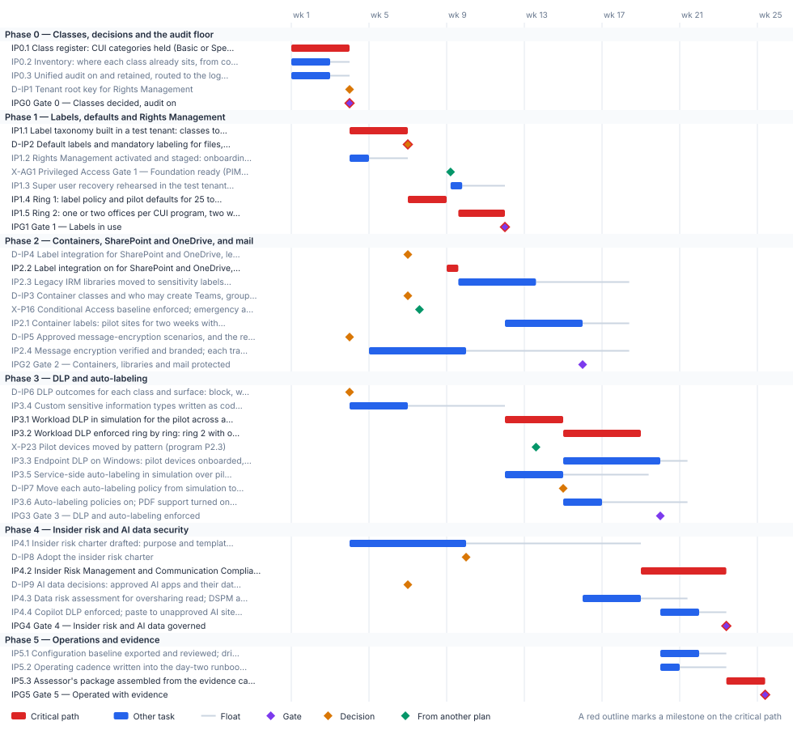

<!-- Generated by scripts/project_plans/build.py from data/project-plans/information-protection.yaml. Edit the YAML, not this page. -->

# Information Protection: Classes, Labels, DLP and Evidence in Microsoft Purview {.unnumbered}

::: {.callout-note}
## A sample plan, not a commitment
This is an illustrative plan built from the workbook's books, in the form a project manager would baseline: a work breakdown, a schedule network, a computed critical path, decision points, gates and risks. The durations are illustrative, sized to the books' roadmap weeks. Replace them with the agency's own estimates, then baseline the result. The plan names roles, not people, and no specific agency.
:::

## Plan at a glance

| | |
|---|---|
| **Plan type** | Project: Book 20, Chapters 01 to 12, from the class register to the assessor's package |
| **Built from** | Book 20 |
| **Sponsor** | Executive sponsor and CIO; CISO |
| **Plan manager** | Platform owner (the Microsoft 365 and Purview engineering lead), with the CUI program manager as policy owner |
| **Duration** | 25 weeks (122 working days), computed from the network |
| **Work** | 25 tasks, 6 gates, 9 decision points, 3 milestones from other plans |
| **Critical path** | 14 of 43 items; 2 more within 5 days of it |
| **Calendar** | Week 1 = the program's Phase 0 approval; five working days a week |

: Plan at a glance {.striped}

This plan sequences [Book 20](../books/b20-information-protection/index.md): classifying and protecting the agency's data in Microsoft Purview so the protection travels with the data. Book 20 gives each control a pilot, a report-only or simulation phase, enforcement rings and a rollback, and its [implementation checklist](../books/b20-information-protection/12-operations-and-evidence.md#implementation-checklist) lists them; this plan puts them in order and dates them. Its roles are Book 20's [RACI](../books/b20-information-protection/12-operations-and-evidence.md#raci): the policy owner decides what the data is and how it's handled, the platform owner configures it, security operations watches it, and the ISSO and assessor read the evidence.

The order follows the book's dependencies. The class register and the audit floor come first, because labels are built from classes and every later control is proved from the audit log. Labels come next, then the containers, SharePoint libraries and mail that carry them, then DLP and auto-labeling, which act on labels and sensitive information types, and then insider risk and AI data security, which wait for a written charter and for the oversharing work on containers. It takes three dates from other plans: the program's Conditional Access baseline (P1.6) for container labels, the program's pilot devices (P2.3) for endpoint DLP, and the [Privileged Access plan](privileged-access.md)'s Gate 1 for the PIM-gated super user procedure.

## Schedule

{fig-alt="Gantt chart of the Information Protection plan over 25 weeks, grouped by phase. Critical-path tasks are red bars, other tasks are blue bars with a grey line showing their float, gates are violet diamonds, decisions are amber diamonds and milestones from other plans are green diamonds. The tables below give every date and float."}

## Critical path

The computed path runs through the labels and then the DLP that insider risk reads. It starts with the class register, which takes three weeks because each CUI category needs its authority recorded, then runs through the label taxonomy in a test tenant, the defaults decision, ring 1, label integration in SharePoint and OneDrive (which has to be on before an encrypting label leaves the pilot), ring 2 and Gate 1 in week 11. From there it runs through workload DLP in simulation across a business cycle and its enforcement rings, then Insider Risk Management's 30-day audit phase, which waits for DLP because DLP alerts are among its signals, then Gate 4 and the assessor's package to Gate 5 in week 25. Containers carry about two weeks of float, auto-labeling about four and message encryption about eight; endpoint DLP waits for the program's pilot devices (P2.3) and still has about a week and a half. The decisions that look early on the chart, the insider risk charter and the AI data decisions, have weeks of float, but they need the privacy office, counsel and labor relations, so the plan starts the charter at Gate 0 rather than when its float runs out.

The critical path, in order. Each item has zero total float: a day lost on any of them is a day lost at the finish.

| # | ID | Item | Owner or approver | When |
|---|---|---|---|---|
| 1 | IP0.1 | Class register: CUI categories held (Basic or Specified), Privacy Act records, retention, impact level and cloud, each with its source | Policy owner (CUI program manager) | wk 1–3 |
| 2 | IPG0 | Gate 0 — Classes decided, audit on | ISSO | end of wk 3 |
| 3 | IP1.1 | Label taxonomy built in a test tenant: classes to labels, scopes, priority, encryption settings, markings, publishing policies | Platform owner | wk 4–6 |
| 4 | D-IP2 | Default labels and mandatory labeling for files, email, meetings and containers | Policy owner | end of wk 6 |
| 5 | IP1.4 | Ring 1: label policy and pilot defaults for 25 to 50 users, two weeks; label events and downgrade justifications read; labeled sample passes | Operator | wk 7–8 |
| 6 | IP2.2 | Label integration on for SharePoint and OneDrive, after labels have replicated to the service | Operator | wk 9 |
| 7 | IP1.5 | Ring 2: one or two offices per CUI program, two weeks; then the production policy for everyone in scope | Operator | wk 9–11 |
| 8 | IPG1 | Gate 1 — Labels in use | ISSO | end of wk 11 |
| 9 | IP3.1 | Workload DLP in simulation for the pilot across a business cycle; matched items exported before the 30 days are up | Operator | wk 12–14 |
| 10 | IP3.2 | Workload DLP enforced ring by ring: ring 2 with override and justification, ring 3 everyone in scope; false positives tuned | Operator | wk 15–18 |
| 11 | IP4.2 | Insider Risk Management and Communication Compliance for a pilot scope: a 30-day audit phase, alerts triaged, a tuning record | Security operations | wk 19–23 |
| 12 | IPG4 | Gate 4 — Insider risk and AI data governed | ISSO | end of wk 23 |
| 13 | IP5.3 | Assessor's package assembled from the evidence catalog; Zero Trust Assessment rerun | ISSO | wk 23–25 |
| 14 | IPG5 | Gate 5 — Operated with evidence | ISSO | end of wk 25 |

: The critical path {.striped .hover}

**Near-critical.** These items have 5 working days of float or less. Track them weekly: once their float is spent, they join the critical path.

| ID | Item | Float | When |
|---|---|---|---|
| IP0.2 | Inventory: where each class already sits, from content and activity explorer under narrowly granted role groups | 5 d | wk 1–2 |
| IP0.3 | Unified audit on and retained, routed to the log platform; a synthetic audit event found by search within the target time | 5 d | wk 1–2 |

: Near-critical items {.striped .hover}

## Decision points

Each decision is a zero-duration milestone in the network. *Decide by* is its late finish: the last week it can be made without moving the plan's finish. A decision with zero float sits on the critical path, so the meeting that makes it should be booked before the plan is baselined. Decision rights follow [Book 01, Chapter 09](../books/b01-transformation-arc/09-who-leads-the-transformation.md#decision-rights-across-the-program).

| ID | Decision | Decides | Needed by | Decide by | Float | Options | If it's late |
|---|---|---|---|---|---|---|---|
| D-IP1 | Tenant root key for Rights Management | Policy owner, with the CISO | IP1.2 | end of wk 5 | 10 d | Microsoft-managed key; bring your own key (BYOK), per Book 12, Chapter 09. Decided before the first encrypting label is published | Rights Management can't be activated, and no encrypting label can be published |
| D-IP2 | Default labels and mandatory labeling for files, email, meetings and containers | Policy owner | IP1.4 | end of wk 6 | **0 (critical)** | A non-encrypting default per item type, with mandatory labeling and a justification for every downgrade; mandatory labeling with no default | The pilot policy has no defaults, and ring 1 waits |
| D-IP4 | Label integration for SharePoint and OneDrive, legacy IRM libraries, PDFs and co-authoring | Policy owner, with the records officer | IP2.2 | end of wk 8 | 10 d | Integration on before the first encrypting label leaves the pilot; PDFs only after Chapter 09's simulations include them; each IRM library migrated, then IRM off (in GCC, kept until its files are labeled); co-authoring only when every tool that reads labels supports it | Encrypted files in SharePoint can't be searched, co-authored or scanned, and ring 2 waits |
| D-IP6 | DLP outcomes for each class and surface: block, warn, or allow with justification | Policy owner | IP3.4, IP3.1 | end of wk 8 | 25 d | Outcome statements per class for mail, Teams, SharePoint and OneDrive, and Windows devices, each with its exceptions and their expiry | DLP policies can't be written, and simulation waits |
| D-IP5 | Approved message-encryption scenarios, and the recipient experience | Policy owner | IP2.4 | end of wk 13 | 47 d | Sender opt-in, named offices, Do Not Forward to a partner, expiring mail where Advanced Message Encryption is licensed; one-time passcodes on or off; social IDs on or off; branding | Transport rules can't be written, and message encryption waits |
| D-IP3 | Container classes and who may create Teams, groups and sites | Policy owner | IP2.1 | end of wk 14 | 37 d | A container label per class with its privacy, guest and unmanaged-device settings; creation open to all, or limited to a group, for each class | Container labels can't be piloted, and the oversharing work Copilot waits for can't start |
| D-IP9 | AI data decisions: approved AI apps and their data, labels Copilot mustn't process, oversharing remediation, who may read prompts | Policy owner | IP4.3 | end of wk 18 | 57 d | Per app class (Copilot in the tenant, enterprise AI apps, third-party AI sites): approve for named classes, or block. Prompt and response access settled with the privacy official and counsel | AI policies can't leave simulation, and Copilot reaches users before oversharing is fixed |
| D-IP8 | Adopt the insider risk charter | CISO, with the senior agency official for privacy and general counsel | IP4.2 | end of wk 18 | 45 d | Adopt it, then configure; don't configure Insider Risk Management or Communication Compliance | Neither tool can be configured, and Gate 4 waits |
| D-IP7 | Move each auto-labeling policy from simulation to labeling | Policy owner | IP3.6 | end of wk 19 | 22 d | Turn the policy on once its false positives are resolved; keep it in simulation | Existing content stays unlabeled, and PDF support in SharePoint stays off |

: Decision points, by decide-by date {.striped .hover}

## Gates

A gate opens the work that names it as a predecessor, which is usually the next phase but not always. The approver signs it against the criteria, from evidence in the repository.

| Gate | When | Approver | Criteria |
|---|---|---|---|
| [Gate 0 — Classes decided, audit on](../books/b20-information-protection/01-data-inventory-and-classification.md#decision-record-template) | end of wk 3 | ISSO | Class register with every federal overlay decision and its source; inventory showing where each class sits; unified audit on, retention set and routed to the log platform, with a synthetic event found within the target time; the decision record template in use |
| [Gate 1 — Labels in use](../books/b20-information-protection/12-operations-and-evidence.md#implementation-checklist) | end of wk 11 | ISSO | Label policy widened past ring 2 on its recorded criteria; labeled sample file and email with the label in the audit log; defaults set; users outside the policy recorded; super user off with no standing members, recovery rehearsed and the decryption-continuity test passed |
| [Gate 2 — Containers, libraries and mail protected](../books/b20-information-protection/12-operations-and-evidence.md#implementation-checklist) | end of wk 15 | ISSO | Container labels required for new sites and applied to CUI sites, with guest add and unmanaged-device access tested; label integration on and IRM libraries migrated or dated; an encrypted test message opened by an external recipient, with the rule hit in the message trace |
| [Gate 3 — DLP and auto-labeling enforced](../books/b20-information-protection/12-operations-and-evidence.md#implementation-checklist) | end of wk 19 | ISSO | Synthetic sensitive content blocked on each surface and the alert received by security operations; every rule exception with an expiry; auto-labeling precision recorded and sample files labeled as designed |
| [Gate 4 — Insider risk and AI data governed](../books/b20-information-protection/12-operations-and-evidence.md#implementation-checklist) | end of wk 23 | ISSO | Charter adopted before configuration; Insider Risk Management and Communication Compliance on for their scope after the audit phase, with users excluded only by the privacy official's approval; Copilot DLP enforced and AI-site paste blocked; approved AI apps and label exclusions recorded |
| [Gate 5 — Operated with evidence](../books/b20-information-protection/12-operations-and-evidence.md#evidence-catalog) | end of wk 25 | ISSO | Every row of the implementation checklist ticked with the evidence the catalog names; first drift run clean; quarterly synthetic tests passed once; assessor's package assembled (closure is the authorizing official's decision) |

: Gates {.striped .hover}

## Links to other plans

- **X-AG1, Privileged Access Gate 1 — Foundation ready (PIM role settings for every tier),** is AG1 in the [Privileged Access & Administrative Identity](privileged-access.md) plan (Gate 1 — Foundation ready), end of wk 9. This plan waits for it; it can slip 11 d before it moves this plan. Recovery operators can't be made eligible through PIM, so the super user procedure can't be rehearsed.
- **X-P16, Conditional Access baseline enforced; emergency access accounts tested (program P1.6),** is P1.6 in the [Program master schedule](program-master-schedule.md) plan (Baseline enforced; emergency access accounts vaulted and tested), end of wk 7. This plan waits for it; it can slip 34 d before it moves this plan. Container labels' unmanaged-device setting has no Conditional Access baseline to work with.
- **X-P23, Pilot devices moved by pattern (program P2.3),** is P2.3 in the [Program master schedule](program-master-schedule.md) plan (Pilot devices moved by pattern (M-023)), end of wk 13. This plan waits for it; it can slip 14 d before it moves this plan. Endpoint DLP has no managed pilot devices to onboard.

## Work breakdown and schedule

Every row, by phase. *Float* is total float in working days; **bold** rows are on the critical path. Each row links to the chapter it comes from.

### Phase 0 — Classes, decisions and the audit floor

| ID | Item | Type | Owner or approver | Days | Predecessors | When | Float |
|---|---|---|---|---|---|---|---|
| IP0.1 | **[Class register: CUI categories held (Basic or Specified), Privacy Act records, retention, impact level and cloud, each with its source](../books/b20-information-protection/01-data-inventory-and-classification.md#b20-01-the-federal-overlay-decisions)** | Task | Policy owner (CUI program manager) | 15 | — | wk 1–3 | 0 |
| IP0.2 | [Inventory: where each class already sits, from content and activity explorer under narrowly granted role groups](../books/b20-information-protection/01-data-inventory-and-classification.md#b20-01-inventory-find-where-the-data-already-is) | Task | Platform owner | 10 | — | wk 1–2 | 5 d |
| IP0.3 | [Unified audit on and retained, routed to the log platform; a synthetic audit event found by search within the target time](../books/b20-information-protection/10-audit-insider-risk-and-communication-compliance.md#audit-is-the-floor) | Task | Platform owner | 10 | — | wk 1–2 | 5 d |
| D-IP1 | [Tenant root key for Rights Management](../books/b20-information-protection/05-rights-management-and-recovery.md#b20-05-decide-activation-onboarding-and-recovery) | Decision | Policy owner, with the CISO | — | IP0.1 | end of wk 3 | 10 d |
| IPG0 | **[Gate 0 — Classes decided, audit on](../books/b20-information-protection/01-data-inventory-and-classification.md#decision-record-template)** | Gate | ISSO | — | IP0.1, IP0.2, IP0.3 | end of wk 3 | 0 |

: Phase 0 — Classes, decisions and the audit floor {.striped .hover}

### Phase 1 — Labels, defaults and Rights Management

| ID | Item | Type | Owner or approver | Days | Predecessors | When | Float |
|---|---|---|---|---|---|---|---|
| IP1.1 | **[Label taxonomy built in a test tenant: classes to labels, scopes, priority, encryption settings, markings, publishing policies](../books/b20-information-protection/02-sensitivity-label-architecture.md#b20-02-how-build-the-taxonomy-in-a-test-tenant)** | Task | Platform owner | 15 | IPG0 | wk 4–6 | 0 |
| D-IP2 | **[Default labels and mandatory labeling for files, email, meetings and containers](../books/b20-information-protection/03-label-publication-and-defaults.md#b20-03-defaults-the-agency-can-justify)** | Decision | Policy owner | — | IP1.1 | end of wk 6 | 0 |
| IP1.2 | [Rights Management activated and staged: onboarding limited to the label pilot; super user feature off; two recovery operators named](../books/b20-information-protection/05-rights-management-and-recovery.md) | Task | Platform owner | 5 | D-IP1, IPG0 | wk 4 | 10 d |
| X-AG1 | [Privileged Access Gate 1 — Foundation ready (PIM role settings for every tier)](privileged-access.md) | External | CISO (Privileged Access & Administrative Identity plan) | — | — | end of wk 9 | 11 d |
| IP1.3 | [Super user recovery rehearsed in the test tenant with PIM-eligible operators; decryption-continuity test passed](../books/b20-information-protection/05-rights-management-and-recovery.md#validate-the-decryption-continuity-test) | Task | Platform owner | 3 | IP1.2, X-AG1 | wk 9 | 11 d |
| IP1.4 | **[Ring 1: label policy and pilot defaults for 25 to 50 users, two weeks; label events and downgrade justifications read; labeled sample passes](../books/b20-information-protection/03-label-publication-and-defaults.md#b20-03-validate-a-labeled-sample)** | Task | Operator | 10 | D-IP2, IP1.2 | wk 7–8 | 0 |
| IP1.5 | **[Ring 2: one or two offices per CUI program, two weeks; then the production policy for everyone in scope](../books/b20-information-protection/03-label-publication-and-defaults.md#b20-03-enforcement)** | Task | Operator | 12 | IP1.4, IP2.2 | wk 9–11 | 0 |
| IPG1 | **[Gate 1 — Labels in use](../books/b20-information-protection/12-operations-and-evidence.md#implementation-checklist)** | Gate | ISSO | — | IP1.5, IP1.3 | end of wk 11 | 0 |

: Phase 1 — Labels, defaults and Rights Management {.striped .hover}

### Phase 2 — Containers, SharePoint and OneDrive, and mail

| ID | Item | Type | Owner or approver | Days | Predecessors | When | Float |
|---|---|---|---|---|---|---|---|
| D-IP4 | [Label integration for SharePoint and OneDrive, legacy IRM libraries, PDFs and co-authoring](../books/b20-information-protection/07-sharepoint-and-onedrive.md) | Decision | Policy owner, with the records officer | — | IP1.1 | end of wk 6 | 10 d |
| IP2.2 | **[Label integration on for SharePoint and OneDrive, after labels have replicated to the service](../books/b20-information-protection/07-sharepoint-and-onedrive.md)** | Task | Operator | 3 | D-IP4, IP1.4 | wk 9 | 0 |
| IP2.3 | [Legacy IRM libraries moved to sensitivity labels one by one, a volunteer library first; IRM turned off on each](../books/b20-information-protection/07-sharepoint-and-onedrive.md) | Task | Operator | 20 | IP2.2 | wk 9–13 | 24 d |
| D-IP3 | [Container classes and who may create Teams, groups and sites](../books/b20-information-protection/04-teams-groups-and-sharepoint-containers.md#b20-04-who-may-create-containers) | Decision | Policy owner | — | IP1.1 | end of wk 6 | 37 d |
| X-P16 | [Conditional Access baseline enforced; emergency access accounts tested (program P1.6)](program-master-schedule.md) | External | Platform teams (program) | — | — | end of wk 7 | 34 d |
| IP2.1 | [Container labels: pilot sites for two weeks with Conditional Access in report-only, then required for new containers and applied to CUI-bearing sites for two](../books/b20-information-protection/04-teams-groups-and-sharepoint-containers.md#b20-04-enforcement) | Task | Operator | 20 | D-IP3, IPG1, X-P16 | wk 12–15 | 12 d |
| D-IP5 | [Approved message-encryption scenarios, and the recipient experience](../books/b20-information-protection/06-exchange-message-encryption.md) | Decision | Policy owner | — | IPG0 | end of wk 3 | 47 d |
| IP2.4 | [Message encryption verified and branded; each transport rule in Audit for two weeks, enforced for ring 1 for one, then rings 2 and 3](../books/b20-information-protection/06-exchange-message-encryption.md) | Task | Operator | 25 | D-IP5, IP1.2 | wk 5–9 | 42 d |
| IPG2 | [Gate 2 — Containers, libraries and mail protected](../books/b20-information-protection/12-operations-and-evidence.md#implementation-checklist) | Gate | ISSO | — | IP2.1, IP2.3, IP2.4 | end of wk 15 | 12 d |

: Phase 2 — Containers, SharePoint and OneDrive, and mail {.striped .hover}

### Phase 3 — DLP and auto-labeling

| ID | Item | Type | Owner or approver | Days | Predecessors | When | Float |
|---|---|---|---|---|---|---|---|
| D-IP6 | [DLP outcomes for each class and surface: block, warn, or allow with justification](../books/b20-information-protection/08-dlp-and-endpoint-controls.md) | Decision | Policy owner | — | IPG0 | end of wk 3 | 25 d |
| IP3.4 | [Custom sensitive information types written as code; exact data match where the class needs it](../books/b20-information-protection/09-auto-labeling-and-sensitive-information-types.md) | Task | Platform owner | 15 | D-IP6 | wk 4–6 | 25 d |
| IP3.1 | **[Workload DLP in simulation for the pilot across a business cycle; matched items exported before the 30 days are up](../books/b20-information-protection/08-dlp-and-endpoint-controls.md)** | Task | Operator | 15 | D-IP6, IPG1, IP3.4 | wk 12–14 | 0 |
| IP3.2 | **[Workload DLP enforced ring by ring: ring 2 with override and justification, ring 3 everyone in scope; false positives tuned](../books/b20-information-protection/08-dlp-and-endpoint-controls.md)** | Task | Operator | 20 | IP3.1 | wk 15–18 | 0 |
| X-P23 | [Pilot devices moved by pattern (program P2.3)](program-master-schedule.md) | External | Platform teams (program) | — | — | end of wk 13 | 14 d |
| IP3.3 | [Endpoint DLP on Windows: pilot devices onboarded, rules in Audit for two weeks, then enforced ring by ring](../books/b20-information-protection/08-dlp-and-endpoint-controls.md#b20-08-enforcement-endpoint) | Task | Operator | 25 | X-P23, IP3.1 | wk 15–19 | 7 d |
| IP3.5 | [Service-side auto-labeling in simulation over pilot sites, PDFs in scope; precision recorded; automatic turn-on left off](../books/b20-information-protection/09-auto-labeling-and-sensitive-information-types.md) | Task | Operator | 15 | IP3.4, IPG1 | wk 12–14 | 22 d |
| D-IP7 | [Move each auto-labeling policy from simulation to labeling](../books/b20-information-protection/09-auto-labeling-and-sensitive-information-types.md) | Decision | Policy owner | — | IP3.5 | end of wk 14 | 22 d |
| IP3.6 | [Auto-labeling policies on; PDF support turned on in SharePoint and OneDrive](../books/b20-information-protection/07-sharepoint-and-onedrive.md) | Task | Operator | 10 | D-IP7 | wk 15–16 | 22 d |
| IPG3 | [Gate 3 — DLP and auto-labeling enforced](../books/b20-information-protection/12-operations-and-evidence.md#implementation-checklist) | Gate | ISSO | — | IP3.2, IP3.3, IP3.6 | end of wk 19 | 7 d |

: Phase 3 — DLP and auto-labeling {.striped .hover}

### Phase 4 — Insider risk and AI data security

| ID | Item | Type | Owner or approver | Days | Predecessors | When | Float |
|---|---|---|---|---|---|---|---|
| IP4.1 | [Insider risk charter drafted: purpose and templates, notice and privacy documentation, bargaining obligations, investigator powers, roles, retention](../books/b20-information-protection/10-audit-insider-risk-and-communication-compliance.md#the-charter-comes-first) | Task | Senior agency official for privacy | 30 | IPG0 | wk 4–9 | 45 d |
| D-IP8 | [Adopt the insider risk charter](../books/b20-information-protection/10-audit-insider-risk-and-communication-compliance.md#the-charter-comes-first) | Decision | CISO, with the senior agency official for privacy and general counsel | — | IP4.1 | end of wk 9 | 45 d |
| IP4.2 | **[Insider Risk Management and Communication Compliance for a pilot scope: a 30-day audit phase, alerts triaged, a tuning record](../books/b20-information-protection/10-audit-insider-risk-and-communication-compliance.md#b20-10-enforcement-irm)** | Task | Security operations | 22 | D-IP8, IP3.2 | wk 19–23 | 0 |
| D-IP9 | [AI data decisions: approved AI apps and their data, labels Copilot mustn't process, oversharing remediation, who may read prompts](../books/b20-information-protection/11-ai-data-security.md#the-ai-data-decisions) | Decision | Policy owner | — | IP1.1 | end of wk 6 | 57 d |
| IP4.3 | [Data risk assessment for oversharing read; DSPM and Copilot DLP in simulation for at least two weeks across a month-end](../books/b20-information-protection/11-ai-data-security.md) | Task | Platform owner | 15 | D-IP9, IPG2 | wk 16–18 | 12 d |
| IP4.4 | [Copilot DLP enforced; paste to unapproved AI sites blocked; a labeled file cited but not summarized](../books/b20-information-protection/11-ai-data-security.md#b20-11-enforcement-ai) | Task | Operator | 10 | IP4.3, IP3.3 | wk 20–21 | 7 d |
| IPG4 | **[Gate 4 — Insider risk and AI data governed](../books/b20-information-protection/12-operations-and-evidence.md#implementation-checklist)** | Gate | ISSO | — | IP4.2, IP4.4 | end of wk 23 | 0 |

: Phase 4 — Insider risk and AI data security {.striped .hover}

### Phase 5 — Operations and evidence

| ID | Item | Type | Owner or approver | Days | Predecessors | When | Float |
|---|---|---|---|---|---|---|---|
| IP5.1 | [Configuration baseline exported and reviewed; drift run scheduled; first drift run with no unexplained differences](../books/b20-information-protection/12-operations-and-evidence.md) | Task | Platform owner | 10 | IPG3 | wk 20–21 | 7 d |
| IP5.2 | [Operating cadence written into the day-two runbook; quarterly synthetic tests run once; help desk briefed](../books/b20-information-protection/12-operations-and-evidence.md#operating-cadence) | Task | Platform owner | 5 | IPG3 | wk 20 | 12 d |
| IP5.3 | **[Assessor's package assembled from the evidence catalog; Zero Trust Assessment rerun](../books/b20-information-protection/12-operations-and-evidence.md#evidence-catalog)** | Task | ISSO | 10 | IP5.1, IP5.2, IPG4 | wk 23–25 | 0 |
| IPG5 | **[Gate 5 — Operated with evidence](../books/b20-information-protection/12-operations-and-evidence.md#evidence-catalog)** | Gate | ISSO | — | IP5.3 | end of wk 25 | 0 |

: Phase 5 — Operations and evidence {.striped .hover}

## Responsibility

Who owns what in this plan. Each row has one owner; consulted and informed parties follow the [decision matrix](../books/b01-transformation-arc/09-who-leads-the-transformation.md#decision-rights-across-the-program).

| Owner or approver | Tasks | Decisions | Gates |
|---|---|---|---|
| Operator | 12 | — | — |
| Platform owner | 9 | — | — |
| ISSO | 1 | — | 6 |
| Policy owner | — | 6 | — |
| Platform teams (program) | 2 | — | — |
| CISO (Privileged Access & Administrative Identity plan) | 1 | — | — |
| CISO, with the senior agency official for privacy and general counsel | — | 1 | — |
| Policy owner (CUI program manager) | 1 | — | — |
| Policy owner, with the CISO | — | 1 | — |
| Policy owner, with the records officer | — | 1 | — |
| Security operations | 1 | — | — |
| Senior agency official for privacy | 1 | — | — |

: Ownership {.striped .hover}

## Assumptions

- The tenant is GCC-Moderate. Purview features differ between the commercial cloud and GCC and change often; each chapter of Book 20 states availability per feature as read on November 11, 2026, and a feature Learn doesn't list for GCC isn't scheduled until it is.
- Licensing covers the controls in scope: sensitivity labels and DLP for every user in scope, Audit (Premium) retention for users whose actions must be kept beyond 180 days, endpoint DLP, auto-labeling, Insider Risk Management and Communication Compliance. Each chapter's decision record names the license it needs.
- The AI rows (D-IP9, IP4.2, IP4.3) apply only where Microsoft 365 Copilot is licensed or third-party AI sites are reachable ([Chapter 11](../books/b20-information-protection/11-ai-data-security.md#the-ai-data-decisions)).
- Each ring lasts the two weeks Book 20's chapters give it. Ring 3, everyone in scope, is a policy change rather than a waved move, so it takes days, not weeks.
- The insider risk charter needs the privacy office, counsel and the labor relations office; this plan gives it six weeks, which a represented workforce can exceed.
- Durations are illustrative. Book 20 gives no calendar; the ring lengths are its own, the rest are sized to its How sections.

## Schedule risks

| Risk | Effect on the schedule | Response |
|---|---|---|
| The class register stalls on which CUI categories the agency holds | No label can be built; every gate moves week for week | Start it on day one with the CUI program manager, and record each category's authority as it's settled (Chapter 01) |
| A label applied in the pilot has the wrong encryption settings | Content labeled in the pilot keeps the settings it was labeled with; users lose access or keep too much | Build and test the taxonomy in a test tenant first (Chapter 02), and run the decryption-continuity test before ring 1 |
| DLP or auto-labeling false positives exceed what the help desk can absorb | Enforcement rings stall; Gate 3 waits | Run simulation across a full business cycle and tune from overrides and justifications before each ring (Chapters 08 and 09) |
| The insider risk charter isn't agreed with the privacy office, counsel or labor relations | Insider Risk Management and Communication Compliance can't be configured; Gate 4 waits | Start the charter at Gate 0 (IP4.1); Gate 4 can sign for AI data security alone if the authorizing official accepts that |
| Copilot reaches a population before its oversharing is remediated | Copilot answers from content users can open but shouldn't | Run the data risk assessment and fix container sharing before Copilot DLP leaves simulation (Chapter 11) |

: Schedule risks {.striped .hover}

## Baseline and change control

- **Baseline** the plan when its first gate is approved: the YAML file, as merged, is the baseline.
- **Report** weekly, green, yellow or red, against the baseline ([Book 01, Chapter 12](../books/b01-transformation-arc/12-migration-roadmap.md#phase-3-general-rollout-weeks-1736)). Report float, not percent complete: a task's float says how much slip the plan can still absorb.
- **Change** the plan only through a reviewed pull request that edits the YAML and regenerates this page, so every change to a date or a dependency has an author, a reviewer and a reason.
- **Re-baseline** at each gate, after the approver signs it, and whenever a critical-path decision is made late.

## Download and adapt

| File | Use it for |
|---|---|
| [information-protection.xml](files/information-protection.xml) | Microsoft Project desktop (open the XML file; it keeps the dependencies, milestones and owners). The dates start on a placeholder Monday: change the project start date. |
| [information-protection.csv](files/information-protection.csv) | Excel or any other scheduling tool: every row with its dependencies, early and late dates and float |
| [information-protection-azure-boards.csv](files/information-protection-azure-boards.csv) | Azure DevOps Boards: an Epic per phase and a Feature per task, gate and decision, with dates and tags (see below) |
| [information-protection-dependencies.csv](files/information-protection-dependencies.csv) · [add-azure-boards-links.ps1](files/add-azure-boards-links.ps1) | The plan's predecessor links, and a script that adds them in Azure Boards after the import |
| [information-protection-jira.csv](files/information-protection-jira.csv) | Jira: an Epic per phase and a Task per task, gate and decision, with dates, labels and Blocks links (see below) |
| [information-protection.yaml](https://github.com/WhalerMike/modernization-workbook/blob/main/data/project-plans/information-protection.yaml) | The source. Edit the durations, owners and dependencies, then run `python scripts/project_plans/build.py` to recompute the critical path and regenerate this page, the chart and the downloads. |

: Downloads {.striped}

::: {.callout-tip}
## Importing this plan into Azure DevOps Boards
1. In the project, select **Boards** > **Queries** > **Import work items**, choose [information-protection-azure-boards.csv](files/information-protection-azure-boards.csv), check the results and select **Save items**. It creates one Epic per phase with a Feature under it for each task, gate and decision, with start and target dates, which is what Delivery Plans show. Epic and Feature exist in the Agile, Scrum and CMMI processes; in the Basic process, change *Feature* to *Issue* in the file first.
2. The import can't create dependency links or assign people. To add the predecessor links, sign in with `az login`, add the CLI extension with `az extension add --name azure-devops`, and run `./add-azure-boards-links.ps1 -Organization https://dev.azure.com/<org> -Project <project> -Plan information-protection` beside [information-protection-dependencies.csv](files/information-protection-dependencies.csv). It finds the imported items by their `fmw-id-` tags and links each one to its predecessors.
3. Assign people in Boards: each item carries its owner role as an *Owner - …* tag, and critical-path items carry *Critical path*. Azure Boards links don't hold lag or start-to-start timing; each item's description keeps them.

The dates count from the plan's placeholder start; shift them when you set the real start. The script hasn't been run against a live organization yet: test it on a scratch project first.
:::

::: {.callout-tip}
## Importing this plan into Jira
1. Run the CSV importer (in Jira Cloud, **Settings** > **System** > **External system import** > **CSV**) with [information-protection-jira.csv](files/information-protection-jira.csv). On the second step, set **Date format in import file** to `yyyy-MM-dd`.
2. Map the columns: *Work item ID* to Work item ID, *Work type* to Work type, *Parent* to Parent, *Summary*, *Description* and every *Labels* column to their fields, *Start date* to the Start date field, *Due date* to Due date, and every *Blocks* column to the **Blocks** link type. Each phase becomes an Epic with a Task under it for each task, gate and decision; each Blocks column makes that row's item block the item it names, which carries the plan's dependencies.
3. Assign people in Jira: each item carries its owner role as an `owner-…` label, and critical-path items carry `critical-path`. Jira links don't hold lag or start-to-start timing; each description keeps them.

Test the import on a scratch project with a few rows first: the importer doesn't remove duplicate links and Jira has no bulk delete for them. If the Blocks links don't come through on your site, import the items first and add the links from the plan's dependency list in a second pass, as Atlassian recommends. The dates count from the plan's placeholder start.
:::

::: {.callout-tip}
## Opening this plan in Project or Planner
- **Microsoft Project desktop** opens the XML file directly, with every dependency, milestone and owner.
- **Microsoft Planner** has no file import of its own: it doesn't read XML, CSV or Excel. To bring this plan into a Planner premium plan, open the XML file in Project desktop, save it as an `.mpp` file, and import that through the Project Power App. Tasks, durations, dependencies and milestones come across; resources and baselines don't, so assign owners again in Planner.
- **Without Project desktop**, the CSV can feed a Power Automate flow that creates the tasks one by one, but dependencies in a premium plan need Microsoft's Project schedule APIs, so that's a build, not an import.
- **In a government cloud tenant**, check that premium plans are available before relying on Planner for this schedule: Microsoft notes that converting a basic plan to a premium plan isn't available in GCC.

Project for the web was retired on August 1, 2025, and Project Online on September 30, 2026; Planner is their successor. Project desktop is unaffected.
:::

